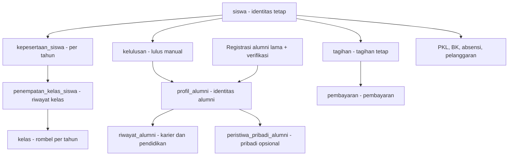

# PRD Platform SaaS SMK — Dedicated VPS per Sekolah

**Product Requirements Document (PRD) · Versi 4.11 · Spesifikasi teknis lengkap untuk cakupan R1–R4**
**Ruang lingkup:** Core System + 15 modul operasional SMK.  
**Arsitektur:** satu sekolah = satu VPS = satu instalasi Laravel + MariaDB.  
**Tujuan utama:** aplikasi praktis; perpindahan siswa, kelulusan, alumni, dan keuangan selalu konsisten.

**Navigasi rincian:** [Kamus database](#kamus-database) · [Transaksi dan validasi](#kontrak-transaksi) · [HTTP/Livewire dan instalasi awal](#transport-aplikasi) · [Inventaris file dan pengujian](TASK.md#inventaris-teknis).

| **Dokumen** | **Keterangan**                                                       |
|-------------|----------------------------------------------------------------------|
| Versi       | 4.11 — pengembangan aplikasi saja; konfigurasi infrastruktur tidak termasuk pekerjaan developer |
| Tanggal     | 11 November 2026 — kamus fisik, aksi/route/file dan penerimaan lengkap                     |
| Status      | Baseline spesifikasi terpetakan; implementasi dan UAT belum diuji                       |
| Target      | SMK di Indonesia                                                     |
| Stack       | Laravel 13 · Livewire 4 · Tailwind CSS 4 · Nginx · PHP 8.5 · MariaDB |
| Hosting     | 1 sekolah = 1 VPS = 1 instalasi dan database                         |
| Batasan     | Tanpa server/domain pusat, multi-tenant, Queue, dan Scheduler        |

**Prinsip produk.** Praktis bagi pengguna sekolah: input seperlunya, validasi hanya saat dibutuhkan, data induk tidak berulang, laporan mudah dicetak, dan **setiap proses yang lama menampilkan progres nyata**.

**Keputusan final.** Penilaian PKL ditranskripsi guru dari kertas; absensi guru dihapus; izin guru/siswa digabung dalam modul absensi siswa; surat boleh tanpa file; naik kelas dan lulus harus melalui konfirmasi admin; lulusan yang sudah tercatat memakai identitas siswa lama, sedangkan alumni lama dapat daftar sendiri tanpa dibuatkan siswa fiktif; Sarpras–Lab memakai satu master aset; menu website dikelola secara dinamis.

**Definisi MVP.** Utamakan alur pokok, formulir singkat, hak akses jelas, modal konfirmasi yang konsisten, loading yang informatif, serta proses massal dengan progres dan pemulihan. **Spesifikasi teknis dan kriteria rilis ada pada Bab 12–18**. Tidak ada Queue, Laravel Scheduler, aplikasi pusat, panel multi-sekolah, atau integrasi pemerintah pada versi ini.

# 1. Ringkasan keputusan produk

**Alur bagian:** Tetapkan Keputusan → Susun Aturan → Terapkan pada Fitur → Validasi Hasil.

| **Keputusan**  | **Ketentuan final**                                                                            |
|----------------|------------------------------------------------------------------------------------------------|
| Model aplikasi | Instalasi independen per sekolah, kode sumber sama pada seluruh VPS.                           |
| Jumlah modul   | 15 modul berbayar. Perizinan lama digabung ke Absensi; tidak dibuat modul pengganti.           |
| Absensi        | Hanya siswa. Pengajuan izin guru ada, tanpa pencatatan kehadiran guru.                         |
| PKL industri   | Tidak ada akun pembimbing industri. Nilai kertas diinput oleh guru pembimbing.                 |
| Tahun ajaran   | Kenaikan kelas dan kelulusan hanya melalui aksi admin, bukan otomatis karena tanggal berganti. |
| Data historis  | ID siswa tetap untuk lulusan yang pernah terdaftar; alumni lama dapat punya profil tanpa `siswa_id`. Riwayat kelas, tagihan, PKL dan alumni tidak ditimpa. |
| Sarpras + Lab  | Satu daftar aset, dengan stok bahan habis pakai dikelola Lab.                                  |
| Surat          | Boleh pencatatan saja, editor surat, atau upload; berkas opsional.                             |
| Website        | CMS mengelola menu, halaman, submenu, urutan dan tautan dinamis.                               |
| Di luar scope  | PPDB, UKK, absensi guru, Queue, Scheduler, billing/pembayaran gateway otomatis.                   |
| Proses massal | Batch kecil paralel terbatas dari browser; progres disimpan ke database, aman dilanjutkan tanpa duplikasi. |
| UI responsif | Loading jelas, progress bar nyata, modal konfirmasi, hasil sukses/gagal per item, pesan galat mudah dipahami. |

# 2. Tujuan, pengguna, dan cakupan

**Alur bagian:** Kenali Pengguna → Pilih Kebutuhan → Tetapkan Cakupan → Uji Alur Sekolah.

- Membantu operasional SMK dalam satu sistem, tanpa harus membeli semua modul.

- Setiap sekolah hanya mengakses modul berlisensi; core sekolah tersedia selalu.

- Setiap proses punya penanggung jawab, langkah minimal, status jelas, dan keluaran laporan.

- Mudah digunakan melalui desktop dan ponsel, tanpa kewajiban akun eksternal yang tidak diperlukan.

## 2.1 Daftar modul final (15 modul)

| **No.** | **Modul**                  | **Perubahan**                                       |
|---------|----------------------------|-----------------------------------------------------|
| 01      | Manajemen PKL              | Industri memberi nilai pada kertas; input oleh guru |
| 02      | Jurnal Kegiatan Harian Guru       | Tetap                                               |
| 03      | Absensi Siswa & Perizinan  | Absensi guru dihapus; perizinan siswa/guru digabung |
| 04      | Administrasi Surat Digital | Lampiran/file opsional                              |
| 05      | Keuangan & SPP             | Riwayat mengikuti siswa sampai alumni               |
| 06      | BKK & Lowongan Kerja       | Pendaftaran alumni mandiri dan profil karier         |
| 07      | Inventaris & Sarpras       | Satu master aset bersama Lab                        |
| 08      | Bimbingan Konseling        | Tetap; akses sensitif dibatasi                      |
| 09      | Jadwal Pelajaran           | Tetap                                               |
| 10      | Tracer Study Alumni        | Profil alumni lama/baru, riwayat aktivitas sepanjang waktu |
| 11      | HUBIN / DUDI               | Data mitra bisa dipakai PKL                         |
| 12      | Supervisi & Kinerja Guru   | Tetap                                               |
| 13      | Laboratorium & Bengkel     | Gunakan aset bersama Sarpras                        |
| 14      | Poin Pelanggaran Siswa     | Sebelumnya modul 15                                 |
| 15      | Website Sekolah + CMS      | Sebelumnya modul 16; menu dinamis                   |

**Catatan nomor modul.** Nomor 14 yang dahulu dipakai Perizinan tidak dipertahankan; seluruh modul setelahnya dinomori ulang. Kode modul harus ditetapkan stabil sejak awal implementasi agar aktivasi lisensi tidak bergantung pada nomor tampilan.

# 3. Arsitektur dan prinsip antarmuka

**Alur bagian:** Pilih Instalasi → Terapkan Konfigurasi Aplikasi → Bangun Antarmuka → Uji Akses.

| **Area**           | **Ketentuan**                                                                                              |
|--------------------|------------------------------------------------------------------------------------------------------------|
| Stack              | Laravel 13, PHP 8.5 FPM, Livewire 4, Blade, Tailwind CSS 4, Nginx, MariaDB.                                |
| Instalasi          | 1 VPS milik 1 sekolah; 1 Laravel; 1 MariaDB; domain .sch.id sekolah.                                       |
| Panel pemilik SaaS | /owner pada instalasi sekolah, dengan autentikasi dan MFA wajib sebelum rilis produksi.                                 |
| Panel operasional  | /admin; tampilan role dan aktivasi modul membatasi menu maupun API/aksi.                                   |
| Lisensi            | Lokal pada database aplikasi. Tanggal kedaluwarsa diperiksa saat membuka/menjalankan modul.                |
| Proses             | Form biasa sinkron; massal via batch kecil dan HTTP request paralel terbatas dari browser, tanpa Queue/Scheduler. |
| File               | Disimpan privat bila memuat data sekolah; validasi tipe dan ukuran file.                                   |
| Backup             | Backup VPS/database dilakukan di level server secara manual/alat infrastruktur; di luar scheduler Laravel. |

**UI standar.** Tiap modul memakai pola: Dashboard ringkas → Daftar → Tambah/Ubah → Detail → Laporan. Status proses ditampilkan dengan bahasa yang mudah dipahami; hindari menu duplikat.

## 3.1 Standar loading, modal, dan pemberitahuan (wajib seluruh modul)

| Situasi | Perilaku antarmuka | Catatan implementasi |
|---|---|---|
| Halaman/daftar sedang mengambil data | Skeleton atau indikator loading pada area yang benar | Jangan menutup seluruh halaman jika hanya tabel yang diperbarui. |
| Tombol Simpan/Kirim/Setujui diproses | Tombol menampilkan spinner + teks **Menyimpan…/Mengirim…**, sementara dinonaktifkan | Mencegah klik berulang; form tetap terbaca. |
| Konfirmasi tindakan berisiko | **Modal konfirmasi** berisi aksi, objek, jumlah data, dampak, tombol **Batal** dan **Lanjutkan** | Dipakai untuk kenaikan/kelulusan massal, perubahan status, penghapusan, pembayaran, dll. |
| Ada kesalahan validasi | Pesan di bawah field; ringkasan di bagian atas form bila perlu | Input pengguna jangan hilang. |
| Error sistem/koneksi | **Modal informasi** dengan alasan mudah dipahami dan tombol **Coba Lagi/Tutup** | Hindari pesan SQL atau stack trace. Jangan menyebut gagal sebelum memeriksa status yang tersimpan. |
| Tindakan ringan sukses | Toast singkat **Berhasil disimpan** | Tidak perlu modal untuk setiap perubahan kecil. |
| Proses massal selesai/parsial | **Modal ringkasan hasil**: berhasil, sudah pernah diproses, gagal, dilewati | Tautan lihat detail, perbaiki dan ulangi yang gagal. |
| Proses massal sedang berlangsung | **Modal progres**: tahap, progress bar %, hitungan item, status, tombol **Jeda** | Tidak dapat ditutup tanpa peringatan; tersedia **Lihat Proses** jika pengguna berpindah halaman. |
| Sesi habis saat memproses | Modal **Sesi berakhir**, arahkan login ulang, lalu lanjutkan proses yang belum selesai | Hasil batch yang sudah commit tidak diulang. |

**Aturan UI:** tidak menggunakan `window.alert()` atau `window.confirm()` bawaan browser; gunakan komponen modal konsisten dengan akses keyboard, fokus yang benar, label tombol jelas, dan warna status tidak menjadi satu-satunya indikator. **Progress bar dilarang menggunakan animasi palsu**: persen harus bersumber dari jumlah item yang sudah ditandai selesai dalam database. Pada operasi biasa yang durasinya tidak bisa diukur, tampilkan loading tak tentu (*indeterminate*), bukan persentase rekaan.


## 3.2 Batas tugas developer aplikasi (FINAL)

**Dalam scope developer:** pembuatan source code Laravel, migration/seeder MariaDB, Blade/Livewire/Tailwind, routing aplikasi, autentikasi dan otorisasi, pengamanan data di tingkat aplikasi, interaksi pengguna, pemrosesan massal HTTP paralel, feature/integration tests, perbaikan bug, dan dokumentasi antarmuka konfigurasi yang dibutuhkan untuk menjalankan aplikasi. Developer menyerahkan instruksi build/migrate/rollback secara operasional **tanpa menjalankan konfigurasi host**.

**Di luar scope developer:** penyediaan VPS, domain/DNS, konfigurasi Nginx, SSL/TLS, firewall/SSH/jaringan, monitoring host, backup dan pemulihan infrastruktur. Tim infrastruktur menerima daftar prasyarat dari developer dan menanggung penerapannya. **Kesiapan aplikasi** tidak identik dengan **kesiapan go-live end-to-end**: rilis nyata memerlukan persetujuan kedua pihak.

**Aturan aplikasi:** jangan hardcode domain atau IP, jangan simpan rahasia pada repository, sediakan `.env.example` tanpa kredensial, route memakai nama, dan uji pada lingkungan pengembangan/staging yang disediakan. Implementasi fitur tidak boleh bergantung pada Laravel Queue maupun Scheduler.

**Acuan dokumen:** `TASK.md` (urutan eksekusi), bagian Panduan implementasi (pedoman asisten coding), bagian Checklist kesiapan rilis aplikasi (gerbang kualitas dan bukti UAT), `prototype/index.html` (referensi antarmuka, bukan implementasi backend).

## 3.3 Bahasa aplikasi dan susunan kode (wajib)

- Seluruh antarmuka menggunakan **Bahasa Indonesia**: menu, tombol, label, placeholder, validasi, autentikasi/reset sandi, modal, notifikasi, status, pesan galat, laporan, cetakan, dan teks aksesibilitas. Halaman HTML memakai `lang="id"`; locale Laravel dan format tanggal/angka memakai Indonesia, mata uang Rupiah. Pesan bawaan Laravel/Livewire/paket harus diterjemahkan sebelum fitur dinyatakan selesai.
- Fokus implementasi fitur pada `routes/`, `app/Http/Controllers/`, `app/Livewire/`, `app/Models/`, `app/Http/Middleware/`, dan `resources/`. Gunakan struktur Laravel standar; kelompokkan per fitur seperlunya tanpa membuat paket modul, lapisan repository/service generik, atau direktori arsitektur tambahan.
- Route hanya memetakan URL dan middleware; Controller menangani alur HTTP; Livewire menangani interaksi, validasi dan status layar; Model menangani relasi, query bisnis yang berulang, serta transaksi data; Middleware menangani autentikasi, peran dan lisensi lintas request; `resources/` berisi Blade, CSS/JS dan teks antarmuka. Controller/Livewire tetap ringkas; jangan salin aturan bisnis di dua tempat.
- Pemeriksaan hak akses objek wajib berlaku pada setiap aksi server. Gunakan fasilitas otorisasi Laravel dari Controller/Livewire dan penugasan pada Model; middleware saja tidak cukup untuk keamanan per objek. Jangan menambah lapisan Policy terpisah sebagai pola wajib di luar fokus folder tersebut.
- File pendukung di luar fokus diubah **sebatas kebutuhan nyata**: `database/migrations`/`seeders` untuk skema dan data awal, `tests/` untuk membuktikan perilaku, `lang/id/` untuk pesan bawaan framework, konfigurasi/bootstrap dan manifest untuk menjalankan Laravel, serta `app/Providers/AppServiceProvider.php` sebagai adapter resmi Fortify/Livewire yang diperlukan. Ini pendukung, bukan perluasan fitur atau pekerjaan infrastruktur.
- Kode bersih dan rapi: nama kelas/metode/variabel bermakna, metode singkat dengan satu tujuan, tipe parameter/return bila sesuai, validasi server, hindari duplikasi dan query N+1, serta komentar hanya untuk alasan bisnis yang tidak langsung terlihat. Ikuti format Laravel/Pint setelah aplikasi tersedia. Jangan membuat abstraksi sebelum ada kebutuhan nyata.

## 3.4 Mudah dipakai pengguna non-IT (kriteria penerimaan)

**Alur pertama kali:** Admin Isi Profil → Impor Data Contoh/Excel → Pilih Tahun dan Kelas → Tetapkan Guru/Wali → Tinjau Ringkasan Kesiapan → Mulai Pakai Modul Aktif.

- Setup berupa langkah pendek yang dapat dilanjutkan, bukan satu form panjang. Siapkan template impor siap unduh, contoh kolom dan pesan kesalahan per baris dalam Bahasa Indonesia. Data yang sudah ada dipilih, bukan diketik berulang. Konsentrasi, lampiran dan kolom tambahan hanya dibuka bila diperlukan; tidak mewajibkan kalender akademik.
- Dashboard menampilkan pekerjaan pengguna sendiri. Guru: Presensi Hari Ini dan Jurnal Kegiatan; wali: Rekap Kelas dan Catat Izin; siswa PKL: Absen Masuk, Absen Pulang, Isi Jurnal. Menu lanjutan dikelompokkan, tidak menampilkan semua 15 modul sekaligus.
- Pakai label tindakan yang biasa digunakan: Simpan, Kirim, Perbaiki, Lihat Riwayat. Hindari istilah database, token, sinkronisasi, idempotensi atau HTTP pada layar pengguna. Pesan selalu menyebut langkah berikutnya, misalnya “Lokasi belum terbaca. Izinkan lokasi, lalu coba lagi.”
- Tanggal, nama siswa, kelas, tempat PKL dan guru terisi dari akun/penugasan yang sah. Pilihan dibatasi pada data yang boleh diakses. Tandai isian wajib secukupnya; kesalahan tampil di dekat isian, input tidak hilang saat gagal.
- Tombol utama cukup satu per langkah, ukuran sentuh minimal 44px, teks terbaca dan tabel tidak memaksa geser horizontal untuk tindakan penting di HP. Loading mencegah kirim ganda; sukses menampilkan hasil nyata dan langkah berikutnya. Konfirmasi modal dipakai untuk perubahan berisiko, bukan setiap pilihan kecil.
- Uji dengan perwakilan guru, wali, siswa dan petugas sekolah yang bukan IT: pengguna harus dapat menyelesaikan alur utama menggunakan label/bantuan singkat di layar tanpa penjelasan istilah teknis. Catat bagian yang membingungkan dan perbaiki sebelum UAT dinyatakan lulus. Tidak mengklaim lulus hanya dari tampilan prototipe.

## 3.5 Pembagian dokumen dan fondasi pengembangan per lapisan

**Alur:** Petakan Seluruh URL/Menu → Tetapkan Skema dan Relasi → Migration Fondasi Rilis → Model dan Uji Relasi → Autentikasi/Hak Akses/Lisensi → Antarmuka Bersama → Alur Core → Gerbang Fondasi → Fitur Rilis hingga Tuntas → Uji Produksi → Handover.

- **PRD** menetapkan kebutuhan produk, aturan bisnis, kontrak data/URL, batas arsitektur dan hasil penerimaan. **TASK** menetapkan urutan kerja, prasyarat, peta file, ID pekerjaan dan bukti pelaksanaannya. Rincian file ditempatkan pada TASK agar PRD tidak menjadi salinan struktur source yang mudah tertinggal.
- Rancang seluruh Core dan 15 modul sejak awal, termasuk nama route, pemilik data bersama, model/relasi dan rilis pertama yang memakainya. Implementasi mengikuti Bab 10: semua migration/model fondasi **rilis target** diselesaikan sebelum layar bisnisnya dibuka. Ini tidak mewajibkan memasang seluruh tabel atau membuat kelas kosong untuk fitur R2–R4 pada R1.
- Pembagian F/K pada TASK adalah kelompok pekerjaan, bukan instruksi menyelesaikan seluruh F0 sebelum menyentuh F1. Akun dan autentikasi memerlukan skema/model pengguna; navigasi berizin memerlukan hak akses, penugasan dan katalog/lisensi. TASK wajib memecah dependensi sampai tingkat ID agar tidak ada ketergantungan berputar.
- Peta route dibuat dahulu. Route nyata hanya menunjuk Controller/Livewire yang tersedia, dilindungi middleware yang sudah terdaftar dan dilengkapi pengujian. Prefix modul belum siap boleh ditolak secara terkontrol; jangan mendaftarkan handler yang belum ada atau menampilkan menu fitur kosong sebagai fitur siap.
- Model mempunyai tabel/FK nyata, casts, relasi, query lingkup dan aturan integritas yang diuji pada MariaDB. Satu model tidak wajib untuk setiap pivot sederhana; pivot mempunyai model khusus bila memiliki perilaku/riwayat bisnis. Membuat semua nama file tidak menjadi bukti lapisan selesai.
- Setelah fondasi rilis lulus, fitur diselesaikan dari aksi pengguna sampai transaksi, bukti simpan, laporan yang diperlukan dan pengujiannya. Contoh R1: presensi/izin lalu jurnal guru, masing-masing sampai berfungsi dan diuji; jangan menunda seluruh pengujian sampai semua modul selesai.
- Rilis berikutnya mengulang urutan lapisan untuk tambahannya. Migration modul yang **sudah dikirim dalam source rilis terpasang** tetap diterapkan meski lisensinya nonaktif; fitur masa depan yang source-nya belum dikirim tidak dianggap terpasang. Toggle owner hanya mengubah akses, tidak menjalankan migration, menambah/menghapus tabel, atau memuat source baru.
- Scope folder tetap §3.3. Peta file tidak mengharuskan lapisan Service/Repository/Policy tambahan, API terpisah, paket modul, worker atau konfigurasi host. Jangan menambahkan file hanya untuk mengisi pola; satu aturan bisnis mempunyai satu implementasi kanonik yang dipanggil Controller/Livewire terkait.

**Gerbang fondasi:** source rilis harus bisa boot, named routes/menu konsisten, migration/model/relasi lulus, login/MFA owner dan izin lingkup bekerja, katalog/lisensi tidak merusak Core, berkas/arsip terlindungi, serta komponen UI dan proses massal Core yang dipakai lulus. Gerbang ini mendahului implementasi operasional modul; kesiapan produksi tetap memerlukan transaksi fitur, pengujian kegagalan/concurrency, keamanan, upgrade dan UAT Bab 14/17/18. Dokumen dan kerangka file saja tidak memberi status siap produksi.

# 4. Core system dan role

**Alur bagian:** Siapkan Master → Buat Akun → Tetapkan Penugasan → Tampilkan Menu Sesuai Hak.

## 4.1 Fitur sistem inti

| **Fitur**            | **Subfitur wajib**                                                  |
|----------------------|---------------------------------------------------------------------|
| Akun                 | Login, logout, reset kata sandi, aktivasi/nonaktif akun.            |
| Profil Sekolah       | Identitas sekolah, NPSN, logo, alamat, kontak, kepala sekolah.      |
| Master Akademik      | Tahun ajaran, semester, jurusan/program (3 atau 4 tahun), kelas/rombel, mata pelajaran. |
| Siswa                | Identitas tetap, NIS/NISN, wali, status, riwayat kelas/tahun ajaran, impor/ekspor Excel. |
| Guru & Staf          | Identitas, jabatan, mata pelajaran, kontak.                         |
| Role/permission      | Role bisa rangkap; izin lihat/tambah/ubah/hapus/setujui bila perlu. |
| Kenaikan & Kelulusan | Proses massal dengan pratinjau, pengecualian, modal konfirmasi, progress real-time, dan lanjutkan proses. |
| Riwayat              | Riwayat kelas/status siswa, perubahan penting, audit dasar.         |

## 4.2 Role dan tugasnya

Gunakan **13 role inti** berikut. Jabatan seperti Waka Kurikulum/Kesiswaan/HUBIN/Sarpras, wali kelas, guru piket, pembimbing/koordinator PKL, supervisor, serta kepala/petugas lab adalah **penugasan dan hak akses**, bukan role tambahan. Satu akun bisa mendapat beberapa penugasan; lisensi modul dan lingkup objek tetap diperiksa. Pengunjung publik tidak memerlukan role/akun.

| Role | Tugas utama | Batas akses dan penugasan |
|---|---|---|
| Owner SaaS | Kelola lisensi, masa berlaku, pembayaran langganan dan versi instalasi. | MFA wajib; tidak otomatis membaca data pribadi sekolah. |
| Admin Sekolah | Kelola profil, master akademik, akun/peran operasional, impor, kenaikan dan kelulusan. | Tidak dapat memberikan role owner atau membuka isi konseling otomatis. |
| Pimpinan Sekolah | Kepala Sekolah/Waka memantau laporan dan memberi persetujuan sesuai bidang. | Bidang kurikulum, kesiswaan, HUBIN atau sarpras merupakan penugasan; laporan privat tetap dibatasi. |
| Guru | Catat presensi siswa per jam mapel, wajib isi jurnal kegiatan dan hasil kerja harian, izin diri dan pembinaan sesuai tugas. | Hanya mapel/kelas/siswa ditugaskan; wali kelas mengonfirmasi presensi kelas binaan. Pembimbing PKL/supervisor adalah penugasan, bukan role baru. |
| Tata Usaha | Kelola surat, templat, penomoran dan arsip; bantu administrasi yang diberi izin. | Surat tertentu memerlukan pejabat penandatangan; tidak mendapat akses keuangan/BK otomatis. |
| Bendahara | Kelola tarif, tagihan, cicilan, kuitansi, tunggakan dan koreksi beralasan. | Koreksi/void memerlukan hak khusus dan audit; tidak menghapus pembayaran sah. |
| Pengelola Alumni | Verifikasi alumni, kelola lowongan/lamaran BKK, periode/form tracer dan laporan alumni. | Satu role untuk BKK dan Tracer; fitur tetap mengikuti lisensi masing-masing, registrasi bila salah satunya aktif. |
| Pengelola Sarana | Kelola aset, ruang, peminjaman dan stok lab sesuai unit penugasan. | Sarpras dan Lab satu role dengan izin fitur/lokasi terpisah; master aset tetap tunggal. |
| Guru BK | Bersama wali kelas menangani masalah presensi, rujukan dan pembinaan; kelola konseling privat sesuai izin. | Hanya siswa/kasus ditugaskan; isi konseling tidak ikut laporan presensi bersama. |
| Editor Website | Kelola konten, media, menu/submenu, pratinjau, terbit dan arsip. | Website aktif; publik hanya melihat konten terbit. |
| Siswa | Lihat data sendiri, lakukan presensi PKL berbasis lokasi, isi jurnal PKL dan ajukan izin/layanan sesuai fitur aktif. | Tidak mengubah presensi guru, konfirmasi wali kelas, nilai atau persetujuan. |
| Alumni | Kelola profil/riwayat sendiri, melamar dan mengisi tracer setelah verifikasi. | Hanya data sendiri dan fitur berlisensi aktif. |
| Orang Tua / Wali Siswa | Sampaikan izin anak melalui jalur sekolah, termasuk di luar aplikasi; pantau data anak atau ajukan izin online bila akun diaktifkan. | Akun opsional; hubungan wali–anak diverifikasi; bukan akses isi konseling privat. |

**Pemetaan jabatan:** Kepala Sekolah/Waka memakai role Pimpinan Sekolah; wali kelas, guru mapel/praktik/piket, pembimbing PKL dan supervisor guru memakai role Guru dengan penugasan terkait. Koordinator PKL/Staf HUBIN memakai Guru atau Tata Usaha sesuai pegawainya dan hak modul yang ditugaskan. Kepala/Petugas Lab dan Petugas Sarpras memakai Pengelola Sarana. Sebutan jabatan di Bab 7/13 menjelaskan penugasan pada role inti, bukan daftar role baru.

### 4.2.1 Penetapan peran dan alur persetujuan

- Owner dibuat melalui provisioning aman. Admin Sekolah hanya boleh memberi peran operasional yang diizinkan, tidak boleh memberikan role owner atau memperluas izinnya sendiri.
- Penugasan menyebut lingkup kelas, siswa bimbingan, kasus, ruang/aset, periode atau bidang. Rangkap jabatan tetap mengikuti lingkup tersebut; perubahan hak akses berlaku pada request berikutnya dan diaudit.
- Izin siswa S/I dicatat wali kelas dan langsung berlaku tanpa persetujuan berlapis. Izin guru diputuskan pejabat berwenang; guru tidak menyetujui izin dirinya sendiri.
- Pelanggaran diperiksa Waka Kesiswaan/petugas validator sebelum poin final. Koreksi pembayaran hanya oleh petugas dengan hak khusus; surat tertentu oleh penandatangan yang ditunjuk. Tidak menambah persetujuan berlapis pada pekerjaan biasa.
- Verifikasi alumni dilakukan Pengelola Alumni; tidak membuka portal tanpa salah satu lisensi tersebut.
- Hak membuat, melihat, mengubah, menyetujui, mengekspor dan mengunduh harus diuji terpisah. Rincian matriks per tindakan/modul pada Bab 13 melengkapi daftar tugas di sini.

## 4.2.2 Model penugasan dan hak akses yang dapat diimplementasikan

**Alur:** Admin Pilih Pengguna → Tetapkan Peran dan Lingkup → Tentukan Masa Berlaku → Simpan serta Audit → Server Periksa Setiap Aksi → Cabut/Ganti bila Tugas Berubah.

| Data | Kolom/aturan minimum | Pemakaian |
|---|---|---|
| `penugasan_mengajar` | `id`, `guru_id`, `kelas_id`, `mata_pelajaran_id`, `berlaku_mulai`, `berlaku_sampai` nullable, `status`, `dibuat_oleh` | Dasar pilihan kelas/mapel presensi; tidak berisi kalender/hari wajib mengajar. Cegah duplikasi lingkup dan rentang aktif sama. |
| `penugasan_wali_kelas` | `id`, `guru_id`, `kelas_id`, rentang berlaku, `status`, aktor | Satu wali utama aktif per kelas pada tanggal yang sama; pengganti lewat delegasi eksplisit. Histori tidak ditimpa saat pergantian. |
| `penugasan_pendampingan` | `id`, `guru_bk_id`, `kelas_id` atau `siswa_id` (tepat satu terisi), rentang berlaku, `status` | Lingkup BK untuk temuan presensi/pembinaan; catatan privat tetap mengikuti izin kasus BK. |
| `penugasan_bidang` | `id`, `pengguna_id`, `bidang` (kurikulum/kesiswaan/hubin/sarpras), rentang berlaku, `status` | Lingkup pimpinan dan laporan bidang. Tidak memberi akses otomatis isi konseling/uang personal. |
| `penugasan_unit` | `id`, `pengguna_id`, `ruang_id`, rentang berlaku, `status` | Batas ruang/aset Lab dan Sarpras. Aset memakai lokasi/ruang master yang sama. |
| `delegasi_tugas` | `id`, `pengguna_asal_id`, `pengguna_pengganti_id`, `jenis_tugas`, referensi penugasan, hak tindakan terbatas, rentang berlaku, `dibuat_oleh`, `alasan`, `status` | Guru pengganti, wali pengganti, koreksi data lampau atau petugas izin pengganti; tidak menggandakan role. Tidak boleh memberikan hak di luar izin pemberi delegasi/admin berwenang. |

- Peran memberi kelompok hak tindakan; tabel penugasan memberi lingkup objek. Server menolak bila pengguna nonaktif, hak tindakan tidak ada atau objek di luar lingkup; lisensi aktif diwajibkan untuk fitur operasional, sedangkan arsip/bukti/progres Core mengikuti pengecualian berotorisasi §13.6. `role` saja tidak cukup. Model FK harus nyata dan diuji, bukan ID teks bebas yang menerima semua tabel.
- Untuk PKL, pembimbing/koordinator mengacu periode/penempatan PKL; untuk supervisi mengacu guru yang dinilai pada record supervisi; untuk alumni satu instalasi sekolah, tetap batasi data personal sesuai tindakan.
- Admin mengelola penugasan dengan tanggal efektif tanpa kalender akademik. Tanggal akhir bersifat eksklusif; hanya rentang aktif yang memberi hak baru. Histori penugasan tetap tersimpan dan pencabutan berlaku mulai request berikutnya.
- Konfirmasi/koreksi presensi lampau **tanpa tenggat**, tetapi tetap membutuhkan penugasan kelas saat ini atau delegasi eksplisit untuk data historis kelas tersebut. Guru yang sudah tidak bertugas tidak mendapat akses kekal; wali baru yang diberi kelas boleh menindaklanjuti rekap kelasnya.
- Bila guru sekaligus wali kelas, ia boleh mengonfirmasi kelas binaannya, termasuk sesi yang dia ajar; tidak perlu aktor kedua. Pembatasan persetujuan izin diri berlaku untuk **izin guru**, bukan pencatatan izin siswa.
- Penugasan tidak mengubah bukti pelaku data lama. Audit menyimpan siapa yang mengisi, mengonfirmasi, mengoreksi dan atas delegasi siapa. Uji guru A/B, wali lama/baru, guru pengganti, rentang kedaluwarsa dan manipulasi ID untuk setiap route/Livewire/export/download.

### 4.2.3 Program, konsentrasi dan kepala program

**Alur:** Admin Buat Program → Tambah Konsentrasi bila Digunakan → Hubungkan Rombel → Tetapkan Penanggung Jawab → Laporan Terbatas pada Lingkupnya.

Master `program_keahlian` tetap mendukung 3/4 tahun. Tambahkan `konsentrasi_keahlian` dengan FK program, kode/nama dan status. Konsentrasi opsional bila sekolah tidak membedakannya; jangan membuat data fiktif agar form lolos. Kelas/kepesertaan boleh memiliki `konsentrasi_keahlian_id` nullable dan server memeriksa program induknya sesuai. Penamaan jurusan pada UI boleh mengikuti kebiasaan sekolah, sementara identitas data tetap konsisten.

Perubahan nama/kode menyimpan riwayat; laporan akademik, kelulusan dan alumni mempertahankan snapshot nama program/konsentrasi pada waktunya. Pindah program/konsentrasi bukan sekadar mengubah teks master: admin menetapkan tanggal efektif, kelas tujuan dan histori penempatan yang sah. Program lama dengan histori diarsipkan, bukan dihapus.

Kepala program/konsentrasi menjadi penugasan pada role Pimpinan Sekolah, **bukan role ke-14**. `penugasan_program` mengaitkan pengguna, program atau konsentrasi, rentang berlaku dan hak lihat/koordinasi. Pilih tepat satu lingkup; lingkup konsentrasi tidak otomatis membuka seluruh program. Kepala program melihat rekap kelas, guru, PKL dan sarana pada lingkupnya sesuai lisensi; tidak otomatis membuka isi BK atau rincian keuangan pribadi. Data yang tidak memiliki lingkup program harus ditolak atau diberi penugasan eksplisit, bukan dibuka seluruhnya.

## 4.3 Daftar fitur dan detail cakupan

Daftar ini adalah indeks fitur. Rincian field, alur, status dan aturan bisnis mengikuti bagian acuan; bukan tambahan modul. Setiap layar daftar menyediakan pencarian/filter, detail, status kosong/galat dan pagination sesuai kebutuhan. Tambah/ubah/hapus hanya muncul bila diizinkan; data historis memakai koreksi/arsip, bukan hapus permanen.

| Fitur | Detail yang disediakan | Acuan |
|---|---|---|
| Core System | Profil sekolah; master tahun/semester, program, kelas, guru/staf/siswa/wali; akun dan penugasan; impor/ekspor; histori kelas, kenaikan/kelulusan; progres massal dan audit. | Bab 4–5, 12–13 |
| PKL | Periode/mitra/kuota, penempatan, pembimbing, jurnal siswa, kehadiran PKL, kunjungan, nilai kertas diinput guru dan laporan. | Bab 7 modul 01 |
| Jurnal Kegiatan Guru | Catatan kegiatan dan hasil kerja harian, draf/kirim/koreksi serta rekap pimpinan tanpa kalender wajib. | Bab 7 modul 02 |
| Presensi dan Izin | Presensi siswa per jam, konfirmasi wali kelas, tindak lanjut bersama BK, izin wali online/offline, izin guru dan rekap. | Bab 7 modul 03 |
| Surat | Surat masuk/keluar, pencatatan tanpa file, editor/unggah opsional, penomoran final, persetujuan dan buku agenda. | Bab 7 modul 04 |
| Keuangan | Jenis biaya/tarif, tagihan individu/massal, cicilan manual, kuitansi, koreksi/void ber-audit, tunggakan historis. | Bab 7 modul 05 |
| BKK | Verifikasi alumni, lowongan, lamaran/CV opsional, hasil seleksi manual dan laporan penempatan. | Bab 7 modul 06 |
| Sarpras | Master aset tunggal, lokasi/kondisi, pinjam/kembali, perbaikan dan laporan inventaris. | Bab 7 modul 07 |
| BK | Rujukan, kasus/sesi, catatan konseling privat, tindak lanjut dan laporan agregat. | Bab 7 modul 08 |
| Jadwal | Jam belajar, penugasan guru/mapel, jadwal kelas/ruang, cek bentrok, publikasi dan cetak. | Bab 7 modul 09 |
| Tracer | Periode/form survei, profil dan riwayat alumni multiaktivitas, jawaban historis dan laporan agregat. | Bab 7 modul 10 |
| HUBIN | Master mitra bersama PKL, kerja sama/MoU, masa berlaku, lampiran opsional dan kegiatan. | Bab 7 modul 11 |
| Supervisi | Penjadwalan, instrumen, observasi/nilai, rekomendasi, tindak lanjut dan rekap semester. | Bab 7 modul 12 |
| Laboratorium | Ruang/aset bersama, jadwal praktik, pinjam alat, stok bahan masuk/pakai dan laporan. | Bab 7 modul 13 |
| Pelanggaran | Kategori/bobot, pencatatan kejadian, validasi/koreksi, keberatan dan pembinaan tanpa hukuman otomatis. | Bab 7 modul 14 |
| Website | Profil/halaman, berita, pengumuman, galeri, tampilan, menu/submenu dinamis dan publikasi. | Bab 7 modul 15 |

## 4.4 Menu dan detail akses tiap role

Menu dibentuk dari **role + penugasan + hak tindakan + lisensi aktif**, bukan semua menu otomatis untuk satu jabatan. Rangkap role menggabungkan menu tanpa duplikasi. Core, Profil Saya dan Ganti Sandi tersedia sesuai pengguna; menu modul berbayar hanya bila aktif. Tindakan pada URL/Livewire/ekspor tetap diperiksa server. Role publik tidak dibuat.

| Role | Menu → submenu | Isi layar dan tindakan | Batas |
|---|---|---|---|
| Owner SaaS | Ringkasan Instalasi; Modul dan Lisensi; Langganan; Pembayaran Langganan; Riwayat Perubahan; Akun/MFA | Lihat versi/status; aktif/nonaktifkan modul, masa berlaku, catat pembayaran manual dan audit. | Panel `/owner`; tidak membuka transaksi siswa atau konseling. |
| Admin Sekolah | Dashboard; Profil Sekolah; Data Induk → Tahun/Semester, Program, Mapel, Kelas, Guru/Staf, Siswa/Wali | CRUD master, filter/impor/ekspor, penempatan kelas dan lihat histori siswa. | Tidak menghapus histori; impor mengikuti mesin massal. |
| Admin Sekolah | Akun dan Penugasan; Akademik → Pindah Kelas, Kenaikan, Kelulusan; Proses Massal; Audit Operasional | Berikan peran operasional/lingkup; preview dan konfirmasi proses; pantau progres, jeda/lanjut/retry. | Tidak memberi role owner atau membaca konseling otomatis. |
| Pimpinan Sekolah | Dashboard/Laporan; Persetujuan → Izin Guru, Surat, Koreksi sesuai izin | Pantau agregat sesuai bidang; buka detail pengajuan dan setujui/tolak dengan alasan. | Hanya bidang/objek ditugaskan; bukan semua persetujuan untuk setiap Waka. |
| Pimpinan Sekolah | Kurikulum → Jadwal, Monitoring Jurnal, Supervisi; Kesiswaan → Rekap Presensi/Pembinaan | Susun/terbit jadwal, cek bentrok; lihat kegiatan/hasil jurnal terkirim dan minta perbaikan; pantau presensi terkonfirmasi. | Menu kurikulum/kesiswaan mengikuti penugasan dan lisensi. |
| Pimpinan Sekolah | HUBIN → Mitra/Kerja Sama/Laporan PKL; Sarana → Rekap Aset/Lab | Pantau kerja sama, periode dan hasil; lihat inventaris, kondisi, peminjaman dan stok. | Sesuai bidang HUBIN atau sarpras; tidak mengedit jika hanya diberi izin lihat. |
| Guru | Dashboard → Presensi Hari Ini; Jurnal Kegiatan Saya → Isi Kegiatan/Hasil, Draf, Terkirim, Perbaikan, Riwayat | Tulis kegiatan dan hasil pekerjaan harian, termasuk nonmengajar; kirim dan koreksi catatan sendiri. | Tidak bergantung jadwal/presensi/kalender; fitur wajib tersedia bila modul aktif. |
| Guru | Presensi Siswa → Sesi Per Jam, Isi/Kirim, Riwayat; Izin Saya | Isi kehadiran pada setiap jam mapel; kirim; koreksi beralasan; ajukan izin guru tanpa presensi guru. | Hanya sesi pengajaran sendiri; tidak mengonfirmasi sebagai wali kelas lain. |
| Guru | Kelas Binaan → Konfirmasi Presensi, Izin Siswa, Tindak Lanjut BK, Data Siswa | Bagi wali kelas: cek semua jam, minta perbaikan/konfirmasi, catat izin dari wali di luar aplikasi, koordinasikan pembinaan. | Hanya kelas binaan; izin S/I oleh wali kelas langsung berlaku. |
| Guru | Penugasan → PKL, Supervisi, HUBIN; Jadwal Saya; Peminjaman Sarana | Pembimbing memeriksa jurnal PKL/input nilai kertas; koordinator menempatkan dan menetapkan lokasi/radius absen; supervisor isi instrumen; ajukan pinjam. | Submenu hanya sesuai penugasan dan modul aktif. |
| Tata Usaha | Surat → Masuk, Keluar, Templat, Persetujuan, Arsip, Buku Agenda | Catat metadata, editor/unggah opsional, ajukan surat, tetapkan nomor final sesuai proses dan cetak agenda. | Nomor final unik; persetujuan penandatangan tidak dilewati. |
| Tata Usaha | Administrasi Ditugaskan → Catat Izin Siswa, Mitra/HUBIN, Administrasi PKL | Catat laporan wali telepon/WhatsApp/surat/tatap muka, data mitra dan administrasi jika diberi tugas. | Pencatatan izin siswa hanya dengan delegasi wali kelas; izin guru sendiri tetap memerlukan pejabat lain. |
| Bendahara | Keuangan → Jenis Biaya/Tarif, Tagihan, Pembayaran, Kuitansi, Koreksi/Void, Tunggakan, Laporan | Terbit tagihan individu/massal, terima cicilan, cetak bukti, proses koreksi ber-audit, filter lintas tahun/alumni. | Saldo dan snapshot historis dilindungi; hak koreksi terpisah. |
| Pengelola Alumni | Alumni → Pengajuan Verifikasi, Profil, Riwayat; BKK → Lowongan, Pelamar, Hasil, Laporan | Cocokkan klaim manual, setujui/klarifikasi/tolak; terbit lowongan dan perbarui hasil seleksi. | BKK hanya bila aktif; profil/registrasi bersama tersedia bila BKK atau Tracer aktif. |
| Pengelola Alumni | Tracer → Periode, Form Survei, Jawaban, Kelengkapan, Laporan | Buka periode, susun form sederhana, periksa respons dan cetak agregat. | Tracer hanya bila aktif; riwayat jawaban tidak ditimpa profil terbaru. |
| Pengelola Sarana | Sarpras → Aset, Lokasi/Kondisi, Peminjaman, Pengembalian, Riwayat, Laporan | Kelola aset unit, serah-terima, pengembalian dan perubahan kondisi/lokasi. | Aset sama dengan Lab; hanya unit ditugaskan. |
| Pengelola Sarana | Laboratorium → Ruang, Alat, Pemesanan, Bahan, Mutasi Stok, Laporan | Atur ruang, cek bentrok, pinjam alat, catat stok masuk/pakai dan kerusakan. | Lab bisa aktif sendiri; tidak boleh stok minus atau aset dipinjam ganda. |
| Guru BK | Dashboard Pendampingan; Presensi → Rujukan/Klarifikasi/Tindak Lanjut; Pelanggaran → Pembinaan | Bersama wali kelas tinjau pola presensi, catat tindak lanjut dan hasil; bantu pembinaan kasus sah. | Hanya siswa ditugaskan dan fitur aktif; tidak mengganti konfirmasi wali kelas. |
| Guru BK | Konseling → Permintaan, Kasus, Sesi, Catatan Privat, Tindak Lanjut, Rekap | Terima rujukan, tangani sesi, simpan catatan terbatas dan hasil. | Menu Konseling butuh lisensi BK; isi privat tidak masuk laporan presensi bersama. |
| Editor Website | Website → Halaman/Profil, Berita/Pengumuman, Galeri/Media, Menu/Submenu, Tampilan, Pratinjau | Simpan draf, pratinjau, terbit/arsip; atur urutan dan visibilitas menu. | Hanya konten terbit ke publik; tidak membuka file siswa privat. |
| Siswa | Beranda; Profil; Jadwal; Presensi Saya; Izin Saya; Pelanggaran Saya; Tagihan Saya | Lihat data sendiri sesuai izin; ajukan izin/koreksi melalui petugas; lihat tagihan/kuitansi bila diberi akses. | Tidak mengubah presensi, status pembayaran, poin final atau persetujuan. |
| Siswa | PKL Saya → Absen Masuk, Absen Pulang, Jurnal Hari Ini, Riwayat, Penempatan, Hasil; Layanan BK | Absen memakai lokasi saat tindakan dan radius penempatan; isi kegiatan/hasil PKL; lihat riwayat dan hasil yang diizinkan; ajukan bantuan bila lokasi gagal. | Hanya penempatan sendiri; nilai industri diinput guru, bukan siswa. |
| Alumni | Profil/Riwayat Saya; Lowongan/Lamaran Saya; Survei Tracer; Tagihan Historis Saya | Perbarui aktivitas, melamar, isi survei dan lihat tagihan lama bila terkait siswa dan diberi akses. | Akun terverifikasi; fitur sesuai lisensi; alumni lama tanpa siswa tidak dibuatkan tagihan fiktif. |
| Orang Tua / Wali Siswa | Anak Saya → Ringkasan, Presensi, Izin, Tagihan, Pembinaan yang Diizinkan | Jika akun dipilih: lihat anak terverifikasi, ajukan izin opsional, lihat keputusan/rekap sesuai hak. | Tanpa akun tetap bisa menyampaikan izin di luar aplikasi; bukan akses catatan privat BK. |

**Kelengkapan izin akses:** halaman bersama seperti Jadwal, Peminjaman, Persetujuan dan Laporan mengikuti izin tindakan; fitur lintas role tidak memerlukan role baru. Label menu seluruhnya Bahasa Indonesia. Daftar detail setiap fitur mengacu §4.3 dan Bab 7; tampilan prototype lama adalah ilustrasi dan harus disesuaikan saat implementasi.

# 5. Desain data siswa dan proses akademik — persyaratan KRITIS

**Alur bagian:** Daftar/Impor Siswa → Tempatkan Kelas → Simpan Histori → Naik/Pindah/Lulus dengan Konfirmasi.

Fondasi identitas dan histori Core pada bagian ini **wajib selesai dan diuji sebelum modul memakainya**. Portal/riwayat mandiri alumni dan skenario Keuangan mengikuti rilis modul terkait, bukan syarat menunda R1; profil alumni dari kelulusan tetap fondasi Core. Kesalahan yang paling harus dihindari adalah hanya menyimpan `kelas_id` di tabel `siswa`, mengubahnya massal saat naik kelas, lalu kehilangan sejarah kelas dan membuat tagihan/alumni tidak sinkron.

## 5.1 Prinsip desain yang tidak boleh dilanggar

1. **Satu identitas siswa sepanjang masa.** `siswa.id` adalah primary key internal yang tidak berubah sejak siswa masuk hingga lulus, menjadi alumni, pindah, atau keluar. Gunakan `BIGINT UNSIGNED` auto increment sesuai Bab 12; jangan memakai NIS/NISN sebagai foreign key.
2. **NIS dan NISN adalah identitas administratif, bukan kunci relasi.** NIS unik pada instalasi sekolah; NISN boleh kosong saat belum tersedia, harus divalidasi format dan ditinjau apabila duplikat.
3. **Status siswa dan kelas adalah dua konsep berbeda.** Siswa dapat berstatus aktif tetapi belum ditempatkan di kelas; siswa lulus menjadi alumni tanpa kehilangan profil siswa/riwayatnya. Akun login juga terpisah dari identitas siswa dan tidak wajib dibuat untuk semua siswa.
4. **Riwayat tahun ajaran dan kelas tidak boleh ditimpa.** Penempatan baru membuat riwayat baru, penempatan lama ditutup, bukan di-overwrite.
5. **Satu siswa maksimal satu kelas aktif pada tanggal yang sama**, di dalam satu tahun ajaran sekolah. Jika pindah kelas di tengah semester, riwayat dipisahkan berdasarkan tanggal efektif.
6. **Kelulusan tidak dipicu jam/tanggal kalender.** Admin harus memilih siswa dan mengonfirmasi keputusan berdasarkan penetapan sekolah.
7. **Biaya yang sudah diterbitkan tidak berubah karena naik kelas, pindah kelas, atau lulus.** Tagihan memakai nilai dan konteks kelas saat diterbitkan; transaksi harus bisa diaudit.
8. **Lulusan yang pernah menjadi siswa di aplikasi tetap menggunakan `siswa.id` lama.** Alumni angkatan lama yang tidak ada di tabel siswa boleh mendaftar dengan profil alumni mandiri tanpa membuat siswa fiktif. BKK/Tracer menggunakan `profil_alumni.id` sebagai identitas alumni.
9. **Tidak ada hapus permanen untuk siswa yang punya riwayat operasional.** Gunakan status `pindah`, `keluar`, atau `lulus`; koreksi data memakai audit log.
10. **Semua aksi massal memakai preview dan konfirmasi** serta transaksi database. Untuk impor/kenaikan/kelulusan/tagihan massal, transaksi atomik berlaku per item: item berhasil tetap tersimpan, item gagal dicatat dan dapat diulang. Khusus kirim presensi satu kelas/sesi, seluruh daftar wajib satu transaksi utuh sesuai modul Absensi; bukan satu request per siswa.

## 5.2 Entitas data yang disarankan

Tabel di bawah adalah **model logis minimal** untuk desain database. Nama kolom boleh disesuaikan saat implementasi, tetapi hubungannya jangan diubah sembarangan.

| Tabel | Kolom kunci (contoh) | Fungsi / aturan |
|---|---|---|
| `siswa` | `id`, `nis`, `nisn` nullable, `nama`, `jenis_kelamin`, `tanggal_lahir`, `status_siklus` | **Sumber identitas siswa.** `id` tetap, data pribadi bukan salinan per tahun. Status: `aktif`, `lulus`, `mutasi_keluar`, `mengundurkan_diri`. |
| `siswa_wali` | `siswa_id`, `wali_siswa_id`, `hubungan`, `utama` | Relasi siswa dengan orang tua/wali; satu wali dapat terkait beberapa anak. Boleh diisi bertahap. |
| `wali_siswa` | `id`, `nama`, `telepon` nullable | Identitas wali terpisah dari akun login. |
| `tahun_ajaran` | `id`, `nama`, `tanggal_mulai`, `tanggal_selesai`, `aktif` | Contoh `2026/2027`; hanya satu tahun ajaran aktif untuk transaksi operasional normal. |
| `semester` | `id`, `tahun_ajaran_id`, `nomor`, `tanggal_mulai`, `tanggal_selesai` | Semester 1/2; tahun ajaran berbeda tidak berbagi data pertemuan. |
| `program_keahlian` | `id`, `nama`, `durasi_tahun` = 3 atau 4 | Membedakan program 3 tahun (kelas akhir XII) dan 4 tahun (kelas akhir XIII). |
| `kelas` | `id`, `tahun_ajaran_id`, `program_keahlian_id`, `konsentrasi_keahlian_id` nullable, `tingkat`, `nama` | Wali berasal penugasan efektif; rombel **milik suatu tahun ajaran**. Contoh `X TKJ 1` tahun 2026/27 berbeda ID dengan nama serupa tahun 2027/28. |
| `kepesertaan_siswa` | `id`, `siswa_id`, `tahun_ajaran_id`, `program_keahlian_id`, `konsentrasi_keahlian_id` nullable, `tingkat`, `status` | Satu baris **per siswa per tahun ajaran**; unique (`siswa_id`, `tahun_ajaran_id`). Menyimpan tingkat/program pada tahun itu; berlaku juga untuk siswa yang kembali pada tahun yang sama. |
| `penempatan_kelas_siswa` | `id`, `kepesertaan_siswa_id`, `kelas_id`, `berlaku_mulai`, `berlaku_sampai` nullable, `alasan` | Riwayat kelas dalam tahun ajaran. Rentang tanggal tidak boleh tumpang tindih; `berlaku_sampai` adalah batas akhir **eksklusif**. |
| `riwayat_status_siswa` | `siswa_id`, `jenis_peristiwa`, `tanggal_efektif`, `catatan`, `dibuat_oleh` | Jejak perubahan status penting, termasuk pindah/keluar dan koreksi. |
| `kelompok_kenaikan` + `peserta_kenaikan` | tahun asal/tujuan, keputusan per siswa, kelas tujuan, `diproses_pada` | Audit keputusan naik kelas/tinggal kelas/pending serta pencegah proses ganda. |
| `kelulusan` | `siswa_id` unique, `tanggal_lulus`, `tahun_ajaran_id`, `referensi_keputusan` nullable | **Hanya untuk siswa yang dinyatakan lulus.** Kelulusan final per siswa dicatat sekali, koreksi melalui prosedur khusus. |
| `profil_alumni` | `id` PK, `siswa_id` **nullable unique**, `pengguna_id` nullable unique, nama, angkatan/tahun lulus, jurusan, kontak, status verifikasi | **Identitas alumni.** Lulusan tercatat ditautkan ke `siswa.id`; alumni lama tidak dipaksa punya record siswa. |
| `pengajuan_registrasi_alumni` | `id`, `pengguna_id`, nama, tahun lulus, jurusan, NIS opsional, `status`, `diperiksa_oleh` | Klaim mandiri yang ditinjau petugas alumni (Pengelola Alumni) sebelum membuka akses alumni. |
| `riwayat_alumni` | `id`, `profil_alumni_id`, `jenis`, `organisasi`, `jabatan_atau_program`, `tanggal_mulai`, `tanggal_selesai` nullable, `catatan` nullable | Riwayat pekerjaan, wirausaha, pendidikan, dan aktivitas lain yang berulang; jangan menimpa catatan lama. |
| `peristiwa_pribadi_alumni` | `id`, `profil_alumni_id`, `jenis_peristiwa`, `tanggal_kejadian` nullable, `catatan` nullable | Catatan pribadi **opsional** seperti menikah; privat dan tidak ditampilkan dalam laporan umum. |
| `pengguna` | `id`, `email`/login, password hash, status | Akun login **terpisah** dari identitas siswa; siswa boleh belum memiliki akun. Hubungkan dengan `siswa.pengguna_id` nullable atau tabel relasi akun. |

**Aturan database wajib:** foreign key dan index pada seluruh referensi; unique `kepesertaan_siswa(siswa_id, tahun_ajaran_id)`; unique `profil_alumni(siswa_id)` untuk nilai yang tidak NULL, unique `profil_alumni(pengguna_id)` untuk nilai yang tidak NULL, dan unique `kelulusan(siswa_id)`; validasi penempatan aktif dan kesesuaian tahun/tingkat/program di backend. MariaDB tidak menyediakan partial unique index seperti PostgreSQL: mencegah dua penempatan aktif harus ditangani melalui transaksi/penguncian baris, dan boleh ditambah constraint yang sesuai bila diperlukan.

**Penting:** jangan menyimpan `kelas_terkini_id` sebagai sumber kebenaran kedua di tabel `siswa`. Kelas terkini dihitung dari penempatan aktif pada tahun ajaran aktif. Jika butuh percepatan query di kemudian hari, cache bukan sumber kebenaran.

### Relasi logis



## 5.3 Contoh riwayat seorang siswa

| Tahun ajaran | Tingkat | Kelas | Keputusan | Identitas |
|---|---|---|---|---|
| 2025/2026 | X | X TKJ 1 | Naik | `siswa.id = 1001` |
| 2026/2027 | XI | XI TKJ 1 | Naik | `siswa.id = 1001` |
| 2027/2028 | XII | XII TKJ 1 | Lulus (program 3 tahun) | `siswa.id = 1001` |
| Setelah kelulusan | — | — | Alumni | `profil_alumni.id` baru, `siswa_id = 1001` |

Tagihan saat kelas X tetap tertaut ke `siswa_id = 1001` dengan kelas/tarif historisnya, meski profil alumni sudah ada. Tidak membuat entri siswa baru.

## 5.4 Proses kenaikan kelas massal (X → XI, XI → XII, XII → XIII bila program 4 tahun)

**Pelaku:** Admin Sekolah; Kepala Sekolah/Waka Kurikulum dapat memantau hasil sesuai wewenang. 

1. Admin membuat **tahun ajaran tujuan** dan rombel-rombel tujuan terlebih dahulu. Tahun ajaran baru belum otomatis memindahkan siswa.
2. Admin membuka menu **Akademik → Kenaikan Kelas**, memilih tahun asal, tahun tujuan, dan kelas asal.
3. Sistem menampilkan **daftar siswa aktif dan eligible** pada kelas asal, dengan checkbox per siswa dan **Pilih Semua** untuk semua hasil filter.
4. Admin menentukan hasil per siswa: **Naik**, **Tinggal Kelas**, atau **Ditunda**. Pilihan **Pindah/Keluar** ditangani lewat proses mutasi siswa tersendiri, bukan dianggap naik kelas.
5. Admin menetapkan kelas tujuan: bisa **set massal ke satu kelas** atau pemetaan kelas asal → kelas tujuan. Setiap siswa masih boleh diubah secara individual (misalnya X TKJ 1 dibagi menjadi XI TKJ 1 dan XI TKJ 2).
6. Sistem menampilkan **Preview** berisi nama/NIS, kelas lama, kelas baru, tingkat baru, jumlah naik/tinggal/ditunda, dan kesalahan validasi (mis. kelas tujuan tidak sesuai jurusan atau peserta sudah diproses). Jumlah siswa terpilih harus jelas, termasuk jika fitur Pilih Semua mencakup lebih dari satu halaman hasil filter.
7. Setelah admin menyetujui **modal konfirmasi**, sistem mencatat satu operasi massal beserta daftar siswa final (*snapshot*) dan mengunci pilihan selama operasi berjalan.
8. Browser mengirim beberapa **batch kecil secara paralel terbatas**. Untuk setiap siswa, pembuatan `kepesertaan_siswa` dan `penempatan_kelas_siswa` dilakukan **atomik dalam satu transaksi per siswa**, lalu hasil disimpan. Tidak ada satu transaksi panjang untuk ratusan siswa.
9. Modal menampilkan **progres nyata** (selesai/total, %, berhasil, sudah diproses, gagal, dilewati) yang terus diperbarui selama browser aktif.
10. Jika ada yang gagal atau browser ditutup, Admin dapat **Lanjutkan Proses** atau **Ulangi yang Gagal** tanpa mengulang siswa berhasil. Siswa **Ditunda** tetap belum dipindahkan.

**Peraturan teknis yang wajib:** 

- `Naik` menaikkan tingkat 1; `Tinggal Kelas` menjaga tingkat tetapi tetap membuat riwayat tahun ajaran **baru**. Jangan menyalin seluruh transaksi lama.
- **Siswa tidak boleh masuk dua kali** pada tahun tujuan. Proses ulang harus menolak duplikasi atau mengembalikan hasil yang sudah ada (idempotent).
- Kelas tujuan harus terdaftar pada tahun ajaran tujuan, sesuai tingkat dan program peserta.
- Menonaktifkan tahun ajaran lama **tidak menghapus** riwayat peserta; pemilihan tahun ajaran tidak sama dengan perintah kenaikan kelas.
- **Tidak boleh ada kenaikan otomatis pada tanggal tertentu.** Semua dijalankan lewat klik Admin.

## 5.4.1 Standar proses massal paralel dan progress nyata

**Berlaku untuk:** impor siswa, penempatan kelas, kenaikan kelas, kelulusan, pembuatan tagihan massal, dan impor alumni. Gunakan komponen proses massal yang sama; fitur tidak perlu membuat mekanisme progress masing-masing.

### Langkah pengguna

1. Admin memilih data menggunakan **checkbox per baris**, **Pilih Semua halaman** atau **Pilih Semua hasil filter** dengan jumlah terpilih yang jelas. Pilihan massal disimpan sebagai snapshot daftar ID di server saat pratinjau dikonfirmasi agar perubahan filter tidak mengubah peserta di tengah proses.
2. Admin memilih aksi dan parameter (misalnya tahun ajaran, kelas tujuan, atau nominal tagihan), lalu menekan **Pratinjau**. Sistem memeriksa duplikat, status peserta, penempatan yang sudah ada, dan kelengkapan data **tanpa mengubah database operasional**.
3. **Modal konfirmasi** menampilkan total dipilih, yang valid, yang dilewati, tujuan/perubahan, dan peringatan penting. Tombol **Proses Sekarang** aktif hanya jika aksi valid.
4. Sistem membuat catatan `operasi_massal` dan `item_operasi_massal`; setiap siswa/item mendapatkan status awal `menunggu`.
5. Browser menjalankan **2–3 request HTTP paralel maksimum**, masing-masing menangani **10–25 siswa/item** per batch (nilai awal, dapat dikonfigurasi menurut kapasitas VPS). Setiap request berdurasi singkat; hasil commit per siswa.
6. Sistem menyimpan status per item (`berhasil`, `sudah_diproses`, `gagal`, `dilewati`) dan menaikkan hitungan progres berdasarkan catatan yang benar-benar selesai. Frontend membaca respons dan/atau memanggil endpoint status berkala **selama halaman terbuka**.
7. **Jeda** menghentikan pengiriman batch baru, tetapi request yang sudah berjalan dibiarkan selesai. **Lanjutkan** mengambil hanya item yang belum selesai. Tidak ada proses yang dijanjikan berjalan terus setelah browser ditutup; request yang telanjur dikirim bisa saja selesai.
8. Ketika semua item memiliki hasil akhir, tampilkan **modal hasil** dan opsi **Unduh daftar gagal**, **Ulangi yang gagal**, atau **Kembali ke daftar**.

### Status, perhitungan progres, dan contoh tampilan

- `operasi_massal.status`: `draf`, `diproses`, `dijeda`, `selesai`, `selesai_dengan_galat`, `terputus`.
- `item_operasi_massal.status`: `menunggu`, `diproses`, `berhasil`, `sudah_diproses`, `gagal`, `dilewati`.
- **Progres = (`berhasil` + `sudah_diproses` + `gagal` + `dilewati`) / total item × 100%**. Angka 100% berarti seluruh item sudah memperoleh hasil, **bukan semua berhasil**; kegagalan tetap ditampilkan jelas.
- Contoh teks modal: **Memproses kenaikan kelas — 380/600 (63%)**; **Berhasil 371 · Sudah diproses 4 · Gagal 5 · Belum selesai 220**.
- Jika jaringan terputus, modal berubah menjadi **Koneksi terputus — 380 dari 600 tercatat. Periksa status dan lanjutkan**. Jangan mengklaim item berhasil hanya karena request sempat dikirim.
- Perubahan setelah siswa selesai diolah segera tersimpan. **Penanda tahun ajaran aktif tidak otomatis berubah** akibat selesainya sebagian batch; Admin mengaktifkannya secara terpisah.

### Aturan backend (tanpa Queue dan Scheduler)

| Kebutuhan | Implementasi minimal |
|---|---|
| Identitas operasi | `operasi_massal`: `id` UUID, `jenis`, `parameter` JSON, `status`, `total_item`, `dibuat_oleh`, timestamp. |
| Identitas item | `item_operasi_massal`: `operasi_id`, `kunci_entitas`, `status`, `galat_terakhir` ringkas, `diproses_pada`; UNIQUE (`operasi_id`, `kunci_entitas`). Kunci stabil dapat merujuk siswa existing atau baris impor; bukan semua operasi harus sudah punya ID siswa. |
| Paralel terbatas | Javascript/Livewire memulai HTTP request berbeda dengan concurrency limit; PHP-FPM memproses request yang masuk, **bukan worker antrean**. |
| Pengambilan batch | Backend **mengklaim** item `menunggu` secara atomik; dua request tidak boleh memproses item sama. |
| Konsistensi | DB transaction **per siswa/item** untuk data yang saling bergantung; index/unique dan penguncian baris mencegah dua penempatan/tagihan/kelulusan. |
| Retry | Request diberi token idempotensi. Item berhasil tidak diulang; kegagalan yang sudah diperbaiki boleh di-reset ke `menunggu` setelah verifikasi. |
| Request berhenti tiba-tiba | Item `diproses` yang tertinggal dapat dideteksi saat admin menekan **Periksa Status/Lanjutkan**; sistem memeriksa hasil aktual dahulu sebelum mengembalikannya ke `menunggu`. |
| Hak akses | Semua endpoint `preview`, `start`, `process`, `status`, `pause`, `resume`, `retry` wajib otorisasi sesuai role dan tindakan. |
| Pengoperasian | Tidak ada background job, cron Laravel, Queue, Scheduler, progress fiktif, atau satu request PHP sangat panjang. |

**Prioritas MVP:** tidak perlu WebSocket, Redis, atau dashboard pekerjaan yang rumit. Polling status singkat atau pembaruan setelah setiap respons batch sudah cukup. Sesuaikan batch/concurrency dengan RAM dan PHP-FPM agar aktivitas guru lain tidak melambat.

## 5.5 Khusus tingkat akhir: kelas XII dan XIII

Jangan mengasumsikan semua siswa kelas XII langsung menjadi alumni. **SMK dapat mempunyai program 3 tahun atau 4 tahun.** Gunakan `program_keahlian.durasi_tahun` untuk menentukan kelas akhir.

| Program | Ketika siswa berada di XII | Tindakan yang diperbolehkan |
|---|---|---|
| 3 tahun | XII adalah kelas akhir | **Proses Kelulusan** secara eksplisit; jika belum lulus, dapat ditempatkan ulang di XII untuk tahun berikutnya. |
| 4 tahun | XII belum kelas akhir | Boleh diproses **Naik XII → XIII** pada tahun ajaran baru. Kelulusan dilaksanakan setelah XIII. |

**Proses Kelulusan:**

1. Admin membuka **Akademik → Kelulusan** dan memilih tahun ajaran serta siswa tingkat akhir yang memenuhi syarat program.
2. Admin menandai hasil: **Lulus**, **Belum Lulus**, atau **Belum Diputuskan**. Sistem menampilkan sumber keputusan sekolah (nomor/tanggal SK bila tersedia) dan tanggal efektif lulus.
3. Sistem menampilkan pratinjau akademik siswa. **Rincian tunggakan hanya ditambahkan bila pengguna juga memiliki hak lihat keuangan siswa terkait**; Admin akademik tanpa hak tersebut tidak menerima nominal, indikator utang personal, atau endpoint keuangan tersembunyi. Bendahara tetap dapat melihat tunggakan melalui Keuangan. Tunggakan **tidak menghalangi kelulusan**, dan modul Keuangan nonaktif/tidak tersedia tidak menggagalkan proses akademik.
4. Setelah konfirmasi, **hanya siswa Lulus** yang dibuatkan record `kelulusan` dan `profil_alumni` (relasi ke `siswa.id` yang sama), serta status siswa diperbarui menjadi `lulus`.
5. Siswa **Belum Lulus** tetap berstatus siswa; jika melanjutkan tahun ajaran berikutnya, ia dapat ditempatkan ulang pada tingkat akhir melalui alur penempatan/tinggal kelas.
6. Siswa **Belum Diputuskan** tidak diubah statusnya.

**Kelulusan keliru:** hanya admin yang diizinkan boleh melakukan **Koreksi Kelulusan** dengan alasan tercatat, pemeriksaan data BKK/Tracer yang sudah dibuat, serta jejak audit. Jangan langsung menghapus data alumni/transaksi terkait.

## 5.6 Pindah kelas, mutasi keluar, dan siswa masuk di tengah tahun

| Kejadian | Input Admin | Efek data |
|---|---|---|
| **Pindah kelas satu sekolah** | Siswa, kelas baru, tanggal efektif, alasan | Tutup `penempatan_kelas_siswa` lama (end eksklusif) dan buat penempatan baru; `siswa_id`/`kepesertaan_siswa_id` tetap. |
| **Pindah sekolah (mutasi keluar)** | Tanggal keluar, sekolah tujuan jika diketahui, keterangan | `status_siklus = mutasi_keluar`, tutup penempatan aktif; data keuangan/akademik tetap tersimpan. |
| **Berhenti/keluar** | Tanggal, alasan | Status `mengundurkan_diri`; riwayat tetap. |
| **Siswa pindahan masuk di tengah tahun** | Tambah identitas siswa, tahun, program, kelas, tanggal efektif | Buat satu `siswa` baru hanya jika siswa belum pernah ada; buat enrollment dan placement sesuai tanggal. |
| **Siswa lama kembali** | Cari profil lama melalui NIS/NISN/nama-tanggal lahir dan verifikasi | **Gunakan kembali `siswa.id` lama** jika orang yang sama, bukan buat akun/identitas kedua. |

**Validasi:** kelas tujuan harus ada di tahun ajaran sama dan tingkat/program sesuai; penempatan lama berakhir tepat saat penempatan baru dimulai; tidak boleh ada dua kelas pada tanggal efektif yang sama. Absensi sebelum perpindahan tetap berasosiasi dengan kelas saat kejadian, bukan berubah mengikuti kelas sekarang. Jika siswa keluar lalu kembali **pada tahun ajaran yang sama**, gunakan kembali `kepesertaan_siswa` tahun tersebut dengan riwayat penempatan baru; jangan melanggar unique enrollment per tahun.

### 5.6.1 Siswa tertunda saat pergantian tahun ajaran

**Alur:** Tahun Baru Aktif → Temukan Siswa Belum Ditempatkan → Admin Tetapkan Keputusan → Preview Penempatan Sah → Simpan Histori → Guru Muat Ulang Daftar.

- Aktivasi tahun ajaran baru tidak membuat penempatan/kelas baru secara otomatis. Siswa aktif yang belum memiliki penempatan pada tahun operasional tampil sebagai **Belum Ditempatkan** di Core beserta asal kelas dan tindakan admin; bukan dianggap keluar, lulus, atau tidak hadir.
- Siswa tanpa penempatan tahun baru belum masuk daftar presensi kelas mana pun. Guru tidak boleh menambahkan ID siswa tersebut ke payload kelas atau memakai kelas lama diam-diam. Admin menyelesaikan keputusan naik/tinggal/penempatan dahulu. Bila pembelajaran telah berlangsung, admin boleh menetapkan tanggal efektif sesuai fakta, memeriksa overlap dan audit; ini bukan kalender akademik.
- Setelah penempatan benar, layar guru memuat ulang daftar dan versi daftar berubah. Sesi hari ini dapat disimpan lengkap; presensi lampau yang terlewat mengikuti alur susulan wali kelas pada modul Absensi. Jangan menciptakan status H/A untuk hari sebelum sesi nyata tersedia.
- Aktivasi tahun baru menampilkan jumlah siswa tertunda dan peringatan operasional, tetapi tetap boleh dilanjutkan setelah konfirmasi admin. Daftar tertunda tetap tersedia sampai setiap siswa memperoleh keputusan. Hasil tidak disembunyikan hanya karena tahun asal tidak aktif.

### 5.6.2 Dua identitas siswa yang telanjur tercatat

**Alur:** Temukan Kandidat Duplikat → Verifikasi Orang yang Sama → Pilih Identitas Utama → Tinjau Seluruh Dampak → Selesaikan Konflik → Konfirmasi Penggabungan Logis → Audit dan Verifikasi Laporan.

- Hanya Admin Sekolah dengan hak khusus rekonsiliasi identitas dapat menjalankan proses. Kemiripan nama/NIS/NISN bukan alasan penggabungan otomatis. Verifikasi menggunakan arsip sekolah dan beberapa informasi identitas; tampilkan referensi bukti/alasan, bukan mempublikasikan data kandidat kepada siswa/alumni.
- Pilih satu `siswa.id` sebagai identitas utama; ID lama tidak dihapus/didaur ulang. `penggabungan_identitas_siswa` menyimpan `siswa_asal_id` unik, `siswa_utama_id`, alasan, bukti verifikasi, aktor/waktu dan status. Larang penggabungan ke diri sendiri, siklus dan rantai ambigu; seluruh alias diselesaikan ke satu identitas utama.
- Preview memeriksa seluruh relasi: akun dan relasi wali, enrolmen/penempatan/status/kelulusan, profil serta riwayat alumni, presensi/izin/pembinaan/BK/pelanggaran, PKL, tagihan/pembayaran, lamaran/tracer dan dokumen privat. Preview Admin rekonsiliasi hanya menunjukkan jumlah record dan referensi konflik sesuai haknya; nominal keuangan atau isi konseling tidak diberikan tanpa izin khusus. Koreksi data pembayaran/BK dilakukan lebih dahulu oleh petugas bidang yang berwenang, bukan dengan memberikan akses baru kepada Admin penggabungan. Tindakan tidak boleh selesai bila masih ada konflik akun, profil alumni ganda, enrolmen se-tahun yang bertentangan, rentang kelas overlap, presensi sesi ganda atau kunci tagihan ganda yang belum direkonsiliasi.
- Riwayat operasional mempertahankan ID sumber dan bukti pelaku; aplikasi menggunakan pemetaan identitas utama untuk seluruh pencarian, otorisasi, pencegahan duplikasi dan agregasi lintas modul. Seluruh pemeriksaan kunci bisnis harus mencakup identitas utama beserta alias (misalnya siswa/jenis biaya/periode), bukan hanya ID tujuan, agar tagihan atau presensi untuk ID lama tidak dibuat ulang sesudah merge. Record konflik tidak dibuang, dijumlahkan atau ditimpa otomatis. Tetapkan mana record sah melalui koreksi modul masing-masing; tagihan/pembayaran yang benar-benar berbeda tetap utuh. Fitur baru menulis ke identitas utama saja. Setiap mutasi bisnis pascapenggabungan menyelesaikan alias dan mengunci identitas utama saat memeriksa kunci bisnis seluruh alias; transaksi penggabungan juga memakai lock utama yang sama. Jangan hanya mengandalkan UNIQUE fisik pada dua ID berbeda, agar request ID lama dan utama tidak sama-sama lolos.
- Akun login utama dipilih secara eksplisit setelah verifikasi; akun duplikat dinonaktifkan dan sesi lama dicabut. Jangan memindahkan role/akun wali kepada orang berbeda atau membuka akses tanpa hubungan sah. Alumni duplikat mengikuti peninjauan profil/riwayat dan bukti penautan, bukan membuat siswa baru.
- Simpan pemetaan dan keputusan rekonsiliasi secara atomik dengan lock kedua identitas dalam urutan ID; jika konflik berubah sebelum commit, batalkan seluruh tindakan dan ulangi preview. Sesudahnya verifikasi jumlah data/saldo/histori dan akses file. Permintaan membatalkan penggabungan menjadi proses koreksi khusus yang meninjau data baru, bukan menghapus pemetaan sembarangan.
- Dua profil alumni lama dengan `siswa_id=NULL` ditangani oleh Pengelola Alumni berhak rekonsiliasi melalui **Verifikasi Identitas → Pilih Profil Utama → Preview Akun/Riwayat/Lamaran/Jawaban Tracer → Selesaikan Konflik → Konfirmasi Pemetaan → Verifikasi Akses**. Tidak membuat siswa fiktif. `penggabungan_profil_alumni` menyimpan FK profil asal/utama, UNIQUE asal, alasan/aktor/waktu dan larangan self/cycle; ID dan record sumber dipertahankan. Dua akun, dua lamaran lowongan sama atau dua jawaban periode sama wajib direkonsiliasi dengan mempertahankan bukti/versi, bukan menimpa data. Pemetaan, pemilihan akun utama dan pencabutan sesi akun duplikat atomik; query, otorisasi, laporan serta pencegahan duplikasi masa depan mencakup semua alias profil dengan lock profil utama pada transaksi; lamaran/tracer dari ID asal dan utama tidak boleh lolos bersamaan. Koreksi relasi privat tetap oleh role pemilik hak, bukan diperluas karena merge.

### 5.6.3 Bukti penerimaan rekonsiliasi akademik

- Kelulusan oleh Admin tanpa izin keuangan tidak memuat nilai utang pada HTML maupun respons JSON; bendahara berizin tetap dapat membuka laporannya. Modul Keuangan nonaktif tidak menghalangi kelulusan.
- Tahun ajaran baru aktif dengan siswa tertunda: siswa tetap ditemukan di Core, belum masuk presensi kelas lama/tujuan sampai penempatan sah disimpan; penempatan baru mengubah versi daftar sehingga layar guru lama diminta muat ulang.
- Penggabungan dua identitas siswa atau dua profil alumni lama dengan konflik relasi tidak dapat disahkan sebelum rekonsiliasi. Setelah sah, jumlah dan saldo data asli tidak hilang, query/constraint bisnis mencakup semua alias, izin siswa/wali tidak melebar, dan identitas sumber masih dapat ditelusuri. Tidak ada siswa fiktif untuk menggabungkan alumni lama.

## 5.7 Keuangan yang tetap konsisten dengan perubahan siswa

Modul Keuangan menggunakan `siswa.id` sebagai penghubung ke siswa aktif maupun alumni. **Pembayaran tidak boleh disimpan sebagai kolom tunggal pada siswa.**

| Tabel | Field minimum | Aturan |
|---|---|---|
| `jenis_biaya` | `id`, `nama` | SPP, praktik, kegiatan, dan lainnya. |
| `aturan_tarif` | `jenis_biaya_id`, `tahun_ajaran_id`, `tingkat` atau `kelas_id`, `nominal` | Tarif acuan untuk **tagihan baru**, bukan untuk menghitung ulang tagihan lama. |
| `tagihan` | `id`, `siswa_id`, `tahun_ajaran_id`, `kepesertaan_siswa_id` nullable, `nama_kelas_saat_terbit`, `nama_biaya_saat_terbit`, `nominal_saat_terbit`, `tanggal_jatuh_tempo`, `status` | Tagihan yang sudah diterbitkan mempertahankan nilai/konteks meski kelas/tarif berubah; periode + jenis tagihan dipakai untuk cegah penerbitan ganda. |
| `pembayaran` | `id`, `tagihan_id`, `nominal`, `dibayar_pada`, `metode`, `dibuat_oleh` | Pembayaran sah membentuk penerimaan; pengembalian nyata dan koreksi administratif dibedakan pada §05.1/§12.4, tanpa menghapus riwayat. |
| `koreksi_pembayaran`, `pengembalian_pembayaran`, `penyesuaian_tagihan` | Referensi tagihan/pembayaran, alasan, nominal/delta, pelaku dan waktu | Tiga jenis kejadian berbeda sesuai §12.4; snapshot awal tetap, uang nyata tidak dianggap kembali hanya karena void administratif. |

Aturan proses yang harus diuji:

- Saat pindah kelas, **tagihan lama tetap** dan kelas pada kuitansi historis tidak berubah.
- Saat naik kelas, **tidak otomatis menerbitkan tagihan**; bendahara memilih tahun/kelas baru dan menekan **Buat Tagihan**. Validasi mencegah tagihan ganda pada siswa, jenis, dan periode yang sama. Pembayaran lebih besar dari sisa tagihan harus ditolak atau ditangani lewat prosedur koreksi terkontrol.
- Ketika tarif diubah, tagihan yang sudah diterbitkan **tidak ikut dihitung ulang**.
- Ketika siswa lulus atau pindah sekolah, **tunggakan tetap bisa dicari** melalui nama/NIS/riwayat siswa; pembayaran tetap dapat dicatat jika secara kebijakan diperbolehkan.
- Tagihan lunas tidak boleh berubah karena status akademik. Perubahan saldo hanya melalui pembayaran, pengembalian nyata atau penyesuaian sah yang diaudit sesuai modul Keuangan; tidak karena kelas siswa terkini.
- Tidak menggunakan `ON DELETE CASCADE` dari siswa ke tagihan, pembayaran, alumni, PKL, atau absensi historis.

## 5.8 Penghubung modul lain dan snapshot historis

| Modul | Identitas utama | Data historis yang harus dipertahankan |
|---|---|---|
| Presensi Siswa | `siswa_id` + `sesi_pelajaran_id` (kelas/tanggal/jam) | Simpan penempatan, pengajar dan mapel saat kejadian; sumber guru/izin/hasil klarifikasi serta versi konfirmasi ditelusuri, bukan satu status harian yang menimpa jam lain. |
| Perizinan Siswa | `siswa_id` + rentang tanggal | Status izin dan keputusan; satu sesi/jam tidak boleh punya dua presensi siswa yang bertentangan; izin boleh mencakup sebagian jam. |
| PKL | `siswa_id` + periode penempatan | Lokasi PKL, guru pembimbing, jurnal dan nilai di periode itu. |
| BK & Pelanggaran | `siswa_id` + tanggal kejadian | Catatan tetap pada identitas yang sama tanpa ikut pindah kelas; tampilan laporan historis memakai kelas saat peristiwa. |
| Keuangan | `siswa_id` + tagihan | Kelas/tarif saat tagihan dibuat. |
| BKK & Tracer | `profil_alumni.id`, `siswa_id` opsional | Lulusan terdokumentasi ditautkan ke siswa; alumni lama bisa punya profil tanpa siswa; seluruh riwayat karier menggunakan ID alumni. |

## 5.9 Kriteria penerimaan desain siswa (wajib lulus sebelum rilis)

| ID | Skenario uji | Ekspektasi |
|---|---|---|
| S01 | 35 siswa X TKJ 1 dipilih sekaligus ke XI TKJ 1 | Preview menampilkan 35; setelah konfirmasi, ada 35 enrollment tahun tujuan dan tidak ada duplikat. |
| S02 | Dua siswa dikecualikan dari batch | Hanya 33 diproses; dua siswa tetap pending dan bisa diputuskan terpisah. |
| S03 | Satu siswa tinggal kelas | Tahun baru mencatat tingkat X dan kelas X baru; riwayat X tahun lalu tetap. |
| S04 | Admin tanpa sengaja mengklik proses dua kali | Tidak membuat enrollment/placement kedua. |
| S05 | Siswa pindah kelas pada 1 Februari | Absensi Januari menampilkan kelas lama, absensi Februari kelas baru; satu placement aktif per tanggal. |
| S06 | Tahun ajaran berganti ketika siswa XII program 3 tahun belum diputuskan lulus | Tidak menjadi alumni otomatis. |
| S07 | Siswa XII program 4 tahun | Dapat naik ke XIII, **belum** menjadi alumni. |
| S08 | Siswa XII program 3 tahun dinyatakan lulus | Profil alumni tercipta dengan `siswa_id` yang sama; tidak ada record siswa baru. |
| S09 | Siswa dinyatakan lulus dan masih menunggak | Tetap alumni; tagihan dan saldo tertunggak bisa dicari bendahara. |
| S10 | Tagihan kelas X Rp100.000, siswa kini XI dengan tarif Rp125.000 | Tagihan lama tetap Rp100.000; tagihan baru menggunakan tarif baru saat diterbitkan. |
| S11 | Koreksi kelulusan setelah alumni mengisi tracer | Sistem meminta peninjauan data terkait, bukan menghapus otomatis. |
| S12 | Siswa mutasi keluar lalu kembali | Data lama ditemukan dan dipakai kembali, tanpa duplikasi identitas. |
| S13 | Proses kenaikan kelas gagal pada satu peserta | Siswa lain yang sudah sukses tetap tersimpan; peserta gagal ditandai, bisa diperbaiki dan dicoba ulang tanpa duplikasi. |
| S14 | Tahun ajaran lama dinonaktifkan | Rekap surat/absensi/tagihan historis masih dapat dilihat sesuai hak akses. |

**Keputusan implementasi:** selesaikan seluruh skenario S01–S14 dan uji proses massal M01–M09 pada Core System sebelum modul Keuangan, PKL, BKK, dan Tracer dipakai dengan data nyata. Tambahan uji alumni A01–A09 pada §5.10 wajib lulus sebelum pendaftaran alumni dibuka.

## 5.10 Pendaftaran mandiri alumni lama dan riwayat sepanjang hidup

**Masalah yang diselesaikan.** Alumni lama (misalnya lulusan sebelum aplikasi dipasang) mungkin belum pernah masuk `siswa`. Mereka **harus bisa mendaftar sendiri**. Jangan membuat baris `siswa` fiktif hanya untuk memungkinkan registrasi alumni. Alumni baru yang telah dicatat lulus tetap menggunakan identitas siswa lama.

### 5.10.1 Alur registrasi / klaim akun alumni

1. Jika **modul BKK atau Tracer Study aktif**, portal `/alumni/daftar` tersedia walaupun modul Website tidak aktif. Pendaftaran dibatasi agar tidak disalahgunakan.
2. Alumni mengisi **nama lengkap, tahun lulus, jurusan saat lulus, email aktif, password**, dan **NIS jika ingat (opsional)**. Tanggal lahir atau informasi tambahan dapat diminta **untuk proses verifikasi**, tidak wajib ditampilkan pada profil publik. Tidak meminta status menikah saat daftar.
3. Sistem membuat akun **berstatus menunggu verifikasi** dan `pengajuan_registrasi_alumni`, **belum** memberi hak membaca data siswa, tagihan, atau riwayat orang lain. Email boleh diverifikasi dengan tautan jika SMTP tersedia; pengiriman langsung, tanpa Queue.
4. **Petugas alumni (Pengelola Alumni)** meninjau klaim dan mencari kecocokan pada `siswa`, `kelulusan`, dan `profil_alumni` berdasarkan beberapa informasi. Sistem menampilkan kandidat **hanya kepada admin**, bukan kepada pendaftar. **Jangan otomatis menghubungkan identitas hanya berdasarkan nama/NIS.**
5. Bila cocok dengan alumni yang **sudah punya `profil_alumni`**, petugas alumni menghubungkan akun ke profil yang sama setelah verifikasi identitas; **tidak membuat profil kedua**.
6. Bila cocok dengan siswa lama yang sudah lulus tetapi belum mempunyai profil alumni, petugas alumni membuat satu `profil_alumni` yang menaut ke `siswa.id` tersebut. Keputusan lulus harus dapat dibuktikan dari catatan sekolah.
7. Bila **alumni lama benar-benar tidak ada pada master siswa**, petugas alumni menyetujui dan membuat `profil_alumni` dengan `siswa_id = NULL`, memakai data kelulusan yang telah diverifikasi.
8. Jika klaim tidak dapat dibuktikan atau duplikat mencurigakan, status **Perlu Klarifikasi / Ditolak**. Pendaftar dapat melengkapi informasi; admin mencatat alasan keputusan.
9. Alumni yang disetujui dapat login, melengkapi profil dan mengubah **riwayatnya sendiri**. Pendaftar yang belum diverifikasi hanya dapat melihat status registrasi dan mengoreksi pengajuan.

**Petugas verifikasi:** Pengelola Alumni.

**Status registrasi:** Menunggu Verifikasi → Disetujui / Perlu Klarifikasi / Ditolak. **Akun tidak otomatis disetujui karena NIS/NISN cocok.**

**Lulusan yang sudah punya akun siswa:** Setelah sekolah menetapkan kelulusan, hak akses siswa dapat dialihkan/ditambah menjadi alumni sesuai proses klaim akun. Jangan membuat akun baru bila orang tersebut sudah memiliki akun yang sah.

### 5.10.2 Fitur profil dan riwayat alumni

| Fitur | Subfitur sederhana | Aturan data |
|---|---|---|
| Profil Alumni | Nama, foto opsional, tahun lulus, jurusan, kontak, domisili opsional | Tahun/jurusan historis tetap; koreksi identitas penting perlu verifikasi admin. |
| Riwayat Kerja | Perusahaan, jabatan, tanggal mulai, tanggal selesai (opsional), deskripsi singkat | Bisa lebih dari satu pekerjaan, pekerjaan lama tidak ditimpa. |
| Riwayat Wirausaha | Nama/bidang usaha, mulai, berakhir (opsional), keterangan | Bisa bekerja **dan** berwirausaha bersamaan. |
| Riwayat Pendidikan | Nama lembaga/kampus, program studi, mulai, selesai (opsional) | Bisa kuliah sambil bekerja. |
| Kondisi Saat Ini | Sedang mencari pekerjaan, aktivitas lain, belum mengisi data | Jangan simpulkan `menganggur` hanya karena tidak ada riwayat kerja. |
| Perkembangan Pribadi | Status pernikahan/peristiwa menikah, perubahan lain yang ingin dibagikan | **Opsional, privat**, dan tidak menentukan akses layanan BKK. Tidak meminta nama pasangan/dokumen. |
| Timeline | Gabungan entri berdasarkan tanggal | Riwayat dapat ditambah, diedit, atau ditutup tanpa menimpa entri sebelumnya. |
| Tracer | Formulir kondisi alumni pada tanggal/periode pengisian | Laporan agregat karier/pendidikan; status pernikahan tidak perlu masuk statistik umum. |

**Catatan status.** Satu alumni boleh memiliki beberapa aktivitas aktif dalam waktu yang sama: bekerja + kuliah, bekerja + usaha, atau kuliah + usaha. Status menikah **bukan** status pekerjaan. Data pekerjaan/pendidikan menyimpan `tanggal_mulai` serta `tanggal_selesai` agar dapat menampilkan riwayat lama dan keadaan saat ini.

### 5.10.3 Koneksi BKK, Tracer, dan Keuangan

- Lamaran BKK serta jawaban tracer menggunakan **`profil_alumni.id`**, bukan mewajibkan `siswa.id`. Alumni lama dan alumni baru mendapat fitur sama.
- Alumni baru yang berasal dari data siswa: profilnya mempunyai `siswa_id` dan riwayat akademik tetap tersambung. **Tagihan memakai `siswa.id` lama** dan tidak terpengaruh perubahan riwayat alumni.
- Alumni lama tanpa `siswa_id` **tidak memiliki data tagihan otomatis**. Jangan membuat riwayat pembayaran, kelas, ataupun kelulusan palsu; jika arsip lama diimpor kemudian, admin dapat **menghubungkan** profil setelah verifikasi dan pemeriksaan duplikasi, dengan riwayat alumni tetap utuh.
- Status **Diterima** pada lamaran BKK tidak otomatis dianggap **sudah mulai bekerja**. Alumni mengonfirmasi pekerjaan dan tanggal mulai, atau admin mencatatnya setelah verifikasi.
- Laporan tracer mengambil snapshot per periode pengisian (misalnya status saat survei), tidak menghitung ulang jawaban tahun lampau memakai pekerjaan terbaru.
- Akses pendaftaran alumni tetap tergantung aktivasi **BKK atau Tracer**; tidak perlu membuat modul ketujuh belas atau layanan pusat.

### 5.10.4 Uji penerimaan tambahan (alumni)

| ID | Skenario | Harus berhasil |
|---|---|---|
| A01 | Alumni 2017 tidak ada dalam `siswa`, daftar sendiri | Menunggu verifikasi; setelah disetujui punya `profil_alumni.id`, `siswa_id = NULL`, dan akun aktif. |
| A02 | Lulusan 2026 sudah ada `siswa` dan `kelulusan` | Akun terhubung ke profil dengan `siswa_id` lama; tidak membuat siswa baru. |
| A03 | Orang mendaftar dua kali dengan data sama | Admin melihat kandidat duplikat; tidak tercipta dua profil terverifikasi untuk orang yang sama. |
| A04 | Pendaftar mengaku memakai NIS siswa lain | Tidak langsung melihat tagihan/data akademik; verifikasi manual diperlukan. |
| A05 | Alumni bekerja 2021–2023, kuliah 2022–2026, usaha sejak 2025 | Ketiga riwayat tersimpan dan timeline benar; pekerjaan pertama tetap historis. |
| A06 | Alumni mengisi status menikah | Boleh dikosongkan; data privat dan tidak masuk laporan umum atau syarat lowongan. |
| A07 | Arsip siswa lama diimpor setelah alumni mendaftar | Admin bisa menautkan `siswa_id` setelah verifikasi tanpa menghapus riwayat. |
| A08 | Alumni tanpa `siswa_id` menggunakan BKK dan Tracer | Dapat melamar dan mengisi tracer; tidak ada tagihan/kelas fiktif. |
| A09 | Alumni menerima tawaran kerja lewat BKK tetapi belum mulai bekerja | Tidak otomatis menambah pekerjaan aktif; riwayat bertambah setelah konfirmasi. |

## 5.11 Uji penerimaan proses massal dan UX (wajib)

| ID | Skenario | Hasil yang harus terlihat |
|---|---|---|
| M01 | Admin memilih 600 siswa lintas halaman menggunakan **Pilih Semua hasil filter** | Modal pratinjau tepat 600, tidak hanya 20 siswa yang sedang tampil. |
| M02 | Memproses 600 siswa dengan 3 request paralel | Progres bertambah sesuai hasil commit, request tidak melebihi batas paralel dan tidak ada siswa terproses dua kali. |
| M03 | Dua batch bersamaan memuat siswa yang sama karena retry | Claim/unique/idempotensi memastikan satu hasil akademik, bukan data rangkap. |
| M04 | Browser ditutup pada 380/600 | Yang sudah selesai tetap tersimpan; saat login kembali bisa menemukan operasi dan melanjutkan sisanya tanpa duplikasi. |
| M05 | Lima dari 600 siswa datanya tidak valid | Modal hasil menjelaskan 595 berhasil dan 5 gagal; gagal bisa diekspor dan diulang setelah diperbaiki. |
| M06 | Koneksi terputus saat request dikirim | UI menampilkan gangguan, membaca status dari server, tidak mengklaim sukses tanpa bukti. |
| M07 | Admin klik **Jeda** | Batch baru tidak dikirim; batch yang sudah berjalan dibiarkan berakhir; **Lanjutkan** aman. |
| M08 | Konfirmasi kelulusan 200 siswa | Modal menyebut dampak ke profil alumni, jumlah peserta dan siswa yang dikecualikan sebelum proses. |
| M09 | Simpan formulir biasa atau hapus data | Loading tombol, validasi inline, modal konfirmasi tindakan penting, dan modal error yang jelas. |

# 6. Panel pemilik SaaS lokal dan langganan

**Alur bagian:** Owner Masuk → Pilih Modul → Periksa Kesiapan → Aktifkan/Nonaktifkan → Audit.

| **Fitur**        | **Subfitur / alur**                                                 |
|------------------|---------------------------------------------------------------------|
| Profil pelanggan | Profil sekolah ini, domain dan kontak penanggung jawab.             |
| Aktivasi modul   | Daftar 15 modul → aktifkan/nonaktifkan → isi masa berlaku → simpan. |
| Lisensi          | Status aktif/kedaluwarsa; pemeriksaan saat request tanpa cron.      |
| Langganan        | Nama paket/modul, harga, periode, catatan.                          |
| Pembayaran       | Input pembayaran manual; bukti optional; riwayat pembayaran.        |
| Audit            | Riwayat perubahan lisensi dan pengaturan penting.                   |

**Perilaku lisensi.** Menu operasional modul nonaktif disembunyikan dan mutasinya ditolak pada route/Livewire; arsip baca/ekspor terkontrol mengikuti §13.5. Data tidak dihapus saat lisensi habis. Core System dan /admin tetap ada untuk pengelolaan dasar.

# 7. Persyaratan fitur dan proses bisnis 15 modul

**Alur bagian:** Pilih Modul Rilis → Jalankan Alur Peran → Simpan Data → Laporan Sesuai Hak.

## 01. Manajemen PKL

**Alur operasional:** Koordinator Atur Periode/Mitra dan Lokasi → Tempatkan Siswa → Siswa Login → Absen Masuk dengan Lokasi → Isi Jurnal Kegiatan/Hasil PKL → Absen Pulang dengan Lokasi → Guru Pantau → Guru Input Nilai Kertas → Finalisasi → Laporan.

**Tujuan.** Mengelola penempatan, jurnal, absensi PKL, monitoring, dan hasil penilaian di satu tempat.

**Role.** Koordinator PKL, Guru Pembimbing, Siswa. Pembimbing industri tidak login.

| **Fitur inti**     | **Subfitur / cakupan**                                                                                                                  |
|--------------------|-----------------------------------------------------------------------------------------------------------------------------------------|
| Tempat PKL         | Perusahaan, PIC, kuota, alamat, kontak.                                                                                                 |
| Penempatan         | Siswa, lokasi, guru pembimbing, periode.                                                                                                |
| Jurnal & kehadiran | Siswa login, absen masuk/pulang memakai lokasi saat tindakan dan batas jarak; jurnal kegiatan/hasil PKL harian, diperiksa guru.                                                                                              |
| Monitoring         | Catatan kunjungan dan pembinaan guru.                                                                                                   |
| Nilai PKL          | Transkripsi nilai dari formulir kertas industri oleh guru pembimbing; sumber, penilai, tanggal; komponen nilai sekolah jika diperlukan. |
| Laporan            | Rekap siswa, jurnal, hadir, nilai; PDF/Excel.                                                                                           |

**Proses bisnis:**

> **1.** Koordinator menetapkan periode, mitra, penempatan dan guru pembimbing.
>
> **2.** Siswa membuka PKL Saya, melakukan Absen Masuk dan Absen Pulang dengan lokasi perangkat pada saat tindakan, lalu mengisi jurnal kegiatan/hasil PKL harian. Guru memeriksa rekap dan jurnal; masalah lokasi mengikuti permintaan bantuan, bukan bypass radius oleh siswa.
>
> **3.** Pembimbing industri menyerahkan lembar nilai kertas kepada guru pembimbing.
>
> **4.** Guru pembimbing memasukkan nilai dari kertas ke aplikasi (scan/foto bukti opsional), menandai nama penilai industri dan tanggal.
>
> **5.** Koordinator memeriksa nilai final dan mengunduh rekap.

**Status.** Jurnal: Draft → Dikirim → Diperiksa / Perlu Perbaikan. Nilai: Belum Diinput → Draft → Final.

**Hasil.** Laporan PKL dan nilai final yang terlacak asalnya.

**Aturan penting.** Tidak ada akun/approval digital pembimbing industri; tanda tangan fisik tetap mengikuti prosedur sekolah. Nilai final yang dikoreksi harus memiliki alasan dan riwayat.

### 01.1 Perubahan dan penghentian PKL

**Alur perubahan:** Koordinator Pilih Penempatan → Periksa Kuota/Rentang → Tetapkan Tanggal Efektif → Tutup Segmen Lama → Buka Segmen Baru → Verifikasi Histori dan Laporan.

- Kuota mitra diperiksa per periode dan rentang penempatan aktif dengan transaksi/lock saat menetapkan siswa; kuota penuh menolak penempatan baru dan menampilkan alternatif, bukan menyisipkan peserta melebihi kapasitas. Siswa tidak boleh memiliki penempatan PKL aktif yang waktunya overlap.
- Perpindahan mitra atau pembimbing membentuk segmen riwayat baru dengan tanggal efektif, alasan dan aktor. Jurnal/kehadiran/monitoring/nilai tetap merujuk segmen asal dan tidak berpindah ke mitra atau pembimbing baru. Kuota dihitung pada rentang segmen; perubahan efektif tidak menimpa histori.
- Pembimbing pengganti mendapat hak sesuai segmen atau delegasi historis yang dinyatakan; pembimbing lama tidak memiliki akses mutasi kekal. Koordinator dapat menetapkan delegasi untuk melengkapi/koreksi catatan segmen lama tanpa memalsukan pelaku.
- Pembatalan sebelum mulai mengarsipkan penempatan dengan alasan dan melepas kuota. Jika PKL sudah berjalan, gunakan **Dihentikan** dengan tanggal akhir dan alasan, bukan hapus penempatan. Catatan yang telah terjadi tetap dapat dilaporkan; kelanjutan siswa menggunakan segmen baru bila diperlukan.
- Nilai final dikunci. Koreksi memakai **Ajukan Koreksi → Koordinator Buka Revisi Beralasan → Guru Pembimbing Isi Versi Baru → Koordinator Finalisasi Ulang**. Nilai lama, nama penilai kertas, tanggal dan alasan revisi tetap tersimpan; laporan membedakan versi final terkini dari versi yang digantikan.
- Status penempatan minimal Draf/Aktif/Selesai/Dibatalkan/Dihentikan; status nilai minimal Belum Diinput/Draf/Final/Dalam Revisi. Status tambahan ini melengkapi daftar status ringkas di atas, bukan penghapusan histori.
- Tidak ada penempatan/penilaian otomatis hanya karena kerja sama HUBIN berakhir. Koordinator memutuskan kelanjutan berdasarkan kondisi nyata; industri tetap tidak memiliki akun.

### 01.2 Presensi PKL siswa dengan lokasi dan batas jarak

**Alur persiapan:** Koordinator Pilih Mitra/Lokasi PKL → Tetapkan Titik dan Batas Jarak → Uji di Lokasi → Kaitkan ke Penempatan → Siswa Dapat Memakai PKL Saya.

**Alur masuk:** Siswa Login → Buka PKL Saya → Tekan Absen Masuk → Izinkan Lokasi → Sistem Periksa Jarak → Simpan → Tampilkan Jam dan Bukti Berhasil.

**Alur pulang:** Siswa Buka PKL Saya → Tekan Absen Pulang → Ambil Lokasi Terbaru → Sistem Periksa Jarak → Simpan Pulang → Tampilkan Ringkasan Hari Ini.

- Halaman siswa mengutamakan **tiga tindakan utama: Absen Masuk, Absen Pulang, dan Isi Jurnal**. Nama tempat, status hari ini dan jam terakhir ditampilkan otomatis dari penempatan. Tidak meminta siswa memilih guru, perusahaan, koordinat, radius atau tanggal presensi. Riwayat/bantuan menjadi tindakan sekunder; teks tombol berbahasa Indonesia dan nyaman di HP.
- Lokasi yang dimaksud adalah **posisi perangkat saat absen**, diambil hanya setelah siswa menekan tindakan dan memberi izin browser. Tidak menjalankan pemantauan terus-menerus, perekaman rute perjalanan atau pelacakan setelah halaman ditutup. Jurnal tidak mewajibkan izin lokasi.
- Koordinator menyimpan titik lokasi kerja nyata (lintang/bujur) dan radius meter; usulan awal **100 meter**, dapat disesuaikan setelah uji lapangan oleh petugas berizin. Satu mitra boleh memiliki beberapa lokasi; penempatan menentukan lokasi siswa yang sah. Form petugas dimulai dari nama tempat dan tombol “Ambil Lokasi Tempat Ini” saat berada di lokasi; memilih titik/koordinat manual tersedia sebagai langkah lanjutan bila diperlukan, bukan isian teknis wajib siswa. Radius awal terisi otomatis dan perubahan hanya oleh petugas berizin. Tampilkan nama tempat serta ringkasan area sebelum menyimpan. Siswa tidak boleh mengganti pusat/radius lewat form maupun request.
- Titik salah atau GPS dalam gedung tidak menjadi alasan memperbesar radius diam-diam. Guru/koordinator memeriksa dan merevisi lokasi secara beralasan; versi baru berlaku untuk tindakan berikutnya, bukti presensi lama mempertahankan titik/radius yang dipakai saat disahkan. PKL di lokasi lain sementara membutuhkan penetapan lokasi/penugasan efektif yang sah atau bantuan guru, bukan pilihan lokasi bebas oleh siswa.
- Presensi sekolah tetap **1 guru–1 kelas tanpa pembagian kelompok** pada modul Absensi. Presensi PKL dicatat sendiri oleh siswa pada modul PKL dan tidak otomatis membuat H/S/I/A sekolah. Tanggal kerja PKL, jurnal PKL, serta catatan guru harian adalah tiga jenis data terpisah. Tidak ada presensi guru atau akun pembimbing industri.

### 01.3 Validasi lokasi dan penyimpanan presensi PKL

| Pemeriksaan server | Ketentuan | Pesan sederhana untuk siswa |
|---|---|---|
| Akun/penempatan | Akun siswa aktif, miliknya sendiri, penempatan PKL aktif pada waktu tindakan dan modul PKL siap/berlisensi. Penyelesaian pulang melewati tanggal akhir penempatan boleh memakai record masuk yang sudah sah dan masih dalam batas durasi, tanpa membuka masuk baru di penempatan berakhir; guru menangani konflik perpindahan. Periksa izin kembali dalam transaksi. | “Penempatan PKL kamu belum aktif. Hubungi guru pembimbing.” |
| Lokasi browser | Gunakan Geolocation API pada HTTPS dengan izin pengguna, `enableHighAccuracy`, `maximumAge=0` dan timeout terbatas. Lintang/bujur harus finite dalam rentang valid; akurasi harus positif. | “Izinkan lokasi agar kamu bisa absen.” |
| Lokasi terbaru | Server menerbitkan token tindakan berlaku **60 detik**, terikat pengguna/penempatan/jenis tindakan. Ambil sampel baru setelah token dibuat; timestamp perangkat diperiksa sebagai informasi, tetapi waktu penerimaan/token server menjadi acuan umur request. Token kedaluwarsa meminta pengambilan ulang. | “Lokasi perlu diperbarui. Tekan Coba Lagi.” |
| Akurasi | Batas akurasi awal `min(50 meter, radius/2)`, dikonfigurasi petugas berdasarkan uji lapangan. Akurasi buruk tidak dihitung sebagai berada di lokasi. | “Lokasi belum cukup akurat. Coba di tempat terbuka, lalu ulangi.” |
| Jarak | Server menghitung jarak geografis dari koordinat sampel ke titik penempatan memakai rumus Haversine, bukan nilai jarak/flag valid kiriman klien. Terima hanya bila `jarak + akurasi <= radius` serta syarat akurasi terpenuhi. Tampilkan jarak dan radius dalam meter yang dibulatkan untuk informasi saja. | “Kamu masih di luar area PKL” bila jarak melampaui radius; “Lokasi masih dekat batas area. Mendekat ke titik absen, lalu coba lagi” bila ketidakpastian akurasi melewati batas. |
| Urutan | Masuk hanya sekali per penempatan dan tanggal kerja, dengan satu record masuk terbuka per siswa; pergantian segmen di hari sama tidak menimpa catatan segmen sebelumnya; pulang membutuhkan masuk yang sah dan waktu pulang setelah masuk. Tombol sesuai status; server menolak tindakan yang tidak sah walaupun UI dimanipulasi. | “Absen masuk sudah tersimpan pukul …” atau “Lakukan absen masuk dahulu.” |
| Hasil simpan | Satu tindakan memakai transaksi, kunci penempatan/hari dan idempotency key. UNIQUE penempatan+siswa+tanggal kerja mencegah dua catatan harian; UNIQUE hari+jenis tindakan mencegah masuk/pulang rangkap. | “Absen masuk berhasil, pukul …” hanya setelah commit. |

- Timestamp disimpan UTC; tampilan dan tanggal kerja memakai `Asia/Jakarta`. Masuk memakai tanggal server hari ini dan tidak menerima tanggal pilihan siswa. Pulang menyelesaikan record masuk yang masih terbuka; untuk giliran yang melewati tengah malam, tanggal kerja tetap tanggal masuk. Batas durasi terbuka awal **18 jam** dapat disesuaikan koordinator per penempatan untuk kebutuhan kerja nyata, tanpa kalender akademik. Setelah lewat batas, minta bantuan guru untuk koreksi, bukan menutup otomatis atau membuat masuk baru yang menimpa record lama.
- Default satu masuk dan satu pulang per hari kerja pada penempatan; perpindahan segmen resmi memakai record terpisah setelah record lama ditutup, bukan presensi rangkap di segmen yang sama; tidak ada absen setiap jam di perusahaan. Hari tanpa presensi tidak otomatis dianggap Alpa karena sistem tidak mewajibkan kalender kerja industri. Petugas memeriksa ketidakhadiran dari rekap/klarifikasi, bukan mengarang daftar hari wajib.
- Penyimpanan masuk/pulang merekam waktu server, koordinat/akurasi yang diterima, jarak hasil server, lokasi/radius versi saat itu dan sumber `lokasi_perangkat`. Bukti geolokasi browser adalah informasi pendukung, bukan jaminan mutlak bahwa perangkat tidak dimanipulasi; jangan memakai klaim anti-kecurangan absolut.
- Double-tap/two-tab dan retry memakai hasil idempotensi, bukan absen kedua. Saat timeout, layar menampilkan **“Sedang memeriksa hasil absen…”** dan memeriksa bukti server sebelum retry. Bila izin lokasi ditolak, GPS tidak tersedia, koneksi hilang atau radius gagal, tidak ada toast sukses atau catatan hadir fiktif.
- Status sekolah/lisensi tetap mengikuti kontrak transaksi dan toggle §13.5: request baru pada modul nonaktif ditolak terkontrol, transaksi tidak parsial, data lama serta bukti hasil milik siswa tetap tersedia lewat arsip/bukti Core berizin. Nonaktivasi di antara masuk dan pulang tidak membuat pulang palsu; setelah aktif lagi atau lewat bantuan guru, record dapat diselesaikan dengan fakta sebenarnya dan audit.
- Tidak perlu API peta berbayar, selfie/foto wajah wajib, pengenalan wajah, aplikasi native, latar belakang, Queue atau Scheduler. Tautan peta hanya opsional untuk petugas berizin; peta tidak menjadi prasyarat menyimpan presensi.

### 01.4 Bantuan lokasi, izin PKL dan privasi

**Alur bantuan:** Siswa Tekan Ada Kendala → Pilih Alasan Singkat dan Kirim → Guru Pembimbing Periksa Fakta → Setujui Koreksi/Pencatatan Petugas atau Tolak Beralasan → Siswa Melihat Hasil.

- Alasan bantuan: izin lokasi/GPS gagal, internet terputus, titik kerja keliru, lupa masuk/pulang atau bekerja di lokasi penugasan lain. Form cukup alasan dan keterangan; lampiran opsional. Tidak membuka input koordinat palsu atau tombol “Lewati lokasi” bagi siswa.
- Guru pembimbing yang ditugaskan/koordinator berizin memeriksa kejadian dan dapat mencatat/koreksi masuk/pulang atau ketidakhadiran dengan alasan, waktu kejadian sebenarnya, bukti klarifikasi dan aktor. Sumber menjadi `verifikasi_petugas`, terpisah dari `lokasi_perangkat`; jangan menyebut lolos radius bila koordinat tidak pernah diverifikasi. Permintaan tidak otomatis disetujui dan tidak mengubah data siswa lain.
- Sakit/izin selama PKL dicatat petugas berwenang setelah klarifikasi wali/siswa dan industri seperlunya. Jangan membuat koordinat masuk/pulang atau status Hadir untuk hari sakit/izin. Ini bagian administrasi PKL, tidak membuat kewajiban akun wali/industri atau persetujuan berlapis pada izin sekolah yang sudah ditetapkan.
- Koordinat hanya dapat dilihat siswa pemilik dan guru pembimbing/koordinator berizin; pimpinan menerima rekap sesuai penugasan, bukan lokasi rinci semua siswa. Owner tidak mendapat akses lokasi karena memegang lisensi. Download/ekspor mengikuti hak data dan tidak memublikasikan koordinat pada website atau log umum.
- Simpan titik saat masuk/pulang yang diperlukan sebagai bukti, tidak menyimpan aliran lokasi. Koordinat rinci disimpan sampai **90 hari setelah periode PKL ditutup** sebagai nilai awal kebijakan; sekolah boleh menetapkan masa berbeda dengan tujuan yang terdokumentasi sebelum penggunaan. Penghapusan/anonymisasi koordinat dilakukan petugas berhak melalui proses manual berjejak, tanpa Scheduler, setelah kewajiban pembuktian terpenuhi. Rekap hari/jam/status dan audit koreksi tetap dipertahankan. Jika ada sengketa yang masih ditinjau, tahan penghapusan data relevan dengan alasan tercatat.

### 01.5 Jurnal PKL harian dan pemeriksaan guru

**Alur jurnal:** Siswa Buka Jurnal Hari Ini → Tulis Kegiatan dan Hasil → Simpan Draf/Kirim → Guru Periksa atau Minta Perbaikan → Siswa Perbaiki → Riwayat Tetap Tersimpan.

- Satu jurnal per siswa/penempatan/tanggal kerja, dapat memuat beberapa rincian kegiatan. Isian wajib cukup **kegiatan yang dikerjakan dan hasilnya**; tanggal/penempatan terisi otomatis. Alat/bahan yang dipakai, kendala, tindak lanjut dan foto lampiran opsional. Hindari form panjang bagi siswa atau mewajibkan istilah teknis yang tidak diperlukan.
- Default tanggal jurnal mengikuti hari kerja masuk yang terbuka, jika ada; jika tidak, hari ini. Jurnal dapat dilengkapi untuk tanggal lampau dalam periode penempatan yang benar dengan alasan bila dikoreksi setelah dikirim; tidak boleh tanggal masa depan. Lokasi tidak diwajibkan dan jurnal tidak diblokir karena absen masuk/pulang bermasalah—keduanya menampilkan statusnya sendiri.
- Status Draf → Terkirim → Perlu Perbaikan / Diperiksa. Guru hanya memeriksa siswa bimbingan/segmen yang ditugaskan; industri tetap memberi nilai di kertas dan tidak login. Jurnal yang sudah Diperiksa lalu dikoreksi membuat versi baru Terkirim; snapshot dan pemeriksaan versi lama tetap ada.
- Perpindahan lokasi/mitra/pembimbing mengikuti segmen PKL; jurnal/presensi lama tetap ke segmen asal, tidak dihitung ulang memakai lokasi atau radius baru. Jangan membuat jurnal guru dari jurnal siswa secara otomatis.

**Acuan desain:** `prototype/15-pkl-siswa.html` memperlihatkan tiga tindakan utama dan pesan kendala dengan data simulasi. Login, radius server, penyimpanan dan hak akses tetap wajib dibuat/dibuktikan pada Laravel; prototype bukan kontrol keamanan produksi.

**Penerimaan PKL berbasis lokasi:** siswa sah berhasil masuk/pulang pada titik dengan akurasi memadai; siswa lain/tanggal palsu/penempatan lain ditolak; luar radius/lokasi ditolak tanpa catatan hadir; token lama dan sampel tak akurat meminta coba ulang; retry tidak ganda; giliran melewati tengah malam tetap pada tanggal masuk; nonaktif modul tidak merusak record; bantuan guru bersumber jelas; jurnal tanpa lokasi tetap dapat dikirim dan pemeriksaan versi lama terjaga.

## 02. Jurnal Kegiatan Harian Guru

**Tujuan.** Guru wajib menuliskan **hari ini mengerjakan apa dan hasilnya apa**, bukan laporan per jadwal mengajar. Kegiatan boleh mengajar, menyiapkan materi, mengoreksi tugas, membimbing siswa, rapat, administrasi atau tugas lain. Kegiatan tidak mengajar tetap sah. Tidak ada ketergantungan jadwal, kalender akademik atau pengisian presensi.

**Alur operasional:** Buka Jurnal Saya → Pilih Hari Catatan → Tambah Kegiatan dan Hasil → Simpan Draf → Kirim → Lihat Riwayat → Koreksi Beralasan bila diperlukan.

| Bagian | Detail keputusan |
|---|---|
| Isian wajib | Tanggal kegiatan, uraian pekerjaan dan hasil pekerjaan. Satu jurnal per guru per tanggal, boleh berisi beberapa rincian kegiatan. Hasil boleh menjelaskan pekerjaan masih berlangsung dan capaian aktual; jangan memaksa klaim selesai. |
| Isian opsional | Kategori kegiatan, rentang jam, kelas/mapel bila relevan, kendala, rencana tindak lanjut dan lampiran. Tidak wajib memilih kelas/mapel atau mengisi materi mengajar. |
| Pengisian | Guru hanya mengelola jurnal sendiri. Default tanggal hari ini; tanggal lampau boleh untuk melengkapi kegiatan sebenarnya, tidak boleh tanggal masa depan. Larangan memilih tanggal hanya berlaku pada presensi, bukan jurnal. |
| Status | Draf → Terkirim → Perlu Perbaikan / Diperiksa. Draf bukan laporan terkirim. Koreksi jurnal terkirim menyimpan alasan, waktu dan aktor dalam audit; bila sebelumnya Diperiksa, versi baru kembali Terkirim dan pemeriksaan lama tetap tercatat untuk versi asal. Pimpinan yang ditugaskan dapat mengembalikan jurnal menjadi Perlu Perbaikan dengan catatan; hanya guru pemilik mengubah isinya. |
| Monitoring | Pimpinan kurikulum melihat jurnal yang ada, tanggal, isi/hasil dan status; dapat meminta perbaikan. Tanpa kalender, sistem **tidak menebak** hari kerja wajib dan tidak menyatakan guru melanggar karena tidak ada jurnal pada hari tertentu. Filter tanggal menghasilkan daftar catatan, bukan skor kepatuhan jadwal. |
| Lisensi | Tetap kode `jurnal_guru`; kewajiban melalui aplikasi berlaku pada sekolah yang mengaktifkan modul. Tidak memblokir presensi, tidak membuat presensi guru dan tidak memerlukan modul Jadwal. |
| Rekap | Per guru/periode/kategori; tampilkan kegiatan dan hasil, bukan persentase kehadiran guru. Hak lihat mengikuti penugasan pimpinan. |

**Contoh penerimaan:** guru tidak mengajar hari ini tetapi menyiapkan bahan ajar dan menghadiri rapat → jurnal dapat dikirim tanpa kelas/jadwal. Guru mengajar lima jam → satu jurnal harian dengan rincian kegiatan, sedangkan presensi tetap catatan siswa per jam yang terpisah.

## 03. Presensi Siswa & Perizinan

**Keputusan tetap:** satu sesi presensi sekolah adalah **1 guru–1 kelas**, tanpa kelas dibagi kelompok dan tanpa team teaching pada MVP. Semua siswa sasaran sah pada sesi wajib tersimpan utuh; struktur tidak ditambah kelompok praktik. Guru pengganti tetap melalui delegasi, bukan pengajar kedua serentak.

**Tujuan.** Saat modul `absensi_izin` aktif, guru mencatat **hari ini mengajar kelas/mapel apa dan siapa yang Sakit (S), Izin (I), Alpa (A)**. Siswa lain Hadir (H). Presensi per jam pelajaran, terpisah dari jurnal kegiatan guru. Tidak ada presensi guru, tidak memerlukan kalender akademik dan tidak wajib modul Jadwal.

**Alur guru:** Buka Presensi Hari Ini → Pilih Penugasan Kelas/Mapel dan Jam → Muat Seluruh Siswa serta Izin Wali → Periksa H/S/I/A → Simpan Satu Kelas → Terima Bukti Simpan Lengkap.

### 03.1 Penggunaan sehari-hari

- Tanggal presensi otomatis **hari ini menurut waktu server `Asia/Jakarta`**. Guru tidak disediakan pemilih tanggal dan tidak boleh mengirim tanggal lain melalui HTTP/Livewire. Pemeriksaan server wajib; menyembunyikan input saja tidak cukup.
- Guru memilih kelas/mapel dari penugasan aktif; jam pelajaran mengikuti jam yang benar-benar diajar. Jadwal aktif boleh menjadi saran, bukan syarat. Tidak membuat sesi otomatis untuk semua tanggal; tidak ada beban admin memelihara kalender/libur.
- Tampilan sederhana: nama/NIS siswa, radio H/S/I/A yang mudah disentuh di HP, ringkasan jumlah, dan satu tombol **Simpan Presensi**. H menjadi pilihan awal untuk siswa tanpa izin; tampilkan jelas bahwa ini **belum tersimpan**. Jam belum pernah dikirim tetap Belum Diisi, bukan otomatis H atau A.
- **Semua Hadir:** satu tindakan memilih H untuk siswa tanpa catatan wali; izin S/I yang sudah ada tidak boleh terhapus oleh tombol ini. Guru memeriksa lalu menyimpan. Tampilkan sumber izin dan alasan singkat seperlunya, bukan kontak/berkas pribadi wali.
- Izin yang dicatat wali kelas langsung membuat radio siswa **S atau I sesuai catatan** pada jam yang dicakup. A adalah ketidakhadiran tanpa izin, bukan kategori izin orang tua; bila ada catatan A dari wali kelas pada sesi terkait, tampilkan A dengan sumbernya. Konflik hadir dengan izin perlu klarifikasi wali kelas, bukan menimpa izin diam-diam.
- Penggantian guru/kelas hanya lewat penugasan pengganti yang sah. Satu guru tidak dapat mengambil kelas lain dengan mengganti ID dalam request.

### 03.1.1 Siswa sedang PKL pada daftar kelas

**Alur:** Tetapkan Kegiatan PKL → Guru Buka Kelas → Lihat Penanda Sedang PKL → Simpan Seluruh Sasaran Sesi Sekolah → Wali Lihat Rekap Sekolah dan PKL Terpisah.

Siswa tetap anggota rombel yang sama selama PKL. Penempatan PKL efektif memberi konteks Sedang PKL; ini bukan nilai H/S/I/A dan tidak membuat siswa keluar dari kelas. Jika modul PKL belum aktif, Admin/wali berizin dapat mencatat konteks kegiatan PKL pada Core dengan rentang tanggal dan sumber verifikasi, tanpa membuka presensi lokasi/jurnal berbayar. Tidak perlu kalender kegiatan tahunan.

Daftar satu kelas menampilkan semua anggota dan penanda PKL. Secara default siswa pada rentang PKL tidak menjadi sasaran H/S/I/A sesi sekolah; jumlah **peserta sekolah + sedang PKL = seluruh daftar yang diperiksa**. Mereka tidak boleh terisi H oleh Semua Hadir atau menjadi A karena tidak berada di sekolah. Pengiriman tetap satu transaksi lengkap untuk seluruh siswa sasaran sekolah, dengan snapshot anggota dan pengecualian PKL yang diverifikasi server. Tidak boleh menghilangkan siswa dari payload tanpa alasan sah. Konteks penempatan PKL yang sudah sah tetap dapat dibaca dari Core saat lisensi PKL nonaktif; nonaktivasi tidak mendadak memasukkan siswa PKL ke sasaran H/A sekolah.

Bila siswa kembali mengikuti pelajaran tertentu pada rentang PKL, wali/guru berizin mencatat pengecualian keikutsertaan untuk sesi itu saja dan alasannya; versi daftar berubah sebelum guru menyimpan. Bila seluruh kelas sedang PKL, tampilkan “Seluruh siswa sedang PKL” dan tidak membuat sesi kosong dianggap hadir. Rekap kelas menampilkan presensi sekolah serta hari PKL di bagian terpisah; tidak menjumlahkan dua sumber sebagai dua hari hadir. Tanggal/rentang PKL tidak menjadi alasan membuka pemilih tanggal presensi guru.

### 03.2 Penyimpanan lengkap dan tahan pengiriman ulang (wajib)

**Batas transaksi:** satu pengiriman berisi seluruh siswa sasaran sekolah dalam satu sesi kelas/jam beserta konteks pengecualian PKL yang sah; semua anggota kelas tetap terjelaskan. Jika UI mengisi beberapa jam sekaligus, seluruh kombinasi siswa × sesi yang dipilih merupakan satu pengiriman utuh. **Dilarang satu request simpan per siswa.**

1. Saat layar dibuka, server membuat token pengiriman, versi daftar siswa dan versi catatan izin/presensi. Daftar bersumber dari penempatan kelas yang sah pada hari ini; catat anggota kelas, himpunan sasaran sekolah dan pengecualian PKL sah secara eksplisit. Validasi jumlah anggota = sasaran sekolah + pengecualian sah, dan himpunan tidak saling overlap.
2. Payload berisi ID sesi, versi, kunci idempotensi, **seluruh siswa sasaran sekolah** beserta H/S/I/A dan snapshot pengecualian PKL yang telah disahkan server. Definisi lengkap tetap seluruh daftar kelas terjelaskan, bukan siswa bebas dihilangkan. Server memeriksa tanggal hari ini, guru berizin, lisensi, kesesuaian sesi, ID tidak ganda, tidak ada siswa hilang/tambahan, serta nilai status sah. Jangan memfilter baris invalid lalu menyimpan sisanya.
3. Di dalam satu transaksi MariaDB, kunci sesi, cek ulang versi daftar/izin/presensi, simpan semua baris sasaran beserta snapshot pengecualian PKL dan status pengiriman. Bila satu baris gagal atau daftar/izin berubah, **rollback seluruh pengiriman** dan minta muat ulang; tidak ada sukses parsial.
4. Respons sukses hanya dikirim setelah commit dan verifikasi jumlah/himpunan baris sasaran tersimpan sama dengan yang diharapkan dan seluruh anggota kelas terjelaskan melalui sasaran atau pengecualian sah. Tampilkan **35 dari 35 siswa tersimpan**, H/S/I/A dan waktu simpan. Angka 35 hanya contoh; jumlah mengikuti daftar sebenarnya.
5. Status H/S/I/A efektif dan sumbernya dibedakan dari observasi independen guru sesuai §03.3.1; nilai S/I prefill tidak membuat observasi dasar fiktif. Tombol dinonaktifkan saat mengirim. Double-click, dua tab atau retry memakai kunci idempotensi yang sama mengembalikan hasil tersimpan, tidak menggandakan data. Sesi sudah berubah dari tab lain menghasilkan konflik versi, bukan last-write-wins.
6. Jika timeout/koneksi terputus, tampilkan **Status simpan belum diketahui**; periksa hasil token di server sebelum retry. Pertahankan input belum terkirim selama halaman tetap terbuka, dan jangan menampilkan toast sukses tanpa bukti commit. Tidak ada janji mode offline atau menyimpan data siswa sensitif ke localStorage.
7. Jika request dibuat sebelum tengah malam dan diterima setelah berganti hari, tolak tanggal lama dengan pesan muat ulang Presensi Hari Ini. Waktu server saat validasi transaksi menjadi acuan; jangan menggeser hasil ke tanggal baru diam-diam.

### 03.3 Izin sederhana dan konfirmasi wali kelas

**Alur izin:** Orang Tua Menghubungi Wali Kelas → Wali Kelas Catat S/I dan Rentang Waktu → Tersimpan serta Langsung Berlaku → Pilihan Presensi Guru Otomatis Sesuai → Wali Kelas Tinjau Rekap.

- Wali boleh menghubungi lewat telepon, WhatsApp, surat atau datang langsung; **tidak wajib akun, aplikasi atau lampiran**. Wali kelas memverifikasi pelapor secukupnya lalu mencatat siswa, S/I, alasan, rentang waktu, nama/hubungan pelapor dan kanal. Tidak perlu pejabat kedua atau tombol persetujuan terpisah untuk izin siswa ini.
- Pengajuan online siswa/wali, jika dipakai, menjadi pesan masuk untuk diperiksa wali kelas; setelah dicatat/diverifikasi wali kelas menjadi berlaku. Izin guru tetap mengikuti pejabat berwenang dan pengaju tidak menyetujui izin dirinya sendiri.
- Sumber izin berlaku juga untuk sesi yang dibuat kemudian. Jika sesi telah disimpan, terapkan perubahan secara transaksional, audit status lama/baru dan tandai Perlu Konfirmasi Ulang; jangan membiarkan laporan dan radio memiliki status berbeda.
- **Konfirmasi wali kelas tanpa batasan waktu.** Wali kelas dapat membuka rekap tanggal lampau, memeriksa satu kelas/hari, memilih semua catatan yang sesuai dan mengonfirmasi sekaligus. Tidak ada tenggat, kedaluwarsa, konfirmasi otomatis atau hukuman karena terlambat konfirmasi.
- Guru hanya mengisi/mengoreksi presensi hari ini. Kesalahan data lampau dilaporkan kepada wali kelas; wali kelas berwenang melakukan koreksi beralasan dengan audit, tanpa mengubah tanggal sesi. Admin hanya dapat membantu bila diberi delegasi koreksi eksplisit; tidak membuat sesi lampau atas nama guru tanpa jejak.
- Status kehadiran H/S/I/A berbeda dari status pemeriksaan Dikirim/Perlu Klarifikasi/Dikonfirmasi. Belum Diisi berarti sesi/baris belum dikirim, bukan A. Riwayat koreksi dan konfirmasi terdahulu tetap dapat ditelusuri.

### 03.3.1 Sumber status, izin bertumpuk, pembatalan dan susulan

**Alur konflik izin:** Terima Catatan Baru → Periksa Rentang dan Status Lama → Wali Klarifikasi bila Berbeda → Tetapkan Sumber Berlaku → Simpan Atomik → Konfirmasi Ulang Catatan yang Berubah.

- Bedakan `status_dasar_guru` (observasi guru yang independen, nullable bila belum ada), `izin_siswa_id` yang sedang berlaku dan keputusan klarifikasi wali kelas. Payload dan server memisahkan observasi guru dari status efektif turunan izin: radio S/I yang terisi otomatis **tidak disalin menjadi status dasar guru** saat simpan seluruh kelas. Server memverifikasi sumber terhadap snapshot/versi izin, bukan percaya label sumber dari klien. Bila hanya prefill izin yang tersedia, dasar tetap NULL; pembatalan izin mengembalikan Belum Diisi bila tidak ada keputusan sah lain. H default sebelum kirim bukan pengamatan faktual atau konflik dengan izin. Saat guru menegaskan H untuk siswa tanpa izin melalui simpan kelas, barulah H menjadi observasi tersimpan. `status_kehadiran` adalah hasil efektif yang ditampilkan, bukan tempat menimpa semua sumber. Audit menyimpan status/sumber sebelum dan sesudah perubahan.
- Satu siswa tidak boleh memiliki dua izin **berlaku** yang berbeda pada waktu sama. Catatan S/I identik dan rentang sama diperlakukan sebagai duplikat, bukan izin kedua. Rentang baru yang tumpang tindih diperlihatkan kepada wali; wali memilih koreksi izin yang ada, memecah rentang, atau mengganti sumber dengan alasan. Jangan memakai aturan otomatis “yang terbaru menang” atau S selalu mengalahkan I.
- Bila tidak ada konflik, S/I sah langsung berlaku pada sesi yang dicakup tanpa persetujuan pejabat kedua. Bila catatan guru H berlawanan dengan izin S/I, tampilkan **Perlu Klarifikasi**, pertahankan informasi sumber dan minta wali menetapkan keadaan sebenarnya; guru tidak menghapus sumber izin dengan radio H. Keputusan wali dapat menegaskan H/S/I/A dan cakupan jamnya dengan alasan.
- Membatalkan/mengubah izin mewajibkan alasan dan pemeriksaan dampak. Bila ada status dasar guru sah dan tidak ada sumber lain yang bertentangan, hitung kembali dari status dasar itu; jika sumber lain bertentangan, minta klarifikasi; bila belum ada input guru dan tidak ada keputusan wali, kembali **Belum Diisi**, bukan otomatis H atau A. Catatan izin dan keputusan lama tidak dihapus.
- Klarifikasi wali terikat pada versi sumber yang diperiksa. Bila izin/sumber berubah lagi, keputusan lama tidak diterapkan diam-diam; tandai klarifikasi/konfirmasi ulang. Mutasi izin, sumber efektif dan versi sesi diproses atomik agar kiriman guru versi lama ditolak utuh. Konfirmasi wali kelas tetap tanpa tenggat.

**Alur sesi susulan:** Laporkan Sesi Terlewat → Wali/Delegasi Periksa Kejadian dan Peserta Historis → Buat atau Lengkapi Sesi Susulan → Isi Seluruh Daftar → Simpan Atomik → Konfirmasi dan Audit.

- Bila hari telah berganti dan sesi sama sekali belum dibuat, guru hanya menyampaikan permintaan susulan dengan kelas/mapel/jam/tanggal kejadian dan alasan; form presensi guru tetap hanya hari ini. Wali kelas atau pengguna dengan delegasi koreksi historis yang eksplisit boleh membuat sesi susulan pada tanggal kejadian, bukan menggesernya ke hari ini.
- Wali/delegasi memeriksa pengajar/penugasan pada tanggal kejadian, daftar siswa berdasarkan penempatan historis, sumber izin dan bukti secukupnya; lampiran tidak wajib. Sesi diberi `jenis_pencatatan=susulan`, aktor pencatat, pengajar sebenarnya, alasan serta waktu pencatatan. Jangan mengaku guru lama telah mengirim bila pencatatnya wali/delegasi.
- Penyimpanan sesi susulan tetap mencakup semua siswa dalam satu transaksi dengan token, lock/versi dan bukti jumlah yang sama seperti pengiriman kelas biasa. Tanggal historis hanya diterima endpoint berizin susulan, bukan endpoint guru hari ini. Unique sesi kelas/tanggal/jam mencegah sesi susulan ganda.
- Bila daftar peserta atau status tidak dapat dibuktikan, simpan permintaan Perlu Klarifikasi dan jangan mengisi otomatis seluruh siswa H/A. Sesi kosong hanya berarti Belum Diisi. Konfirmasi sesudah pemeriksaan dapat dilakukan wali pencatat yang sah; tidak perlu aktor kedua atau batas waktu.

### 03.4 Penanganan bersama BK

**Alur penanganan:** Temuan → Klarifikasi Wali Kelas → Rujukan BK bila diperlukan → Tindak Lanjut → Selesai.

Wali kelas mencatat temuan dari rekap; melakukan klarifikasi dan mencatat hasil. Jika selesai di wali kelas, catat tindakan/hasil lalu tutup tanpa rujukan. Bila perlu BK, tetapkan Guru BK yang bertanggung jawab, bagikan ringkasan relevan dan catat tindak lanjut/hasil. Penyelesaian wajib memiliki ringkasan hasil dan aktor/waktu; tidak ada hukuman atau poin otomatis. Kasus dapat dibuka kembali dengan alasan bila temuan berulang. Tidak ada ambang angka otomatis yang menjadi syarat wajib rujukan.

Kolaborasi presensi tersedia pada modul Absensi untuk wali kelas/Guru BK yang ditugaskan; catatan konseling rinci tetap privat pada modul BK bila aktif. Guru mapel melihat klarifikasi yang relevan, bukan isi konseling. Tanpa lisensi BK, tindak lanjut presensi dasar tetap dapat diselesaikan.

## 04. Administrasi Surat Digital

**Alur operasional:** TU Catat Surat → Simpan Metadata/File Opsional → Persetujuan bila Diperlukan → Nomor Final → Arsip → Rekap.

**Tujuan.** Mencatat surat masuk dan mengelola surat keluar baik dengan maupun tanpa file.

**Role.** Tata Usaha, Pejabat Penyetuju, Kepala Sekolah.

| **Fitur inti**    | **Subfitur / cakupan**                                                |
|-------------------|-----------------------------------------------------------------------|
| Surat masuk       | Nomor, tanggal, pengirim, perihal; file opsional.                     |
| Surat keluar      | Nomor, tanggal, tujuan, perihal; pilih pencatatan saja/editor/upload. |
| Template          | Kop dan isi surat sederhana bila memakai editor.                      |
| Penomoran         | Nomor final unik untuk surat yang diterbitkan sistem; nomor surat eksternal dicatat apa adanya dengan lingkup sumber yang jelas.                                  |
| Arsip & pencarian | Filter tanggal, jenis, perihal; lihat/unduh jika ada file.            |
| Laporan           | Buku agenda dan rekap surat.                                          |

**Proses bisnis:**

> **1.** TU memilih Tambah Surat Masuk atau Surat Keluar.
>
> **2.** TU mengisi metadata minimum; boleh tanpa lampiran, boleh mengunggah, atau menulis surat langsung di editor.
>
> **3.** Surat keluar yang perlu persetujuan diajukan ke pejabat; jika surat hanya diarsipkan, ikuti izin petugas.
>
> **4.** Surat keluaran sistem memperoleh nomor final sekali setelah pengesahan; surat eksternal yang hanya diarsipkan mempertahankan nomor asal. Keduanya tercatat di buku agenda dengan sumber nomor yang jelas.
>
> **5.** TU melakukan pencarian dan cetak/unduh laporan.

**Status.** Surat keluaran sistem: Draf → Diajukan → Revisi / Disahkan → Arsip; surat final dapat Dibatalkan dengan alasan. Surat eksternal: Dicatat → Arsip / Dibatalkan. Arsip bukan penghapusan dan tidak menghilangkan status sah/batal.

**Hasil.** Buku agenda dan surat digital bila ada.

**Aturan penting.** Tanpa file tetap valid; metadata wajib: nomor jika tersedia, tanggal, pihak terkait dan perihal. Hindari nomor surat ganda.

### 04.1 Sumber nomor, koreksi dan pembatalan surat

**Alur keluaran sistem:** TU Buat Draf → Pejabat Sahkan bila Diperlukan → Sistem Tetapkan Nomor Final → Terbit/Arsip → Koreksi Terlacak atau Batalkan Beralasan.

**Alur arsip eksternal:** TU Pilih Arsip Eksternal → Catat Nomor Asli/Sumber → Periksa Duplikasi → Simpan Metadata/File Opsional → Arsip.

- `asal_surat` membedakan `keluaran_sistem` dari `arsip_eksternal`; `arah_surat` membedakan masuk/keluar. Surat keluar yang sudah diterbitkan secara manual di luar aplikasi tetap masuk arsip eksternal, bukan diberi nomor sistem baru. Nomor asli boleh kosong jika memang tidak tersedia, dengan alasan; nomor tidak boleh direka agar form lolos.
- Nomor sistem dialokasikan di transaksi saat finalisasi, memakai urutan unik per jenis/tahun sesuai format sekolah. Dua pengesahan bersamaan tidak mendapat nomor sama; retry finalisasi mengembalikan nomor yang sudah terbit. Draf tidak menghabiskan nomor final.
- Nomor eksternal disimpan dengan pengirim/instansi, tanggal dan identitas arsip. Nomor sama dari dua instansi tidak otomatis dianggap duplikat; kombinasi sumber/arah/nomor/tanggal yang sama memunculkan kandidat untuk diperiksa TU. Jangan menghapus arsip lama hanya karena nomor mirip.
- Surat disahkan tidak diedit diam-diam. Koreksi metadata/isi membuat revisi dengan alasan, aktor, waktu dan snapshot isi/file sebelumnya. Pejabat meninjau ulang jika isi yang membutuhkan pengesahan berubah. Revisi tidak mengganti nomor final; jika sekolah membutuhkan surat pengganti bernomor baru, terbitkan record baru dengan relasi `menggantikan_surat_id`, dan tandai surat lama digantikan.
- Hanya TU/petugas berhak membatalkan; bila surat membutuhkan pengesahan, pejabat berwenang menyetujui pembatalan. Nomor surat final yang batal **tidak pernah digunakan ulang**; alasan, tanggal dan pelaku tetap di agenda. File privat lama dipertahankan sesuai retensi dan akses arsip.
- Lampiran tetap opsional. Surat yang dibatalkan tidak tampil sebagai surat sah dalam cetak/unduh; tampilkan penanda batal. Penolakan, revisi atau nomor gagal tidak menghasilkan status Terbit palsu.

**Penerimaan:** arsip surat manual nomor 001 tetap nomor 001; dua instansi dengan nomor sama dapat diarsipkan terpisah; pengesahan paralel tidak ganda; pembatalan final tidak membebaskan nomor; surat tanpa file tetap valid.

## 05. Keuangan & SPP

**Alur operasional:** Bendahara Atur Tarif → Preview Tagihan → Terbitkan → Catat Cicilan → Kuitansi → Tunggakan/Lunas → Koreksi Ber-audit bila Perlu.

**Tujuan.** Mencatat tagihan dan pembayaran sekolah tanpa memutus histori saat siswa naik kelas/lulus.

**Role.** Bendahara, Kepala Sekolah (ringkasan), Siswa/Orang Tua (tagihan sendiri bila diberikan akun).

| **Fitur inti**  | **Subfitur / cakupan**                              |
|-----------------|-----------------------------------------------------|
| Tarif & tagihan | Jenis, tarif, jatuh tempo, tagihan individu/massal. |
| Pembayaran      | Catat pembayaran dan cicilan manual.                |
| Kuitansi        | Nomor bukti dan cetak.                              |
| Tunggakan       | Sisa belum lunas, termasuk alumni.                  |
| Koreksi         | Pembetulan transaksi dengan alasan dan riwayat.     |
| Laporan         | Per siswa, kelas, tahun/periode, lunas/menunggak.   |

**Proses bisnis:**

> **1.** Bendahara mengatur tarif sesuai tahun ajaran/kelas dan menerbitkan tagihan.
>
> **2.** Tagihan menyimpan siswa_id serta snapshot kelas/tarif pada waktu penerbitan.
>
> **3.** Bendahara mencatat pembayaran, sistem menghitung sisa tagihan.
>
> **4.** Perpindahan kelas atau kelulusan tidak mengubah dan tidak menghapus tagihan lama.
>
> **5.** Bendahara melihat tunggakan siswa aktif maupun alumni, serta mencetak kuitansi/laporan.

**Status.** Saldo tagihan aktif: Belum Bayar → Sebagian → Lunas. Status administrasi terpisah: Aktif / Menunggu Penyelesaian / Dibatalkan. Pembayaran: Sah / Dibatalkan Administratif; pengembalian uang memiliki bukti terpisah.

**Hasil.** Buku pembayaran, kuitansi, tunggakan lintas tahun.

**Aturan penting.** Tidak ada pembayaran gateway pada MVP. Pembatalan/koreksi tidak boleh menghilangkan rekam audit.

### 05.1 Tagihan salah, pembayaran salah dan pengembalian uang

**Alur koreksi tanpa uang diterima:** Temukan Kesalahan → Bendahara Tinjau Bukti → Petugas Berhak Setujui Koreksi → Simpan Pembalik/Penyesuaian Ber-audit → Hitung Saldo → Cetak Hasil dengan Riwayat.

**Alur pembatalan dengan uang nyata:** Usulkan Pembatalan → Bekukan Penerimaan Baru pada Tagihan → Verifikasi Uang Diterima → Kembalikan Uang di Luar Aplikasi → Catat Bukti Pengembalian → Sahkan Pembatalan → Simpan Arsip.

- Nilai, kelas dan tarif saat penerbitan tidak diedit. Kesalahan penerbitan dibetulkan melalui `penyesuaian_tagihan` dengan alasan dan bukti, bukan mengubah `nominal_saat_terbit`. Penyesuaian bertanda positif/negatif membentuk jumlah tagihan efektif; riwayat penerbitan tetap dapat dicetak. Ini koreksi tagihan sederhana, bukan modul akuntansi umum atau otomatisasi beasiswa.
- Tagihan salah siswa tidak dipindah FK-nya. Selesaikan/batalkan tagihan lama dan terbitkan tagihan pada siswa yang benar. Tagihan yang salah nominal pada siswa sama memakai penyesuaian pada identitas tagihan yang sama; tidak membuat dua tagihan untuk kunci bisnis sama. Salah periode mengikuti pembatalan tagihan lama dan penerbitan pada periode benar.
- Pembayaran salah ketik/pencatatan ganda yang **tidak mewakili uang nyata** boleh dibatalkan administratif oleh petugas dengan hak koreksi, lalu input record pengganti bila diperlukan. Nomor kuitansi lama tidak dipakai ulang dan cetak lama ditandai batal. Catatan nominal/metode/tanggal asli tetap ada; koreksi tidak menghapus transaksi.
- Bila uang benar-benar diterima, jangan menyebut pembatalan administratif sebagai pengembalian uang. Pengembalian terjadi manual di luar aplikasi, baru dicatat sebagai `pengembalian_pembayaran` dengan nominal, tanggal, penerima, metode, referensi pembayaran dan bukti/nomor dokumen. Tidak ada payment gateway dan tidak ada transfer dana otomatis.
- Petugas dengan hak khusus aksi `keuangan.koreksi.putuskanVoid`, `keuangan.koreksi.putuskanPenyesuaian`, `keuangan.pengembalian.putuskan` atau `keuangan.pengembalian.balik` menyetujui tindakan sensitif sesuai penugasan; Bendahara biasa hanya mengajukan. Sekolah boleh menugaskan hak tersebut kepada Bendahara yang sama; sistem tidak menambah jabatan baru, tetapi memisahkan izin tindakan dan merekam persetujuannya. Nilai sebelum/sesudah wajib ditampilkan pada konfirmasi.
- Untuk membatalkan tagihan dengan pembayaran nyata, tandai Menunggu Penyelesaian dan tolak penerimaan pembayaran baru. Pembatalan final hanya bila seluruh penerimaan neto sudah nol setelah pengembalian yang sah. Pengembalian parsial diperbolehkan tetapi tagihan belum menjadi Dibatalkan sampai rekonsiliasi nol; jangan menghilangkan kewajiban uang yang masih harus dikembalikan.
- Pengembalian dibatasi uang sah yang belum dikembalikan, nominal positif dan tidak boleh ganda. Kunci tagihan/pembayaran dalam urutan konsisten dan pakai kunci idempotensi. Pengembalian yang salah dibetulkan lewat record pembalik dengan alasan/bukti, bukan menghapus bukti uang keluar. Arah `keluar` mengurangi penerimaan neto; arah `pembalik` membalik dampak record asal, maksimal bagian yang belum dibalik. Pembalik administratif atas catatan yang tidak pernah terjadi harus dibedakan dari uang yang benar-benar diterima kembali sekolah dan disertai bukti klarifikasi; jangan mengklaim terjadi arus kas baru tanpa kejadian nyata. Pembalik hanya boleh commit jika seluruh invariant saldo tetap sah. Pada tagihan yang sudah final Dibatalkan, pembalik pengembalian wajib sekaligus membuka kembali record tagihan dan membalik penyesuaian pembatalannya dalam transaksi yang sama, lalu memvalidasi ulang saldo; jika tidak dapat dipenuhi, tolak seluruh tindakan. Tagihan Dibatalkan tidak boleh memiliki penerimaan neto di atas nol.
- Pembatalan final menambahkan penyesuaian pembatalan sebesar sisa tagihan efektif hingga nol. Kunci siswa/jenis/periode tetap milik record yang sama. Bila pembatalan keliru, petugas koreksi dapat membuka kembali record tersebut dengan pembalik penyesuaian pembatalan dan audit; tidak menghapus status historis pembatalan atau menerbitkan tagihan ganda.
- Modul nonaktif tetap mengizinkan baca/ekspor arsip sesuai hak, tetapi tidak menerima pembayaran, koreksi atau pengembalian baru sampai aktif kembali. Pembatalan/refund tidak dipicu perubahan kelas, kelulusan atau perubahan lisensi.

**Penerimaan:** salah tagihan belum dibayar dapat dikoreksi tanpa mengubah snapshot; kuitansi salah tanpa uang nyata dapat dibatalkan administratif; penerimaan nyata harus diselesaikan dengan pengembalian tercatat; dua pengembalian paralel tidak melebihi uang tersisa; tagihan batal tetap ada dalam arsip dan tidak muncul sebagai tunggakan aktif.

## 06. BKK & Lowongan Kerja

**Alur operasional:** Alumni Daftar → Pengelola Verifikasi → Lowongan Terbit → Alumni Melamar → Hasil Seleksi Dicatat → Laporan.

**Tujuan.** Menyalurkan lowongan, menerima pendaftaran alumni mandiri, dan mencatat proses lamaran alumni/siswa akhir.

**Role.** Pengelola Alumni, Alumni terverifikasi, Siswa akhir (opsional).

| **Fitur inti** | **Subfitur / cakupan**                     |
|----------------|--------------------------------------------|
| Pendaftaran alumni | Form registrasi mandiri, verifikasi petugas alumni, hindari duplikat. |
| Profil alumni | Kontak, angkatan, jurusan, riwayat kegiatan (terhubung ke Tracer). |
| Lowongan | Perusahaan, posisi, syarat, batas tanggal. |
| Pelamar | Form lamaran dan CV opsional. |
| Status seleksi | Diproses, diterima, ditolak; hasil dari perusahaan dicatat admin. |
| Laporan | Rekap lowongan, pelamar, penempatan. |

**Proses bisnis:**

> **1.** Alumni lama mendaftar sendiri dan diverifikasi petugas alumni; alumni baru dapat memakai akun yang terhubung dari data kelulusan.
>
> **2.** Pengelola Alumni memasukkan dan menerbitkan lowongan.
>
> **3.** Alumni terverifikasi melamar pekerjaan dan mengunggah CV bila perlu.
>
> **4.** Pengelola Alumni menerima hasil seleksi dari perusahaan di luar sistem dan memperbarui status.
>
> **5.** Alumni mengisi riwayat kerja setelah benar-benar mulai bekerja; admin mengunduh laporan.

**Status.** Lowongan: Draf → Aktif → Ditutup / Dibatalkan → Arsip. Lamaran: Diajukan → Diproses → Diterima / Ditolak / Ditarik; pembatalan lowongan menandai lamaran Belum Selesai sebagai Lowongan Dibatalkan, bukan Ditolak.

**Hasil.** Database lowongan dan rekap penempatan.

**Aturan penting.** Perusahaan tidak diwajibkan memiliki akun untuk MVP. Pendaftaran alumni tidak mensyaratkan adanya siswa di Core System; mekanisme §5.10 wajib diterapkan.

### 06.1 Batas lamaran, penutupan dan koreksi hasil

**Alur:** Terbitkan Lowongan → Alumni Kirim Satu Lamaran → Pengelola Proses → Catat Hasil → Alumni Konfirmasi Pekerjaan bila Mulai Bekerja; atau Alumni Tarik Lamaran / Pengelola Batalkan Lowongan dengan Alasan.

- Satu profil alumni hanya satu lamaran per lowongan, dibatasi UNIQUE (`lowongan_kerja_id`, `profil_alumni_id`). Lamaran ditarik tetap menjadi record yang sama. Sebelum batas waktu, alumni boleh mengajukan ulang pada record tersebut setelah konfirmasi dengan riwayat penarikan; tidak membuat record kedua. Hasil final Diterima/Ditolak tidak dapat dibuka ulang sendiri oleh alumni.
- Pelamar siswa tingkat akhir opsional memakai identitas siswa sah dengan kunci unik siswa/lowongan yang terpisah; setelah menjadi alumni, penautan mempertahankan satu identitas lamaran dan menolak duplikasi. Kode aplikasi tidak mewajibkan siswa fiktif bagi alumni lama.
- Batas waktu disimpan eksplisit dalam waktu sekolah dan diuji di server pada setiap kirim/ajukan ulang. Saat `sekarang >= batas_lamaran`, tolak lamaran baru meskipun status UI masih Aktif. Pada GET, tampilkan status efektif Ditutup dari batas waktu tanpa menulis database; pembaruan status tersimpan hanya melalui request mutasi terotorisasi yang relevan. Tidak memerlukan Scheduler. Tutup manual sebelum tenggat memerlukan alasan.
- Perubahan syarat setelah ada pelamar disimpan sebagai revisi; lamaran menyimpan snapshot syarat/posisi saat dikirim. Pengelola tidak mengubah lowongan lama menjadi posisi lain diam-diam; posisi berbeda dibuat lowongan baru. Perpanjangan batas waktu diaudit dan berlaku hanya untuk kiriman setelah perubahan.
- Alumni hanya menarik lamaran sendiri yang Diajukan/Diproses dengan alasan opsional. Pengelola berizin boleh membatalkan lowongan; hasil final yang sudah dicatat dipertahankan sebagai histori, tidak otomatis diubah ke Ditolak atau menghapus riwayat pekerjaan alumni.
- Koreksi hasil seleksi dilakukan Pengelola Alumni berizin dengan alasan, sumber konfirmasi perusahaan, status lama/baru dan waktu. Diterima tidak otomatis menambah riwayat pekerjaan aktif; pekerjaan dicatat setelah alumni/petugas memverifikasi tanggal benar-benar mulai bekerja.

**Penerimaan:** double-submit hanya satu lamaran; tenggat lewat ditolak tanpa cron; penarikan/ajukan ulang tidak menggandakan; hasil yang dikoreksi tetap punya jejak dan tidak mengubah tracer historis.

### 06.2 Penyerahan kandidat kepada industri

**Alur:** Alumni Melamar → Pengelola Pilih Kandidat → Tinjau Data yang Dikirim → Serahkan ke PIC Industri → Catat Penyerahan → Terima Hasil Seleksi → Perbarui Status.

Pengelola Alumni berizin memilih kandidat yang melamar lowongan tersebut dan berkas yang diperlukan (misalnya CV). Alumni saat mengirim lamaran diberi penjelasan bahwa berkas yang dipilih akan diserahkan ke perusahaan tujuan lowongan; jangan mengekspor data semua alumni atau menyertakan informasi BK, pembayaran, pernikahan dan dokumen tak relevan. Pemrosesan kandidat siswa akhir mengikuti izin sekolah dan aturan akses data siswa.

Penyerahan dilakukan petugas melalui kanal luar aplikasi yang disepakati, tanpa akun industri/integrasi otomatis. `penyerahan_kandidat` menyimpan lowongan, PIC/instansi tujuan, kanal, waktu, petugas dan referensi kandidat/versi berkas yang diserahkan. Tindakan Unduh Paket Kandidat diaudit; tidak otomatis berarti paket sudah diterima PIC. Petugas mencatat Terkirim dan konfirmasi penerimaan bila diperoleh. Status penyerahan terpisah dari hasil Diterima kerja dan dari riwayat pekerjaan. Jika berkas diperbaiki, penyerahan ulang membuat versi/riwayat baru dan tidak menghapus bukti sebelumnya.

## 07. Inventaris & Sarpras

**Alur operasional:** Catat Aset → Tetapkan Lokasi/Kondisi → Pinjam → Serah Terima → Kembali/Perbaikan → Rekap.

**Tujuan.** Mencatat seluruh aset sekolah, penempatan, peminjaman, dan kondisinya.

**Role.** Petugas Sarpras, Guru/Staf peminjam, Waka Sarpras.

| **Fitur inti**      | **Subfitur / cakupan**                                   |
|---------------------|----------------------------------------------------------|
| Master aset bersama | Satu kode unik per unit fisik, nama, kategori, lokasi dan kondisi; jumlah inventaris dihitung dari unit, bukan kolom stok aset. |
| Peminjaman          | Peminjam, tanggal, barang, pengembalian.                 |
| Perubahan kondisi   | Rusak/perbaikan; catatan riwayat.                        |
| Laporan             | Per lokasi, kondisi, dan peminjaman.                     |

**Proses bisnis:**

> **1.** Petugas Sarpras membuat/memperbaiki data aset pada master bersama.
>
> **2.** Pengguna meminjam, petugas mencatat penyerahan dan pengembalian.
>
> **3.** Petugas mengubah kondisi lokasi/barang disertai riwayat.
>
> **4.** Waka Sarpras melihat rekap aset seluruh ruangan, termasuk lab.

**Status.** Kondisi aset: Baik/Rusak/Perbaikan/Hilang/Dihapuskan. Ketersediaan pinjam dihitung terpisah dari kondisi dan pinjaman aktif. Permohonan: Diajukan → Disetujui / Ditolak / Dibatalkan; serah-terima per unit: Dipinjam → Dikembalikan / Penyelesaian Kehilangan.

**Hasil.** Data aset tunggal dan laporan inventaris.

**Aturan penting.** Aset lab bukan salinan: modul Sarpras dan Lab memakai ID aset yang sama. Peralatan tetap memakai master aset; bahan habis pakai memakai catatan stok terpisah. Jika Lab aktif tetapi Sarpras tidak, petugas Lab tetap dapat mengelola aset Lab melalui antarmuka Lab terbatas.

### 07.1 Unit aset, pengembalian sebagian dan kehilangan

**Alur:** Pilih Unit Aset → Ajukan Pinjam → Petugas Setujui → Serah Terima per Unit → Kembalikan Sebagian/Semua → Periksa Kondisi → Tutup Pinjaman atau Tindak Lanjuti Kehilangan.

- `aset` selalu satu baris per unit yang dapat dipinjam; tiga laptop mempunyai tiga ID/kode. Stok kuantitas hanya untuk bahan habis pakai di Lab. Pengelompokan model/kategori tidak mengubah identitas individual.
- Satu permohonan dapat memuat beberapa `rincian_peminjaman_aset`. Saat serah-terima, validasi ulang izin unit, kondisi, dan tidak ada pinjaman aktif lalu kunci unit. Status persetujuan belum berarti barang telah diserahkan; pembatalan sebelum serah-terima tidak membuat catatan pengembalian palsu.
- Pengembalian dicatat per unit, tanggal, penerima dan kondisi. Dua dari tiga laptop kembali berarti dua rincian selesai dan satu tetap Dipinjam; status header Sebagian Dikembalikan. Hanya unit yang benar-benar kembali tersedia lagi. Retry tidak menutup unit dua kali.
- Unit rusak yang kembali diterima dengan kondisi Rusak/Perbaikan serta catatan; pinjamannya dapat selesai, tetapi unit tidak dapat dipinjam lagi sampai petugas mencatat perbaikan selesai. Jangan menganggap semua pengembalian otomatis Baik.
- Unit hilang tidak ditandai Dikembalikan. Petugas mencatat kejadian, penanggung jawab dan hasil penyelesaian; status unit Hilang dan rincian Penyelesaian Kehilangan. Penutupan tanpa barang kembali membutuhkan hak penyelesaian aset dan alasan/bukti. Penggantian barang menjadi aset baru dengan referensi kejadian, bukan mengganti identitas unit lama.
- Penghapusan aset adalah status Dihapuskan melalui petugas berhak dan audit, bukan DELETE. Tidak boleh menghapuskan unit yang masih berstatus Dipinjam tanpa menyelesaikan kejadian. Dokumen pertanggungjawaban/biaya, bila ada, dicatat sebagai informasi; penagihan/ganti rugi otomatis tidak menjadi fitur MVP.
- Pemindahan lokasi/kewenangan unit tidak menghilangkan jejak peminjam dan petugas asal. Petugas pengganti mendapat akses melalui penugasan/delegasi, bukan mengubah aktor lama. Semua perubahan langsung terlihat di Sarpras dan Lab yang aktif sesuai lingkup.

**Penerimaan:** tiga unit dipinjam, dua kembali dan satu hilang menghasilkan status per unit yang benar; unit hilang/rusak tidak tersedia; dua petugas bersamaan tidak menyerahkan aset sama ke dua peminjam; histori tetap terbaca setelah pindah unit penugasan.

## 08. Bimbingan Konseling

**Alur rujukan:** Temuan → Klarifikasi Wali Kelas → Rujukan BK bila diperlukan → Tindak Lanjut → Selesai.

**Alur konseling langsung:** Siswa Minta Layanan / Guru BK Temukan Kebutuhan → Guru BK Tinjau dan Tetapkan Penanggung Jawab → Sesi Konseling → Tindak Lanjut → Selesai.

**Tujuan.** Mencatat layanan konseling dengan perlindungan catatan pribadi siswa.

**Role.** Guru BK, Siswa (permintaan jika diaktifkan), Wali Kelas (rujukan), Pimpinan (rekap).

| **Fitur inti**    | **Subfitur / cakupan**                                        |
|-------------------|---------------------------------------------------------------|
| Layanan BK        | Siswa, tanggal, jenis, guru BK.                               |
| Catatan konseling | Catatan privat, ringkasan tindak lanjut.                      |
| Rujukan           | Masukan dari wali kelas atau poin pelanggaran.                |
| Laporan           | Jumlah layanan/periode dan tindak lanjut, tanpa isi sensitif. |

**Proses bisnis:**

> **1.** Guru BK menerima permintaan atau rujukan.
>
> **2.** Guru BK melakukan layanan dan menyimpan catatan privat.
>
> **3.** Jika perlu, tindakan pembinaan/tindak lanjut ditentukan.
>
> **4.** Pimpinan hanya melihat statistik atau ringkasan yang diizinkan.

**Status kasus konseling.** Diajukan → Ditangani → Perlu Tindak Lanjut → Selesai; permintaan/kasus dapat Dibatalkan beralasan, dan kasus Selesai dapat dibuka kembali menjadi Ditangani dengan audit. Status rujukan presensi tetap mengikuti modul 03, bukan syarat konseling langsung.

**Hasil.** Riwayat BK dan laporan agregat.

**Aturan penting.** Catatan konseling tidak bisa dibaca Admin Sekolah/Owner secara otomatis.

### 08.1 Pintu masuk, penyelesaian dan kerahasiaan BK

- Permintaan langsung siswa kepada Guru BK tidak membutuhkan rujukan atau persetujuan wali kelas. Siswa boleh menghubungi secara langsung; Guru BK berizin mencatat permintaan bila akun siswa tidak tersedia. Catatan rujukan presensi dan catatan konseling adalah objek terpisah dengan izin berbeda.
- Guru BK menetapkan kasus/penanggung jawab sesuai penugasan; kasus boleh memiliki beberapa sesi. Guru BK dapat mengembalikan permintaan untuk klarifikasi, menjadwalkan penanganan, atau membatalkan permintaan yang ganda/tidak jadi dengan alasan; bukan menghapus catatan yang telah ditangani.
- Selesai berarti ada ringkasan hasil dan tindak lanjut/penutupan oleh Guru BK penanggung jawab beserta waktu. Wali kelas melihat status tindak lanjut dan informasi minimum yang memang boleh dibagikan, bukan isi sesi privat. Tidak wajib menambah sesi bila pembinaan sudah selesai di wali kelas.
- Pembukaan kembali kasus mencatat alasan dan versi status baru; pergantian Guru BK memerlukan penugasan kasus yang eksplisit dengan audit akses. Pimpinan/Admin/Owner tidak otomatis mendapat isi konseling dari status selesai, pergantian petugas atau penggabungan identitas.
- Tanpa modul BK aktif, alur pendampingan presensi dasar tetap berjalan pada Absensi; pembuatan sesi/catatan konseling rinci tetap ditolak. Kasus/arsip privat mengikuti hak akses arsip, tidak ditampilkan pada rekap presensi umum.

## 09. Jadwal Pelajaran

**Alur operasional:** Tetapkan Jam/Pengajar → Susun Jadwal → Periksa Bentrok → Terbit → Guru/Siswa Lihat.

**Tujuan.** Menyusun jadwal yang tidak berbenturan dengan guru, kelas atau ruang.

**Role.** Waka Kurikulum, Guru, Siswa.

| **Fitur inti** | **Subfitur / cakupan**                     |
|----------------|--------------------------------------------|
| Waktu belajar  | Hari, jam, jeda.                           |
| Jadwal         | Kelas, guru, mapel, ruang, jam.            |
| Cek bentrok    | Validasi guru/kelas/ruang pada waktu sama. |
| Publikasi      | Jadwal aktif dan cetak per kelas/guru.     |

**Proses bisnis:**

> **1.** Waka mengatur jam dan pembagian guru.
>
> **2.** Waka membuat jadwal manual.
>
> **3.** Sistem menolak publikasi saat ada bentrok guru/kelas/ruang pada waktu yang sama; peringatan saja tidak boleh menghasilkan jadwal terbit yang bertabrakan.
>
> **4.** Guru dan siswa membaca jadwal yang sudah terbit.

**Status.** Draft → Terbit.

**Hasil.** Jadwal kelas dan guru tanpa bentrok.

**Aturan penting.** Tidak perlu generator jadwal otomatis untuk MVP.

### 09.1 Revisi jadwal dan pengganti tanpa kalender akademik

**Alur revisi:** Salin Jadwal Terbit menjadi Draf → Ubah Penugasan/Jam → Tentukan Tanggal Berlaku → Uji Bentrok → Terbitkan Versi Baru → Versi Lama Menjadi Histori.

- Jadwal mingguan memiliki versi, status dan rentang berlaku; perubahan tidak mengedit versi terbit yang sudah menjadi rujukan sesi. Validasi overlap versi aktif serta bentrok guru, kelas dan ruang dilakukan pada transaksi publikasi untuk rentang yang bertemu, termasuk dua petugas menerbitkan bersamaan.
- Penugasan pengganti sementara menyebut guru asal/pengganti, kelas/mapel, tanggal atau rentang waktu dan alasan. Tidak perlu mengubah jadwal satu semester atau membuat kalender akademik. Pengganti mendapat pilihan presensi hanya pada lingkup delegasi yang sah.
- Kegiatan yang batal atau bergeser dicatat sebagai pengecualian sesi/jadwal terkait dengan alasan; jangan membuat seluruh siswa A atau jurnal guru kosong. Tidak mewajibkan admin mengisi daftar libur/kalender tahunan.
- Sesi presensi yang sudah tersimpan mempertahankan snapshot kelas, pengajar, mapel dan jam kejadian. Revisi jadwal tidak mengubah presensi historis atau jurnal kegiatan guru. Jadwal yang dibatalkan/digantikan tetap dapat ditelusuri; tidak menghapus sesi atau penugasan lama.
- Jadwal tetap opsional bagi Absensi. Bila tidak aktif, pilihan kelas/mapel berasal dari `penugasan_mengajar` dan guru menyatakan jam yang benar-benar diajar; perubahan jadwal tidak mengubah kewajiban jurnal harian kegiatan/hasil.

### 09.2 Ruang bersama Jadwal dan Lab

**Alur:** Pilih Ruang dan Waktu → Periksa Semua Pemakaian → Tampilkan Bentrok bila Ada → Simpan dengan Lock Ruang → Publikasikan/Setujui.

Gunakan master `ruang` yang sama untuk jadwal pelajaran dan pemesanan Lab. Validasi bentrok memeriksa **kedua sumber** yang aktif/terkonfirmasi, bukan hanya tabel masing-masing. Dua petugas yang bersamaan menerbitkan jadwal dan menyetujui reservasi memakai lock ruang yang sama sehingga hanya satu penggunaan yang bertabrakan bisa disahkan. Menonaktifkan modul pemilik tidak membebaskan pemakaian yang sudah disahkan; pembatalan/perubahan oleh petugas berhak menyelesaikannya. Modul lain membaca ketersediaan minimum melalui Core, tanpa membuka detail privat atau fungsi modul nonaktif.

Bila jadwal terbit dan reservasi Lab menunjuk kegiatan yang sama, tautkan ke satu penggunaan ruang agar tidak dianggap dua kegiatan berbeda. Perubahan masa berlaku jadwal dan pembatalan reservasi memperbarui penggunaan secara transaksional; histori tidak dihapus. Jadwal mingguan diperiksa pada tanggal dan rentang berlaku reservasi yang diajukan, tanpa membuat kalender tahunan atau job harian. Ini bukan kalender akademik atau penjadwalan otomatis.

## 10. Tracer Study Alumni

**Alur operasional:** Alumni Terverifikasi → Isi Riwayat → Periode Survei Dibuka → Jawab → Simpan Snapshot → Rekap.

**Tujuan.** Alumni **lama dan baru** bisa mengisi serta memperbarui riwayat kerja, wirausaha, kuliah, dan perkembangan lain. Sekolah mendapatkan tracer study tanpa kehilangan perjalanan alumni dari waktu ke waktu.

**Role.** Alumni terverifikasi, Pengelola Alumni, Kepala Sekolah (rekap agregat).

| **Fitur inti** | **Subfitur / cakupan** |
|---|---|
| Registrasi alumni | Alumni lama mendaftar sendiri; petugas alumni memverifikasi sesuai §5.10. |
| Profil alumni | Kontak, angkatan, jurusan, data personal miliknya sendiri. |
| Riwayat pekerjaan | Perusahaan, jabatan, periode mulai/selesai, masih bekerja. |
| Riwayat wirausaha | Usaha/bidang usaha, periode mulai/selesai, masih berjalan. |
| Riwayat pendidikan | Perguruan tinggi/lembaga, program, periode, status studi. |
| Riwayat lain | Kegiatan lain dan peristiwa pribadi yang alumni pilih untuk dicatat; **status menikah opsional dan privat**. |
| Kondisi terkini | Bisa multi-aktivitas; mencari kerja dinyatakan oleh alumni sendiri. |
| Survei tracer | Isi kondisi pada tanggal survei; simpan snapshot respon per periode. |
| Rekap dan laporan | Angkatan, jurusan, pekerjaan, kuliah, usaha; Excel/PDF. |

**Proses bisnis:**

> **1.** Alumni yang belum tercatat mendaftar mandiri dan menunggu verifikasi petugas alumni; lulusan yang sudah terdata menghubungkan akun ke profil yang ada.
>
> **2.** Alumni login, melengkapi profil, menambahkan riwayat kerja/kuliah/usaha (boleh lebih dari satu dan saling tumpang tindih).
>
> **3.** Alumni dapat menutup riwayat yang selesai lalu menambah riwayat baru; peristiwa pribadi sepenuhnya opsional.
>
> **4.** Saat periode tracer dibuka, alumni mengisi ringkasan kondisi saat itu. Data survei historis tidak ditimpa perubahan profil terbaru.
>
> **5.** Pengelola Alumni melihat jumlah responden dan laporan agregat. Data pribadi sensitif tidak tampil dalam laporan umum.

**Status registrasi.** Menunggu Verifikasi → Disetujui / Perlu Klarifikasi / Ditolak. **Status periode survei.** Draf → Dibuka → Ditutup. **Status respons.** Draf → Terkirim; revisi menghasilkan versi baru, bukan menimpa kiriman lama.

**Hasil.** Profil alumni berkelanjutan, timeline aktivitas, dan statistik alumni per angkatan.

**Aturan penting.** Pendaftaran dapat digunakan jika BKK **atau** Tracer aktif, tidak perlu modul Website; tidak menggantikan sistem pelaporan tracer resmi pemerintah. Tidak memaksa alumni memilih hanya satu status (bekerja/kuliah/usaha), dan tidak memaksa data pernikahan.

### 10.1 Versi formulir dan koreksi jawaban tracer

**Alur:** Pengelola Susun Versi Form → Kunci Versi Saat Periode Dibuka → Alumni Simpan Draf/Kirim → Simpan Snapshot Pertanyaan dan Jawaban → Koreksi sebagai Versi Baru bila Sah → Laporan Mengacu Versi yang Dipilih.

- `periode_tracer` menunjuk satu `versi_formulir_tracer` yang sudah diterbitkan. Versi pertanyaan, pilihan, tipe/aturan validasi dan label tidak diubah setelah periode dibuka atau ada respons. Perbaikan salah ketik substantif/pertanyaan baru dibuat pada versi baru untuk periode berikutnya; bukan mengubah makna jawaban periode berjalan.
- Periode memiliki waktu buka/tutup eksplisit tanpa kalender akademik. Server memeriksa batas pada setiap penyimpanan/kirim; setelah ditutup tidak ada kiriman baru kecuali Pengelola Alumni membuka kembali dengan alasan dan audit, atau memberi izin koreksi untuk satu respons tertentu sesuai aturan di bawah. Izin koreksi terbatas tidak membuka periode untuk alumni lain atau respons baru. Tidak ada scheduler atau pengingat otomatis yang menjadi prasyarat.
- Satu alumni satu respons logis per periode, UNIQUE (`periode_tracer_id`, `profil_alumni_id`); kiriman memiliki `revisi_ke` dan snapshot pertanyaan/opsi/jawaban/tanggal kondisi. Draf boleh diperbaiki sendiri sebelum dikirim; kiriman tidak diubah oleh perubahan profil/riwayat karier.
- Sebelum periode ditutup, alumni boleh mengoreksi jawaban sendiri melalui tindakan **Kirim Koreksi** dengan alasan; buat `versi_jawaban_tracer` baru, simpan versi lama dan tandai versi efektif. Sesudah ditutup, alumni mengajukan koreksi ke Pengelola Alumni; petugas membuka akses koreksi satu respons dengan alasan, bukan membuka seluruh data alumni lain. Petugas tidak mengarang jawaban menggantikan alumni.
- Laporan normal menghitung satu versi efektif per alumni/periode, tidak menjumlahkan semua revisi sebagai responden baru. Ekspor bukti dapat memilih versi lama/baru dan mencantumkan versi formulir, revisi jawaban serta waktu pengisian. Perbandingan lintas versi form hanya untuk pertanyaan yang maknanya setara; jangan menyamakan pilihan yang berbeda secara diam-diam.
- Data pribadi opsional tetap privat. Koreksi pencarian kerja/aktivitas tidak memaksa satu status tunggal dan tidak mempublikasikan pernikahan. Hak baca/koreksi mengikuti alumni sendiri atau petugas tracer yang ditugaskan, serta lisensi aktif untuk mutasi.

**Penerimaan:** mengubah profil tidak mengubah survei lama; dua klik kirim tidak menambah responden; koreksi menghasilkan revisi terlacak; formulir periode yang sudah dibuka tidak dapat diganti isinya; laporan tetap satu responden per periode.

### 10.2 Sasaran tracer dan laporan cakupan

**Alur:** Pilih Angkatan/Program → Tinjau Daftar Sasaran → Buka Periode → Alumni Mengisi → Petugas Catat Jangkauan → Rekap Jawaban dan Cakupan.

Periode memiliki snapshot sasaran alumni berdasarkan angkatan/program/konsentrasi. Sasaran tidak dibatasi pemilik akun: alumni sah yang belum memiliki akun tetap dapat menjadi sasaran dengan referensi data alumni/kelulusan, tanpa membuat akun atau siswa fiktif. Label angka harus jelas: **80 menjawab dari 100 sasaran (80%)**, bukan 100% dari 80 akun terdaftar. Bila sasaran nol, tampilkan Belum ada sasaran, bukan pembagian nol.

Setiap sasaran memiliki status jangkauan terpisah dari jawaban: Belum Dihubungi/Sudah Dihubungi/Belum Terjangkau. Alumni belum menjawab tidak otomatis dianggap belum terjangkau atau menganggur. Jangkauan dicatat manual tanpa pengingat otomatis/WhatsApp gateway. Laporan mencantumkan sasaran, jumlah jawaban efektif, belum menjawab dan status jangkauan tanpa menghitung revisi jawaban sebagai responden baru.

Tambahan/pengeluaran sasaran setelah periode dibuka memakai revisi daftar dengan alasan dan audit; simpan angka/versi sasaran laporan agar persentase lampau tidak berubah tanpa penjelasan. Responden yang sudah mengisi tidak dihapus untuk menaikkan persentase. Hak melihat kontak tetap dibatasi, terutama ekspor.

## 11. HUBIN / DUDI

**Alur operasional:** Catat Mitra → Catat Kerja Sama → Periksa Dokumen/Masa Berlaku → Catat Kegiatan → Laporan.

**Tujuan.** Menyimpan daftar mitra industri dan arsip kerja sama.

**Role.** Waka HUBIN, Staf HUBIN, Kepala Sekolah.

| **Fitur inti** | **Subfitur / cakupan**                                    |
|----------------|-----------------------------------------------------------|
| Mitra          | Nama, PIC, bidang, alamat, kontak.                        |
| Kerja sama     | Jenis, nomor dokumen, tanggal mulai/akhir, file opsional. |
| Kegiatan       | Kunjungan, guru tamu, kolaborasi.                         |
| Laporan        | Daftar mitra dan kerja sama aktif.                        |

**Proses bisnis:**

> **1.** Staf memasukkan mitra dan rincian kerja sama.
>
> **2.** Waka memeriksa periode dan dokumen bila ada.
>
> **3.** Staf mencatat pelaksanaan kegiatan dengan mitra.
>
> **4.** Pimpinan melihat rekap.

**Status.** Draf → Aktif → Berakhir / Dibatalkan; perpanjangan dan adendum adalah record/version terkait, bukan penimpaan kontrak lama.

**Hasil.** Database mitra dan arsip kerja sama.

**Aturan penting.** Mitra yang digunakan PKL mengambil sumber data yang sama jika kedua modul aktif.

### 11.1 Revisi, perpanjangan dan pembatalan kerja sama

**Alur:** Catat Draf Kerja Sama → Pejabat Periksa → Aktifkan → Catat Adendum/Perpanjangan bila Ada → Berakhir atau Batalkan dengan Alasan → Tinjau Dampak Penempatan Secara Terpisah.

- `kerja_sama_industri` menyimpan mitra, nomor, ruang lingkup, waktu mulai/akhir, status, penanggung jawab dan file opsional. Nomor/sumber dokumen dan periode disimpan sebagai fakta historis. Perubahan kontak master mitra tidak menulis ulang identitas pihak pada dokumen yang sudah berlaku.
- Adendum menyimpan snapshot perubahan dan referensi dokumen induk; perpanjangan menyimpan periode/dokumen baru dengan `kerja_sama_sebelumnya_id`. Dokumen lama tidak diedit untuk seolah selalu berlaku. Waka/pimpinan berizin mengesahkan atau membatalkan sesuai penugasan; staf dapat menyiapkan draf.
- Waktu akhir diperiksa ketika data dibaca/ditindaklanjuti; GET hanya menghitung status efektif Berakhir tanpa menulis database, dan perubahan status tersimpan hanya melalui request mutasi berizin. Tidak membutuhkan scheduler. Record tetap bisa diarsipkan dan diekspor. Pembatalan sebelum waktu akhir membutuhkan alasan, tanggal efektif dan pelaku; tidak menghapus dokumen atau kegiatan yang sudah terjadi.
- Berakhir/dibatalkannya MoU **tidak otomatis membatalkan penempatan PKL, jurnal atau nilai** yang sah. Tampilkan peringatan kepada koordinator/HUBIN; koordinator meninjau kelanjutan, penghentian atau perpindahan PKL melalui alur PKL dengan tanggal efektif dan histori.
- Penempatan PKL tidak diwajibkan memiliki MoU HUBIN ketika modul HUBIN tidak aktif. Jika kedua modul aktif, referensi kerja sama dapat ditautkan untuk bukti, tetapi tidak menduplikasi mitra atau mengubah fakta penempatan lama saat kontrak diperbarui.

**Penerimaan:** perpanjangan mempertahankan dokumen lama; expiry tanpa cron tampil tepat; pembatalan kerja sama tidak menghapus nilai/penempatan PKL; perpindahan PKL hanya terjadi setelah tindakan koordinator.

## 12. Supervisi & Kinerja Guru

**Alur operasional:** Jadwalkan Supervisi → Supervisor Observasi/Nilai → Guru Lihat Hasil → Tindak Lanjut → Selesai.

**Tujuan.** Mencatat observasi dan tindak lanjut supervisi internal sekolah.

**Role.** Kepala Sekolah, Waka Kurikulum, Supervisor, Guru.

| **Fitur inti** | **Subfitur / cakupan**            |
|----------------|-----------------------------------|
| Jadwal         | Guru, supervisor, tanggal, kelas. |
| Instrumen      | Indikator, nilai, catatan.        |
| Hasil          | Ringkasan dan saran perbaikan.    |
| Laporan        | Rekap supervisi per semester.     |

**Proses bisnis:**

> **1.** Waka menjadwalkan supervisi.
>
> **2.** Supervisor mengisi observasi dan penilaian.
>
> **3.** Guru membaca hasil serta menindaklanjuti rekomendasi.
>
> **4.** Kepala Sekolah melihat rekap.

**Status supervisi.** Dijadwalkan → Dinilai (Draf/Final) → Perlu Tindak Lanjut → Selesai. Pembatalan memakai Dibatalkan; koreksi hasil final memakai Dalam Revisi → Final kembali, dengan versi/jejak lama tetap tersimpan.

**Hasil.** Dokumen hasil supervisi dan rekap.

### 12.1 Revisi instrumen, pergantian petugas dan penyelesaian supervisi

**Alur:** Susun Versi Instrumen → Tetapkan Supervisi dan Penanggung Jawab → Observasi → Finalkan Hasil → Guru Catat Tindak Lanjut → Supervisor Verifikasi → Selesai.

- Instrumen mempunyai versi; setiap supervisi menyimpan versi/indikator, rentang skor dan rumus/rubrik yang dipakai saat penilaian. Mengubah master instrumen tidak menghitung ulang atau mengganti hasil supervisi lama.
- Perubahan tanggal/guru/supervisor sebelum observasi dicatat dengan alasan dan pemberitahuan di halaman pihak terkait. Setelah ada penilaian, pergantian supervisor memerlukan penugasan serah-terima eksplisit; pelaku nilai terdahulu tidak diganti dengan nama supervisor baru.
- Pembatalan supervisi menyimpan alasan/status Dibatalkan. Observasi yang sudah dilakukan tidak dihapus; bila perlu pengulangan buat supervisi baru yang merujuk record asal, bukan menimpa bukti lama.
- Hasil final terkunci. Koreksi melalui **Minta Revisi → Supervisor Berizin Buka Versi Revisi → Koreksi Beralasan → Finalisasi Ulang**. Guru menanggapi rekomendasi, bukan mengubah nilai dirinya. Pimpinan hanya memfinalkan bila memang diberi hak tersebut.
- Status Selesai membutuhkan ringkasan hasil, tindak lanjut guru (atau alasan tidak diperlukan) dan verifikasi supervisor/pejabat yang ditugaskan beserta tanggal. Jika bukti belum cukup, kembalikan ke Perlu Tindak Lanjut; pembukaan kembali dicatat dalam audit. Rekap memakai hasil final terkini dan tetap dapat menelusuri versi lama.

## 13. Laboratorium & Bengkel

**Alur operasional:** Siapkan Ruang/Aset → Catat Bahan Masuk → Pesan Ruang/Pinjam Alat → Pakai Bahan → Kembali → Rekap.

**Tujuan.** Mengatur penggunaan ruang praktik, aset alat, dan bahan habis pakai.

**Role.** Kepala Lab, Petugas Lab, Guru Praktik.

| **Fitur inti**    | **Subfitur / cakupan**                       |
|-------------------|----------------------------------------------|
| Data ruang        | Nama lab/bengkel, jurusan, penanggung jawab. |
| Alat praktik      | Referensi aset dari master aset bersama.     |
| Bahan habis pakai | Stok masuk, dipakai, sisa.                   |
| Jadwal praktik    | Guru, kelas, tanggal, ruang.                 |
| Peminjaman alat   | Pinjam, kembali, kerusakan.                  |
| Laporan           | Pemakaian ruang, alat dan stok bahan.        |

**Proses bisnis:**

> **1.** Kepala Lab mengatur ruang dan mengelola alat melalui daftar aset bersama.
>
> **2.** Petugas mencatat stok masuk bahan habis pakai.
>
> **3.** Guru menggunakan ruang dan meminjam alat; petugas mencatat pemakaian bahan.
>
> **4.** Petugas memperbarui stok dan kondisi alat; laporan tersedia bagi Kepala Lab/Sarpras.

**Status.** Bahan memakai mutasi Masuk/Dipakai/Penyesuaian/Pembalik. Kondisi dan pinjaman alat mengikuti unit aset pada modul Sarpras. Pemesanan ruang: Diajukan → Disetujui / Ditolak / Dibatalkan → Digunakan → Selesai.

**Hasil.** Riwayat praktik dan stok aktual.

**Aturan penting.** Bila hanya modul Lab yang aktif, pengelolaan aset terbatas ruang lab tetap tersedia melalui core aset yang sama. Tidak membuat tabel/identitas aset duplikat.

### 13.1 Batal pemesanan, pengembalian dan koreksi stok

**Alur ruang:** Guru Ajukan Ruang/Waktu → Petugas Cek Bentrok → Setujui → Gunakan → Selesai; atau Batalkan Sebelum Digunakan dengan Alasan.

**Alur bahan:** Terima Bahan → Catat Mutasi Masuk → Catat Pemakaian → Cocokkan Stok Fisik → Jika Berbeda Catat Penyesuaian Beralasan → Verifikasi Saldo.

- Batal pemesanan sebelum Digunakan melepaskan slot waktu tetapi mempertahankan permohonan dan alasan. Pemesanan yang sudah digunakan tidak dibatalkan seolah kegiatan tak terjadi; koreksi waktu/hasil disimpan sebagai revisi. Persetujuan dan koreksi mengunci ruang/rentang terkait sehingga dua petugas tidak menyetujui bentrok secara bersamaan.
- Reservasi ruang tidak otomatis menyerahkan aset atau mengurangi bahan. Pengambilan alat memakai serah-terima dan rincian unit yang sama dengan Sarpras; pengembalian sebagian/rusak/hilang mengikuti §07.1, tanpa membuat pinjaman kedua di tabel Lab.
- Stok bahan berasal dari jumlah mutasi sah, bukan nilai yang bebas diedit pada master. Pemakaian membutuhkan jumlah positif, satuan baku dan pelaku/tujuan; kunci baris bahan untuk mencegah saldo negatif akibat request paralel. Pembatalan pemesanan tidak otomatis mengembalikan bahan yang benar-benar telah dipakai.
- Selisih stok fisik dicatat sebagai `penyesuaian_stok_lab` dengan jumlah tercatat, jumlah fisik, selisih, alasan dan petugas. Petugas dengan hak penyesuaian mengesahkan; penyesuaian menghasilkan mutasi bertanda positif/negatif. Tidak mengubah atau menghapus mutasi lama.
- Salah mutasi diperbaiki dengan mutasi pembalik yang mereferensikan transaksi asal lalu record pengganti bila diperlukan, dalam satu transaksi dan idempotensi. Tolak pembalik yang membuat stok negatif atau melebihi transaksi yang belum dibalik; minta verifikasi fisik, jangan memaksa saldo nol.
- Mengganti nama/satuan bahan tidak boleh mengubah kuantitas historis. Konversi satuan di luar MVP; jika satuan dasar berbeda, buat master bahan berbeda dan catat perpindahan yang sah, bukan mengubah satuan master lama.

**Penerimaan:** pemesanan dibatalkan tidak hilang dari audit; dua persetujuan bentrok hanya satu berhasil; pemakaian paralel tidak minus; koreksi stok menghasilkan mutasi baru; alat yang kembali sebagian tidak menutup semua unit.

### 13.2 Stok bahan per lokasi

**Alur:** Pilih Lab/Bengkel → Catat Bahan Masuk/Pakai → Periksa Saldo Lokasi → Pindahkan bila Diperlukan → Tinjau Riwayat.

Bahan memakai satu master jenis/satuan, tetapi saldo terpisah per `bahan_habis_pakai_id` + `ruang_id`. Petugas hanya memakai dan menyesuaikan stok pada unit penugasannya. Stok oli di bengkel A tidak dapat dikurangi seolah stok bengkel B; nama bahan yang sama tidak perlu diduplikasi hanya untuk membedakan lokasi.

Perpindahan lokasi mencatat jumlah, asal/tujuan, alasan dan pelaku; satu transaksi membuat mutasi keluar asal dan masuk tujuan dengan referensi perpindahan yang sama. Petugas wajib berhak pada kedua lokasi atau mendapat delegasi transfer terbatas. Kunci saldo dalam urutan lokasi konsisten; jika stok kurang atau satu sisi gagal, rollback keduanya. Pembatalan/koreksi transfer memakai pasangan pembalik ber-audit, bukan menghapus satu sisi. Satuan dasar harus sama; tidak menambah konversi satuan atau modul pengadaan.

## 14. Poin Pelanggaran Siswa Digital

**Alur operasional:** Guru Catat Temuan → Kesiswaan Klarifikasi/Validasi → Poin Sah → Pembinaan → Koreksi bila Perlu → Selesai.

**Tujuan.** Mencatat kejadian dan pembinaan dengan mekanisme validasi.

**Role.** Guru Piket/Guru, Waka Kesiswaan, Wali Kelas, Guru BK, Siswa/Orang Tua (ringkasan).

| **Fitur inti** | **Subfitur / cakupan**                          |
|----------------|-------------------------------------------------|
| Tata tertib    | Kategori pelanggaran dan bobot.                 |
| Catatan        | Siswa, tanggal, kejadian, poin, bukti opsional. |
| Validasi       | Disetujui/ditolak/dikoreksi.                    |
| Pembinaan      | Tindakan, catatan guru BK/wali kelas.           |
| Laporan        | Riwayat dan rekap per siswa/kelas.              |

**Proses bisnis:**

> **1.** Guru mencatat kejadian dan memilih kategori poin.
>
> **2.** Petugas kesiswaan memeriksa sebelum poin berlaku.
>
> **3.** Siswa/orang tua dapat meminta koreksi melalui petugas bila terjadi kesalahan.
>
> **4.** Guru BK/wali kelas mencatat pembinaan jika diperlukan.

**Status kejadian.** Menunggu Verifikasi → Sah / Ditolak; kejadian Sah dapat Dibatalkan beralasan. Dikoreksi adalah versi pengganti Sah yang menandai versi lama digantikan, bukan dua kejadian berpoin. Pembinaan memiliki status tindak lanjut terpisah dari keabsahan poin.

**Hasil.** Riwayat kedisiplinan yang dapat ditelusuri.

**Aturan penting.** Tidak ada hukuman otomatis berdasarkan angka poin; keputusan pembinaan dibuat manusia.

### 14.1 Snapshot poin, periode dan pembatalan kejadian

**Alur koreksi:** Siswa/Wali/Guru Ajukan Keberatan → Kesiswaan Periksa Bukti → Tegaskan/Koreksi/Batalkan → Simpan Versi dan Alasan → Hitung Ulang Rekap Periode → Lanjutkan Pembinaan bila Perlu.

- Catatan kejadian menyimpan snapshot kode/nama aturan, bobot poin, tanggal kejadian, tahun ajaran/semester serta kelas saat kejadian. Saat divalidasi, validator memastikan versi aturan yang berlaku untuk tanggal kejadian; perubahan master sesudahnya tidak mengubah poin historis.
- Rekap standar per tahun ajaran, dapat difilter semester dan seluruh histori. Tahun baru tidak menghapus poin lama dan tidak otomatis memindahkan total tahun lalu ke total tahun baru. Laporan menyebut cakupan periode dengan jelas; pembinaan dapat berlanjut tanpa memalsukan tanggal kejadian.
- Poin hanya dihitung dari kejadian Sah. Koreksi membuat versi pengganti yang sah, bukan menjumlahkan versi lama dan baru. Pembatalan kejadian yang telanjur Sah menyimpan alasan/bukti keputusan dan mengeluarkannya dari total efektif, tanpa menghapus peristiwa atau audit.
- Keberatan tidak otomatis membatalkan poin; validator menetapkan keputusan. Pelapor tidak bisa mengubah sendiri bobot final atau mengesahkan ulang record yang dibatalkan tanpa proses koreksi berizin.
- Rujukan/pembinaan BK menaut ke kejadian dan statusnya, bukan membuka catatan konseling. Penyelesaian pembinaan tidak berarti menghapus poin sah; tidak ada hukuman otomatis berdasarkan total angka.

## 15. Website Sekolah + CMS

**Alur operasional:** Editor Isi Konten → Atur Menu → Pilih/Pratinjau Tema → Terbitkan → Publik Melihat → Arsip bila Perlu.

**Tujuan.** Membuat dan memperbarui website publik sekolah pada alamat yang telah disediakan oleh pengelola infrastruktur.

**Role.** Editor Website, Admin Sekolah, Pengunjung publik.

| **Fitur inti**      | **Subfitur / cakupan**                                                                  |
|---------------------|-----------------------------------------------------------------------------------------|
| Halaman & profil    | Sejarah, visi-misi, sambutan, jurusan, kontak.                                          |
| Berita & pengumuman | Tambah, edit, draft, terbit, arsip.                                                     |
| Galeri              | Foto dan tautan video.                                                                  |
| Menu dinamis        | Tambah/ubah/hapus menu, urutan, submenu 1 tingkat, tujuan halaman/URL, tampil/sembunyi. |
| Tampilan            | Logo, warna, banner, footer.                                                            |
| Pratinjau           | Lihat hasil sebelum publikasi.                                                          |

**Proses bisnis:**

> **1.** Admin melengkapi profil dan identitas sekolah.
>
> **2.** Editor membuat draf/revisi halaman atau berita. Simpan Draf hanya mengubah versi kerja; tindakan Terbitkan secara eksplisit mengganti versi yang dilihat publik.
>
> **3.** Editor mengatur menu dinamis, posisi, parent submenu dan tautannya.
>
> **4.** Pengunjung melihat menu serta konten yang sudah diterbitkan; editor dapat mengarsipkan konten.

**Status.** Konten: Draft → Terbit → Arsip. Menu: Tampil/Tersembunyi.

**Hasil.** Website responsif dengan navigasi yang dikelola lewat CMS.

**Aturan penting.** Menu tidak dikode secara statis; CMS menyediakan pengelolaan judul, URL tujuan, urutan, status tampil, dan submenu. Saat halaman ditarik dari publikasi, menu terkait disembunyikan atau diarahkan ulang agar tidak menjadi tautan rusak. Tidak ada PPDB atau page builder kompleks.

### 15.1 Lima tema website publik

**Alur:** Editor Buka Tampilan Website → Pilih Tema → Pratinjau Desktop/HP → Konfirmasi Terapkan → Publik Melihat Tema Baru → Kembali ke Tema Lama bila Diperlukan.

| Kode tema | Nama | Karakter dan susunan utama | Prototipe |
|---|---|---|---|
| `klasik` | Sekolah Klasik | Biru-putih formal; header identitas, sambutan, berita dan panel pengumuman. | `prototype/tema-01-klasik.html` |
| `modern` | Modern Minimalis | Ruang lega, hijau, tipografi besar, kartu layanan dan berita sederhana. | `prototype/tema-02-modern.html` |
| `vokasi` | Vokasi Industri | Navy-oranye, program keahlian unggulan, fasilitas praktik dan mitra industri. | `prototype/tema-03-vokasi.html` |
| `berita` | Portal Informasi | Merah-putih, berita utama dan kolom informasi, pengumuman serta agenda informasi. | `prototype/tema-04-berita.html` |
| `kreatif` | Kreatif Dinamis | Ungu-kuning, bentuk lembut, karya/prestasi dan galeri sebagai fokus. | `prototype/tema-05-kreatif.html` |

- Lima tema berlaku **hanya website publik**. Semua halaman admin, owner dan guru memakai satu sistem desain/admin layout yang sama; portal siswa memakai komponen visual yang sama dengan susunan ringkas sesuai tugas, bukan pilihan tema publik; tema publik tidak mengubah sidebar, form, otorisasi atau alur kerja admin.
- Tema adalah pilihan layout/presentasi dalam `resources/views/website/tema/` dan aset resources, bukan lima aplikasi atau database. Semua memakai konten CMS, menu dinamis, logo, warna identitas dan media sekolah yang sama; perbedaan susunan bukan hardcoded konten sekolah.
- Simpan `tema_website` pada profil/pengaturan website, hanya menerima lima kode allowlist, bukan path template dari input. Tema awal `klasik`. Simpan pilihan secara atomik; kode lama/tidak dikenal menggunakan fallback klasik dan log aman, bukan halaman 500.
- Pratinjau draft hanya untuk editor terautentikasi; publik tetap melihat tema aktif sampai Terapkan. Pergantian tidak menghapus berita, URL, menu, media atau SEO dasar; template menampilkan empty state jika konten belum tersedia.
- Seluruh tema responsif, navigasi keyboard, kontras memadai, Bahasa Indonesia, judul/deskripsi yang dapat diatur, serta menu/submenu CMS. Tidak ada PPDB, payment, formulir kontak atau fitur baru hanya karena ada elemen visual tema.
- Setiap tema wajib lulus uji halaman publik, berita/detail, halaman statis, menu mobile, submenu dan kondisi kosong/error. Pilihan tema dipertahankan saat upgrade maupun modul nonaktif/aktif ulang. Prototipe HTML adalah contoh desain, bukan bukti backend CMS sudah tersedia.

### 15.2 Revisi publikasi dan media yang masih digunakan

**Alur konten:** Editor Buat/Revisi Draf → Pratinjau Privat → Terbitkan Eksplisit → Publik Melihat Versi Terbit → Revisi Berikutnya Tetap Draf sampai Diterbitkan.

**Alur media:** Unggah dan Validasi → Pilih untuk Konten/Menu/Tema → Catat Pemakaian → Cek Referensi Sebelum Hapus → Ganti/Lepaskan Referensi bila Perlu → Arsipkan atau Hapus Sesuai Hak.

- Halaman/berita memiliki identitas URL tetap, versi draf dan referensi versi terbit. Mengedit konten yang sudah terbit membuat `revisi_konten_website` baru; menyimpan draf tidak mengganti HTML, judul, slug, menu atau media yang dilihat publik.
- Terbitkan memvalidasi isi/menu/media, memindahkan pointer versi terbit dan menginvalidasi cache halaman secara atomik setelah commit. Gagal publikasi tetap menyajikan versi terbit lama. Dua editor memakai versi data; kiriman tab lama ditolak dengan pesan muat ulang, bukan menimpa revisi baru.
- Kembali ke versi sebelumnya merupakan publikasi ulang versi tersimpan dengan audit, bukan menghapus revisi yang lebih baru. Arsip konten menariknya dari publik dan menyembunyikan tautan menu internal terkait; admin tetap dapat membaca versi lama. Mengubah slug perlu redirect dari URL lama atau mempertahankan slug; jangan menghasilkan tautan menu rusak diam-diam.
- Pratinjau memerlukan editor terautentikasi dan tidak membuka draf melalui URL publik/tautan yang dapat ditebak. Berita terbit, halaman statis, menu, tema dan media tampil konsisten di kelima tema publik; layout admin tetap sama.
- `pemakaian_media_website` mencatat referensi file pada versi konten, galeri, logo/banner, menu dan pengaturan tema. Media yang masih dipakai versi terbit **atau draf/revisi tersimpan** tidak boleh dihapus fisik. Tampilkan daftar pemakaian dan minta editor mengganti atau melepaskan referensi secara eksplisit; jangan menghapus file lalu membiarkan gambar rusak.
- Media tidak terpakai boleh diarsipkan dan dihapus oleh editor berhak setelah pemeriksaan referensi ulang dalam transaksi/lock yang sesuai. Penghapusan gagal tidak merusak konten; penghapusan DB/file harus memakai mekanisme yang dapat diperiksa ulang tanpa menghapus file lain. Jangan menghapus unggahan privat modul sekolah melalui pengelolaan media website.
- Semua versi HTML tetap disanitasi saat publikasi dan output aman; revisi lama bukan cara melewati sanitasi. Kebijakan retensi revisi/media ditetapkan sekolah; MVP tidak menjalankan penghapusan otomatis atau scheduler.

**Penerimaan:** mengubah berita terbit lalu Simpan Draf membuat publik tetap melihat versi lama; publikasi gagal tidak membuat halaman kosong; media yang dipakai ditolak saat dihapus; rollback versi konten dan ganti tema tidak kehilangan URL/menu/media.

# 8. Integrasi wajib lintas fitur

**Alur bagian:** Gunakan Master Bersama → Periksa Lisensi Pasangan → Sinkronkan Relasi → Uji Modul Mandiri.

| **Sumber bersama**             | **Dipakai oleh**                         | **Ketentuan**                                                      |
|--------------------------------|------------------------------------------|--------------------------------------------------------------------|
| siswa + kepesertaan_siswa + penempatan_kelas_siswa | Absensi, PKL, Keuangan, BK, Poin | Satu ID identitas; tahun ajaran/kelas/masa aktif disimpan historis.                             |
| profil_alumni (`siswa_id` nullable) | BKK, Tracer, dan Keuangan lewat `siswa.id` bila ada | Lulusan terdata tetap tertaut tagihan; alumni lama tanpa siswa tidak mendapat tagihan fiktif. |
| aset                         | Sarpras, Laboratorium                    | Satu kode/ID aset; stok bahan habis pakai terpisah.                |
| mitra_industri              | HUBIN, PKL, BKK jika relevan             | Hindari pencatatan perusahaan ganda.                               |
| kelas + guru             | Jadwal dan Absensi                  | Jadwal hanya saran sesi presensi; jurnal kegiatan tidak bergantung jadwal.     |
| pengajuan_izin_siswa            | Absensi                                  | Catatan S/I wali kelas langsung menyelaraskan presensi hanya pada sesi/jam dalam rentang izin. |

**Independensi modul.** Jika satu modul pasangan tidak aktif, modul lain tetap dapat beroperasi dengan data minimum yang tersedia pada Core System.

# 9. Kriteria penerimaan minimum (UAT)

**Alur bagian:** Pilih Skenario → Siapkan Data Sintetis → Jalankan UAT → Catat Hasil → Perbaiki.

| **ID** | **Skenario uji**                             | **Harus berhasil**                                                                     |
|--------|----------------------------------------------|----------------------------------------------------------------------------------------|
| U01    | SMK membeli hanya Surat + Website            | Hanya dua modul tersebut tampil dan bisa dipakai; modul lain ditolak saat URL diakses. |
| U02    | PKL memberi nilai industri melalui kertas    | Guru mengisi nilai atas nama penilai industri; tanpa membuat akun industri.            |
| U03    | Surat masuk hanya metadata, tanpa berkas     | Dapat disimpan, dicari, dan masuk agenda.                                              |
| U04    | Pilih seluruh siswa kelas X untuk naik ke XI | Daftar calon perpindahan, kelas tujuan, dan pengecualian tampil sebelum konfirmasi.    |
| U05    | Kelas XII/XIII pada pergantian tahun        | Program 3 tahun: kelas XII hanya lulus lewat keputusan; program 4 tahun: XII boleh naik XIII. |
| U06    | Lulus dengan tagihan belum lunas             | Profil alumni muncul; tagihan tetap terlihat pada bendahara.                           |
| U07    | Tagihan semester lalu setelah naik kelas     | Kelas/nominal tagihan historis tidak berubah.                                          |
| U08    | Alat Lab diperbaiki melalui menu Lab         | Sarpras membaca kondisi aset terbaru tanpa duplikasi.                                  |
| U09    | Wali kelas mencatat S/I siswa                   | Hanya jam dalam rentang izin yang diselaraskan; catatan jam lain tetap, dan perubahan meminta konfirmasi ulang wali kelas.   |
| U10    | Guru mengajukan izin                         | Alur izin berjalan, tanpa membuat rekaman absensi guru.                                |
| U11    | Editor menambah submenu website              | Menu tampil di publik; urutan dan visibilitas sesuai pengaturan CMS.                   |
| U12    | Masa berlaku modul habis                     | Mutasi modul ditolak terkontrol; arsip tetap baca/ekspor sesuai hak, Core dan modul lain berjalan.                                |
| U13    | Alumni lama mendaftar mandiri                | Verifikasi petugas alumni diperlukan, tidak membuat siswa fiktif, riwayat alumni tersimpan. |
| U14    | Alumni bekerja sambil kuliah lalu wirausaha  | Semua entri berperiode tersimpan tanpa menimpa riwayat lama. |
| U15 | Proses massal 600 siswa memakai progres dan modal | Loading/progres nyata, konfirmasi sebelum eksekusi, ringkasan hasil, dapat jeda/lanjutkan/retry tanpa duplikat. |

# 10. Paket produk dan cakupan rilis

**Alur:** Tetapkan Rilis → Bangun Core serta Modul Target → Uji Alur Nyata → Pilot Sekolah → Catat Bukti → Aktifkan Penjualan Modul Lulus → Lanjutkan Rilis Berikutnya.

Katalog akhir tetap **Core + 15 modul berlisensi**. Istilah MVP berarti **R1**, bukan kewajiban membangun 15 modul sekaligus. Paket di bawah adalah urutan pengembangan dan penawaran awal, bukan role baru, bukan perubahan kode modul dan bukan harga langganan. Harga/periode kontrak diatur manajer bisnis di luar spesifikasi kode.

| Rilis | Modul dan cakupan | Kriteria penerimaan |
|---|---|---|
| R1 — Operasional harian | Core lengkap untuk data sekolah/siswa/guru, penugasan, owner/lisensi, akun, histori kelas/kenaikan/kelulusan dasar; `absensi_izin` dan `jurnal_guru`. Pendampingan presensi wali/BK dasar termasuk Absensi, bukan modul konseling penuh. | Presensi hari ini seluruh kelas tersimpan utuh; S/I langsung dari wali kelas; konfirmasi tanpa tenggat; jurnal kegiatan/hasil tanpa jadwal; penugasan dan privasi lulus; pilot operator/guru/wali/BK/pimpinan. |
| R2 — Administrasi dan pembinaan | `surat`, `website`, `pelanggaran`, `bk`, `jadwal` | Surat tanpa file, 5 tema web publik, poin tervalidasi, konseling privat dan jadwal independen lulus UAT modul terkait. |
| R3 — Kejuruan dan alumni | `pkl`, `hubin`, `bkk`, `tracer` | Mitra bersama, PKL nilai kertas oleh guru, alumni terverifikasi, satu Pengelola Alumni, riwayat dan snapshot tracer lulus. |
| R4 — Keuangan dan sarana | `keuangan`, `sarpras`, `laboratorium`, `supervisi` | Snapshot tagihan/cicilan, koreksi, aset bersama, stok, ruang dan supervisi lulus uji integritas/concurrency. |

- Core selalu tersedia; R1 menjual hanya dua modul yang benar-benar selesai. Modul rilis berikutnya tetap nonaktif dan tidak boleh ditampilkan seolah siap. Pemilik sekolah kelak dapat memilih modul satuan yang sudah lulus; paket tidak memaksa ketergantungan fitur berbayar.
- Penyiapan skema/model keuangan untuk menguji histori pada fondasi tidak berarti Keuangan sudah siap dijual. Bukti R4 tetap wajib. Alumni Core dari kelulusan tetap terhubung, tetapi portal registrasi mandiri hanya dibuka saat BKK/Tracer aktif.
- F5 pada TASK adalah daftar ID stabil, bukan urutan prioritas baru. Implementasi R1 memprioritaskan F5.03/F5.06, kemudian kelompok R2–R4 di tabel ini; K0–K3/F7–F9 diterapkan pada rilis masing-masing.
- Pilot R1 harus memperlihatkan: guru menyimpan satu kelas dan memperoleh jumlah tepat, wali menginput S/I dan melihat perubahan, konfirmasi rekap tanggal lampau, rujukan BK selesai, jurnal nonmengajar terkirim. Tidak menilai kepatuhan hari kerja dari kalender yang memang tidak disediakan.
- Lisensi aktif/nonaktif/berakhir mengikuti §13.5. Akses data lama dan ekspor terkontrol tetap tersedia untuk petugas berwenang; data tidak dihapus. Tidak ada masa tenggang otomatis pada MVP: batas akhir lisensi eksplisit menurut `Asia/Jakarta`, mutasi baru ditolak setelahnya.

# 11. Ketentuan keamanan dan operasional

**Alur bagian:** Validasi → Otorisasi → Transaksi → Audit → Tampilkan Hasil Aman.

- Akses berdasarkan role, tindakan dan lingkup objek. Modul nonaktif menolak seluruh fitur operasional/mutasi melalui route maupun Livewire; arsip baca/ekspor dan bukti proses memakai jalur Core khusus §13.6/§15.1 tanpa mensyaratkan lisensi aktif. Hak data tetap diperiksa, bukan bypass otorisasi.

- File sensitif (nilai, pembayaran, dokumen siswa, konseling) berada di penyimpanan privat dengan pemeriksaan izin saat unduh.

- Gunakan transaksi database **per siswa/item** untuk operasi massal kenaikan/kelulusan/tagihan, dan transaksi yang sesuai untuk pembayaran serta perubahan stok; kegagalan item tidak membatalkan ratusan item lain yang sukses. Cegah konflik lintas-request dengan constraint dan kunci baris.

- Perubahan historis sensitif (kelulusan, nilai final, transaksi pembayaran, aset) memiliki audit berisi pengguna, waktu, alasan dan nilai sebelum/sesudah.

- Proses upload menggunakan validasi tipe/ukuran; tidak semua formulir harus mempunyai lampiran.

- Backup, pemeliharaan, dan pemulihan host dilakukan tim infrastruktur, bukan Queue/Scheduler Laravel. Developer menguji integritas aplikasi pada salinan data yang dipulihkan operator.

- Gunakan HTTPS, autentikasi aman, pembatasan login/registrasi, MFA wajib untuk owner sebelum rilis produksi dan dianjurkan untuk pengelola data sensitif. Alumni menilai sendiri data pribadi apa yang ingin dibagikan; catatan pernikahan tidak ditampilkan di dashboard publik atau laporan tracer umum.

- Tidak ada penghapusan otomatis ketika lisensi kedaluwarsa. Kebijakan retensi dan ekspor diatur dalam kontrak layanan.

- Setiap operasi massal memiliki catatan status yang dapat dilihat kembali, pembatasan jumlah request paralel, serta audit siapa yang memulai/menjeda/melanjutkan. Saat sekolah mengubah hak akses atau lisensi di tengah operasi, endpoint selanjutnya harus memeriksa hak akses ulang.

- Semua konfirmasi penting menggunakan modal yang konsisten, tombol tidak bisa diklik dua kali, loading dan pesan gangguan koneksi harus jelas; hindari menampilkan data sensitif di notifikasi yang bisa dilihat role lain.

# 12. Desain Database MariaDB — keputusan implementasi

**Alur bagian:** Tetapkan Entitas → Buat Kunci/Relasi → Migrasi → Uji Integritas → Pelihara Histori.

**Tujuan:** desain database yang cukup sederhana untuk satu sekolah, tetapi tidak kehilangan riwayat ketika siswa naik kelas, pindah, lulus, menjadi alumni, atau memiliki tunggakan. Bab ini memperinci model logis Bab 5; jika terdapat perbedaan penamaan, **aturan integritas dan relasi pada Bab 12 menjadi acuan implementasi**.

## 12.1 Konvensi dasar

| Area | Aturan yang wajib dipakai |
|---|---|
| Primary key | `id` BIGINT UNSIGNED auto increment untuk tabel utama; pakai pola sama di seluruh modul. Pengecualian: `operasi_massal.id` memakai UUID sesuai §12.7; `item_operasi_massal.operasi_id` wajib bertipe UUID yang kompatibel. |
| Foreign key | Gunakan FK pada data yang berkaitan; hindari penghapusan berantai untuk data historis penting. |
| NIS / NISN | `siswa.id` adalah identitas relasional permanen; NIS unik dalam sekolah, NISN nullable dan unik jika terisi setelah verifikasi. |
| Waktu | `created_at`, `updated_at` untuk tabel utama; `dibuat_oleh` / `diubah_oleh` pada aksi sensitif. Timestamp disimpan dalam UTC; tampilan dan tanggal efektif akademik memakai `Asia/Jakarta`. Kolom tanggal tanpa waktu tetap menyimpan tanggal lokal; uji batas hari/tahun. |
| Status | Gunakan enum aplikasi / nilai status terdokumentasi, bukan sekadar teks bebas yang berbeda-beda. |
| Data historis | Koreksi status menggunakan event/audit; catatan kelas, kelulusan, transaksi dan nilai tidak dihapus diam-diam. |
| Lampiran | Simpan file privat dan referensi path di DB; file boleh nullable untuk surat, PKL, izin, dan catatan tertentu. |
| Database | Satu MariaDB pada satu VPS/sekolah; **tidak perlu `sekolah_id` di seluruh tabel operasional**. |
| Modul tidak aktif | Tabel modul boleh tetap ada. Penonaktifan tidak menghapus baris data atau membuat akun hilang. |

**Prinsip penting:** data operasional tidak boleh mengambil kelas terkini dari nilai tunggal `siswa.kelas_id`. Kelas yang benar didapat dari riwayat penempatan siswa pada tahun ajaran dan tanggal yang relevan.

### 12.1.1 Penamaan database Bahasa Indonesia

- Tabel dan kolom bisnis memakai Bahasa Indonesia, `snake_case`, tanpa aksen dan tanpa pemaksaan bentuk jamak: contoh `siswa`, `penempatan_kelas_siswa`, `tagihan`, `pembayaran`, `tahun_ajaran_id`. Seluruh referensi Bab 5/8/12/17 dan `TASK.md` harus memakai nama yang sama.
- `id`, NIS/NISN/NPSN, `email`, `status`, tipe SQL, serta istilah teknis baku dipertahankan. Kolom teknis Laravel `created_at`, `updated_at`, `deleted_at` (jika dipakai), `password`, `remember_token`, dan `email_verified_at` boleh tetap mengikuti framework agar autentikasi/Eloquent kompatibel; label pengguna tetap Bahasa Indonesia. Tabel sesi/reset sandi/cache bawaan framework boleh tetap baku dan bukan tabel bisnis.
- Model memakai nama domain jelas seperti `Siswa`, `Tagihan`, `Pembayaran`, `Pengguna`; tetapkan `$table` dan foreign key relasi secara eksplisit karena pluralisasi Eloquent berbahasa Inggris. Model `Pengguna` tetap mengikuti kontrak autentikasi Laravel dan dikaitkan melalui konfigurasi provider. Jangan menerjemahkan nama API/method framework secara sembarang.
- Nilai status bisnis memakai kode Indonesia yang konsisten (contoh `menunggu`, `diproses`, `berhasil`, `gagal`); tampilkan label manusiawi seperti **Sedang diproses**. Kode modul lisensi dan path route yang sudah dikunci tidak diubah hanya untuk penerjemahan.
- Ini perubahan spesifikasi sebelum aplikasi dibuat, bukan migrasi database operasional. Bila kelak ditemukan database berisi data, buat migration perubahan nama beserta pengujian relasi; jangan hapus tabel atau reset data untuk menerapkan penamaan.

### 12.1.2 Urutan migration dan relasi lintas rilis

**Alur:** Tabel Induk → Tabel Anak → Pivot/Riwayat → Constraint/Indeks → Uji Relasi → Uji Upgrade Data Lama.

- Urutan konkret per kelompok berada pada TASK. Tabel pengguna/peran dan master didahulukan; tabel siswa/guru mendahului kelas/penugasan; riwayat, transaksi dan pivot dibuat setelah induknya. FK selalu kompatibel tipe/unsigned/UUID. Relasi melingkar diselesaikan dengan migration penambahan FK setelah kedua tabel tersedia, bukan menonaktifkan pemeriksaan FK.
- Semua tabel/constraint yang dipakai fitur rilis target harus terpasang sebelum fitur dinyatakan siap. FK ke tabel modul rilis mendatang tidak boleh menyebabkan instalasi R1 gagal. Contoh: pada R1 presensi tidak memerlukan Jadwal; kolom/FK opsional `sesi_pelajaran.jadwal_pelajaran_id` ditambahkan melalui migration additive R2 setelah `jadwal_pelajaran` tersedia. Source R1 tidak meng-query kolom atau relasi itu; sumber sesi tetap penugasan mengajar. Kontrak akhir §12.6 tetap wajib ketika kedua struktur telah dipasang.
- Pemilik master bersama ditetapkan sebelum migration: identitas dan penugasan pada Core; `ruang` pada master bersama; `mitra_industri` untuk PKL/HUBIN/BKK; `aset`/peminjaman unit untuk Sarpras/Lab. Tabel bersama dibuat sekali saat rilis pertama yang memakainya, tanpa mewajibkan lisensi modul pasangannya.
- Uji instalasi kosong dan upgrade versi sebelumnya secara terpisah. Setelah rilis digunakan, jangan mengedit migration lama yang sudah dijalankan sekolah; tambahkan migration baru dan pertahankan kompatibilitas pembaca arsip serta data historis §14.6.

## 12.2 Tabel inti yang harus dibuat lebih dahulu

| Tabel | Kolom pokok | Relasi / batasan penting |
|---|---|---|
| `profil_sekolah` | `id`, `nama`, `npsn`, `domain`, `alamat`, `lokasi_logo`, `tema_website` | Satu baris profil sekolah dalam instalasi ini; `domain` hanya metadata profil, bukan pengelolaan DNS/server. |
| `pengguna` | `id`, `nama`, `email`, `password`, `aktif` | `email` unik untuk akun dengan login email; hindari akun duplikat. |
| `peran`, `hak_akses`, `peran_pengguna`, `hak_akses_peran` | `pengguna_id`, `peran_id`, `hak_akses_id` | Akun bisa punya beberapa role; pastikan kombinasi pada tabel pivot unik. |
| `siswa` | `id`, `nis`, `nisn` nullable, `nama`, `program_keahlian_id`, `status_siklus`, `pengguna_id` nullable | `nis` unik; `pengguna_id` unik bila terisi; `id` tidak berubah saat lulus. |
| `wali_siswa`, `siswa_wali` | Nama/kontak wali, `siswa_id`, `wali_siswa_id`, `hubungan` | Wali dapat terkait dengan beberapa siswa; akses akun wali diverifikasi, bukan hanya nomor telepon cocok. |
| `guru`, `pegawai` | Identitas, kontak, jabatan, `pengguna_id` nullable | Tidak wajib punya akun login; `pengguna_id` unik bila terisi. |
| `program_keahlian`, `konsentrasi_keahlian` | Program: `id`, `kode`, `nama`, `durasi_tahun`; konsentrasi: FK program, kode/nama/status dan riwayat perubahan. | Durasi 3/4 tahun; konsentrasi opsional, histori nama dan program induk terjaga. |
| `tahun_ajaran`, `semester` | Tahun, tanggal, status aktif, nomor semester | Satu tahun ajaran operasional aktif pada satu waktu; semester terkait tahun yang benar. |
| `mata_pelajaran` | Kode, nama, program opsional | Dipakai Jadwal dan Jurnal. |
| `ruang` | `id`, `kode` unik, `nama`, `jenis`, `aktif` | Master lokasi/unit bersama untuk penugasan, Jadwal dan Lab; bukan reservasi ruang atau modul baru. |
| `berkas_privat` | `id`, `disk`, `lokasi_berkas`, `nama_asli`, `mime`, `ukuran_byte`, `checksum` nullable, `diunggah_oleh`, timestamp | Metadata file opsional privat. Record bisnis menaut berkas melalui FK yang dibuat saat domain terkait tersedia; pembaca berizin ditetapkan source, bukan nama model/path dari pengguna. ID berkas bukan bukti hak unduh. |
| `kelas` | `tahun_ajaran_id`, `program_keahlian_id`, `konsentrasi_keahlian_id` nullable, `tingkat`, `nama` | Wali berasal penugasan efektif; rombel harus terkait satu tahun ajaran; nama kelas unik **di dalam tahun ajaran**, bukan global. |
| `kepesertaan_siswa` | `siswa_id`, `tahun_ajaran_id`, `program_keahlian_id`, `konsentrasi_keahlian_id` nullable, `tingkat`, `status` | **UNIQUE (`siswa_id`, `tahun_ajaran_id`)**: satu enrolmen per siswa per tahun ajaran. |
| `penempatan_kelas_siswa` | `kepesertaan_siswa_id`, `kelas_id`, `berlaku_mulai`, `berlaku_sampai`, `alasan` | Riwayat pindah kelas; tidak boleh ada rentang tanggal bertabrakan untuk enrolmen siswa yang sama. |
| `riwayat_status_siswa` | `siswa_id`, `jenis_peristiwa`, `tanggal_efektif`, `catatan`, `dibuat_oleh` | Catat mutasi, keluar, kelulusan, pembetulan status. |
| `kelulusan` | `siswa_id`, `tahun_ajaran_id`, `tanggal_lulus`, `referensi_keputusan` nullable, `dibuat_oleh` | **UNIQUE (`siswa_id`)**; lulus hanya melalui aksi terkonfirmasi. |
| `log_aktivitas` | Aktor, aksi, objek, waktu, ringkasan perubahan | Untuk perubahan penting; jangan menyimpan password, token, atau catatan konseling lengkap dalam log. |

**Aturan penempatan kelas:** saat membuat penempatan, server mengunci enrolmen siswa (`SELECT ... FOR UPDATE`) lalu memastikan tidak ada penempatan dengan rentang tanggal tumpang tindih. `berlaku_sampai` adalah batas akhir **eksklusif**. Jika kelas X pindah ke kelas X lain pada 1 September, penempatan lama berakhir pada 1 September dan yang baru mulai 1 September. Jangan menerima penempatan lintas tahun ajaran atau tingkat yang tidak cocok.

**Aturan pergantian tahun:** tahun ajaran baru dibuat sebagai draft; Admin melakukan penempatan/kenaikan dan memeriksa daftar siswa yang belum diproses, lalu mengaktifkan tahun yang baru. Penggantian tahun tidak otomatis mengubah status siswa atau menciptakan kelulusan. Siswa yang tertunda tetap terlihat di daftar **Belum Diproses**.

## 12.3 Kenaikan kelas, kelulusan, dan akun alumni

| Tabel | Kolom pokok | Batasan |
|---|---|---|
| `kelompok_kenaikan` | `id`, tahun asal/tujuan, `status`, `dibuat_oleh`, waktu | Satu operasi massal yang tercatat; pratinjau sebelum konfirmasi. |
| `peserta_kenaikan` | `kelompok_kenaikan_id`, `siswa_id`, `kepesertaan_asal_id`, `kelas_tujuan_id` nullable, `keputusan`, `status` | UNIQUE (`kelompok_kenaikan_id`, `siswa_id`); tidak boleh menempatkan siswa dua kali di tahun tujuan. |
| `profil_alumni` | `id`, `siswa_id` nullable, `pengguna_id` nullable, tahun lulus, jurusan historis, `status_verifikasi` | `siswa_id` dan `pengguna_id` masing-masing unik bila terisi. Alumni lama boleh tanpa `siswa_id`. |
| `pengajuan_registrasi_alumni` | `id`, `pengguna_id`, nama klaim, angkatan, jurusan, `status`, `diperiksa_oleh` | Registrasi mandiri **wajib diverifikasi** sebelum ditautkan ke alumni/siswa existing. |
| `riwayat_alumni` | `profil_alumni_id`, `jenis`, organisasi, peran/program, `tanggal_mulai`, `tanggal_selesai` nullable | Banyak riwayat per alumni; pekerjaan, usaha dan kuliah dapat berlangsung bersamaan. |
| `peristiwa_pribadi_alumni` | `profil_alumni_id`, `jenis_peristiwa`, `tanggal_kejadian` nullable | Data opsional/privat; **bukan** statistik pekerjaan. |

**Algoritme promosi per siswa:** periksa enrolmen asal; validasi keputusan (naik/tinggal/ditunda) dan kelas tujuan; kunci siswa dan enrolmen tujuan; buat enrolmen tahun tujuan bila belum ada; buat penempatan bila belum ada; simpan item berhasil **dalam satu transaksi**. Jika enrolmen sudah dibuat oleh request paralel lain, baca hasilnya dan jangan buat duplikat. Gunakan unique constraint sebagai pagar akhir.

**Aturan kelas akhir:** program 3 tahun kelas XII dan program 4 tahun kelas XIII **tidak** masuk proses promosi standar. Admin melakukan kelulusan terpisah. Program 4 tahun boleh promosi XII → XIII. Kelulusan harus mencatat `kelulusan`, mengubah `siswa.status_siklus`, membuat/menautkan satu `profil_alumni`, dan menyesuaikan hak akun yang sudah ada **dalam transaksi yang konsisten**. Alumni yang belum tercatat lulus tidak boleh dibuat otomatis karena pergantian tahun.

**Akun siswa berlanjut:** apabila `siswa.pengguna_id` terisi, akun pengguna **sama** dapat memperoleh role alumni setelah kelulusan, tanpa membuat akun baru. Akses kelas aktif siswa berhenti sesuai status, tetapi catatan historis tetap ada. Alumni lama yang mendaftar mandiri mendapatkan `profil_alumni.id` tanpa membuat `siswa` fiktif. Jika nanti arsip siswa ditemukan, penautan dilakukan melalui verifikasi dan pengecekan duplikasi.

## 12.4 Tagihan dan pembayaran: jaga histori meski siswa pindah/lulus

Untuk MVP, gunakan **satu tagihan untuk satu jenis biaya dalam satu periode**, dan satu pembayaran menunjuk satu tagihan. Pembayaran bertahap/cicilan tetap bisa dibuat tanpa tabel alokasi yang rumit.

| Tabel | Kolom pokok | Ketentuan |
|---|---|---|
| `jenis_biaya` | `id`, `nama`, `aktif` | Jenis biaya seperti SPP/praktik; nama baru tidak mengubah tagihan lama. |
| `aturan_tarif` | `jenis_biaya_id`, `tahun_ajaran_id`, tingkat/kelas, `nominal` | Tarif acuan untuk **tagihan baru**. |
| `tagihan` | `id`, `siswa_id`, `jenis_biaya_id`, `kunci_periode`, `tahun_ajaran_id`, `kepesertaan_siswa_id` nullable, `nama_kelas_saat_terbit`, `nama_biaya_saat_terbit`, `nominal_saat_terbit`, `tanggal_jatuh_tempo`, `status`, `status_administrasi` | **UNIQUE (`siswa_id`, `jenis_biaya_id`, `kunci_periode`)** dalam lingkup biaya yang ditagih sekali per periode; sesuaikan `kunci_periode` agar mencakup tahun ajaran yang relevan. |
| `pembayaran` | `id`, `tagihan_id`, `nomor_kuitansi`, `nominal`, `dibayar_pada`, `metode`, `status`, `dibuat_oleh` | Pembayaran parsial diperbolehkan; `nomor_kuitansi` unik. Koreksi/void dicatat, bukan menghapus pembayaran. |
| `koreksi_pembayaran` | `id`, `pembayaran_id`, `jenis_koreksi`, `alasan`, `status_lama`, `status_baru`, `disetujui_oleh`, `dikoreksi_pada`, `pembayaran_pengganti_id` nullable | Audit pembatalan administratif/koreksi; uang nyata tidak dianggap kembali hanya karena record di-void. |
| `penyesuaian_tagihan` | `id`, `tagihan_id`, `delta_nominal`, `jenis`, `alasan`, `status`, `disetujui_oleh`, `kunci_idempotensi`, `membalik_penyesuaian_id` nullable | Koreksi/batal/pembalik sebagai event bertanda, tidak mengubah snapshot penerbitan. Nominal efektif tidak negatif atau lebih kecil dari penerimaan neto saat tagihan aktif. |
| `pengembalian_pembayaran` | `id`, `pembayaran_id`, `arah` (keluar/pembalik), `nominal`, `tanggal`, `penerima`, `metode`, `referensi_bukti`, `status`, `disetujui_oleh`, `kunci_idempotensi`, `membalik_pengembalian_id` nullable | Bukti pengembalian manual/pembalik terverifikasi, nominal positif dengan arah bertanda; keluar tidak melebihi penerimaan tersisa, pembalik tidak melebihi bagian record asal yang belum dibalik. |

**Invarian keuangan:** `total_tagihan_efektif = nominal_saat_terbit + SUM(penyesuaian_tagihan.delta_nominal yang sah)`; `pengembalian_neto = SUM(pengembalian_pembayaran.nominal bertanda menurut arah yang sah)`; `penerimaan_neto = SUM(pembayaran.nominal yang sah) - pengembalian_neto`; `sisa = total_tagihan_efektif - penerimaan_neto`. Semua nominal rupiah memakai DECIMAL tetap, bukan float. Tagihan aktif mensyaratkan `total_tagihan_efektif >= 0`, `penerimaan_neto >= 0` dan `sisa >= 0`; pengembalian tidak boleh melebihi penerimaan belum dikembalikan. Pembatalan final hanya saat penerimaan neto nol dan penyesuaian pembatalan membuat tagihan efektif nol. Tagihan Menunggu Penyelesaian ditampilkan terpisah, tidak menerima pembayaran baru. Saldo **Belum Bayar / Sebagian / Lunas** dihitung untuk tagihan aktif; status administratif batal tidak disamakan dengan pembayaran lunas. Kunci tagihan/pembayaran dan hitung kembali nilai ini dalam transaksi sebelum menerima uang/koreksi/pengembalian.

**Larangan:** kenaikan kelas, pemindahan kelas, kelulusan, perubahan tarif dan perubahan role tidak boleh mengubah `nominal_saat_terbit`, `nama_biaya_saat_terbit`, maupun `nama_kelas_saat_terbit` pada tagihan yang sudah diterbitkan. Alumni tanpa `siswa_id` tidak mendapat tagihan fiktif. Pembuatan tagihan untuk alumni lama tanpa riwayat siswa **di luar MVP**.

**Tagihan massal:** pasangan (`siswa_id`, `jenis_biaya_id`, `kunci_periode`) menjadi kunci bisnis pencegah duplikasi, termasuk record batal. Pembukaan kembali setelah pembatalan keliru memakai koreksi pada record sama, bukan insert tagihan baru. Jika sekolah memerlukan beberapa komponen berbeda pada periode sama, buat tagihan terpisah per jenis dan tampilkan total gabungannya di laporan. Retry batch dengan kunci sama harus melewati item yang sudah dibuat, bukan membuat tagihan ganda.

## 12.5 Satu master aset untuk Sarpras dan Laboratorium

| Tabel | Kolom pokok | Aturan |
|---|---|---|
| `aset` | `id`, `kode_aset`, nama, kategori, lokasi, kondisi, penanggung jawab | **UNIQUE (`kode_aset`)**; milik bersama Sarpras–Lab. |
| `peminjaman_aset` | `id`, `peminjam_id` (FK pengguna), `diajukan_pada`, `status`, `alasan`, `disetujui_oleh` nullable | Header satu permohonan beberapa unit; status keseluruhan berasal dari rincian, bukan mengembalikan semua unit sekaligus. |
| `rincian_peminjaman_aset` | `id`, `peminjaman_aset_id`, `aset_id`, `diserahkan_pada` nullable, `dikembalikan_pada` nullable, `kondisi_awal`, `kondisi_akhir` nullable, `status`, `diterima_oleh` nullable | Satu unit hanya satu serah-terima aktif; kunci baris aset saat serah-terima/kembali. UNIQUE pasangan pinjaman/unit; pinjaman aktif antar-header dicegah lewat transaksi/lock aset. |
| `kejadian_aset` | `id`, `aset_id`, `rincian_peminjaman_aset_id` nullable, `jenis`, `tanggal`, `alasan`, `hasil_penyelesaian` nullable, `diselesaikan_oleh` nullable | Kerusakan/kehilangan/penghapusan/ganti unit ber-audit; unit hilang tidak ditandai kembali. |
| `perpindahan_aset` | `aset_id`, lokasi asal/tujuan, waktu, alasan | Riwayat perpindahan dan perubahan penting. |
| `bahan_habis_pakai`, `saldo_bahan_lokasi` | Master: `id`, nama dan satuan; saldo: FK bahan/ruang dan jumlah, UNIQUE bahan/ruang. | Saldo per lokasi berasal mutasi sah; master bahan bukan saldo gabungan yang bebas diubah. |
| `mutasi_stok_lab` | `id`, `bahan_habis_pakai_id`, `ruang_id`, `jenis`, `delta_jumlah`, `satuan_saat_transaksi`, `alasan`, `dibuat_oleh`, `membalik_mutasi_id` nullable, `kunci_idempotensi` | Saldo berasal dari mutasi sah; tidak boleh minus; pembalik/penyesuaian record baru, bukan edit/hapus lama. |
| `penyesuaian_stok_lab` | `id`, `bahan_habis_pakai_id`, `ruang_id`, `jumlah_tercatat`, `jumlah_fisik`, `selisih`, `alasan`, `disetujui_oleh`, `mutasi_stok_lab_id` | Pengesahan hasil pemeriksaan fisik menghasilkan satu mutasi idempotent. |
| `pemesanan_ruang_lab` | `id`, `ruang_id`, kelas/guru, waktu mulai/selesai, `status`, `alasan_pembatalan` nullable, `diputuskan_oleh` nullable | Validasi bentrok secara transaksional; batal sebelum digunakan melepaskan slot, histori dipertahankan. |

**Pembedaan wajib:** laptop dengan nomor inventaris dikelola per unit di `aset`, sedangkan bahan seperti kabel, cairan, atau baut yang habis pakai dikelola kuantitas di stok Lab. Jika alat Praktik diperbaiki melalui modul Lab, perubahan kondisi terjadi pada **baris `aset` yang sama** dan langsung terlihat di Sarpras. Untuk transaksi stok paralel gunakan penguncian baris stok.

## 12.6 Data sederhana untuk modul lain

| Modul | Tabel minimum yang relevan | Aturan lintas modul |
|---|---|---|
| PKL | `mitra_industri`, `lokasi_pkl`, `versi_lokasi_pkl`, `periode_pkl`, `penempatan_pkl`, `kehadiran_pkl`, `peristiwa_kehadiran_pkl`, `permintaan_bantuan_pkl`, `jurnal_pkl`, `versi_jurnal_pkl`, `penilaian_pkl` | Presensi siswa masuk/pulang berbasis lokasi saat tindakan dan radius; jurnal kegiatan/hasil harian berversi; nilai industri tetap diinput guru dari kertas. |
| Jurnal Kegiatan Guru | `jurnal_kegiatan_guru`, `rincian_jurnal_guru` | Catatan pekerjaan dan hasil harian, tanpa ketergantungan jadwal/presensi/kalender. |
| Absensi + Izin | `sesi_pelajaran`, `kehadiran_siswa`, `tindak_lanjut_presensi`, `pengajuan_izin_siswa`, `pengajuan_izin_pegawai` | `sesi_pelajaran` unik (`kelas_id`, `tanggal`, `jam_ke`); pengiriman satu kelas/sesi wajib atomik lengkap; `kehadiran_siswa` unik (`sesi_pelajaran_id`, `siswa_id`) untuk setiap jam; **tanpa** tabel absensi guru. |
| Surat | `surat`, `templat_surat`, `urutan_nomor_surat`, `revisi_surat` | `asal_surat`, `arah_surat`, nomor sistem/nomor asli/sumber, status dan referensi pengganti; isi/file tiap revisi tersimpan. Nomor sistem unik per lingkup tahun/jenis, tidak dipakai ulang setelah batal. |
| BKK | `lowongan_kerja`, `lamaran_kerja`, `riwayat_lamaran_kerja`, `revisi_lowongan_kerja` | Batas lamaran dan snapshot syarat; UNIQUE pelamar/lowongan, status dan koreksi terlacak. Pelamar menunjuk tepat satu profil alumni atau siswa akhir sah, tidak keduanya. |
| BK | `kasus_konseling`, `sesi_konseling` | Catatan rahasia terpisah dan izin sangat terbatas. |
| Jadwal | `jadwal_pelajaran` | Periksa bentrok guru/kelas/ruang untuk rentang waktu yang sama. |
| Tracer | `periode_tracer`, `versi_formulir_tracer`, `jawaban_tracer`, `versi_jawaban_tracer` | Periode mengunci versi form; UNIQUE alumni/periode; tiap revisi menyimpan snapshot pertanyaan/opsi/jawaban dan alasan, satu pointer versi efektif. |
| HUBIN | `mitra_industri`, `kerja_sama_industri`, `adendum_kerja_sama`, `kegiatan_hubin` | Master mitra bersama PKL; versi dokumen/nomor/periode dan relasi perpanjangan dipertahankan; berakhirnya MoU bukan pembatalan otomatis PKL. |
| Supervisi | `supervisi`, `nilai_supervisi` | Guru hanya melihat hasil miliknya; supervisor menginput. |
| Poin pelanggaran | `aturan_pelanggaran`, `catatan_pelanggaran`, `tindak_lanjut_pelanggaran` | Poin berlaku sesudah validasi; koreksi mempunyai audit. |
| Website | `halaman_website`, `artikel_website`, `revisi_konten_website`, `menu_website`, `media_website`, `pemakaian_media_website` | Identitas konten/URL tetap, pointer draf/terbit; snapshot versi terpisah, referensi media terlacak; menu dinamis dan 5 tema memakai konten sama. |

**Struktur jurnal dan izin dari luar aplikasi:**

| Tabel | Kolom pokok | Aturan |
|---|---|---|
| `jurnal_kegiatan_guru` | `id`, `guru_id`, `tanggal`, `versi_aktif`, `status`, `dikirim_pada` nullable | UNIQUE (`guru_id`, `tanggal`); satu jurnal harian, tidak bergantung jadwal/mapel/sesi. `versi_jurnal_guru` menyimpan versi/kegiatan-hasil dan pemeriksaan terikat versi, bukan menimpa bukti lama. |
| `pengajuan_izin_siswa` | `id`, `siswa_id`, `waktu_mulai`, `waktu_selesai`, `status_kehadiran` (S/I), `alasan`, `kanal_penerimaan`, `nama_pelapor`, `hubungan_pelapor`, `diterima_pada`, `dicatat_oleh`, `status` (menunggu_pemeriksaan/berlaku/dibatalkan), `diverifikasi_oleh` nullable, `berkas_privat_id` nullable | Catatan wali kelas langsung berlaku; pengajuan online menunggu pemeriksaan wali kelas. Tanpa persetujuan pejabat lain, tanpa akun wali wajib. Koreksi/pembatalan ber-audit. |
| `rincian_jurnal_guru` | `id`, `jurnal_kegiatan_guru_id`, `versi_jurnal_guru_id`, `urutan`, `kegiatan`, `hasil`, `kategori` nullable, `jam_mulai` nullable, `jam_selesai` nullable, `kelas_id` nullable, `mata_pelajaran_id` nullable, `kendala` nullable, `tindak_lanjut` nullable | FK jurnal; kegiatan dan hasil wajib tiap rincian; minimal satu rincian valid sebelum kirim. Jam/kelas/mapel opsional. |

**Versi jurnal harian:** `versi_jurnal_guru` menyimpan `jurnal_kegiatan_guru_id`, `nomor_versi`, `status`, snapshot rincian kegiatan/hasil, `alasan_koreksi` nullable, `dibuat_oleh`, `dikirim_pada`, `diperiksa_oleh` nullable, `diperiksa_pada` nullable dan `catatan_pemeriksa` nullable; UNIQUE (`jurnal_kegiatan_guru_id`, `nomor_versi`). Rincian versi terkirim tidak ditimpa. Koreksi membuat versi berikutnya dan status pemeriksaan baru; laporan dapat memilih versi aktif atau menelusuri versi lama. Ini tidak menambah jurnal pertemuan atau kewajiban jadwal.

**Struktur presensi per jam:**

| Tabel | Kolom pokok | Aturan |
|---|---|---|
| `sesi_pelajaran` | `id`, `kelas_id`, `tanggal`, `jam_ke`, `mata_pelajaran_id`, `guru_id`, `waktu_mulai`, `waktu_selesai`, `jadwal_pelajaran_id` nullable, `jenis_pencatatan` (normal/susulan), `dicatat_oleh`, `alasan_susulan` nullable | UNIQUE (`kelas_id`, `tanggal`, `jam_ke`); validasi guru/mapel, waktu dan penugasan. Data sesi historis tidak ditimpa perubahan jadwal. |
| `kehadiran_siswa` | `id`, `sesi_pelajaran_id`, `siswa_id`, `penempatan_kelas_siswa_id`, `status_dasar_guru` nullable, `izin_siswa_id` nullable, `status_kehadiran` nullable, `sumber_status`, `versi_sumber`, `status_pemeriksaan`, `catatan`, `dikirim_pada`, `dikonfirmasi_oleh` nullable, `dikonfirmasi_pada` nullable | UNIQUE (`sesi_pelajaran_id`, `siswa_id`); siswa sesuai penempatan saat sesi. Koreksi membatalkan konfirmasi lama dengan jejak audit, lalu minta konfirmasi ulang. |
| `tindak_lanjut_presensi` | `id`, `siswa_id`, `tanggal`, `wali_kelas_id`, `guru_bk_id` nullable, `ringkasan_masalah`, `hasil_klarifikasi` nullable, `dirujuk_pada` nullable, `penanggung_jawab_id`, `tindakan`, `status` (temuan/klarifikasi/dirujuk/tindak_lanjut/selesai), `hasil` nullable, `diselesaikan_oleh` nullable, `diselesaikan_pada` nullable | Kolaborasi wali kelas/BK sesuai penugasan; bukan tempat catatan rahasia konseling. Referensi presensi terkait harus dapat ditelusuri. |

**Referensi lampiran:** istilah lokasi/path lampiran pada tabel ringkas adalah deskripsi penyimpanan, bukan URL publik. Implementasi record bisnis menaut FK nullable `berkas_privat_id` (atau tabel penghubung untuk beberapa lampiran) dan membaca lokasi melalui metadata `berkas_privat`; lampiran tetap opsional. Jangan menyimpan lokasi bebas dari input pengguna atau memakai dua sumber path yang bisa berbeda.

**Aturan izin–presensi:** catatan S/I oleh wali kelas langsung berlaku pada jam dalam rentang izin, termasuk sesi yang baru dibuat kemudian. Jika ada konflik versi ketika guru menyimpan, tolak seluruh kiriman dan muat ulang status terbaru. Catatan lampau dikoreksi wali kelas dengan audit, tidak membuka pemilih tanggal guru. Izin guru terpisah pada `pengajuan_izin_pegawai` sesuai persetujuan pejabat, tanpa presensi guru.

**Jejak pengiriman presensi:** tabel `pengiriman_presensi` menyimpan `id`, `kunci_idempotensi` unik, `guru_id` (pengajar), `dicatat_oleh` (pengguna pelaku sebenarnya), `tanggal`, `versi_daftar`, `versi_data`, `jumlah_diharapkan`, `jumlah_tersimpan`, `ringkasan_status`, `disimpan_pada`. Relasi `sesi_pengiriman_presensi` mengaitkan pengiriman ke sesi yang ditulis. Token yang belum commit tidak boleh dilaporkan berhasil; token tersimpan menjadi bukti hasil retry. Tambahkan versi integer pada sesi untuk konflik dua tab dan versi sumber izin; kunci sesi dalam urutan ID konsisten bila menyimpan beberapa jam agar mengurangi deadlock. `jumlah_tersimpan = jumlah_diharapkan` dan kesamaan himpunan siswa wajib diverifikasi sebelum commit. Tidak memakai mesin operasi massal per siswa untuk pengiriman kelas ini.

**Kontrak data tambahan untuk perubahan akademik dan pembinaan:**

| Area | Data tambahan dan batasan yang wajib dimigrasikan | Bukti integritas |
|---|---|---|
| Presensi | `status_dasar_guru` nullable, `izin_siswa_id` nullable, sumber/status efektif dan versi; `klarifikasi_presensi` menyimpan sesi/siswa, versi sumber, status hasil, alasan, aktor/waktu. `sesi_pelajaran` menyimpan jenis pencatatan normal/susulan, pengajar nyata, pencatat dan alasan susulan. | Pembatalan izin tidak membuat H/A otomatis; konflik versi dan sesi susulan tetap atomik seluruh kelas. |
| Identitas | `penggabungan_identitas_siswa` dengan FK asal/utama, UNIQUE asal, larangan self/cycle, alasan/aktor/waktu; konflik relasi diverifikasi sebelum commit. | Semua modul membaca identitas utama melalui pemetaan tanpa menghapus jejak FK/ID sumber historis. |
| PKL | Segmen penempatan bertanggal, riwayat pembimbing dan versi nilai final; referensi jurnal/kehadiran/nilai tetap ke segmen asal. | Tidak overlap peserta; kuota tidak terlampaui saat request paralel; hasil revisi final dapat ditelusuri. |
| Jadwal | Versi jadwal/rentang berlaku, pengecualian sesi dan delegasi pengganti; sesi presensi menyimpan konteks historis. | Publikasi bentrok ditolak; revisi tidak menimpa sesi yang sudah tercatat. |
| Supervisi | Versi instrumen/indikator/rubrik, versi hasil, riwayat penanggung jawab dan verifikasi tindak lanjut. | Master baru tidak mengubah nilai lama; guru tidak dapat mengubah penilaian sendiri. |
| Pelanggaran | Snapshot aturan/bobot/periode/kelas, versi koreksi dan status Sah/Dibatalkan dengan aktor/alasan. | Agregasi tidak menghitung versi ganda, record batal atau master bobot terbaru untuk kejadian lampau. |

**Kontrak data presensi lokasi dan jurnal PKL:**

| Tabel | Kolom/batasan minimum | Aturan |
|---|---|---|
| `lokasi_pkl`, `versi_lokasi_pkl` | Lokasi FK mitra; versi berisi nama/alamat, `lintang`, `bujur`, `radius_meter`, `batas_akurasi_meter`, waktu berlaku, alasan, aktor; UNIQUE lokasi/nomor versi. | Penempatan menunjuk lokasi sah; versi koordinat/radius baru tidak mengubah bukti lama. Jangan masukkan koordinat bebas dari siswa sebagai lokasi master. |
| `penempatan_pkl` | Tambahan `lokasi_pkl_id`, `batas_durasi_harian_jam` (awal 18), waktu berlaku dan pembimbing/segmen. | Satu penempatan aktif pada waktu yang sama; server menentukan versi lokasi yang berlaku saat tindakan. Tanpa kalender kerja wajib. |
| `kehadiran_pkl` | `id`, `siswa_id`, `penempatan_pkl_id`, `tanggal_kerja`, `status_harian` (masuk/selesai/sakit/izin/perlu_klarifikasi), `versi_data`; UNIQUE siswa/penempatan/tanggal kerja. | Header satu hari; jam masuk/pulang bersumber event sah. Satu record masuk terbuka per siswa; penempatan dan identitas kanonik diperiksa dalam transaksi. |
| `peristiwa_kehadiran_pkl` | `id`, `kehadiran_pkl_id`, `jenis` (masuk/pulang), `terjadi_pada`, `dicatat_pada`, `sumber`, `versi_lokasi_pkl_id` nullable untuk verifikasi petugas, koordinat/akurasi nullable jika tidak ada sampel sah, `jarak_meter` nullable, `radius_saat_validasi` nullable, `kunci_idempotensi`, `dicatat_oleh`, `alasan_koreksi` nullable, `versi_event`, referensi versi yang digantikan nullable. | Satu versi efektif per hari/jenis; kunci idempotensi unik. Koreksi membuat versi pengganti, bukan menimpa bukti; sumber/aktor tidak dipalsukan. Waktu masuk < pulang. |
| `permintaan_bantuan_pkl` | `id`, `siswa_id`, `penempatan_pkl_id`, tanggal/waktu kejadian, `jenis_kendala`, `keterangan`, `status` (diajukan/disetujui/ditolak), `diperiksa_oleh` nullable, `hasil` nullable, referensi event koreksi nullable. | Hanya pemilik mengajukan dan pembimbing/koordinator berhak memutuskan; permintaan bukan bukti hadir otomatis. |
| `jurnal_pkl`, `versi_jurnal_pkl` | Header FK siswa/penempatan dan `tanggal_kerja` UNIQUE; versi berisi rincian kegiatan/hasil, lampiran opsional, status, nomor versi, dikirim/diperiksa oleh/pada, catatan pemeriksa dan alasan koreksi. | Minimal satu kegiatan/hasil sebelum kirim; versi terkirim/disetujui tidak ditimpa. Tidak mensyaratkan GPS atau absen sukses. |

Token lokasi sementara disimpan sebagai state transaksi berizin, berumur 60 detik dan terikat jenis tindakan, bukan URL publik yang cukup diketahui untuk absen. Bukti commit/hasil idempotensi dapat dibaca pemilik melalui Core saat modul nonaktif, tanpa menjalankan pengambilan lokasi atau mutasi baru. Koordinat tidak disimpan di localStorage, query URL atau log umum.

**Data pendukung kebutuhan SMK:** `penugasan_program` menyimpan pengguna, FK program/konsentrasi (tepat satu lingkup), hak dan rentang berlaku; `konteks_pkl_siswa`/pengecualian sesi menyimpan siswa, rentang berlaku, sumber/verifikasi dan alasan; `penggunaan_ruang` menyimpan ruang/waktu/status dan FK jadwal/reservasi sah dengan satu pemakaian logis; `perpindahan_bahan_lab` menautkan mutasi asal–tujuan; `sasaran_tracer` menyimpan FK periode/profil alumni, versi daftar sasaran, status jangkauan dan alasan perubahan, UNIQUE periode/alumni kanonik; `penyerahan_kandidat` dan rinciannya menaut lowongan/lamaran, PIC/kanal/waktu serta versi berkas yang sah. Semua memakai FK, pemeriksaan lingkup dan audit; tidak menyimpan referensi resource arbitrer dari input pengguna.

## 12.7 Proses massal: progres nyata dan keamanan idempotensi

| Tabel | Kolom inti | Fungsi |
|---|---|---|
| `operasi_massal` | `id` UUID, `jenis`, `dibuat_oleh`, `status`, `total_item`, `parameter` JSON, `created_at`, `selesai_pada` | Mencatat impor, kenaikan, kelulusan, tagihan massal, atau impor alumni. |
| `item_operasi_massal` | `operasi_id`, `kunci_entitas`, `status`, `jumlah_percobaan`, `galat_terakhir`, `diproses_pada` | UNIQUE (`operasi_id`, `kunci_entitas`); tiap siswa/baris impor dihitung sekali. |

- Status operasi konsisten dengan Bab 5: `draf`, `diproses`, `dijeda`, `selesai`, `selesai_dengan_galat`, `terputus`.
- Status item: `menunggu`, `diproses`, `berhasil`, `sudah_diproses`, `dilewati`, `gagal`; item `gagal` bisa diulang setelah diperbaiki.
- **Progress = (`berhasil` + `sudah_diproses` + `dilewati` + `gagal`) / `total_item` × 100%** pada satu putaran proses. Artinya 100% adalah **seluruh item sudah mendapat hasil**, bukan berarti semua berhasil; tampilkan rincian berhasil/gagal/dilewati. `diproses` belum dihitung selesai.
- Jika Admin menekan **Ulangi yang Gagal**, item yang dipilih dikembalikan ke status `menunggu` sehingga persentase proses putaran baru bisa turun. Tunjukkan informasi **Mengulang item gagal** agar tidak membingungkan.
- `kunci_entitas` adalah identitas stabil seperti `siswa_id` atau baris file impor + checksum; request berulang untuk operasi/item yang sama tidak membuat duplikat.
- Tiap item diproses dengan transaksi untuk claim, validasi, perubahan bisnis, dan status akhir. Jika request mati, lanjutkan hanya setelah memeriksa hasil bisnis yang telah commit; jangan mengandalkan timeout sebagai tanda gagal.
- Browser mengirim **2–3 HTTP request paralel**, masing-masing mengerjakan **10–25 item**. Ini batas awal yang harus diuji pada VPS, bukan jaminan performa.
- Klik **Jeda** mencegah pengiriman batch berikutnya; request yang telanjur berjalan tetap boleh selesai. Setelah browser ditutup, proses tidak berjalan terus otomatis; saat login lagi Admin dapat **Lanjutkan** setelah pemeriksaan status.
- **Tidak ada Queue, Scheduler, cron aplikasi, atau worker latar belakang.** Persentase berasal dari status item yang benar-benar tersimpan di MariaDB, bukan animasi.
- Endpoint mutasi proses/retry/resume memeriksa hak objek dan lisensi setiap request. Status/bukti hasil yang read-only tetap dapat diakses melalui jalur Core §15.1 oleh pembuat atau petugas berizin saat modul nonaktif. Setelah jaringan putus, frontend membaca bukti DB sebelum meminta retry; membaca status tidak menjalankan item baru.

## 12.8 Daftar constraint yang wajib ada sejak migrasi pertama

1. Unique NIS sekolah; NISN unik hanya jika terisi; `siswa.id` tidak boleh diperbarui.
2. Unique enrolmen siswa/tahun; kesesuaian kelas dengan tahun, program dan tingkat diperiksa dalam transaksi.
3. Tidak ada rentang penempatan kelas tumpang tindih; keputusan promosi dan kelulusan tidak dapat diproses dua kali.
4. Unique graduasi per siswa; alumni terkait siswa dan akun masing-masing maksimal satu profil.
5. Foreign key/tagihan selalu menunjuk `siswa.id` lama; snapshot nominal dan kelas tagihan tak berubah karena kenaikan/kelulusan.
6. Pembayaran tidak boleh melebihi sisa tagihan; transaksi dibatalkan/dikoreksi melalui audit, bukan dihapus.
7. Unique kode aset; stok lab tidak negatif; satu aset tidak dipinjam aktif oleh dua pihak.
8. UNIQUE sesi kelas/tanggal/jam dan UNIQUE presensi siswa/sesi; satu siswa tidak boleh tercatat di dua sesi yang waktunya bertabrakan. Status izin hanya berlaku pada jam yang dicakup; konfirmasi wali kelas terpisah dari status hadir.
9. Unique item per operasi massal dan kunci bisnis untuk tagihan massal, agar retry tidak menduplikasi.
10. Foreign key dengan `RESTRICT`/perlakuan aman untuk histori siswa, alumni, transaksi, dan aset; data sensitif tidak dihapus berantai.

---

## 12.9 Katalog rilis dan status lisensi lokal

| Tabel | Kolom dan batasan minimum | Aturan |
|---|---|---|
| `katalog_modul` | `id`, `kode` UNIQUE, `nama` | Lima belas kode stabil. Manifest rilis pada source menetapkan modul yang sudah diimplementasikan, versi minimum skema dan kemampuan baca arsip; owner tidak dapat mengubah kesiapan rilis dari form lisensi. |
| `lisensi_modul` | `id`, `modul_id` UNIQUE FK katalog, `aktif`, `mulai_pada` nullable, `berakhir_pada` nullable, `versi_status` integer, `pertama_diaktifkan_pada` nullable, `diubah_oleh` | Satu baris per modul per instalasi. `aktif` saja tidak cukup: fitur operasional wajib lulus kesiapan rilis/skema dan rentang lisensi. Timestamp disimpan UTC, batas diperiksa dengan zona `Asia/Jakarta`; batas akhir eksklusif. |
| `riwayat_lisensi_modul` | `id`, `lisensi_modul_id`, `status_lama`, `status_baru`, `versi_lama`, `versi_baru`, `alasan`, `dibuat_oleh`, `created_at` | Perubahan owner ber-audit dalam transaksi yang sama. Riwayat aktivasi sah menjadi dasar kelayakan arsip; jangan mengisi seluruh flag pernah aktif lewat seeder. |

**Data administrasi langganan owner:** `langganan_saas` menyimpan `id`, periode mulai/akhir, snapshot paket/modul yang disepakati, nilai kontrak, status dan catatan; `pembayaran_langganan_saas` menyimpan FK `langganan_saas_id`, nominal, tanggal, metode manual, referensi/bukti opsional dan pencatat. Keduanya tidak memakai tabel `tagihan`/`pembayaran` siswa. Pencatatan pembayaran owner tidak otomatis mengubah tanggal/status lisensi; perubahan lisensi tetap tindakan owner terkonfirmasi dan diaudit sesuai Bab 6.

Perubahan lisensi oleh owner mengunci baris `lisensi_modul`; mutasi modul memakai urutan lock yang konsisten dan memeriksa hak/rentang lisensi sebelum menulis. **Nonaktivasi manual** menunggu transaksi pendek yang sudah memegang lock selesai utuh sesuai §13.5. **Kedaluwarsa berdasarkan waktu** berbeda: transaksi memeriksa waktu server lagi sebelum commit; bila batas akhir telah terlewati, rollback seluruh transaksi dan tampilkan pesan lisensi berakhir, tanpa hasil parsial. Pemeriksaan token/bukti kemudian membedakan commit yang sudah berhasil dari rollback. Tiap batch/request baru memeriksa ulang; tidak menambah Scheduler. Seeder hanya upsert katalog kode/nama dan membuat lisensi awal nonaktif bila belum ada, tidak memperpanjang atau mengaktifkan lisensi existing. Upgrade menyimpan manifest/versi rilis dan membandingkannya dengan migration yang benar-benar terpasang sebelum memberi status siap.

<a id="kamus-database"></a>

## 12.10 Kamus skema fisik normatif R1–R4

**Status: rancangan implementasi ditetapkan untuk cakupan PRD ini; belum ada tabel produksi yang dibuat.** Bagian ini memperinci tabel ringkas §12.2–12.9. Nama, tipe, nullability, FK dan indeks di bawah adalah kontrak baseline; perilaku bisnis Bab 5/7/13 tetap berlaku. Tidak ada kolom bisnis yang diambil dari contoh HTML. Perubahan setelah baseline harus mengubah PRD/TASK dan migration baru secara eksplisit.

### 12.10.1 Konvensi kolom, indeks dan Model

| Notasi | Definisi implementasi |
|---|---|
| `vN`, `charN`, `text`, `longtext`, `json` | VARCHAR(N), CHAR(N), TEXT, LONGTEXT untuk encrypted notes, JSON tervalidasi. JSON hanya snapshot/rincian terstruktur yang disebut, bukan pengganti FK atau izin akses. |
| `u8`, `u16`, `uint`, `biguint` | TINYINT/SMALLINT/INT/BIGINT UNSIGNED. |
| `bool`, `date`, `dt`, `time` | BOOLEAN, DATE Jakarta, DATETIME(6) UTC, TIME lokal. Pengguna melihat tanggal/angka Indonesia. |
| `uang`, `jumlah`, `nilai`, `jarak` | DECIMAL(18,2), DECIMAL(18,3), DECIMAL(5,2), DECIMAL(12,3); PHP memakai string decimal, bukan float untuk ledger uang/stok. Nilai 0..100. |
| `lat`, `lng`, `gen_biguint` | DECIMAL(10,7), DECIMAL(11,7), BIGINT UNSIGNED generated stored dengan rumus pada aturan tabel. |
| `FK(tabel)`, `FKUUID(tabel)` | BIGINT UNSIGNED/CHAR(36) ke PK tabel tujuan, ON UPDATE/DELETE RESTRICT. FK nullable memakai `?`; self-FK sah. |
| `?`, `=nilai` | Nullable, atau default literal yang ditulis. Tanpa `?` wajib NOT NULL; tanpa default wajib diisi server/form sesuai allowlist. |
| Kolom bersama | Setiap tabel bisnis memiliki `id` BIGINT UNSIGNED PK, `created_at`/`updated_at` DATETIME(6), `dibuat_oleh` FK nullable ke `pengguna`; NULL hanya seed/provisioning. Mutasi bisnis wajib aktor. `operasi_massal.id` CHAR(36) UUID mengganti PK standar. Tabel mutable memiliki `versi_data` INT UNSIGNED DEFAULT 1; immutable tidak. Kolom bersama yang sudah tercantum eksplisit tidak dibuat dua kali. Tidak menambahkan soft-delete otomatis. |
| Indeks | Setiap FK punya indeks; setiap UNIQUE pada tabel di bawah memakai nama `uq_<nomor_M>_<urut>`; FK `fk_<nomor_M>_<urut>`, indeks baca `ix_<nomor_M>_<urut>`, di bawah batas 64 karakter. `/` memisahkan beberapa indeks UNIQUE, koma menggabungkan kolom. NULL tetap mengikuti MariaDB; XOR/lock melengkapi aturan yang tak cukup diwakili UNIQUE. |
| Relasi Eloquent | Nama Model/file exact pada TASK; `$table`, foreign key dan tipe key eksplisit. `belongsTo` untuk setiap FK, `hasMany` pada induk, `belongsToMany` untuk tiga pivot tanpa Model. Relasi langsung dari kolom tanpa `_id` memakai camelCase; inverse aggregate dan pivot ditetapkan TASK T2.1, bukan dibuat nanti. Cast date/datetime/boolean/array/decimal sesuai kamus. |
| Versi lokal | `versi_aktif`, `versi_final`, `versi_draf`, `versi_terbit`, `versi_hasil_aktif` adalah nomor versi milik header, bukan ID tabel lain. Nilai 0 hanya ketika belum ada versi. Transaksi header+versi memeriksa pasangan nomor; tidak membuat FK ke nomor global atau query versi milik objek lain. |
| Input | ID pemilik, aktor, peran, sumber snapshot, counter, nomor final, saldo dan status keputusan ditentukan server, bukan mass assignment dari form. Form hanya menerima field yang terdaftar pada katalog aksi TASK. |

Tabel teknis Laravel dikecualikan dari penamaan bisnis: `migrations` dikelola framework; `password_reset_tokens(email VARCHAR(191) PK, token VARCHAR(255), created_at TIMESTAMP nullable)` dan `sessions(id VARCHAR(255) PK,user_id BIGINT UNSIGNED nullable terindeks,payload LONGTEXT,ip_address VARCHAR(45) nullable,user_agent TEXT nullable,last_activity INT terindeks)` memakai format resmi. `user_id` merujuk pengguna, tanpa Model bisnis baru. Cache file/session database, tanpa tabel jobs/queue. Kolom MFA dienkripsi Fortify; jangan ditambah encrypted cast kedua. Catatan privat BK/peristiwa pribadi memakai encrypted cast Laravel, bukan algoritme buatan.

### 12.10.2 Kamus tabel R1

| Tabel | Kolom domain di luar kolom bersama | UNIQUE / indeks baca tambahan | Integritas dan perubahan |
|---|---|---|---|
| `pengguna` | `nama:v150`; `email:v191`; `password:v255`; `aktif:bool=1`; `email_verified_at:dt?`; `remember_token:v100?`; `two_factor_secret:text?`; `two_factor_recovery_codes:text?`; `two_factor_confirmed_at:dt?`; `wajib_ganti_sandi:bool=0`; `password_ditetapkan_pada:dt?` | UNIQUE `email` | Optimistic version + lock sesuai aksi. Email dinormalisasi; sandi hash; secret/recovery MFA terenkripsi dan tidak diserialisasi ke UI/log. |
| `peran` | `kode:v50`; `nama:v100` | UNIQUE `kode` | Optimistic version + lock sesuai aksi. Tepat 13 kode peran pada §4.2; jabatan adalah penugasan, bukan peran tambahan. |
| `hak_akses` | `kode:v120`; `nama:v150`; `khusus:bool=0` | UNIQUE `kode` | Optimistic version + lock sesuai aksi. Kode mengikuti katalog aksi TASK; tidak ada wildcard owner untuk data sekolah. |
| `profil_sekolah` | `nama:v150`; `npsn:v20?`; `domain:v191?`; `alamat:text?`; `kontak:v100?`; `tema_website:v20=klasik`; `versi_skema:v50?` | Tidak ada UNIQUE tambahan | Optimistic version + lock sesuai aksi. Satu record id=1; domain metadata, bukan konfigurasi jaringan; tema allowlist lima kode. |
| `program_keahlian` | `kode:v30`; `nama:v150`; `durasi_tahun:u8`; `aktif:bool=1` | UNIQUE `kode` | Optimistic version + lock sesuai aksi. durasi_tahun tepat 3 atau 4; nonaktif tidak mengubah histori. |
| `tahun_ajaran` | `nama:v20`; `tanggal_mulai:date`; `tanggal_selesai:date`; `status:v30=draf` | UNIQUE `nama` | Optimistic version + lock sesuai aksi. Selesai > mulai; satu aktif melalui lock ProfilSekolah; bukan kalender akademik. |
| `ruang` | `kode:v30`; `nama:v100`; `jenis:v40`; `aktif:bool=1` | UNIQUE `kode` | Optimistic version + lock sesuai aksi. FK/UNIQUE, hak objek dan audit wajib. |
| `katalog_modul` | `kode:v30`; `nama:v150` | UNIQUE `kode` | Optimistic version + lock sesuai aksi. 15 kode, source manifest menentukan kesiapan, bukan kolom yang dapat diedit owner. |
| `langganan_saas` | `mulai_pada:date`; `berakhir_pada:date`; `paket_saat_kontrak:v150`; `modul_saat_kontrak:json`; `nilai_kontrak:uang`; `status:v30=draf`; `catatan:text?` | Tidak ada UNIQUE tambahan | Optimistic version + lock sesuai aksi. Satu sekolah; tidak otomatis mengubah lisensi; nilai nonnegatif. |
| `peran_pengguna` | `pengguna_id:FK(pengguna)`; `peran_id:FK(peran)` | UNIQUE `pengguna_id,peran_id` | Optimistic version + lock sesuai aksi. FK/UNIQUE, hak objek dan audit wajib. |
| `hak_akses_peran` | `peran_id:FK(peran)`; `hak_akses_id:FK(hak_akses)` | UNIQUE `peran_id,hak_akses_id` | Optimistic version + lock sesuai aksi. FK/UNIQUE, hak objek dan audit wajib. |
| `log_aktivitas` | `pengguna_id:FK(pengguna)?`; `aksi:v120`; `jenis_objek:v80`; `kunci_objek:v80`; `alasan:text?`; `perubahan_aman:json`; `terjadi_pada:dt` | Tidak ada UNIQUE tambahan; INDEX `jenis_objek,kunci_objek,terjadi_pada` | Append-only. Append-only; hanya ringkasan teredaksi, tanpa password/token/lokasi mentah/isi konseling. |
| `konsentrasi_keahlian` | `program_keahlian_id:FK(program_keahlian)`; `kode:v30`; `nama:v150`; `aktif:bool=1` | UNIQUE `program_keahlian_id,kode` | Optimistic version + lock sesuai aksi. FK/UNIQUE, hak objek dan audit wajib. |
| `semester` | `tahun_ajaran_id:FK(tahun_ajaran)`; `nomor:u8`; `tanggal_mulai:date`; `tanggal_selesai:date`; `aktif:bool=0` | UNIQUE `tahun_ajaran_id,nomor` | Optimistic version + lock sesuai aksi. Nomor 1/2; rentang dalam tahun; satu aktif dalam tahun melalui lock tahun. |
| `mata_pelajaran` | `kode:v30`; `nama:v150`; `program_keahlian_id:FK(program_keahlian)?`; `aktif:bool=1` | UNIQUE `kode` | Optimistic version + lock sesuai aksi. FK/UNIQUE, hak objek dan audit wajib. |
| `guru` | `pengguna_id:FK(pengguna)?`; `nomor_induk:v50?`; `nama:v150`; `kontak:v100?`; `aktif:bool=1` | UNIQUE `pengguna_id / nomor_induk` | Optimistic version + lock sesuai aksi. FK/UNIQUE, hak objek dan audit wajib. |
| `pegawai` | `pengguna_id:FK(pengguna)?`; `nomor_induk:v50?`; `nama:v150`; `jabatan:v100?`; `kontak:v100?`; `aktif:bool=1` | UNIQUE `pengguna_id / nomor_induk` | Optimistic version + lock sesuai aksi. FK/UNIQUE, hak objek dan audit wajib. |
| `siswa` | `pengguna_id:FK(pengguna)?`; `nis:v50`; `nisn:v20?`; `nama:v150`; `program_keahlian_id:FK(program_keahlian)?`; `tanggal_lahir:date?`; `kontak:v100?`; `status_siklus:v30=aktif` | UNIQUE `nis / nisn / pengguna_id` | Optimistic version + lock sesuai aksi. ID permanen; NISN kosong -> NULL; program pada identitas adalah default penerimaan, histori operasional dari kepesertaan/penempatan. |
| `wali_siswa` | `pengguna_id:FK(pengguna)?`; `nama:v150`; `kontak:v100?` | UNIQUE `pengguna_id` | Optimistic version + lock sesuai aksi. Identitas kontak tidak mewajibkan akun; telepon sama bukan verifikasi hubungan. |
| `penugasan_bidang` | `pengguna_id:FK(pengguna)`; `bidang:v30`; `berlaku_mulai:date`; `berlaku_sampai:date?`; `status:v30=aktif`; `hak_tindakan:json` | Tidak ada UNIQUE tambahan; INDEX `berlaku_mulai,berlaku_sampai,status` | Optimistic version + lock sesuai aksi. Bidang kurikulum/kesiswaan/hubin/sarpras. Cegah duplikasi/overlap lingkup melalui lock induk; akhir eksklusif. |
| `penugasan_unit` | `pengguna_id:FK(pengguna)`; `ruang_id:FK(ruang)`; `berlaku_mulai:date`; `berlaku_sampai:date?`; `status:v30=aktif`; `hak_tindakan:json` | Tidak ada UNIQUE tambahan; INDEX `berlaku_mulai,berlaku_sampai,status` | Optimistic version + lock sesuai aksi. Hanya unit yang ditugaskan. Cegah duplikasi/overlap lingkup melalui lock induk; akhir eksklusif. |
| `lisensi_modul` | `modul_id:FK(katalog_modul)`; `aktif:bool=0`; `mulai_pada:dt?`; `berakhir_pada:dt?`; `pertama_diaktifkan_pada:dt?`; `versi_status:uint=1`; `diubah_oleh:FK(pengguna)?` | UNIQUE `modul_id` | Optimistic version + lock sesuai aksi. Akhir eksklusif; akhir > awal; lock lisensi sebelum mutasi domain. Aktivasi bukan migration. |
| `operasi_massal` | `jenis:v50`; `status:v40=draf`; `total_item:uint=0`; `parameter:json`; `kunci_idempotensi:v100`; `dibuat_oleh:FK(pengguna)`; `putaran:uint=1`; `selesai_pada:dt?`; `hash_payload:char64` | UNIQUE `kunci_idempotensi`; INDEX `dibuat_oleh,status` | Optimistic version + lock sesuai aksi. PK UUID CHAR(36), target snapshot tidak berubah; jenis allowlist source, bukan model/path input. |
| `berkas_privat` | `disk:v30=private`; `lokasi_berkas:v255`; `nama_asli:v255`; `mime:v100`; `ukuran_byte:biguint`; `checksum:char64`; `diunggah_oleh:FK(pengguna)`; `status:v30=aktif` | UNIQUE `disk,lokasi_berkas` | Optimistic version + lock sesuai aksi. Nama lokasi acak; unduh melalui pemilik domain berizin. Tidak ada path/model bebas pada URL. |
| `hak_khusus_pengguna` | `pengguna_id:FK(pengguna)`; `hak_akses_id:FK(hak_akses)`; `berlaku_mulai:dt`; `berlaku_sampai:dt?`; `status:v30=aktif`; `alasan:text`; `diberikan_oleh:FK(pengguna)` | UNIQUE `pengguna_id,hak_akses_id,berlaku_mulai` | Optimistic version + lock sesuai aksi. Hak khusus hanya melengkapi role/tindakan/lingkup yang sah, tidak menggantikan role atau membuka data owner. Rentang tidak overlap; pencabutan berlaku request berikutnya; admin tidak menaikkan hak sendiri. |
| `siswa_wali` | `siswa_id:FK(siswa)`; `wali_siswa_id:FK(wali_siswa)`; `hubungan:v50`; `utama:bool=0`; `diverifikasi_oleh:FK(pengguna)?`; `diverifikasi_pada:dt?` | UNIQUE `siswa_id,wali_siswa_id` | Optimistic version + lock sesuai aksi. Satu wali utama melalui lock siswa; akses anak hanya tautan terverifikasi. |
| `kelas` | `tahun_ajaran_id:FK(tahun_ajaran)`; `program_keahlian_id:FK(program_keahlian)`; `konsentrasi_keahlian_id:FK(konsentrasi_keahlian)?`; `tingkat:u8`; `nama:v100`; `aktif:bool=1` | UNIQUE `tahun_ajaran_id,nama` | Optimistic version + lock sesuai aksi. Tingkat X–XII/XIII sesuai durasi; wali dihitung dari penugasan efektif, bukan sumber kedua kelas.wali_kelas_id. |
| `kepesertaan_siswa` | `siswa_id:FK(siswa)`; `tahun_ajaran_id:FK(tahun_ajaran)`; `program_keahlian_id:FK(program_keahlian)`; `konsentrasi_keahlian_id:FK(konsentrasi_keahlian)?`; `tingkat:u8`; `status:v30=aktif` | UNIQUE `siswa_id,tahun_ajaran_id` | Optimistic version + lock sesuai aksi. FK/UNIQUE, hak objek dan audit wajib. |
| `riwayat_status_siswa` | `siswa_id:FK(siswa)`; `jenis_peristiwa:v40`; `tanggal_efektif:date`; `status_lama:v30`; `status_baru:v30`; `alasan:text`; `snapshot:json` | Tidak ada UNIQUE tambahan; INDEX `siswa_id,tanggal_efektif` | Append-only. FK/UNIQUE, hak objek dan audit wajib. |
| `kelulusan` | `siswa_id:FK(siswa)`; `tahun_ajaran_id:FK(tahun_ajaran)`; `tanggal_lulus:date`; `referensi_keputusan:v150?`; `status:v30=sah`; `alasan_koreksi:text?` | UNIQUE `siswa_id` | Optimistic version + lock sesuai aksi. Hanya keputusan lulus final; ditunda/belum lulus tidak membuat profil alumni. Koreksi record sama dengan audit/versi, bukan hapus. |
| `profil_alumni` | `siswa_id:FK(siswa)?`; `pengguna_id:FK(pengguna)?`; `nama:v150`; `tahun_lulus:u16`; `program_saat_lulus:v150`; `konsentrasi_saat_lulus:v150?`; `kontak:v100?`; `status_verifikasi:v30=terverifikasi`; `alamat:text?` | UNIQUE `siswa_id / pengguna_id` | Optimistic version + lock sesuai aksi. Alumni Core kelulusan sejak R1; alumni lama R3 tanpa siswa fiktif; snapshot nama saat lulus. |
| `penggabungan_identitas_siswa` | `siswa_asal_id:FK(siswa)`; `siswa_utama_id:FK(siswa)`; `alasan:text`; `pemetaan_relasi:json`; `disahkan_oleh:FK(pengguna)`; `disahkan_pada:dt` | UNIQUE `siswa_asal_id` | Append-only. Tidak self/cycle; lock kedua identitas urut ID; hanya setelah konflik lintas domain diselesaikan berizin. FK historis tidak dihapus. |
| `penugasan_program` | `pengguna_id:FK(pengguna)`; `program_keahlian_id:FK(program_keahlian)?`; `konsentrasi_keahlian_id:FK(konsentrasi_keahlian)?`; `berlaku_mulai:date`; `berlaku_sampai:date?`; `status:v30=aktif`; `hak_tindakan:json` | Tidak ada UNIQUE tambahan; INDEX `berlaku_mulai,berlaku_sampai,status` | Optimistic version + lock sesuai aksi. XOR program/konsentrasi; pimpinan sesuai lingkup. Cegah duplikasi/overlap lingkup melalui lock induk; akhir eksklusif. |
| `riwayat_lisensi_modul` | `lisensi_modul_id:FK(lisensi_modul)`; `status_lama:json`; `status_baru:json`; `versi_lama:uint`; `versi_baru:uint`; `alasan:text` | Tidak ada UNIQUE tambahan | Append-only. FK/UNIQUE, hak objek dan audit wajib. |
| `pembayaran_langganan_saas` | `langganan_saas_id:FK(langganan_saas)`; `nominal:uang`; `tanggal:date`; `metode:v30`; `referensi_bukti:v150?`; `status:v30=sah`; `alasan_koreksi:text?`; `berkas_privat_id:FK(berkas_privat)?` | Tidak ada UNIQUE tambahan | Optimistic version + lock sesuai aksi. Nominal positif; uang SaaS terpisah siswa; koreksi ditelusuri audit, tidak menghapus pembayaran. |
| `item_operasi_massal` | `operasi_id:FKUUID(operasi_massal)`; `kunci_entitas:v191`; `payload_snapshot:json`; `status:v40=menunggu`; `jumlah_percobaan:uint=0`; `token_klaim:v100?`; `lease_sampai:dt?`; `galat_terakhir:v500?`; `hasil:json?`; `diproses_pada:dt?` | UNIQUE `operasi_id,kunci_entitas`; INDEX `operasi_id,status,lease_sampai` | Optimistic version + lock sesuai aksi. Claim dan retry terotorisasi; status terminal bersama perubahan bisnis dalam satu commit. |
| `kelompok_kenaikan` | `operasi_id:FKUUID(operasi_massal)`; `tahun_asal_id:FK(tahun_ajaran)`; `tahun_tujuan_id:FK(tahun_ajaran)`; `status:v30=draf` | UNIQUE `operasi_id` | Optimistic version + lock sesuai aksi. FK/UNIQUE, hak objek dan audit wajib. |
| `konteks_pkl_siswa` | `siswa_id:FK(siswa)`; `berlaku_mulai:date`; `berlaku_sampai:date`; `sumber:v40`; `sumber_referensi:v150?`; `diverifikasi_oleh:FK(pengguna)`; `alasan:text`; `status:v30=berlaku` | Tidak ada UNIQUE tambahan; INDEX `siswa_id,berlaku_mulai,berlaku_sampai` | Optimistic version + lock sesuai aksi. Core hanya konteks/pengecualian; tidak membuka PKL berbayar. Tidak overlap efektif; tanggal akhir eksklusif. |
| `pengajuan_izin_siswa` | `siswa_id:FK(siswa)`; `waktu_mulai:dt`; `waktu_selesai:dt`; `status_kehadiran:char1`; `alasan:text`; `kanal_penerimaan:v40`; `nama_pelapor:v150`; `hubungan_pelapor:v50`; `diterima_pada:dt`; `dicatat_oleh:FK(pengguna)`; `status:v40`; `diverifikasi_oleh:FK(pengguna)?`; `diverifikasi_pada:dt?`; `berkas_privat_id:FK(berkas_privat)?`; `dibatalkan_pada:dt?`; `alasan_pembatalan:text?` | Tidak ada UNIQUE tambahan; INDEX `siswa_id,waktu_mulai,waktu_selesai,status` | Optimistic version + lock sesuai aksi. Status S/I saja; wali/delegasi langsung berlaku, online menunggu_pemeriksaan; tidak ada pejabat kedua; overlap berbeda perlu klarifikasi. |
| `pengajuan_izin_pegawai` | `pengguna_id:FK(pengguna)`; `waktu_mulai:dt`; `waktu_selesai:dt`; `jenis:v40`; `alasan:text`; `berkas_privat_id:FK(berkas_privat)?`; `status:v30=draf`; `diputuskan_oleh:FK(pengguna)?`; `diputuskan_pada:dt?`; `alasan_keputusan:text?` | Tidak ada UNIQUE tambahan | Optimistic version + lock sesuai aksi. Guru/staf berakun; izin diri tidak disetujui sendiri; izin bukan presensi guru. |
| `pengiriman_presensi` | `kunci_idempotensi:v100`; `hash_payload:char64`; `guru_id:FK(guru)`; `dicatat_oleh:FK(pengguna)`; `tanggal:date`; `versi_daftar:uint`; `versi_data_kiriman:uint`; `jumlah_anggota:uint`; `jumlah_diharapkan:uint`; `jumlah_tersimpan:uint`; `snapshot_anggota:json`; `snapshot_pengecualian:json`; `ringkasan_status:json`; `disimpan_pada:dt` | UNIQUE `kunci_idempotensi` | Append-only. Record bukti hanya bersama commit seluruh kelas; sama token beda hash -> konflik; anggota = sasaran + pengecualian. |
| `tindak_lanjut_presensi` | `siswa_id:FK(siswa)`; `tanggal:date`; `wali_kelas_id:FK(guru)`; `guru_bk_id:FK(guru)?`; `ringkasan_masalah:text`; `hasil_klarifikasi:text?`; `dirujuk_pada:dt?`; `penanggung_jawab_id:FK(pengguna)`; `tindakan:text?`; `status:v30=temuan`; `hasil:text?`; `diselesaikan_oleh:FK(pengguna)?`; `diselesaikan_pada:dt?` | Tidak ada UNIQUE tambahan | Optimistic version + lock sesuai aksi. Temuan/klarifikasi/dirujuk/tindak_lanjut/selesai; tidak ada isi konseling privat. |
| `jurnal_kegiatan_guru` | `guru_id:FK(guru)`; `tanggal:date`; `versi_aktif:uint=0`; `status:v30=draf`; `dikirim_pada:dt?` | UNIQUE `guru_id,tanggal` | Optimistic version + lock sesuai aksi. versi_aktif nomor lokal jurnal, bukan ID global; 0 hanya sebelum versi pertama; tanpa jadwal wajib. |
| `penempatan_kelas_siswa` | `kepesertaan_siswa_id:FK(kepesertaan_siswa)`; `kelas_id:FK(kelas)`; `berlaku_mulai:date`; `berlaku_sampai:date?`; `alasan:text` | UNIQUE `kepesertaan_siswa_id,berlaku_mulai`; INDEX `kelas_id,berlaku_mulai,berlaku_sampai` | Optimistic version + lock sesuai aksi. Rentang setengah terbuka; lock kepesertaan, tidak overlap; tahun/program/tingkat kelas harus cocok. |
| `penugasan_mengajar` | `guru_id:FK(guru)`; `kelas_id:FK(kelas)`; `mata_pelajaran_id:FK(mata_pelajaran)`; `berlaku_mulai:date`; `berlaku_sampai:date?`; `status:v30=aktif`; `hak_tindakan:json` | Tidak ada UNIQUE tambahan; INDEX `berlaku_mulai,berlaku_sampai,status` | Optimistic version + lock sesuai aksi. Satu guru–kelas–mapel pada rentang; bukan jadwal wajib. Cegah duplikasi/overlap lingkup melalui lock induk; akhir eksklusif. |
| `penugasan_wali_kelas` | `guru_id:FK(guru)`; `kelas_id:FK(kelas)`; `berlaku_mulai:date`; `berlaku_sampai:date?`; `status:v30=aktif`; `hak_tindakan:json` | Tidak ada UNIQUE tambahan; INDEX `berlaku_mulai,berlaku_sampai,status` | Optimistic version + lock sesuai aksi. Satu wali utama per kelas/rentang, lock kelas. Cegah duplikasi/overlap lingkup melalui lock induk; akhir eksklusif. |
| `penugasan_pendampingan` | `guru_bk_id:FK(guru)`; `kelas_id:FK(kelas)?`; `siswa_id:FK(siswa)?`; `berlaku_mulai:date`; `berlaku_sampai:date?`; `status:v30=aktif`; `hak_tindakan:json` | Tidak ada UNIQUE tambahan; INDEX `berlaku_mulai,berlaku_sampai,status` | Optimistic version + lock sesuai aksi. XOR kelas/siswa; tidak memberi akses isi konseling. Cegah duplikasi/overlap lingkup melalui lock induk; akhir eksklusif. |
| `peserta_kenaikan` | `kelompok_kenaikan_id:FK(kelompok_kenaikan)`; `siswa_id:FK(siswa)`; `kepesertaan_asal_id:FK(kepesertaan_siswa)`; `kelas_tujuan_id:FK(kelas)?`; `keputusan:v30`; `status:v30=menunggu`; `diproses_pada:dt?` | UNIQUE `kelompok_kenaikan_id,siswa_id` | Optimistic version + lock sesuai aksi. Keputusan naik/tinggal/ditunda; kelas tujuan wajib untuk penempatan, tidak untuk ditunda. |
| `sesi_pelajaran` | `kelas_id:FK(kelas)`; `tanggal:date`; `jam_ke:u16`; `mata_pelajaran_id:FK(mata_pelajaran)`; `guru_id:FK(guru)`; `waktu_mulai:time`; `waktu_selesai:time`; `jenis_pencatatan:v20=normal`; `dicatat_oleh:FK(pengguna)`; `alasan_susulan:text?`; `versi_daftar:uint=1` | UNIQUE `kelas_id,tanggal,jam_ke`; INDEX `guru_id,tanggal` | Optimistic version + lock sesuai aksi. 1 guru/kelas/jam; normal wajib hari server Jakarta, susulan wali/delegasi; R2 menambah FK jadwal; rentang jam tidak overlap. |
| `versi_jurnal_guru` | `jurnal_kegiatan_guru_id:FK(jurnal_kegiatan_guru)`; `nomor_versi:uint`; `status:v30=draf`; `alasan_koreksi:text?`; `dikirim_pada:dt?`; `diperiksa_oleh:FK(pengguna)?`; `diperiksa_pada:dt?`; `catatan_pemeriksa:text?`; `kunci_idempotensi:v100?`; `hash_payload:char64?` | UNIQUE `jurnal_kegiatan_guru_id,nomor_versi / kunci_idempotensi` | Optimistic version + lock sesuai aksi. Isi/rincian versi terkirim immutable; review terikat versi, revisi membuat versi baru. |
| `delegasi_tugas` | `pengguna_asal_id:FK(pengguna)`; `pengguna_pengganti_id:FK(pengguna)`; `jenis_tugas:v40`; `penugasan_mengajar_id:FK(penugasan_mengajar)?`; `penugasan_wali_kelas_id:FK(penugasan_wali_kelas)?`; `penugasan_pendampingan_id:FK(penugasan_pendampingan)?`; `penugasan_bidang_id:FK(penugasan_bidang)?`; `penugasan_unit_id:FK(penugasan_unit)?`; `penugasan_program_id:FK(penugasan_program)?`; `hak_tindakan:json`; `berlaku_mulai:dt`; `berlaku_sampai:dt`; `alasan:text`; `status:v30=aktif` | Tidak ada UNIQUE tambahan | Optimistic version + lock sesuai aksi. Tepat satu FK penugasan; jenis cocok; hak subset pemberi; bukan referensi tabel bebas. Pencabut/admin tercatat audit. |
| `pengecualian_sesi_pkl` | `sesi_pelajaran_id:FK(sesi_pelajaran)`; `siswa_id:FK(siswa)`; `konteks_pkl_siswa_id:FK(konteks_pkl_siswa)`; `ikut_sekolah:bool=0`; `alasan:text`; `disahkan_oleh:FK(pengguna)` | UNIQUE `sesi_pelajaran_id,siswa_id` | Optimistic version + lock sesuai aksi. Konteks PKL tidak mengubah kelas; ikut sekolah khusus sesi mengubah versi daftar. |
| `kehadiran_siswa` | `sesi_pelajaran_id:FK(sesi_pelajaran)`; `siswa_id:FK(siswa)`; `penempatan_kelas_siswa_id:FK(penempatan_kelas_siswa)`; `status_dasar_guru:char1?`; `izin_siswa_id:FK(pengajuan_izin_siswa)?`; `status_kehadiran:char1?`; `sumber_status:v30`; `versi_sumber:uint`; `status_pemeriksaan:v30=belum_dikonfirmasi`; `catatan:text?`; `dikirim_pada:dt`; `dikonfirmasi_oleh:FK(pengguna)?`; `dikonfirmasi_pada:dt?` | UNIQUE `sesi_pelajaran_id,siswa_id` | Optimistic version + lock sesuai aksi. H/S/I/A atau NULL; prefill bukan observasi. Batal izin tanpa observasi -> NULL; koreksi membatalkan konfirmasi dengan audit. |
| `sesi_pengiriman_presensi` | `pengiriman_presensi_id:FK(pengiriman_presensi)`; `sesi_pelajaran_id:FK(sesi_pelajaran)` | UNIQUE `pengiriman_presensi_id,sesi_pelajaran_id` | Append-only. FK/UNIQUE, hak objek dan audit wajib. |
| `klarifikasi_presensi` | `sesi_pelajaran_id:FK(sesi_pelajaran)`; `siswa_id:FK(siswa)`; `versi_sumber:uint`; `status_usulan:char1?`; `status_hasil:char1?`; `alasan:text`; `status:v30=temuan`; `diputuskan_oleh:FK(pengguna)?`; `diputuskan_pada:dt?` | Tidak ada UNIQUE tambahan; INDEX `sesi_pelajaran_id,siswa_id,status` | Optimistic version + lock sesuai aksi. FK/UNIQUE, hak objek dan audit wajib. |
| `rincian_jurnal_guru` | `jurnal_kegiatan_guru_id:FK(jurnal_kegiatan_guru)`; `versi_jurnal_guru_id:FK(versi_jurnal_guru)`; `urutan:u16`; `kegiatan:text`; `hasil:text`; `kategori:v80?`; `jam_mulai:time?`; `jam_selesai:time?`; `kelas_id:FK(kelas)?`; `mata_pelajaran_id:FK(mata_pelajaran)?`; `kendala:text?`; `tindak_lanjut:text?`; `berkas_privat_id:FK(berkas_privat)?` | UNIQUE `versi_jurnal_guru_id,urutan` | Optimistic version + lock sesuai aksi. Minimal satu kegiatan/hasil; kelas/mapel/jam opsional; FK header cocok versi; rincian terkirim tidak ditimpa. |
| `rujukan_presensi` | `tindak_lanjut_presensi_id:FK(tindak_lanjut_presensi)`; `kehadiran_siswa_id:FK(kehadiran_siswa)` | UNIQUE `tindak_lanjut_presensi_id,kehadiran_siswa_id` | Optimistic version + lock sesuai aksi. FK/UNIQUE, hak objek dan audit wajib. |

### 12.10.3 Kamus tabel R2

| Tabel | Kolom domain di luar kolom bersama | UNIQUE / indeks baca tambahan | Integritas dan perubahan |
|---|---|---|---|
| `templat_surat` | `kode:v50`; `nama:v150`; `isi_template:text`; `aktif:bool=1` | UNIQUE `kode` | Optimistic version + lock sesuai aksi. FK/UNIQUE, hak objek dan audit wajib. |
| `urutan_nomor_surat` | `tahun:u16`; `jenis:v50`; `nomor_terakhir:uint=0` | UNIQUE `tahun,jenis` | Optimistic version + lock sesuai aksi. Lock row nomor sebelum finalisasi; final batal tidak mengurangi counter. |
| `kategori_artikel_website` | `nama:v150`; `slug:v191`; `aktif:bool=1` | UNIQUE `slug` | Optimistic version + lock sesuai aksi. FK/UNIQUE, hak objek dan audit wajib. |
| `halaman_website` | `judul:v255`; `slug:v191`; `versi_draf:uint=0`; `versi_terbit:uint=0`; `status:v30=draf`; `diterbitkan_pada:dt?` | UNIQUE `slug` | Optimistic version + lock sesuai aksi. URL/ID tetap; pointer versi lokal diperiksa dalam transaksi. Draf tidak mengganti publik; jadwal tampil diperiksa saat request, tanpa cron. |
| `pengumuman_website` | `judul:v255`; `slug:v191`; `tampil_mulai:dt?`; `tampil_sampai:dt?`; `versi_draf:uint=0`; `versi_terbit:uint=0`; `status:v30=draf`; `diterbitkan_pada:dt?` | UNIQUE `slug` | Optimistic version + lock sesuai aksi. URL/ID tetap; pointer versi lokal diperiksa dalam transaksi. Draf tidak mengganti publik; jadwal tampil diperiksa saat request, tanpa cron. |
| `media_website` | `disk:v30=private`; `lokasi_berkas:v255`; `nama_asli:v255`; `mime:v100`; `ukuran_byte:biguint`; `checksum:char64`; `diunggah_oleh:FK(pengguna)`; `status:v30=aktif` | UNIQUE `disk,lokasi_berkas` | Optimistic version + lock sesuai aksi. Namespace file CMS privat terpisah berkas siswa; public reader hanya versi terbit/album terbit/logo profil yang sah. Draft tidak menjadi URL storage publik; preview editor terotorisasi. |
| `album_website` | `judul:v150`; `slug:v191`; `deskripsi:text?`; `status:v30=draf` | UNIQUE `slug` | Optimistic version + lock sesuai aksi. FK/UNIQUE, hak objek dan audit wajib. |
| `aturan_pelanggaran` | `kode:v50`; `nama:v150`; `bobot:uint`; `aktif:bool=1` | UNIQUE `kode` | Optimistic version + lock sesuai aksi. FK/UNIQUE, hak objek dan audit wajib. |
| `versi_jadwal` | `tahun_ajaran_id:FK(tahun_ajaran)`; `nomor_versi:uint`; `berlaku_mulai:date`; `berlaku_sampai:date?`; `status:v30=draf`; `disahkan_oleh:FK(pengguna)?`; `disahkan_pada:dt?`; `alasan_revisi:text?` | UNIQUE `tahun_ajaran_id,nomor_versi` | Optimistic version + lock sesuai aksi. Draf/sah/digantikan/dibatalkan; publikasi tidak overlap lingkup kelas/waktu versi efektif. |
| `surat` | `asal_surat:v20`; `arah_surat:v20`; `jenis:v50`; `tanggal:date`; `perihal:v255`; `pengirim_tujuan:v255`; `nomor_asli:v150?`; `nomor_final:v150?`; `urutan_nomor_surat_id:FK(urutan_nomor_surat)?`; `nomor_urut:uint?`; `templat_surat_id:FK(templat_surat)?`; `status:v30=draf`; `versi_aktif:uint=0`; `pengganti_surat_id:FK(surat)?`; `perlu_persetujuan:bool=0`; `diputuskan_oleh:FK(pengguna)?`; `diputuskan_pada:dt?`; `alasan_keputusan:text?`; `dibatalkan_pada:dt?`; `alasan_pembatalan:text?`; `kunci_finalisasi:v100?`; `hash_finalisasi:char64?` | UNIQUE `urutan_nomor_surat_id,nomor_urut / kunci_finalisasi` | Optimistic version + lock sesuai aksi. asal sekolah/eksternal; arah masuk/keluar. Eksternal wajib nomor_asli, tidak mengambil counter. Final internal punya nomor unik dalam lingkup. |
| `artikel_website` | `judul:v255`; `slug:v191`; `kategori_artikel_website_id:FK(kategori_artikel_website)?`; `versi_draf:uint=0`; `versi_terbit:uint=0`; `status:v30=draf`; `diterbitkan_pada:dt?` | UNIQUE `slug` | Optimistic version + lock sesuai aksi. URL/ID tetap; pointer versi lokal diperiksa dalam transaksi. Draf tidak mengganti publik; jadwal tampil diperiksa saat request, tanpa cron. |
| `menu_website` | `induk_id:FK(menu_website)?`; `judul:v100`; `jenis:v20`; `halaman_website_id:FK(halaman_website)?`; `kategori_artikel_website_id:FK(kategori_artikel_website)?`; `url_eksternal:v500?`; `urutan:uint`; `aktif:bool=1` | Tidak ada UNIQUE tambahan; INDEX `induk_id,urutan` | Optimistic version + lock sesuai aksi. halaman/kategori/eksternal tepat satu tujuan; kedalaman maksimal 2; tidak cycle; induk mati menyembunyikan anak; eksternal HTTPS. |
| `item_galeri_website` | `album_website_id:FK(album_website)`; `media_website_id:FK(media_website)?`; `url_video:v500?`; `keterangan:v255?`; `urutan:uint` | UNIQUE `album_website_id,urutan` | Optimistic version + lock sesuai aksi. XOR foto/video HTTPS; hanya album terbit tampil; iframe/provider allowlist, tanpa HTML bebas. |
| `catatan_pelanggaran` | `siswa_id:FK(siswa)`; `tahun_ajaran_id:FK(tahun_ajaran)`; `semester_id:FK(semester)?`; `kelas_id:FK(kelas)`; `aturan_pelanggaran_id:FK(aturan_pelanggaran)`; `terjadi_pada:dt`; `versi_aktif:uint=1`; `status:v30=menunggu_validasi`; `berkas_privat_id:FK(berkas_privat)?` | Tidak ada UNIQUE tambahan; INDEX `siswa_id,tahun_ajaran_id,status` | Optimistic version + lock sesuai aksi. Nilai rekap dari versi efektif berstatus sah, bukan bobot master terbaru. |
| `jadwal_pelajaran` | `versi_jadwal_id:FK(versi_jadwal)`; `kelas_id:FK(kelas)`; `guru_id:FK(guru)`; `mata_pelajaran_id:FK(mata_pelajaran)`; `ruang_id:FK(ruang)?`; `hari_ke:u8`; `jam_ke:u16`; `waktu_mulai:time`; `waktu_selesai:time` | UNIQUE `versi_jadwal_id,kelas_id,hari_ke,jam_ke`; INDEX `guru_id,hari_ke,waktu_mulai` | Optimistic version + lock sesuai aksi. Hari 1–7; bentrok guru/kelas/ruang ditolak saat sah; bukan kalender/libur. |
| `revisi_surat` | `surat_id:FK(surat)`; `nomor_versi:uint`; `metode_input:v20`; `isi:text?`; `berkas_privat_id:FK(berkas_privat)?`; `metadata_snapshot:json`; `status:v30=draf`; `alasan_revisi:text?` | UNIQUE `surat_id,nomor_versi` | Optimistic version + lock sesuai aksi. metadata/editor/unggah; berkas selalu opsional; versi final immutable. |
| `revisi_konten_website` | `halaman_website_id:FK(halaman_website)?`; `artikel_website_id:FK(artikel_website)?`; `pengumuman_website_id:FK(pengumuman_website)?`; `nomor_versi:uint`; `isi_tersanitasi:text`; `ringkasan:text?`; `metadata_snapshot:json`; `status:v30=draf`; `alasan_revisi:text?` | UNIQUE `halaman_website_id,nomor_versi / artikel_website_id,nomor_versi / pengumuman_website_id,nomor_versi` | Optimistic version + lock sesuai aksi. Tepat satu FK konten; versi terbit immutable; restore membuat versi baru. |
| `versi_catatan_pelanggaran` | `catatan_pelanggaran_id:FK(catatan_pelanggaran)`; `nomor_versi:uint`; `nama_aturan_snapshot:v150`; `bobot_snapshot:uint`; `kejadian:text`; `alasan_koreksi:text?`; `status:v30=menunggu_validasi`; `diputuskan_oleh:FK(pengguna)?`; `diputuskan_pada:dt?`; `alasan_keputusan:text?` | UNIQUE `catatan_pelanggaran_id,nomor_versi` | Optimistic version + lock sesuai aksi. Koreksi/sanggahan membuat versi; status menunggu_validasi/sah/perlu_koreksi/ditolak/dibatalkan. Tidak ada poin prestasi. |
| `keberatan_pelanggaran` | `catatan_pelanggaran_id:FK(catatan_pelanggaran)`; `versi_yang_disanggah:uint`; `alasan:text`; `status:v30=diajukan`; `diputuskan_oleh:FK(pengguna)?`; `diputuskan_pada:dt?`; `hasil:text?` | Tidak ada UNIQUE tambahan | Optimistic version + lock sesuai aksi. Hanya siswa/wali terkait atau petugas; tidak mengubah poin langsung. |
| `tindak_lanjut_pelanggaran` | `catatan_pelanggaran_id:FK(catatan_pelanggaran)`; `penanggung_jawab_id:FK(pengguna)`; `tindakan:text`; `hasil:text?`; `status:v30=terbuka`; `selesai_pada:dt?` | Tidak ada UNIQUE tambahan | Optimistic version + lock sesuai aksi. Tidak otomatis memberi hukuman dari total poin. |
| `pengecualian_jadwal` | `jadwal_pelajaran_id:FK(jadwal_pelajaran)`; `tanggal:date`; `delegasi_tugas_id:FK(delegasi_tugas)?`; `jenis:v30`; `alasan:text`; `status:v30=berlaku` | UNIQUE `jadwal_pelajaran_id,tanggal` | Optimistic version + lock sesuai aksi. Pengganti/batal untuk sesi tanggal nyata; tidak mengubah sesi presensi lama. |
| `penggunaan_ruang` | `ruang_id:FK(ruang)`; `jadwal_pelajaran_id:FK(jadwal_pelajaran)?`; `mulai_pada:dt?`; `selesai_pada:dt?`; `hari_ke:u8?`; `jam_mulai:time?`; `jam_selesai:time?`; `berlaku_mulai:date?`; `berlaku_sampai:date?`; `status:v30=disahkan`; `sumber:v30` | UNIQUE `jadwal_pelajaran_id`; INDEX `ruang_id,mulai_pada,selesai_pada,status` | Optimistic version + lock sesuai aksi. Sumber jadwal menyimpan pola hari/jam/rentang; sumber lab menyimpan datetime nyata dan FK R4. XOR pola/nyata; hitung bentrok pada rentang tanggal booking tanpa mengisi kalender. Lock ruang, nonaktif lisensi tidak membebaskan reservasi. |
| `pemakaian_media_website` | `media_website_id:FK(media_website)`; `revisi_konten_website_id:FK(revisi_konten_website)?`; `item_galeri_website_id:FK(item_galeri_website)?`; `profil_sekolah_id:FK(profil_sekolah)?`; `jenis_pemakaian:v30` | Tidak ada UNIQUE tambahan | Optimistic version + lock sesuai aksi. Tepat satu FK pemakai; referensi draf/versi/terbit/logo tetap melarang hapus fisik; kunci media saat publikasi/hapus. |
| `permintaan_konseling` | `siswa_id:FK(siswa)`; `diajukan_oleh:FK(pengguna)`; `sumber:v30`; `tindak_lanjut_presensi_id:FK(tindak_lanjut_presensi)?`; `tindak_lanjut_pelanggaran_id:FK(tindak_lanjut_pelanggaran)?`; `ringkasan:text`; `status:v30=diajukan`; `ditangani_oleh:FK(pengguna)?`; `alasan_keputusan:text?`; `waktu_diharapkan:dt?` | Tidak ada UNIQUE tambahan | Optimistic version + lock sesuai aksi. Sumber langsung/presensi/pelanggaran; langsung tidak wajib wali/referral; FK sumber cocok dan minimal. |
| `kasus_konseling` | `permintaan_konseling_id:FK(permintaan_konseling)`; `siswa_id:FK(siswa)`; `penanggung_jawab_id:FK(pengguna)`; `status:v30=terbuka`; `ringkasan_aman:text?`; `hasil_aman:text?`; `ditutup_pada:dt?`; `alasan_buka_kembali:text?` | UNIQUE `permintaan_konseling_id` | Optimistic version + lock sesuai aksi. Catatan privat hanya pada sesi; wali/pelapor hanya status/ringkasan yang memang boleh dibagikan. |
| `riwayat_penanggung_jawab_bk` | `kasus_konseling_id:FK(kasus_konseling)`; `pengguna_lama_id:FK(pengguna)?`; `pengguna_baru_id:FK(pengguna)`; `berlaku_mulai:dt`; `berlaku_sampai:dt?`; `alasan:text` | Tidak ada UNIQUE tambahan | Optimistic version + lock sesuai aksi.  Isi versi/aktor lama tetap; hanya batas berlaku_sampai boleh ditutup satu kali oleh transaksi penggantian, dengan audit. |
| `sesi_konseling` | `kasus_konseling_id:FK(kasus_konseling)`; `waktu_mulai:dt`; `waktu_selesai:dt?`; `petugas_id:FK(pengguna)`; `catatan_privat:longtext`; `tindak_lanjut_privat:longtext?`; `status:v30=draf`; `versi:uint=1` | Tidak ada UNIQUE tambahan | Optimistic version + lock sesuai aksi. Catatan encrypted cast, kunci APP_KEY wajib dipertahankan saat upgrade; draf/sah/dibatalkan; koreksi sah ke revisi append-only, isi tidak masuk audit. |
| `revisi_sesi_konseling` | `sesi_konseling_id:FK(sesi_konseling)`; `nomor_versi:uint`; `catatan_privat:longtext`; `tindak_lanjut_privat:longtext?`; `alasan:text` | UNIQUE `sesi_konseling_id,nomor_versi` | Append-only. Encrypted cast; isi versi lama terjaga, hanya petugas berizin. |

### 12.10.4 Kamus tabel R3

| Tabel | Kolom domain di luar kolom bersama | UNIQUE / indeks baca tambahan | Integritas dan perubahan |
|---|---|---|---|
| `mitra_industri` | `kode:v50`; `nama:v191`; `alamat:text?`; `kontak:v100?`; `nama_pic:v150?`; `kontak_pic:v100?`; `aktif:bool=1` | UNIQUE `kode` | Optimistic version + lock sesuai aksi. Satu master dipakai PKL/HUBIN/BKK; tidak mewajibkan aktivasi lisensi pasangan. |
| `periode_pkl` | `nama:v150`; `tahun_ajaran_id:FK(tahun_ajaran)`; `mulai_pada:date`; `selesai_pada:date`; `koordinator_id:FK(pengguna)`; `status:v30=draf` | Tidak ada UNIQUE tambahan | Optimistic version + lock sesuai aksi. Tanpa kalender kerja wajib; akhir > awal. |
| `pengajuan_registrasi_alumni` | `pengguna_id:FK(pengguna)`; `nama_klaim:v150`; `tahun_lulus:u16`; `program_klaim:v150`; `nis_klaim:v50?`; `kontak:v100`; `profil_alumni_id:FK(profil_alumni)?`; `status:v30=menunggu_pemeriksaan`; `diperiksa_oleh:FK(pengguna)?`; `diperiksa_pada:dt?`; `alasan_keputusan:text?` | UNIQUE `pengguna_id` | Optimistic version + lock sesuai aksi. Satu klaim logis per akun, klarifikasi memperbarui versi/audit; tidak membocorkan kandidat identitas kepada pemohon. |
| `riwayat_alumni` | `profil_alumni_id:FK(profil_alumni)`; `jenis:v30`; `organisasi:v191`; `jabatan_atau_program:v150?`; `tanggal_mulai:date`; `tanggal_selesai:date?`; `catatan:text?`; `status:v30=aktif` | Tidak ada UNIQUE tambahan | Optimistic version + lock sesuai aksi. Jenis pekerjaan/pendidikan/wirausaha/lainnya; boleh overlap antarriwayat. |
| `peristiwa_pribadi_alumni` | `profil_alumni_id:FK(profil_alumni)`; `jenis_peristiwa:v40`; `tanggal_kejadian:date?`; `catatan:longtext?` | Tidak ada UNIQUE tambahan | Optimistic version + lock sesuai aksi. Opsional/privat, encrypted catatan; tidak masuk agregat tracer publik. |
| `penggabungan_identitas_alumni` | `alumni_asal_id:FK(profil_alumni)`; `alumni_utama_id:FK(profil_alumni)`; `alasan:text`; `pemetaan_relasi:json`; `disahkan_oleh:FK(pengguna)`; `disahkan_pada:dt` | UNIQUE `alumni_asal_id` | Append-only. Tidak self/cycle; konflik lamaran/survei/akun diverifikasi berizin, tidak menjumlah jawaban atau menghapus histori. |
| `periode_tracer` | `nama:v150`; `angkatan_mulai:u16`; `angkatan_selesai:u16`; `buka_pada:dt`; `tutup_pada:dt`; `status:v30=draf`; `versi_form_aktif:uint=0`; `versi_sasaran:uint=0` | Tidak ada UNIQUE tambahan | Optimistic version + lock sesuai aksi. Draf/buka/tutup; batas server; responden tanpa akun tetap masuk sasaran. |
| `lokasi_pkl` | `mitra_industri_id:FK(mitra_industri)`; `kode:v50`; `nama:v150`; `aktif:bool=1` | UNIQUE `mitra_industri_id,kode` | Optimistic version + lock sesuai aksi. FK/UNIQUE, hak objek dan audit wajib. |
| `kerja_sama_industri` | `mitra_industri_id:FK(mitra_industri)`; `nomor:v150`; `jenis:v50`; `mulai_pada:date`; `berakhir_pada:date`; `status:v30=draf`; `berkas_privat_id:FK(berkas_privat)?`; `perpanjangan_dari_id:FK(kerja_sama_industri)?`; `alasan_pembatalan:text?` | Tidak ada UNIQUE tambahan | Optimistic version + lock sesuai aksi. Kedaluwarsa dihitung request; tidak mengakhiri PKL otomatis. |
| `lowongan_kerja` | `mitra_industri_id:FK(mitra_industri)`; `judul:v191`; `batas_lamar:dt`; `untuk_siswa_akhir:bool=0`; `status:v30=draf`; `versi_aktif:uint=1` | Tidak ada UNIQUE tambahan | Optimistic version + lock sesuai aksi. Draf/terbit/ditutup/dibatalkan; tenggat server; syarat efektif dari revisi. |
| `versi_formulir_tracer` | `periode_tracer_id:FK(periode_tracer)`; `nomor_versi:uint`; `pertanyaan:json`; `status:v30=draf` | UNIQUE `periode_tracer_id,nomor_versi` | Optimistic version + lock sesuai aksi. JSON pertanyaan ber-ID stabil, tipe teks/pilihan/tanggal/angka, wajib dan opsi; versi terkunci saat periode buka. |
| `sasaran_tracer` | `periode_tracer_id:FK(periode_tracer)`; `profil_alumni_id:FK(profil_alumni)`; `versi_daftar:uint`; `status_sasaran:v30=aktif`; `status_jangkauan:v30=belum_dihubungi`; `dihubungi_pada:dt?`; `alasan_perubahan:text?` | UNIQUE `periode_tracer_id,profil_alumni_id` | Optimistic version + lock sesuai aksi. Penyebut alumni kanonik aktif termasuk tanpa akun; jangkauan terpisah dari bekerja/menganggur. |
| `revisi_sasaran_tracer` | `periode_tracer_id:FK(periode_tracer)`; `nomor_versi:uint`; `snapshot_sasaran:json`; `alasan:text` | UNIQUE `periode_tracer_id,nomor_versi` | Append-only. FK/UNIQUE, hak objek dan audit wajib. |
| `jawaban_tracer` | `periode_tracer_id:FK(periode_tracer)`; `profil_alumni_id:FK(profil_alumni)`; `versi_aktif:uint=0`; `status:v30=draf` | UNIQUE `periode_tracer_id,profil_alumni_id` | Optimistic version + lock sesuai aksi. Satu responden logis; petugas dapat mencatat wawancara alumni tanpa akun dengan sumber/izin, tidak membuat akun fiktif. |
| `versi_lokasi_pkl` | `lokasi_pkl_id:FK(lokasi_pkl)`; `nomor_versi:uint`; `nama_alamat_snapshot:text`; `lintang:lat`; `bujur:lng`; `radius_meter:jarak=100`; `batas_akurasi_meter:jarak=50`; `berlaku_mulai:dt`; `berlaku_sampai:dt?`; `alasan:text` | UNIQUE `lokasi_pkl_id,nomor_versi` | Optimistic version + lock sesuai aksi. -90..90/-180..180; radius > 0; akurasi <= min(50,radius/2), >0; versi/rentang tidak overlap; bukti lama tidak berubah. Isi versi/aktor lama tetap; hanya batas berlaku_sampai boleh ditutup satu kali oleh transaksi penggantian, dengan audit. |
| `kuota_pkl` | `periode_pkl_id:FK(periode_pkl)`; `lokasi_pkl_id:FK(lokasi_pkl)`; `kuota:uint` | UNIQUE `periode_pkl_id,lokasi_pkl_id` | Optimistic version + lock sesuai aksi. Lock lokasi/kuota saat menambah segmen; hitung overlap rentang sah, tidak hanya status label. |
| `penempatan_pkl` | `siswa_id:FK(siswa)`; `periode_pkl_id:FK(periode_pkl)`; `lokasi_pkl_id:FK(lokasi_pkl)`; `guru_pembimbing_id:FK(guru)`; `segmen_sebelumnya_id:FK(penempatan_pkl)?`; `berlaku_mulai:date`; `berlaku_sampai:date`; `batas_durasi_harian_jam:u8=18`; `status:v30=draf`; `alasan_perubahan:text?` | Tidak ada UNIQUE tambahan; INDEX `siswa_id,berlaku_mulai,berlaku_sampai` | Optimistic version + lock sesuai aksi. Segmen tidak overlap; lokasi/kuota sah; batas durasi >0 <=48 konfigurasi koordinator; pindah membuat segmen baru, histori tidak dipindah. |
| `adendum_kerja_sama` | `kerja_sama_industri_id:FK(kerja_sama_industri)`; `nomor_versi:uint`; `nomor_adendum:v150`; `berlaku_mulai:date`; `berlaku_sampai:date`; `isi_perubahan:text`; `berkas_privat_id:FK(berkas_privat)?` | UNIQUE `kerja_sama_industri_id,nomor_versi` | Append-only. FK/UNIQUE, hak objek dan audit wajib. |
| `kegiatan_hubin` | `mitra_industri_id:FK(mitra_industri)`; `kerja_sama_industri_id:FK(kerja_sama_industri)?`; `tanggal:date`; `nama:v150`; `pelaksana_id:FK(pengguna)`; `hasil:text`; `berkas_privat_id:FK(berkas_privat)?` | Tidak ada UNIQUE tambahan | Optimistic version + lock sesuai aksi. FK/UNIQUE, hak objek dan audit wajib. |
| `revisi_lowongan_kerja` | `lowongan_kerja_id:FK(lowongan_kerja)`; `nomor_versi:uint`; `syarat_snapshot:json`; `deskripsi:text`; `alasan_perubahan:text?` | UNIQUE `lowongan_kerja_id,nomor_versi` | Append-only. FK/UNIQUE, hak objek dan audit wajib. |
| `penyerahan_kandidat` | `lowongan_kerja_id:FK(lowongan_kerja)`; `nama_pic:v150`; `kanal:v30`; `waktu_penyerahan:dt`; `referensi_pengiriman:v150?`; `versi:uint`; `alasan_kirim_ulang:text?` | Tidak ada UNIQUE tambahan | Optimistic version + lock sesuai aksi. Pencatatan komunikasi manual, tidak mengirim email/WhatsApp otomatis; berkas minimal yang diizinkan. |
| `versi_jawaban_tracer` | `jawaban_tracer_id:FK(jawaban_tracer)`; `versi_formulir_tracer_id:FK(versi_formulir_tracer)`; `nomor_versi:uint`; `snapshot_pertanyaan:json`; `jawaban:json`; `sumber:v30`; `status:v30=draf`; `dikirim_pada:dt?`; `alasan_koreksi:text?`; `disahkan_oleh:FK(pengguna)?` | UNIQUE `jawaban_tracer_id,nomor_versi` | Optimistic version + lock sesuai aksi. Koreksi setelah tutup hanya petugas berizin/alasan; laporan satu versi efektif, profil terbaru tidak menimpa snapshot. |
| `monitoring_pkl` | `penempatan_pkl_id:FK(penempatan_pkl)`; `tanggal:date`; `guru_id:FK(guru)`; `kegiatan:text`; `hasil:text`; `tindak_lanjut:text?`; `berkas_privat_id:FK(berkas_privat)?` | Tidak ada UNIQUE tambahan | Optimistic version + lock sesuai aksi. FK/UNIQUE, hak objek dan audit wajib. |
| `token_lokasi_pkl` | `hash_token:char64`; `pengguna_id:FK(pengguna)`; `penempatan_pkl_id:FK(penempatan_pkl)`; `versi_lokasi_pkl_id:FK(versi_lokasi_pkl)`; `jenis:v10`; `diterbitkan_pada:dt`; `kedaluwarsa_pada:dt`; `dipakai_pada:dt?` | UNIQUE `hash_token` | Optimistic version + lock sesuai aksi. Rahasia acak 256 bit; hash saja tersimpan; terikat masuk/pulang/pemilik; TTL 60 detik; dipakai atomik saat event commit; tidak berisi koordinat. |
| `kehadiran_pkl` | `siswa_id:FK(siswa)`; `penempatan_pkl_id:FK(penempatan_pkl)`; `tanggal_kerja:date`; `status_harian:v30=masuk`; `terbuka:bool=0`; `siswa_terbuka_id:gen_biguint` | UNIQUE `siswa_id,penempatan_pkl_id,tanggal_kerja / siswa_terbuka_id` | Optimistic version + lock sesuai aksi. Generated stored siswa_terbuka_id=CASE WHEN terbuka=1 THEN siswa_id ELSE NULL END; unik satu terbuka per siswa. Pulang melekat tanggal masuk; sakit/izin tidak membuat event GPS. |
| `jurnal_pkl` | `siswa_id:FK(siswa)`; `penempatan_pkl_id:FK(penempatan_pkl)`; `tanggal_kerja:date`; `versi_aktif:uint=0`; `status:v30=draf` | UNIQUE `siswa_id,penempatan_pkl_id,tanggal_kerja` | Optimistic version + lock sesuai aksi. Tidak perlu GPS/absen berhasil; tanggal dalam segmen, tidak masa depan. |
| `penilaian_pkl` | `penempatan_pkl_id:FK(penempatan_pkl)`; `versi_final:uint=0`; `status:v30=belum_diinput` | UNIQUE `penempatan_pkl_id` | Optimistic version + lock sesuai aksi. FK/UNIQUE, hak objek dan audit wajib. |
| `lamaran_kerja` | `lowongan_kerja_id:FK(lowongan_kerja)`; `profil_alumni_id:FK(profil_alumni)?`; `siswa_id:FK(siswa)?`; `revisi_lowongan_kerja_id:FK(revisi_lowongan_kerja)`; `cv_berkas_id:FK(berkas_privat)?`; `status:v30=diajukan`; `diajukan_pada:dt`; `ditarik_pada:dt?`; `persetujuan_tujuan:json` | UNIQUE `lowongan_kerja_id,profil_alumni_id / lowongan_kerja_id,siswa_id` | Optimistic version + lock sesuai aksi. XOR alumni/siswa akhir sah; identitas kanonik tunggal; ajukan ulang record sama; Diterima bukan otomatis riwayat kerja. |
| `peristiwa_kehadiran_pkl` | `kehadiran_pkl_id:FK(kehadiran_pkl)`; `jenis:v10`; `terjadi_pada:dt`; `dicatat_pada:dt`; `sumber:v30`; `versi_lokasi_pkl_id:FK(versi_lokasi_pkl)?`; `lintang:lat?`; `bujur:lng?`; `akurasi_meter:jarak?`; `jarak_meter:jarak?`; `radius_saat_validasi:jarak?`; `hash_payload:char64`; `kunci_idempotensi:v100`; `nomor_versi:uint`; `menggantikan_id:FK(peristiwa_kehadiran_pkl)?`; `efektif:bool=1`; `alasan_koreksi:text?`; `koordinat_dihapus_pada:dt?`; `retensi_dicatat_oleh:FK(pengguna)?`; `alasan_retensi:v255?`; `token_lokasi_pkl_id:FK(token_lokasi_pkl)?` | UNIQUE `kunci_idempotensi / kehadiran_pkl_id,jenis,nomor_versi / token_lokasi_pkl_id` | Optimistic version + lock sesuai aksi. Satu versi efektif/jenis via lock header; sumber lokasi/verifikasi_petugas; masuk < pulang; koreksi append-only, hanya flag efektif versi lama berpindah; data mentah dapat dianonimkan lewat retensi berizin. |
| `versi_jurnal_pkl` | `jurnal_pkl_id:FK(jurnal_pkl)`; `nomor_versi:uint`; `rincian:json`; `berkas_privat_id:FK(berkas_privat)?`; `status:v30=draf`; `alasan_koreksi:text?`; `dikirim_pada:dt?`; `diperiksa_oleh:FK(pengguna)?`; `diperiksa_pada:dt?`; `catatan_pemeriksa:text?` | UNIQUE `jurnal_pkl_id,nomor_versi` | Optimistic version + lock sesuai aksi. rincian array {kegiatan,hasil,kendala?,tindak_lanjut?}, minimal 1; versi terkirim immutable, koreksi versi baru. |
| `versi_penilaian_pkl` | `penilaian_pkl_id:FK(penilaian_pkl)`; `nomor_versi:uint`; `nilai_industri:nilai`; `komponen_sekolah:json?`; `nama_penilai_industri:v150`; `tanggal_penilaian:date`; `berkas_privat_id:FK(berkas_privat)?`; `status:v30=draf`; `alasan_revisi:text?`; `difinalkan_oleh:FK(pengguna)?`; `difinalkan_pada:dt?` | UNIQUE `penilaian_pkl_id,nomor_versi` | Optimistic version + lock sesuai aksi. 0..100; guru input kertas, koordinator final. Revisi final perlu izin koordinator dan alasan, bukan timpa nilai. |
| `riwayat_lamaran_kerja` | `lamaran_kerja_id:FK(lamaran_kerja)`; `nomor_versi:uint`; `status_lama:v30?`; `status_baru:v30`; `alasan:text`; `snapshot:json` | UNIQUE `lamaran_kerja_id,nomor_versi` | Append-only. FK/UNIQUE, hak objek dan audit wajib. |
| `rincian_penyerahan_kandidat` | `penyerahan_kandidat_id:FK(penyerahan_kandidat)`; `lamaran_kerja_id:FK(lamaran_kerja)`; `cv_berkas_id:FK(berkas_privat)?`; `snapshot_persetujuan:json`; `snapshot_data_minimum:json` | UNIQUE `penyerahan_kandidat_id,lamaran_kerja_id` | Append-only. FK/UNIQUE, hak objek dan audit wajib. |
| `permintaan_bantuan_pkl` | `siswa_id:FK(siswa)`; `penempatan_pkl_id:FK(penempatan_pkl)`; `tanggal_kejadian:date`; `jenis_kendala:v40`; `keterangan:text`; `status:v30=diajukan`; `diperiksa_oleh:FK(pengguna)?`; `diperiksa_pada:dt?`; `hasil:text?`; `event_koreksi_id:FK(peristiwa_kehadiran_pkl)?` | Tidak ada UNIQUE tambahan | Optimistic version + lock sesuai aksi. Bantuan bukan hadir otomatis; petugas memverifikasi dan tidak mengaku lolos GPS. |

### 12.10.5 Kamus tabel R4

| Tabel | Kolom domain di luar kolom bersama | UNIQUE / indeks baca tambahan | Integritas dan perubahan |
|---|---|---|---|
| `jenis_biaya` | `kode:v50`; `nama:v150`; `periode:v30`; `aktif:bool=1` | UNIQUE `kode` | Optimistic version + lock sesuai aksi. FK/UNIQUE, hak objek dan audit wajib. |
| `aset` | `kode_aset:v80`; `nama:v150`; `kategori:v80`; `ruang_id:FK(ruang)`; `kondisi:v30=baik`; `status_ketersediaan:v30=tersedia`; `penanggung_jawab_id:FK(pengguna)?`; `tanggal_perolehan:date?`; `nilai_perolehan:uang?` | UNIQUE `kode_aset` | Optimistic version + lock sesuai aksi. Satu ID per unit; kondisi baik/rusak_ringan/rusak_berat/perbaikan terpisah dari tersedia/dipinjam/hilang/dihapus. |
| `peminjaman_aset` | `peminjam_id:FK(pengguna)`; `diajukan_pada:dt`; `rencana_kembali:dt?`; `status:v40=diajukan`; `alasan:text`; `disetujui_oleh:FK(pengguna)?`; `disetujui_pada:dt?`; `alasan_keputusan:text?` | Tidak ada UNIQUE tambahan | Optimistic version + lock sesuai aksi. Disetujui bukan diserahkan; header sebagian_dikembalikan bila hanya sebagian unit kembali. |
| `bahan_habis_pakai` | `kode:v50`; `nama:v150`; `satuan:v30`; `aktif:bool=1` | UNIQUE `kode` | Optimistic version + lock sesuai aksi. FK/UNIQUE, hak objek dan audit wajib. |
| `pemesanan_ruang_lab` | `ruang_id:FK(ruang)`; `kelas_id:FK(kelas)?`; `guru_id:FK(guru)`; `mulai_pada:dt`; `selesai_pada:dt`; `status:v30=diajukan`; `alasan_pembatalan:text?`; `diputuskan_oleh:FK(pengguna)?`; `diputuskan_pada:dt?`; `kunci_idempotensi:v100`; `alasan:text`; `hash_payload:char64` | UNIQUE `kunci_idempotensi` | Optimistic version + lock sesuai aksi. Disahkan mengecek jadwal mingguan+booking pada lock ruang; batal sebelum pakai melepas slot saja, tidak membalik stok/aset otomatis. |
| `instrumen_supervisi` | `kode:v50`; `nama:v150`; `aktif:bool=1` | UNIQUE `kode` | Optimistic version + lock sesuai aksi. FK/UNIQUE, hak objek dan audit wajib. |
| `tarif_biaya` | `jenis_biaya_id:FK(jenis_biaya)`; `tahun_ajaran_id:FK(tahun_ajaran)`; `kelas_id:FK(kelas)?`; `nominal:uang`; `berlaku_mulai:date`; `berlaku_sampai:date?` | Tidak ada UNIQUE tambahan | Optimistic version + lock sesuai aksi. Nominal >=0; satu tarif efektif per lingkup/jenis/waktu melalui lock jenis; perubahan tidak mengubah invoice. |
| `tagihan` | `siswa_id:FK(siswa)`; `jenis_biaya_id:FK(jenis_biaya)`; `tahun_ajaran_id:FK(tahun_ajaran)`; `periode:v50`; `nama_kelas_saat_terbit:v100`; `nama_biaya_saat_terbit:v150`; `nominal_saat_terbit:uang`; `diterbitkan_pada:dt`; `jatuh_tempo:date?`; `status_administrasi:v40=aktif`; `kunci_idempotensi:v100`; `hash_payload:char64` | UNIQUE `siswa_id,jenis_biaya_id,periode / kunci_idempotensi` | Optimistic version + lock sesuai aksi. Periode kanonik YYYY-MM untuk SPP, tahun/sekali pakai kode eksplisit; nilai awal immutable. Saldo dari ledger, tidak dari status akademik. |
| `rincian_peminjaman_aset` | `peminjaman_aset_id:FK(peminjaman_aset)`; `aset_id:FK(aset)`; `diserahkan_pada:dt?`; `dikembalikan_pada:dt?`; `kondisi_awal:v30?`; `kondisi_akhir:v30?`; `status:v30=diajukan`; `diterima_oleh:FK(pengguna)?`; `catatan:text?` | UNIQUE `peminjaman_aset_id,aset_id` | Optimistic version + lock sesuai aksi. Lock unit saat serah/kembali; satu pinjaman aktif per unit; rusak kembali bukan tersedia; hilang bukan dikembalikan. |
| `perpindahan_aset` | `aset_id:FK(aset)`; `ruang_asal_id:FK(ruang)`; `ruang_tujuan_id:FK(ruang)`; `terjadi_pada:dt`; `alasan:text` | Tidak ada UNIQUE tambahan | Append-only. Asal != tujuan; lock unit, audit lokasi sebelum/sesudah. |
| `saldo_bahan_lokasi` | `bahan_habis_pakai_id:FK(bahan_habis_pakai)`; `ruang_id:FK(ruang)`; `jumlah:jumlah=0` | UNIQUE `bahan_habis_pakai_id,ruang_id` | Optimistic version + lock sesuai aksi. Proyeksi terverifikasi dari mutasi sah, tidak diedit master. Lock row berurutan; jumlah tidak negatif. |
| `mutasi_stok_lab` | `bahan_habis_pakai_id:FK(bahan_habis_pakai)`; `ruang_id:FK(ruang)`; `jenis:v30`; `delta_jumlah:jumlah`; `satuan_saat_transaksi:v30`; `alasan:text`; `membalik_mutasi_id:FK(mutasi_stok_lab)?`; `kunci_idempotensi:v100`; `hash_payload:char64` | UNIQUE `kunci_idempotensi` | Append-only. Delta !=0; masuk/pakai/transfer/penyesuaian/pembalik; append-only, saldo dan mutasi satu transaksi. |
| `versi_instrumen_supervisi` | `instrumen_supervisi_id:FK(instrumen_supervisi)`; `nomor_versi:uint`; `indikator_rubrik:json`; `status:v30=draf` | UNIQUE `instrumen_supervisi_id,nomor_versi` | Optimistic version + lock sesuai aksi. Indikator ber-ID stabil dan rentang skor/bobot; versi sah terpakai immutable. |
| `pembayaran` | `tagihan_id:FK(tagihan)`; `nomor_kuitansi:v100`; `nominal:uang`; `dibayar_pada:dt`; `metode:v30`; `referensi_bukti:v150?`; `status:v30=sah`; `kunci_idempotensi:v100`; `hash_payload:char64` | UNIQUE `nomor_kuitansi / kunci_idempotensi` | Optimistic version + lock sesuai aksi. Positif; lock tagihan, tidak melebihi sisa; tagihan menunggu/batal menolak bayar. Uang nyata tidak divoid seolah refund. |
| `penyesuaian_tagihan` | `tagihan_id:FK(tagihan)`; `delta_nominal:uang`; `jenis:v30`; `alasan:text`; `status:v30=diajukan`; `diajukan_oleh:FK(pengguna)`; `disetujui_oleh:FK(pengguna)?`; `disetujui_pada:dt?`; `membalik_penyesuaian_id:FK(penyesuaian_tagihan)?`; `kunci_idempotensi:v100`; `hash_payload:char64` | UNIQUE `kunci_idempotensi` | Optimistic version + lock sesuai aksi. Delta bertanda !=0; nilai efektif/neto/sisa nonnegatif; pembatalan final hanya penerimaan nol dan nilai efektif jadi nol; jangan edit snapshot. |
| `kejadian_aset` | `aset_id:FK(aset)`; `rincian_peminjaman_aset_id:FK(rincian_peminjaman_aset)?`; `jenis:v30`; `tanggal:date`; `alasan:text`; `hasil_penyelesaian:text?`; `diselesaikan_oleh:FK(pengguna)?`; `diselesaikan_pada:dt?` | Tidak ada UNIQUE tambahan | Optimistic version + lock sesuai aksi. Kerusakan/kehilangan/perbaikan/penghapusan administratif; tidak hapus histori unit. |
| `penyesuaian_stok_lab` | `bahan_habis_pakai_id:FK(bahan_habis_pakai)`; `ruang_id:FK(ruang)`; `jumlah_tercatat:jumlah`; `jumlah_fisik:jumlah`; `selisih:jumlah`; `alasan:text`; `status:v30=diajukan`; `disetujui_oleh:FK(pengguna)?`; `mutasi_stok_lab_id:FK(mutasi_stok_lab)?` | UNIQUE `mutasi_stok_lab_id` | Optimistic version + lock sesuai aksi. Sahkan satu kali; selisih=fisik-tercatat, hitung ulang saldo saat commit. |
| `perpindahan_bahan_lab` | `bahan_habis_pakai_id:FK(bahan_habis_pakai)`; `ruang_asal_id:FK(ruang)`; `ruang_tujuan_id:FK(ruang)`; `jumlah:jumlah`; `mutasi_keluar_id:FK(mutasi_stok_lab)`; `mutasi_masuk_id:FK(mutasi_stok_lab)`; `membalik_transfer_id:FK(perpindahan_bahan_lab)?`; `kunci_idempotensi:v100`; `alasan:text`; `hash_payload:char64` | UNIQUE `kunci_idempotensi / mutasi_keluar_id / mutasi_masuk_id` | Optimistic version + lock sesuai aksi. Asal != tujuan, jumlah >0, pasangan delta -/+ sama dan satu commit; ulang tidak gandakan; pembalik berpasangan. Kedua ruang harus termasuk hak petugas. |
| `supervisi` | `guru_id:FK(guru)`; `supervisor_id:FK(pengguna)`; `versi_instrumen_supervisi_id:FK(versi_instrumen_supervisi)`; `dijadwalkan_pada:dt`; `status:v30=dijadwalkan`; `versi_hasil_aktif:uint=0`; `alasan_perubahan:text?`; `selesai_pada:dt?` | Tidak ada UNIQUE tambahan | Optimistic version + lock sesuai aksi. Guru tidak mengubah nilai sendiri; penugasan/batal/ganti supervisor ber-audit. |
| `koreksi_pembayaran` | `pembayaran_id:FK(pembayaran)`; `jenis:v30`; `alasan:text`; `uang_tidak_pernah_diterima:bool`; `status:v30=diajukan`; `diajukan_oleh:FK(pengguna)`; `disetujui_oleh:FK(pengguna)?`; `disetujui_pada:dt?`; `kunci_idempotensi:v100`; `hash_payload:char64` | UNIQUE `kunci_idempotensi` | Optimistic version + lock sesuai aksi. Void administratif hanya catatan tanpa uang; hak koreksi terpisah, pelaku boleh sama jika diberi kedua hak; audit keputusan. |
| `pengembalian_pembayaran` | `pembayaran_id:FK(pembayaran)`; `arah:v20`; `nominal:uang`; `tanggal:date`; `penerima:v150`; `metode:v30`; `referensi_bukti:v150`; `alasan:text`; `membalik_pengembalian_id:FK(pengembalian_pembayaran)?`; `status:v30=diajukan`; `diajukan_oleh:FK(pengguna)`; `disetujui_oleh:FK(pengguna)?`; `disetujui_pada:dt?`; `kunci_idempotensi:v100`; `hash_payload:char64`; `dasar_pembalik:v30?` | UNIQUE `kunci_idempotensi` | Optimistic version + lock sesuai aksi. arah keluar/pembalik; positif; saldo neto sah; tidak melebihi uang tersisa/record asal. Pembalik tagihan batal atomik memulihkan tagihan/penyesuaian atau ditolak. |
| `riwayat_penanggung_jawab_supervisi` | `supervisi_id:FK(supervisi)`; `pengguna_lama_id:FK(pengguna)?`; `pengguna_baru_id:FK(pengguna)`; `berlaku_mulai:dt`; `berlaku_sampai:dt?`; `alasan:text` | Tidak ada UNIQUE tambahan | Optimistic version + lock sesuai aksi.  Isi versi/aktor lama tetap; hanya batas berlaku_sampai boleh ditutup satu kali oleh transaksi penggantian, dengan audit. |
| `versi_hasil_supervisi` | `supervisi_id:FK(supervisi)`; `nomor_versi:uint`; `versi_instrumen_supervisi_id:FK(versi_instrumen_supervisi)`; `catatan_observasi:text`; `umpan_balik:text?`; `status:v30=draf`; `alasan_revisi:text?`; `disahkan_oleh:FK(pengguna)?`; `disahkan_pada:dt?` | UNIQUE `supervisi_id,nomor_versi` | Optimistic version + lock sesuai aksi. Revisi hasil sah menyimpan versi baru; instrumen baru tidak mengubah hasil lama. |
| `tindak_lanjut_supervisi` | `supervisi_id:FK(supervisi)`; `tindakan:text`; `target_selesai:date?`; `hasil_guru:text?`; `status:v30=terbuka`; `diverifikasi_oleh:FK(pengguna)?`; `diverifikasi_pada:dt?` | Tidak ada UNIQUE tambahan | Optimistic version + lock sesuai aksi. Guru mengisi hasil tindak lanjut sendiri; supervisor verifikasi sebelum selesai. |
| `nilai_supervisi` | `versi_hasil_supervisi_id:FK(versi_hasil_supervisi)`; `kode_indikator:v80`; `rubrik_snapshot:json`; `nilai:nilai`; `bobot:jumlah` | UNIQUE `versi_hasil_supervisi_id,kode_indikator` | Optimistic version + lock sesuai aksi. Skor sesuai rubrik snapshot, total terhitung server, bukan input total bebas. |

### 12.10.6 Penambahan FK lintas rilis

| Rilis | Tabel | Kolom/UNIQUE yang ditambahkan | Ketentuan |
|---|---|---|---|
| R2 | `sesi_pelajaran` | `jadwal_pelajaran_id:FK(jadwal_pelajaran)?` | R1 tidak meng-query relasi ini; sesi lama boleh NULL. |
| R2 | `profil_sekolah` | `logo_media_id:FK(media_website)?` | Logo publik bukan berkas privat; perubahan pemakaian media atomik. |
| R3 | `konteks_pkl_siswa` | `penempatan_pkl_id:FK(penempatan_pkl)?` | Konteks manual lama tetap sah; sinkron segmen PKL dan konteks satu transaksi. |
| R3 | `delegasi_tugas` | `penempatan_pkl_id:FK(penempatan_pkl)?` | Perluas XOR FK penugasan menjadi termasuk segmen PKL; izin tidak melampaui pemberi. |
| R4 | `penggunaan_ruang` | `pemesanan_ruang_lab_id:FK(pemesanan_ruang_lab)?`; UNIQUE `pemesanan_ruang_lab_id` | Satu sumber XOR jadwal/booking; tidak menduplikasi pemakaian yang sama. |
| R4 | `delegasi_tugas` | `supervisi_id:FK(supervisi)?` | Perluas XOR FK; hak supervisi terbatas guru yang dinilai. |

Semua FK di atas ditambahkan setelah kedua tabel tersedia. R1 tidak meng-query kolom R2–R4. Untuk penggunaan ruang, sumber `jadwal` memakai pola hari/jam/rentang efektif, sumber `lab` memakai datetime nyata; satu sumber/FK logis per row. Pemeriksaan bentrok menggabungkan pola dan booking pada tanggal yang diminta, tanpa membuat kalender akademik atau mengisi kejadian mingguan massal.

### 12.10.7 Status tersimpan yang diizinkan

Kolom status memakai VARCHAR + CHECK nilai di bawah dan validasi aplikasi yang sama. Label UI diterjemahkan ke Bahasa Indonesia, bukan menampilkan kode mentah. Status efektif berbasis waktu (kedaluwarsa lisensi, tenggat lowongan/MoU) dihitung saat request; tidak mensyaratkan cron. Tidak semua transisi antar-nilai boleh: katalog aksi menentukan aktor, status awal, versi, alasan dan akibatnya.

| Tabel.kolom | Kode yang diizinkan |
|---|---|
| `tahun_ajaran.status` | `draf`, `aktif`, `nonaktif` |
| `siswa.status_siklus` | `aktif`, `mutasi_keluar`, `mengundurkan_diri`, `lulus` |
| `riwayat_status_siswa.status_lama` | `aktif`, `mutasi_keluar`, `mengundurkan_diri`, `lulus` |
| `riwayat_status_siswa.status_baru` | `aktif`, `mutasi_keluar`, `mengundurkan_diri`, `lulus` |
| `kepesertaan_siswa.status` | `aktif`, `selesai`, `keluar`, `belum_ditempatkan` |
| `kelulusan.status` | `sah`, `dibatalkan` |
| `profil_alumni.status_verifikasi` | `menunggu_pemeriksaan`, `terverifikasi`, `perlu_klarifikasi`, `ditolak` |
| `penugasan_mengajar.status` | `aktif`, `dicabut` |
| `penugasan_wali_kelas.status` | `aktif`, `dicabut` |
| `penugasan_pendampingan.status` | `aktif`, `dicabut` |
| `penugasan_bidang.status` | `aktif`, `dicabut` |
| `penugasan_unit.status` | `aktif`, `dicabut` |
| `penugasan_program.status` | `aktif`, `dicabut` |
| `delegasi_tugas.status` | `aktif`, `dicabut` |
| `langganan_saas.status` | `draf`, `berlaku`, `selesai`, `dibatalkan` |
| `pembayaran_langganan_saas.status` | `sah`, `dibatalkan_administratif` |
| `operasi_massal.status` | `draf`, `diproses`, `dijeda`, `selesai`, `selesai_dengan_galat`, `terputus` |
| `item_operasi_massal.status` | `menunggu`, `diproses`, `berhasil`, `sudah_diproses`, `dilewati`, `gagal` |
| `kelompok_kenaikan.status` | `draf`, `diproses`, `selesai`, `selesai_dengan_galat` |
| `peserta_kenaikan.status` | `menunggu`, `berhasil`, `dilewati`, `gagal` |
| `peserta_kenaikan.keputusan` | `naik`, `tinggal`, `ditunda` |
| `berkas_privat.status` | `sementara`, `aktif`, `dilepas` |
| `konteks_pkl_siswa.status` | `berlaku`, `diakhiri`, `dibatalkan` |
| `pengajuan_izin_siswa.status` | `menunggu_pemeriksaan`, `berlaku`, `ditolak`, `dibatalkan` |
| `pengajuan_izin_pegawai.status` | `draf`, `diajukan`, `disetujui`, `ditolak`, `dibatalkan` |
| `kehadiran_siswa.status_pemeriksaan` | `belum_dikonfirmasi`, `dikonfirmasi`, `perlu_klarifikasi` |
| `klarifikasi_presensi.status` | `temuan`, `diputuskan`, `dibatalkan` |
| `tindak_lanjut_presensi.status` | `temuan`, `klarifikasi`, `dirujuk`, `tindak_lanjut`, `selesai` |
| `jurnal_kegiatan_guru.status` | `draf`, `terkirim`, `perlu_perbaikan`, `diperiksa` |
| `versi_jurnal_guru.status` | `draf`, `terkirim`, `perlu_perbaikan`, `diperiksa` |
| `jurnal_pkl.status` | `draf`, `terkirim`, `perlu_perbaikan`, `diperiksa` |
| `versi_jurnal_pkl.status` | `draf`, `terkirim`, `perlu_perbaikan`, `diperiksa` |
| `surat.status` | `draf`, `diajukan`, `disetujui`, `ditolak`, `final`, `dibatalkan` |
| `revisi_surat.status` | `draf`, `terkunci` |
| `halaman_website.status` | `draf`, `terbit`, `diarsipkan` |
| `artikel_website.status` | `draf`, `terbit`, `diarsipkan` |
| `pengumuman_website.status` | `draf`, `terbit`, `diarsipkan` |
| `album_website.status` | `draf`, `terbit`, `diarsipkan` |
| `media_website.status` | `aktif`, `dilepas` |
| `revisi_konten_website.status` | `draf`, `terbit`, `diarsipkan` |
| `catatan_pelanggaran.status` | `menunggu_validasi`, `sah`, `perlu_koreksi`, `ditolak`, `dibatalkan` |
| `versi_catatan_pelanggaran.status` | `menunggu_validasi`, `sah`, `perlu_koreksi`, `ditolak`, `dibatalkan` |
| `keberatan_pelanggaran.status` | `diajukan`, `diterima`, `ditolak` |
| `tindak_lanjut_pelanggaran.status` | `terbuka`, `selesai` |
| `permintaan_konseling.status` | `diajukan`, `diterima`, `ditolak`, `dibatalkan` |
| `kasus_konseling.status` | `terbuka`, `tindak_lanjut`, `selesai`, `dibatalkan` |
| `sesi_konseling.status` | `draf`, `sah`, `dibatalkan` |
| `versi_jadwal.status` | `draf`, `sah`, `digantikan`, `dibatalkan` |
| `pengecualian_jadwal.status` | `berlaku`, `dibatalkan` |
| `penggunaan_ruang.status` | `disahkan`, `digunakan`, `selesai`, `dibatalkan` |
| `periode_pkl.status` | `draf`, `aktif`, `selesai`, `dibatalkan` |
| `penempatan_pkl.status` | `draf`, `aktif`, `selesai`, `dibatalkan`, `dihentikan` |
| `kehadiran_pkl.status_harian` | `masuk`, `selesai`, `sakit`, `izin`, `perlu_klarifikasi` |
| `permintaan_bantuan_pkl.status` | `diajukan`, `disetujui`, `ditolak` |
| `penilaian_pkl.status` | `belum_diinput`, `draf`, `final`, `dalam_revisi` |
| `versi_penilaian_pkl.status` | `draf`, `final`, `dalam_revisi` |
| `kerja_sama_industri.status` | `draf`, `sah`, `dibatalkan` |
| `pengajuan_registrasi_alumni.status` | `menunggu_pemeriksaan`, `terverifikasi`, `perlu_klarifikasi`, `ditolak` |
| `riwayat_alumni.status` | `aktif`, `berakhir`, `dibatalkan` |
| `lowongan_kerja.status` | `draf`, `terbit`, `ditutup`, `dibatalkan` |
| `lamaran_kerja.status` | `diajukan`, `diverifikasi`, `diserahkan`, `proses_seleksi`, `diterima`, `tidak_diterima`, `ditarik`, `dibatalkan` |
| `riwayat_lamaran_kerja.status_lama` | `diajukan`, `diverifikasi`, `diserahkan`, `proses_seleksi`, `diterima`, `tidak_diterima`, `ditarik`, `dibatalkan` |
| `riwayat_lamaran_kerja.status_baru` | `diajukan`, `diverifikasi`, `diserahkan`, `proses_seleksi`, `diterima`, `tidak_diterima`, `ditarik`, `dibatalkan` |
| `periode_tracer.status` | `draf`, `buka`, `tutup` |
| `versi_formulir_tracer.status` | `draf`, `terkunci` |
| `sasaran_tracer.status_sasaran` | `aktif`, `dikeluarkan` |
| `sasaran_tracer.status_jangkauan` | `belum_dihubungi`, `dihubungi`, `tidak_terjangkau` |
| `jawaban_tracer.status` | `draf`, `terkirim` |
| `versi_jawaban_tracer.status` | `draf`, `terkirim` |
| `tagihan.status_administrasi` | `aktif`, `menunggu_penyelesaian`, `dibatalkan` |
| `pembayaran.status` | `sah`, `dibatalkan_administratif` |
| `koreksi_pembayaran.status` | `diajukan`, `disetujui`, `ditolak` |
| `pengembalian_pembayaran.status` | `diajukan`, `disetujui`, `ditolak` |
| `penyesuaian_tagihan.status` | `diajukan`, `disetujui`, `ditolak` |
| `pengembalian_pembayaran.arah` | `keluar`, `pembalik` |
| `aset.kondisi` | `baik`, `rusak_ringan`, `rusak_berat`, `perbaikan` |
| `aset.status_ketersediaan` | `tersedia`, `dipinjam`, `hilang`, `dihapus` |
| `peminjaman_aset.status` | `diajukan`, `disetujui`, `ditolak`, `diserahkan`, `sebagian_dikembalikan`, `selesai`, `dibatalkan` |
| `rincian_peminjaman_aset.status` | `diajukan`, `disetujui`, `diserahkan`, `dikembalikan`, `hilang`, `dibatalkan` |
| `penyesuaian_stok_lab.status` | `diajukan`, `disetujui`, `ditolak` |
| `pemesanan_ruang_lab.status` | `diajukan`, `disahkan`, `ditolak`, `digunakan`, `selesai`, `dibatalkan` |
| `versi_instrumen_supervisi.status` | `draf`, `sah` |
| `supervisi.status` | `dijadwalkan`, `observasi`, `umpan_balik`, `tindak_lanjut`, `selesai`, `dibatalkan` |
| `versi_hasil_supervisi.status` | `draf`, `sah`, `digantikan` |
| `tindak_lanjut_supervisi.status` | `terbuka`, `dilaporkan`, `perlu_perbaikan`, `terverifikasi` |
| `hak_khusus_pengguna.status` | `aktif`, `dicabut` |
| `pengajuan_izin_siswa.status_kehadiran` | `S`, `I` |
| `pengajuan_izin_siswa.kanal_penerimaan` | `whatsapp`, `telepon`, `surat`, `tatap_muka`, `portal` |
| `kehadiran_siswa.status_dasar_guru` | `H`, `S`, `I`, `A` |
| `kehadiran_siswa.status_kehadiran` | `H`, `S`, `I`, `A` |
| `kehadiran_siswa.sumber_status` | `guru`, `izin_wali`, `klarifikasi`, `susulan`, `belum_diisi` |
| `sesi_pelajaran.jenis_pencatatan` | `normal`, `susulan` |
| `surat.asal_surat` | `sekolah`, `eksternal` |
| `surat.arah_surat` | `masuk`, `keluar` |
| `revisi_surat.metode_input` | `metadata`, `editor`, `unggah` |
| `menu_website.jenis` | `halaman`, `kategori`, `eksternal` |
| `permintaan_konseling.sumber` | `langsung`, `presensi`, `pelanggaran` |
| `penggunaan_ruang.sumber` | `jadwal`, `lab` |
| `token_lokasi_pkl.jenis` | `masuk`, `pulang` |
| `peristiwa_kehadiran_pkl.jenis` | `masuk`, `pulang` |
| `peristiwa_kehadiran_pkl.sumber` | `lokasi`, `verifikasi_petugas` |
| `riwayat_alumni.jenis` | `pekerjaan`, `pendidikan`, `wirausaha`, `lainnya` |
| `mutasi_stok_lab.jenis` | `masuk`, `pakai`, `transfer_keluar`, `transfer_masuk`, `penyesuaian`, `pembalik` |
| `pengembalian_pembayaran.dasar_pembalik` | `koreksi_administratif`, `penerimaan_kembali` |

<a id="kontrak-transaksi"></a>

## 12.11 Kontrak transaksi, validasi dan hasil aksi

**Alur:** Terima Input Allowlist → Periksa Pengguna/Hak/Lingkup → Baca Versi → Lock Berurutan → Validasi Ulang → Simpan Semua Akibat → Periksa Invariant → Commit → Kirim Bukti → Perbarui UI/Cache.

### 12.11.1 Aturan umum seluruh aksi

- Form mengirim ID objek yang dipilih, bukan identitas pemilik yang dipercaya. Aktor dari sesi; role/hak/lingkup dari database saat request. Tabel `hak_khusus_pengguna` hanya untuk tindakan khusus yang ditandai di TASK (misalnya sahkan void/refund); Bendahara tidak otomatis mendapatkannya. Grant khusus tetap membutuhkan role minimum dan objek/lingkup sah; admin tidak menaikkan hak diri sendiri, tidak memberi owner melalui web, dan semua grant/pencabutan diaudit.
- Record mutable memakai `versi_data` awal 1. Update mengirim versi terakhir; server membandingkan di dalam lock dan menaikkan sekali. Beda versi -> konflik 409, tidak last-write-wins. Perubahan rinci yang memengaruhi daftar/izin/hasil juga menaikkan versi header/sumber terkait. Tidak mengubah isi versi terkirim/final; koreksi membuat versi baru.
- Lock global: lisensi modul penulis berdasarkan ID (Core tidak memerlukan lisensi), pengguna yang terlibat berdasarkan ID, lalu tabel bisnis menurut urutan migration/ID record. Baca referensi awal boleh tanpa lock; sesudah lock baca ulang. Bila himpunan referensi berubah dan membutuhkan lock baru di luar urutan, rollback/409 lalu muat ulang, bukan mengambil lock acak. Penugasan/role/grant admin mengunci pengguna penerima sehingga pencabutan tidak balapan dengan mutasinya. Saldo/pinjaman/kuota mengunci induk yang sama sebelum baris anak.
- Retry deadlock maksimum 3 kali memakai kunci idempotensi sama dan batas waktu request; hanya transaksi DB yang diulang. File disimpan sementara sebelum transaksi, ditaut saat commit; email/cache/notifikasi UI hanya setelah commit. Tidak mengirim uang atau pesan eksternal dari retry transaksi.
- Mutasi modul memegang lock `lisensi_modul` dan membaca ulang kesiapan/rentang/versi. Nonaktivasi manual menunggu transaksi pendek pemegang lock selesai; expiry waktu diperiksa lagi tepat sebelum commit, melewati batas -> rollback seluruhnya. UI tab lama bukan bukti hak. Modul asal penulis dipilih dari handler source; Lab boleh memakai method aset bersama dengan lisensi Lab, bukan harus Sarpras.
- Token idempotensi adalah UUID/random 128 bit minimum; token lokasi 256 bit. Untuk aksi yang mensyaratkannya, simpan UNIQUE pada bukti/record transaksi dan hash payload kanonik (urut ID, normalisasi decimal/waktu). Pemilik yang sama + token sama + hash sama mengembalikan bukti commit; hash berbeda -> 409. Token tidak mengizinkan akses data. Setelah modul nonaktif, baca bukti melalui Core, bukan mengulang endpoint mutasi.
- Semua FK/UNIQUE/CHECK kamus tetap dipasang; overlap tanggal, satu tahun aktif, identitas kanonik, kesesuaian lintas tabel dan agregasi saldo diuji dengan transaksi, bukan validasi browser. Akhir rentang eksklusif; tanggal kegiatan lokal, waktu tersimpan UTC. Tanggal lisensi yang dipilih sebagai “aktif sampai hari X” dikonversi ke awal hari X+1 Jakarta sebagai batas akhir eksklusif.
- Input teks dibatasi panjang kolom; `text` input biasa maksimal 10000 karakter, rincian kegiatan/hasil masing-masing maksimal 3000, judul 255. Draf boleh belum lengkap, tetapi kirim/final minimal memenuhi field wajib PRD. Array rincian maksimal 50 per jurnal, tidak membatasi jumlah siswa kelas: himpunan presensi harus tepat sama dengan daftar server. Payload kirim kelas batas 2 MiB; jika melebihi, tampilkan galat, jangan memecah penyimpanan per siswa.
- Baca `render()`/GET tidak melakukan recovery lease, memperbarui status domain karena expiry, atau menjalankan transaksi ulang. Penulisan teknis sesi/log akses aman diperbolehkan, tidak mengubah data bisnis. Reset sandi/email memakai fasilitas resmi framework secara sinkron; kegagalan kirim tidak dinyatakan berhasil terkirim.

### 12.11.2 Batas transaksi dan bukti per proses

| Proses | Input dan prasyarat inti | Satu commit harus mencakup | Bukti / kegagalan yang harus dibedakan |
|---|---|---|---|
| Pindah/naik kelas | Siswa kanonik, tahun/kelas/tingkat/program benar, tanggal efektif, keputusan, versi | Enrolmen/penempatan baru, penutupan rentang lama, histori; untuk massal status satu item ikut transaksi | ID/histori tetap; siswa ditunda tidak diberi penempatan palsu; UNIQUE/overlap gagal -> item tidak setengah jadi. |
| Kelulusan/koreksi | Tingkat akhir XII program3/XIII program4, keputusan sekolah, referensi opsional, hak koreksi | Kelulusan/status siswa, profil alumni/link akun sama, audit keputusan; koreksi memeriksa data bidang terkait | Bukan keputusan otomatis; perbaikan tidak hapus data alumni/tracer/tagihan dan tidak mengungkap data privat kepada petugas akademik. |
| Rekonsiliasi identitas | Pratinjau dua identitas, versi, alasan, semua konflik domain diselesaikan petugas bidang | Pemetaan alias ke identitas utama, akun utama, referensi keputusan dan audit | Tidak self/cycle, tidak menjumlah pembayaran/jawaban/poin otomatis; ID asal/histori tetap dapat ditelusuri. |
| Kirim presensi | Token, sesi/jam, hari server, guru/penugasan, versi daftar/izin, himpunan lengkap dan pengecualian | Seluruh siswa × sesi, snapshot anggota/PKL, status/sumber, pembatalan konfirmasi bila koreksi, bukti pengiriman | Jumlah dan himpunan harus sama sebelum commit. Seluruh kelas PKL -> tidak membuat sesi kosong seolah hadir. Timeout -> hasil belum diketahui lalu periksa bukti, bukan gagal/sukses palsu. |
| Izin/klarifikasi/konfirmasi | S/I wali/delegasi, kanal/pelapor, rentang, sumber status dan versi; atau online menunggu pemeriksaan | Izin/sumber efektif, perubahan versi sesi terdampak dan jejak konfirmasi ulang; pembatalan menjaga observasi independen | Batal tanpa observasi -> NULL/Belum Diisi, bukan H/A. Konflik I/S/observasi -> klarifikasi, konfirmasi wali tidak berbatas waktu. |
| Jurnal guru/PKL | Tanggal sah, pemilik/segmen, minimal satu kegiatan+hasil saat kirim | Header, versi, rincian/snapshot dan status; review terikat versi | Draf bukan terkirim; revisi diperiksa kembali Terkirim; jurnal guru tidak perlu jadwal/kelas, jurnal PKL tidak perlu GPS sukses. |
| Surat | Asal/arah, metadata, metode input, approval bila perlu, versi | Finalisasi, counter internal terkunci, nomor/arsip revisi dan audit | Eksternal mempertahankan nomor asli tanpa counter; file opsional; batal tidak memakai ulang nomor, pengganti memperoleh nomor baru. |
| CMS | Jenis konten fixed, HTML tersanitasi, versi draf, hak publikasi, referensi media | Pointer versi terbit, status/pemakaian media dan audit; cache setelah commit | Draf tidak mengubah publik; dua editor konflik; media terpakai draf/revisi/terbit tidak dihapus; 5 tema memakai data sama. |
| Konseling | Permintaan langsung atau rujukan minimal; petugas/lingkup, versi | Kasus/sesi/pergantian penanggung jawab dan riwayat; isi privat terenkripsi | Tidak memerlukan rujukan wali untuk permintaan langsung. Wali/publik/owner tanpa hak tidak menerima isi privat/log; kasus selesai boleh dibuka kembali beralasan. |
| Jadwal/pemesanan ruang | Pola hari/jam/rentang atau booking datetime, hak ruang/kelas/guru | Versi sah dan satu pemakaian ruang logis setelah cek bentrok lintas modul | Tidak mengisi kalender; source yang nonaktif tetap menduduki slot sah. Pembatalan booking tidak otomatis mengembalikan stok atau unit aset. |
| Penempatan/nilai PKL | Kuota dan rentang segmen, lokasi, pembimbing; nilai kertas/penilai/tanggal | Segmen/konteks Core/kuota efektif; penilaian versi dan finalisasi berizin | Pindah tidak memindahkan jurnal/bukti lama. MoU habis tidak otomatis menghentikan PKL; revisi nilai final dibuka koordinator. |
| Absen lokasi PKL | Token60detik, owner/penempatan, posisi/akurasi baru, jenis, idempotensi | Header tanggal kerja, event versi efektif, token dipakai dan bukti; satu terbuka per siswa | Masuk sebelum pulang; pulang lintas tengah malam tetap tanggal masuk; koreksi petugas bukan bukti lolos GPS. |
| Lamaran/penyerahan | Tenggat server, XOR alumni/siswa akhir, lowongan, CV/tujuan diizinkan | Satu lamaran logis dan riwayat; serah kandidat menyimpan PIC/kanal/waktu/berkas terpilih | Tarik/ajukan ulang record sama, Terkirim bukan Diterima kerja; hasil diterima tidak otomatis menambah riwayat kerja. Tidak mengirim WhatsApp/email otomatis. |
| Tracer | Sasaran termasuk tanpa akun, versi form terkunci, pemilik atau petugas berizin | Header jawaban/versi snapshot, satu jawaban efektif dan versi daftar sasaran | Tidak ada respons draf yang dihitung menjawab; sasaran nol -> Belum ada sasaran; jangkauan bukan status pekerjaan; koreksi sesudah tutup melalui hak khusus. |
| Uang siswa | Hak pencatatan/pengesahan terpisah, nilai decimal, bukti manual, token | Pembayaran/penyesuaian/void/refund/pembalik sah dan status tagihan dalam transaksi yang menjaga saldo | Tagihan efektif = awal + delta sah; penerimaan neto = pembayaran sah − pengembalian bertanda; sisa = efektif − neto, semua nonnegatif. Void tanpa uang bukan refund; final batal hanya neto0/efektif0. Pembalik refund pada tagihan batal harus sekaligus buka tagihan dan balik penyesuaian batal atau ditolak seluruhnya. |
| Unit aset | Identitas unit sama, kondisi/ketersediaan terpisah, hak unit, versi | Penyerahan/pengembalian per rincian, status unit dan header, kejadian/perpindahan | Parsial tidak menutup semua unit; rusak/hilang tidak jadi tersedia; penghapusan administratif mempertahankan ID/histori. Lab aktif cukup tanpa Sarpras. |
| Bahan/transfer | Lokasi/satuan, saldo server, jumlah positif atau delta sah, token | Mutasi immutable dan saldo; transfer pasangan keluar/masuk kedua sisi sekaligus | Tidak stok minus, retry tidak ganda, pembalik tidak edit mutasi asal; pembatalan reservasi tidak membalik bahan yang telah dipakai. |
| Supervisi | Instrumen/rubrik versi, supervisor/guru ditugaskan, nilai per indikator | Versi hasil/nilai snapshot, penanggung jawab, review dan tindak lanjut | Guru tidak memberi nilai sendiri; instrumen baru tidak ubah hasil lama; selesai setelah tindak lanjut diverifikasi. |

### 12.11.3 Token, unggahan, ekspor dan batas runtime aplikasi

- **Token presensi sekolah:** state terenkripsi/ditandatangani server berisi user, tanggal Jakarta, kelas/sesi, versi daftar/sumber dan nonce; berlaku 15 menit dan tidak melewati pergantian hari. Kunci bukti commit terpisah tidak kedaluwarsa untuk baca historis terotorisasi. Retry kiriman yang belum commit wajib token/versi masih sah; hasil commit dibaca lewat bukti Core.
- **Lokasi PKL:** `getCurrentPosition` hanya setelah tombol, `enableHighAccuracy=true`, `maximumAge=0`, timeout15detik; tidak `watchPosition`. Server menolak koordinat tak hingga/di luar batas, akurasi <=0 atau >min(50,radius/2), sampel lebih tua60detik/masa depan >5detik, token tidak cocok/expired. Hitung Haversine server, bulatkan jarak/akurasi ke atas 0,001m sebelum syarat jarak+akurasi<=radius. Bedakan luar area, dekat batas, akurasi buruk, izin ditolak, timeout, dan perlu bantuan. Tidak mempercayai `distance/inside/verified` kiriman client. Batas masuk-terbuka default18jam per penempatan; sesudah lewat butuh klarifikasi petugas, tanpa pulang palsu.
- **Unggahan privat:** PDF/JPEG/PNG/WebP maksimal5MiB, scan nilai/surat/izin opsional; surat eksternal boleh DOCX maksimal5MiB yang tidak dieksekusi/render sebagai HTML. Validasi MIME+ekstensi+ukuran, nama/path acak, metadata sementara hanya milik pengunggah. Tautkan FK domain setelah izin/scope diverifikasi; tidak menerima path client. Berkas sementara tanpa referensi dapat dibersihkan manual setelah24jam dengan pratinjau dan audit; tidak menghapus berkas yang dirujuk.
- **Impor:** CSV UTF-8/XLSX data saja, maksimal10MiB/10000baris, XLSX hasil dekompresi maksimal50MiB/1000entry; XLSM/formula aktif/tautan eksternal ditolak. Templat terunduh sesuai jenis allowlist. Preview boleh menyimpan staging/draf operasi/file privat, tetapi tidak mutasi data siswa/transaksi. Start membekukan snapshot. Kolom impor dan error per baris terlihat sebelum konfirmasi.
- **Media publik:** JPEG/PNG/WebP maksimal5MiB, tanpa SVG mentah atau file privat siswa. Video hanya tautan HTTPS provider YouTube/Vimeo yang dinormalisasi ke embed aman, bukan HTML client. Publikasi media bukan pemindahan disk berkas privat.
- **Ekspor/cetak:** CSV formula-safe (nilai teks berawalan =,+,-,@ diawali apostrof), XLSX typed, PDF dari Blade tetap dengan remote fetch/PHP dinonaktifkan. Kolom/filter allowlist, proyeksi objek sebelum output; maksimal10000row untuk XLSX/PDF, CSV streaming untuk lebih besar. Tidak ada job export background; pengguna menyempitkan filter bila budget tidak cukup. Ekspor sensitif diaudit tanpa menyalin isi data ke log.
- **Batas aplikasi:** batch default20item/request, maksimum25, maksimum3request paralel, lease120detik, budget12detik sebelum klaim item berikutnya; item belum diklaim tetap menunggu. Retry/lanjut diperiksa ulang setelah bukti status. Login5/menit per IP+email, reset3/15menit, challenge MFA5/menit, registrasi alumni3/jam per IP, token lokasi10/menit per user+penempatan; endpoint write umum60/menit per user, tetap idempotent.
- **Privasi/retensi:** tidak ada lokasi mentah di localStorage/URL/log; hanya event efektif berizin. Default retensi koordinat mentah90hari, pembersihan manual berizin dengan pratinjau/alasan, tidak cron. Setelah pembersihan, jarak/radius/akurasi/sumber/waktu/versi/hasil tetap, koordinat menjadi NULL dengan audit; tidak mengubah kehadiran. Bukti bisnis/histori tidak dihapus otomatis. Catatan BK dan file privat tetap sesuai akses/retensi yang disahkan sekolah; tidak dipublikasikan atau dihapus oleh toggle lisensi.

### 12.11.4 Normalisasi field dan konfigurasi yang tidak dibiarkan kosong

- Nama/nilai kode di kamus adalah allowlist, bukan teks bebas pada form status. NIS di-trim, NISN kosong menjadi NULL dan bila terisi10digit; NPSN bila terisi8digit; email di-trim/lowercase tanpa mengubah titik/plus alamat. Checkbox boolean, ID integer/UUID, tanggal ISO server, decimal dinormalisasi bertanda/skala sebelum validasi dan hash. Tidak menerima tahun/kelas/mapel atau relasi anak yang tidak cocok meski FK-nya ada.
- `pertanyaan` tracer berbentuk array `{id,tipe,label,wajib,opsi?,banyak?,min?,max?}`; tipe `teks/pilihan/tanggal/angka`, opsi `{id,label}` unik. `banyak=true` hanya pilihan; jawaban berupa map ID pertanyaan -> nilai/array ID opsi. Ini mendukung bekerja+kuliah+usaha bersamaan. Pertanyaan/opsi tak dikenal ditolak; jawaban wajib divalidasi sesuai versi form asli, bukan master terbaru.
- Default konfigurasi aplikasi adalah yang ditulis pada §12.11.3/TASK T1/T6: locale id, UTC + tampilan Jakarta, session120menit, password-confirm15menit, token-reset60menit, token-presensi15menit, token-lokasi60detik, batch20/paralel3/lease120detik/budget12detik, radius100m/akurasi50m, PKL terbuka18jam, file5MiB, impor10MiB/10000baris, retensi koordinat90hari. Batas teknis boleh diturunkan sesuai hasil uji VPS tanpa mengubah aturan bisnis/himpunan simpan.
- Actor/hak khusus, pilihan tema, radius PKL dan batas durasi ditetapkan melalui tindakan yang diaudit. Secret/key/host/SMTP tidak diisi dengan contoh seolah produksi; itu nilai deployment yang harus disuplai aman dan diverifikasi, bukan rancangan yang belum diputuskan. Nilai lisensi/role/tema existing tidak direset oleh upgrade/seeder.

### 12.11.5 Bentuk pengiriman kelas dan sesi yang belum tersimpan

- Membuka halaman tidak membuat sesi/kehadiran bisnis. Pilihan kelas/mapel/jam hanya membaca penugasan dan memberi token signed berisi descriptor sesi. Jika belum ada sesi, descriptor memuat `id=null,versi_data=0`; pada simpan pertama server mengunci kelas, memeriksa UNIQUE kelas/tanggal/jam, lalu membuat sesi dan seluruh kehadiran dalam transaksi yang sama. Jika sesi sudah dibuat tab lain, versi0 ditolak409 kecuali token idempotensi itu sudah mempunyai bukti commit yang cocok.
- `sesi` adalah array `{id?,kelas_id,mata_pelajaran_id,jam_ke,waktu_mulai,waktu_selesai,versi_data}` untuk **satu kelas dan satu pengajar nyata**; tanggal/guru/pencatat ditetapkan server sesuai penugasan/delegasi. Beberapa jam boleh, kelas tidak dipecah kelompok. Daftar normal hanya hari ini; susulan menggunakan jalur wali dengan daftar historis dan alasan.
- `kehadiran_lengkap` adalah array `{sesi_descriptor,siswa_id,penempatan_kelas_siswa_id,status_pilihan,observasi_guru?,izin_siswa_id?,versi_sumber}`. Server mencocokkan produk himpunan siswa×sesi dengan snapshot kelas dan pengecualian PKL yang sah. Status/prefill/sumber izin dari server, bukan flag client. Pilihan S/I warisan izin tidak membuat observasi guru; H awal baru menjadi pengamatan setelah guru memeriksa dan mengirim untuk sasaran tanpa izin.
- `jumlah_diharapkan`/`jumlah_tersimpan` adalah jumlah pasangan siswa×sesi sekolah. Snapshot menyimpan semua anggota serta pengecualian per sesi; bukti menampilkan hitungan per jam dan total pasangan agar beberapa jam tidak ditulis seolah jumlah siswa unik. Jika semua sasaran sekolah nol, simpan ditolak dengan pesan Seluruh siswa sedang PKL dan tidak membuat hadir palsu.
- Saat izin/sumber/keanggotaan berubah, versi sumber/daftar berubah; token/form lama ditolak utuh. Mencabut izin tanpa observasi sebelumnya mengembalikan Belum Diisi. Wali dapat mengonfirmasi/koreksi data lampau sesuai hak saat ini tanpa tenggat; pengajar asli dan aktor susulan disimpan terpisah.
- Untuk PKL lintas tengah malam, pulang mencari header masuk terbuka milik siswa dan segmen asal; tanggal kerja tetap tanggal masuk. Batas hari segmen yang berlalu secara alami tidak menggagalkan pulang yang masih dalam durasi18jam; status segmen dibatalkan/dihentikan eksplisit atau durasi lewat memerlukan bantuan petugas, bukan sesi/tanggal baru dipilih siswa.

### 12.11.6 Identitas kanonik dan sumber pembalik

- Semua penulisan menormalisasi siswa/alumni ke identitas utama, mengambil seluruh alias sah, lalu mengunci identitas utama sebelum memeriksa kunci bisnis. Kunci logis tagihan, kelulusan, sasaran/jawaban tracer, lamaran, pinjaman/presensi yang terkait identitas diperiksa pada seluruh alias, bukan hanya FK mentah satu row. FK/ID historis tidak dihapus untuk memaksakan UNIQUE baru.
- `pemetaan_relasi` rekonsiliasi berisi array `{jenis_domain,id_sumber,id_efektif,keputusan,referensi_penyelesaian}` dengan `jenis_domain` allowlist source. Petugas bidang menetapkan record efektif saat konflik, bukan sistem memilih terbaru/menjumlah otomatis. Query/laporan memakai keputusan efektif dan menyimpan akses jejak record lama sesuai hak. Akun utama dinyatakan eksplisit; akun duplikat dinonaktifkan tanpa memalsukan aktor audit.
- Event lokasi PKL menaut FK nullable `token_lokasi_pkl_id` UNIQUE. Sumber `lokasi` wajib token sah, versi lokasi dan koordinat/akurasi pada commit; sumber `verifikasi_petugas` tidak memiliki token/koordinat palsu. Retensi hanya meniadakan koordinat lewat prosedur berizin dengan `koordinat_dihapus_pada`, aktor dan alasan; bukti sumber/waktu/jarak tetap dapat dibaca.
- Record pengembalian arah `pembalik` wajib `dasar_pembalik=koreksi_administratif` bila catatan uang keluar ternyata tidak pernah terjadi, atau `penerimaan_kembali` bila uang benar-benar diterima kembali sekolah dengan bukti. Pembalikan dampak ledger tidak otomatis mengklaim arus kas baru; arah keluar memakai NULL. Seluruh invariant saldo dan pemulihan tagihan batal tetap satu transaksi.

### 12.11.7 Publikasi media dan relasi Model

- File `media_website` diunggah ke namespace CMS privat, terpisah dari `berkas_privat` siswa. Public URL adalah named route `publik.media`, bukan symlink/path storage. Reader publik hanya mengizinkan media yang dirujuk versi konten yang **saat ini** ditunjuk `versi_terbit`, album terbit, atau logo profil sekolah yang sah; website wajib aktif kecuali logo identitas Core. Semua respons media no-store. Draf/revisi historis yang tidak sedang terbit hanya melalui preview editor/arsip berizin.
- Perubahan pointer publikasi/album/logo dan referensi media atomik; reader memeriksa ulang pointer/status. Hapus fisik tetap ditolak selama ada referensi draf/revisi/terbit/galeri/logo, termasuk versi historis. Tidak menerima ID `berkas_privat` untuk membuat media publik, tidak menyalin file siswa melalui parameter model/path bebas.
- Endpoint unggah privat membedakan `tujuan=impor_*` yang berizin dengan batas CSV/XLSX10MiB, dari lampiran biasa5MiB. Tipe tujuan lain ditolak sebelum penyimpanan; semua metadata sementara terikat pengunggah. Setelah domain disimpan, hak unduh mengikuti record domain, bukan hak pengunggah yang berlaku kekal.
- Relasi langsung setiap FK ditetapkan di TASK T2.1: nama camelCase dari kolom tanpa `_id`, target Model yang dikunci. Inverse koleksi hanya dibuat untuk aggregate yang tercantum, bukan ratusan method audit balik yang tidak digunakan. Tiga pivot tanpa Model memakai relasi many-to-many bernama yang ditetapkan. Jika nama komponen sama dengan Model, import Model memakai alias `Model<Nama>` agar tidak konflik class.


# 13. Permission Matrix — role dan kewenangan

**Alur bagian:** Periksa Akun → Periksa Lisensi → Periksa Hak Tindakan → Periksa Lingkup → Izinkan/Tolak.

**Prinsip:** role hanya menjelaskan jabatan. Izin aktual memeriksa **pengguna aktif, hak tindakan, dan lingkup objek**; fitur operasional berbayar juga mewajibkan lisensi aktif. Jalur arsip Core mengikuti §13.6: lisensi boleh nonaktif, tetapi hak arsip dan lingkup data tetap wajib. Menyembunyikan menu saja tidak aman. Pemeriksaan yang sama berlaku pada URL, aksi Livewire, unduhan, dan request massal.

## 13.1 Akses sistem inti dan panel owner

| Tindakan | Owner SaaS | Admin Sekolah | Kepala Sekolah/Waka | Guru/Wali Kelas | Siswa/Alumni |
|---|---|---|---|---|---|
| Kelola lisensi, aktivasi modul, masa berlaku | **Ya** | Tidak | Tidak | Tidak | Tidak |
| Catat pembayaran langganan SaaS | **Ya** | Tidak | Tidak | Tidak | Tidak |
| Kelola profil sekolah & tahun ajaran | Teknis terbatas | **Ya** | Lihat | Tidak | Tidak |
| Tambah/impor siswa, guru, kelas | Tidak secara default | **Ya** | Lihat sesuai tugas | Lihat lingkup tugas | Diri sendiri (profil) |
| Kenaikan kelas massal & kelulusan | Tidak | **Ya** | Lihat/konfirmasi sesuai kebijakan | Tidak | Tidak |
| Kelola akun dan role operasional | Owner akun sendiri | **Ya** | Tidak secara default | Tidak | Tidak |
| Lihat data BK/keuangan siswa | **Tidak default** | Sesuai izin khusus, bukan otomatis | Rekap seperlunya | Hanya sesuai penugasan | Hanya data sendiri yang diizinkan |
| Lihat informasi versi dan kesehatan instalasi | **Ya** | Terbatas | Tidak | Tidak | Tidak |

**Aturan owner:** pemilik SaaS boleh memperbaiki instalasi dan lisensi, tetapi tidak boleh otomatis membaca catatan konseling atau rincian keuangan sekolah. Bantuan yang memerlukan akses data sekolah harus diotorisasi secara eksplisit dan diaudit. **Jangan sediakan tombol bypass bebas**.

## 13.2 Matriks kewenangan tiap modul

| Modul | Boleh membuat/mengubah | Boleh memeriksa/menyetujui | Boleh melihat laporan | Batas data yang wajib diterapkan |
|---|---|---|---|---|
| 01 PKL | Koordinator (penempatan), siswa (jurnal sendiri), guru pembimbing (nilai kertas) | Guru pembimbing/koordinator | Koordinator, Waka HUBIN | Siswa: dirinya; guru: siswa binaan. Tidak ada akun industri. |
| 02 Jurnal | Guru pemilik jurnal harian | Pimpinan kurikulum (pemeriksaan opsional) | Waka Kurikulum, Kepala Sekolah | Guru hanya kegiatan/hasil sendiri, tidak wajib kelas/mapel; pimpinan sesuai bidang. |
| 03 Absensi + Izin | Guru mapel: presensi tiap jam; siswa/wali: izin; wali kelas dan BK: tindak lanjut | Wali kelas: konfirmasi presensi tanpa tenggat; wali kelas: S/I langsung; pejabat: izin guru | Wali kelas/BK sesuai penugasan, pimpinan agregat | Guru hanya sesi pengajarannya; wali kelas hanya kelas binaan; konseling privat terpisah. |
| 04 Surat | Tata Usaha | Kepala Sekolah/pejabat penandatangan untuk surat tertentu | Tata Usaha, Kepala Sekolah | Arsip/dokumen sesuai tugas; file boleh kosong. |
| 05 Keuangan | Bendahara | Bendahara berizin untuk koreksi/void | Bendahara, Kepala Sekolah (ringkasan) | Siswa/orang tua hanya tagihannya sendiri; Owner bukan bendahara. |
| 06 BKK | Pengelola Alumni (lowongan/status), alumni (lamaran sendiri) | Pengelola Alumni (validasi lowongan/akun alumni) | Pengelola Alumni | Alumni hanya lamaran/profil sendiri; perusahaan belum perlu akun. |
| 07 Sarpras | Petugas Sarpras; guru/staf (ajukan pinjam) | Petugas Sarpras | Petugas, Waka Sarpras | Unit/lokasi aset yang dikelola. |
| 08 BK | Guru BK (catatan), siswa (permohonan) | Guru BK untuk penanganan | Guru BK, pimpinan hanya angka agregat | Catatan rahasia per kasus; tidak otomatis terlihat oleh Admin/Owner. |
| 09 Jadwal | Waka Kurikulum/petugas penjadwalan | Waka Kurikulum (publikasi) | Guru, siswa, pimpinan | Guru/siswa hanya jadwal relevan; versi draft dibatasi. |
| 10 Tracer | Alumni (riwayat/jawaban sendiri), Pengelola Alumni (form/periode) | Pengelola Alumni (verifikasi akun) | Pengelola Alumni, pimpinan (agregat) | Data pernikahan privat dan tidak masuk laporan umum. |
| 11 HUBIN | Staf/Waka HUBIN | Waka HUBIN/pejabat berwenang | HUBIN, Kepala Sekolah | Dokumen kerja sama sesuai penugasan. |
| 12 Supervisi | Supervisor | Kepala Sekolah (hasil akhir bila diperlukan) | Guru (hasil sendiri), Kepala Sekolah | Hasil supervisi guru lain tidak terbuka untuk semua guru. |
| 13 Lab/Bengkel | Kepala/Petugas Lab (stok), guru praktik (pinjam) | Petugas/Kepala Lab | Kepala Lab, Waka Sarpras | Lokasi lab yang ditugaskan; aset dari master Sarpras bersama. |
| 14 Pelanggaran | Guru/Guru piket (catat), BK (pembinaan) | Waka Kesiswaan/petugas terpilih (validasi/koreksi) | Wali kelas/BK sesuai siswa, pimpinan agregat | Siswa/orang tua hanya catatan dirinya/anak terkait yang telah valid. |
| 15 Website | Editor/pegawai ditugaskan (konten/menu) | Editor/pengelola yang ditunjuk (publikasi) | Admin Sekolah; publik hanya konten terbit | Draft dan media internal tidak boleh terekspos publik. |

### Aturan approval minimal

- **Wajib persetujuan:** poin sebelum berlaku, izin guru, koreksi transaksi keuangan sah dan surat tertentu. Izin siswa S/I dari wali kelas langsung berlaku; pengajuan online siswa/wali cukup diperiksa wali kelas.
- **Tidak perlu approval berlapis:** jurnal guru standar, konten yang diterbitkan Editor berwenang, pembaruan profil sendiri, dan data operasional biasa (kecuali kebijakan sekolah mengharuskan).
- **Alumni lama:** mendaftar mandiri → status pending → Pengelola Alumni memverifikasi → baru mendapat akses alumni. Tidak ada klaim otomatis berdasarkan NIS/NISN.

## 13.3 Bentuk permission yang diterapkan di Laravel

Kode izin kanonik mengikuti inventaris TASK T1/T3–T5: halaman `<named-route>.lihat`, aksi `<named-route>.<namaMethod>`, HTTP privat mutatif `<named-route>.jalankan`; contoh `inti.siswa.lihat`, `inti.siswa.simpan`, `presensi.hari_ini.simpan`, `keuangan.pengembalian.putuskan`, `website.artikel.terbitkan`, `owner.modul.simpan`. Arsip tetap `arsip.<kode_modul>.lihat/ekspor`. Semua kode di-seed tetap; UI menampilkan label Indonesia. Tidak mempertahankan alias `finance.*`/`discipline.*` karena belum ada aplikasi operasional yang membutuhkan kompatibilitasnya.

- Pengguna dengan dua role mendapat gabungan izin **yang sah**, tetapi tetap dibatasi penugasan data, bukan akses penuh otomatis.
- Hanya tindakan bisnis yang ditetapkan pada TASK yang dibuka. Tidak membuat CRUD/delete generik untuk versi, histori, pivot, keuangan atau catatan privat. Hak khusus `hak_khusus_pengguna` tidak otomatis diberikan kepada seluruh pemilik role, tetap mensyaratkan role minimum dan lingkup yang sah.
- Pengecekan otorisasi berbasis objek: Guru A tidak boleh mengubah jurnal Guru B, wali kelas tidak boleh membaca kelas lain, siswa tidak dapat memanipulasi `siswa_id` dalam request.
- Endpoint massal dan endpoint status operasi memeriksa pembuat/petugas berizin; angka progres operasi sensitif tidak bisa dibaca akun lain tanpa izin.
- Akses orang tua mensyaratkan relasi wali–anak sudah diverifikasi; tidak berdasarkan pencarian NIS saja.
- Ketika lisensi berakhir di tengah operasi massal, request **mutasi** berikutnya berhenti terkontrol; pembacaan progres/bukti melalui Core tetap tersedia sesuai hak. Data yang berhasil tetap tersimpan; lisensi aktif kembali tidak melanjutkan mutasi tanpa tindakan pengguna.

## 13.4 Akses ketika modul berakhir

**Alur:** Lisensi Berakhir/Nonaktif → Mutasi Baru Ditolak → Arsip Tetap Bisa Dibaca Sesuai Hak → Aktif Ulang → Lanjutkan Fitur Tanpa Kehilangan Data.

| Kondisi | Perilaku |
|---|---|
| Aktif + pengguna berizin | Fitur sesuai hak dan penugasan. |
| Belum dibeli/belum dirilis | Tidak ada menu operasional; route ditolak terkontrol. Modul belum dirilis tidak bisa diaktifkan owner. |
| Nonaktif/kedaluwarsa | Mutasi baru ditolak; arsip milik sekolah tetap baca/ekspor bagi petugas berwenang, tanpa membuka fungsi berbayar lain. |
| Core | Tetap berjalan; dashboard/proses/arsip hanya menampilkan data sesuai izin. |

## 13.5 Aktivasi dan nonaktivasi modul tanpa mengganggu aplikasi

**Alur:** Owner Pilih Modul → Lihat Dampak dan Proses Berjalan → Konfirmasi → Simpan Lisensi Atomik → Request Baru Mengikuti Status → Modul Lain Tetap Berjalan.

1. Katalog 15 modul tetap tersedia dalam codebase. Aktivasi/nonaktivasi **hanya mengubah konfigurasi lisensi**, bukan menginstal/menghapus source, tabel, menu template atau dependency. Core, login, owner dan dashboard tidak boleh ikut mati.
2. Sebelum aktivasi, periksa versi aplikasi/skema dan kesiapan modul. Modul belum dirilis atau migrasi belum lengkap ditolak dengan pesan jelas; jangan mengaktifkan lalu membiarkan route error. Fitur modul lain tidak boleh memanggil komponen/relasi/modul nonaktif tanpa pemeriksaan.
3. Simpan perubahan lisensi dalam satu transaksi dan invalidasi cache status/menu **setelah commit**. Otorisasi server memakai versi lisensi terkini setiap request; UI lama pada tab pengguna bukan bukti akses masih sah. Hindari cache per proses yang terus memperbolehkan izin lama.
4. Mutasi modul dan perubahan lisensi memakai lock/versi lisensi secara konsisten. Untuk nonaktivasi manual oleh owner, transaksi yang sudah memegang izin/lock boleh selesai utuh; perubahan owner menunggu transaksi pendek tersebut. Expiry berdasarkan waktu diperiksa lagi sebelum commit sesuai §12.9 dan menyebabkan rollback utuh bila sudah lewat batas, bukan penulisan sebagian. Jika owner menonaktifkan dahulu, pengiriman berikutnya ditolak **tanpa menulis sebagian data**. Tidak membatalkan commit yang telah berhasil.
5. Halaman modul yang sedang terbuka mendapat pesan Indonesia **Modul sedang tidak aktif** beserta jalan kembali ke dashboard saat request berikutnya. Tanggapi terkontrol, bukan 500, komponen hilang, stack trace, atau redirect berulang. Request presensi yang statusnya tidak diketahui tetap dapat memeriksa bukti pengiriman miliknya melalui endpoint audit Core berizin tanpa membuka mutasi modul.
6. Proses massal dihentikan mengirim batch baru; item sudah commit tetap tersimpan. Progres milik pengguna dapat dilihat melalui Core; proses dilanjutkan hanya setelah modul aktif dan izin valid. Sistem tidak menyatakan transaksi yang selesai sebagai gagal hanya karena lisensi berubah.
7. Data historis tetap ada. Sediakan mode **baca/ekspor arsip** untuk pengguna yang saat ini memiliki hak arsip serta lingkup data historis yang sah, termasuk petugas pengganti dan setelah lisensi habis; tidak membuka mutasi atau semua data untuk owner. Daftar arsip bisa diakses dari Core, tanpa route mutasi modul aktif.
8. Pasangan mandiri diuji: Lab tanpa Sarpras, PKL tanpa HUBIN, Tracer tanpa BKK/Website, Absensi tanpa Jadwal/BK/Jurnal, Jurnal tanpa semua modul lain. Master bersama tetap dapat dipakai antarmuka modul aktif tanpa membuka fitur pasangan.
9. Website nonaktif menampilkan halaman informasi minimal pada `/`; admin tetap satu desain dan login berfungsi. Tema tersimpan tidak dihapus; aktif ulang mengembalikan tema/data sebelumnya.
10. Tombol aktif ulang memakai pemeriksaan kesiapan yang sama, tanpa seed ulang yang menimpa data. Audit siapa, waktu, status lama/baru dan alasan; uji toggle berulang, expiry saat request, dua tab dan proses bersamaan.

## 13.6 Arsip Core dan bukti transaksi setelah modul nonaktif

**Alur:** Petugas Buka Arsip Core → Server Periksa Kelayakan Modul dan Hak Objek → Tampilkan Data Tersimpan → Baca/Unduh/Ekspor Sesuai Hak → Audit Akses.

- Pisahkan namespace arsip dari route operasional modul. Middleware arsip memeriksa akun aktif, hak `arsip.<kode_modul>.lihat` atau `arsip.<kode_modul>.ekspor`, lingkup kelas/siswa/unit/kasus dan kemampuan pembaca arsip pada versi aplikasi. Middleware ini **tidak** memakai `module-aktif`. Menonaktifkan modul tidak mencabut hak data; menonaktifkan akun/mencabut penugasan tetap mencabut akses pada request berikutnya.
- Kelayakan arsip mensyaratkan modul pernah diaktifkan secara sah pada instalasi dan mempunyai data yang berasal dari transaksi aplikasi atau migrasi/impor terotorisasi yang dapat ditelusuri. Riwayat pernah aktif tidak otomatis memberi pengguna hak lihat; hak saat ini dan lingkup setiap record tetap diperiksa. Modul yang belum pernah aktif, belum dirilis, atau tidak memiliki pembaca arsip yang kompatibel tidak boleh membuka tabel/data melalui parameter kode modul. Owner tidak mendapat hak data sekolah karena mengelola lisensi. Data hasil impor dari aplikasi lama baru tersedia setelah aktivasi/migrasi modul yang sah, bukan dengan mengubah flag manual dari URL.
- Arsip hanya membaca record yang benar-benar tersimpan, relasi dan snapshot historis; filter, cetak dan ekspor sinkron diperbolehkan. Tidak menerbitkan tagihan, menyimpan jurnal, mengubah presensi, memproses item massal, memperbarui statistik dengan mutasi tersembunyi atau menjalankan aksi modul nonaktif. Total laporan dihitung dari snapshot/record tersimpan, bukan memanggil layanan mutasi modul.
- Endpoint pemeriksaan bukti pengiriman presensi dan progres massal adalah read-only Core; pembuat dapat membaca hasil miliknya, petugas lain membutuhkan hak inspeksi dan lingkup yang sesuai. Endpoint tidak mengklaim item atau melakukan lazy recovery mutatif saat lisensi nonaktif. Lazy recovery/resume baru dijalankan pada endpoint mutasi setelah lisensi dan izin valid.
- Ekspor/unduhan arsip tetap memakai otorisasi per objek dan kolom; tidak mengekspos isi konseling, kontak wali atau keuangan personal pada role yang hanya boleh melihat agregat. Berkas diunduh melalui Controller, tidak berupa path publik. Tindakan ekspor sensitif diaudit tanpa menyalin isi data sensitif ke log.
- Riwayat lisensi bukan syarat bahwa pengguna yang sama harus pernah mengakses record. Petugas pengganti dengan hak arsip dan lingkup historis yang sah boleh mengambil alih; petugas lama yang telah dicabut tidak boleh tetap mengaksesnya. Ini memungkinkan sekolah membaca datanya tanpa menghidupkan kembali modul berbayar atau mempertahankan akun pegawai lama.
- Aktivasi ulang mengembalikan akses operasional sesuai lisensi/penugasan **tanpa** mengubah data arsip. Uji akses tamu, role salah, pergantian wali/petugas, lisensi expired, kode modul yang tidak dikenal dan modul yang belum pernah dibeli.

# 14. Implementation & Testing Plan — dari kode hingga produksi

**Alur bagian:** Pilih Rilis → Implementasi → Uji → Pilot → Handover → Upgrade Terkendali.

**Prinsip rilis:** jangan mengklaim aplikasi siap produksi hanya karena PRD lengkap. Tahap di bawah adalah gerbang kerja dan pengujian nyata. Tidak menambah modul dan tidak mengharuskan Queue/Scheduler.

## 14.1 Urutan implementasi menurut rilis R1–R4

Nomor F/K pada `TASK.md` adalah ID pekerjaan stabil, bukan paket produk atau urutan folder. Jalankan fondasi per lapisan §3.5 dengan prasyarat ID pada TASK, lalu selesaikan fitur rilis dari UI sampai database dan tes. **Bab 10 adalah satu-satunya pengelompokan rilis.** Setiap rilis menjalankan QA, UAT, arsip/lisensi, upgrade dan handover untuk fitur yang ditambahkan beserta regresi fitur yang sudah terpasang.

| Tahap | Implementasi | Syarat selesai dan bukti |
|---|---|---|
| Fondasi R1 | Peta route/file → kontrak skema → migration → model/relasi → auth/izin/lisensi → UI bersama; bagian F0/F1/F3/K/C0 terkait mengikuti dependensi ID pada TASK | Gerbang fondasi TASK lulus: bootstrap, FK/UNIQUE, relasi, login/MFA, lingkup, lisensi/arsip dan UI aman; katalog tidak berarti 15 modul selesai. |
| Data/histori R1 | F4 sebelum impor F1.07; F2 siklus akademik/kelulusan dan profil alumni Core | Transaksi per item massal, ID siswa/histori utuh, 600 siswa sintetis dan retry lulus; registrasi alumni mandiri belum dibuka sebelum BKK/Tracer siap. |
| Operasional R1 | F5.03 Absensi/Izin dan F5.06 Jurnal Kegiatan, integrasi F6 yang relevan | Presensi hari ini satu kelas atomik, S/I wali langsung, konfirmasi tanpa tenggat, pendampingan dasar, jurnal kegiatan/hasil tanpa jadwal. OP dan UAT R1 lulus. |
| Modul R2 | F5.02 Surat, F5.01 Website/5 tema, F5.04 Pelanggaran, F5.08 BK, F5.07 Jadwal | Semua alur/pengecualian modul R2, regresi R1 serta independensi modul lulus. |
| Modul R3 | F5.05 PKL, F5.12 HUBIN, F5.13 BKK, F5.14 Tracer | Master mitra/alumni bersama, portal verifikasi serta histori/snapshot lulus; regresi R1–R2 yang terpasang. |
| Modul R4 | F5.09 Keuangan, F5.10 Sarpras, F5.11 Lab, F5.15 Supervisi | Tagihan/pembayaran historis, aset/stok dan supervisi lulus; regresi fitur terdahulu yang terpasang. |
| QA/handover setiap rilis | K3, F7–F9 sesuai cakupan dan uji upgrade §14.6 | Bukti fitur+keamanan+UAT, tag/schema/runtime, jalur upgrade dan pemulihan; modul di luar cakupan tetap belum siap/nonaktif. |

F2.14 menetapkan kontrak ID/snapshot historis sejak fondasi; migration/model tagihan serta fixture uang diselesaikan saat R4 atau diuji lebih awal jika skemanya memang sudah dipasang. Tabel Keuangan bukan prasyarat R1; ini **bukan** layanan Keuangan siap pakai. Pengujian transaksi uang nyata dan kriteria tagihan/cicilan menjadi gerbang R4 saat modul Keuangan masuk rilis. Demikian pula profil alumni dari kelulusan adalah Core, sedangkan registrasi/lamaran/survei adalah R3. Jangan membangun frontend modul lain hanya untuk memenuhi gerbang R1.

## 14.2 Standar semua halaman agar pengalaman pengguna konsisten

| Situasi | Perilaku wajib |
|---|---|
| Masuk halaman / pindah tab | Skeleton atau loading jelas ketika konten belum siap; bukan halaman putih. |
| Simpan formulir | Tombol menunjukkan **Menyimpan...**, tidak dapat ditekan dua kali, validasi di bawah field. |
| Hapus/batalkan/ubah status penting | Modal konfirmasi menyebut objek dan dampak, tombol **Batal** dan tindakan utama jelas. |
| Perubahan berhasil | Toast sukses singkat dan data layar langsung sesuai database. |
| Gagal validasi | Pesan mudah dipahami dan data input tidak hilang. |
| Request lama tidak terukur | Spinner indeterminate; **tidak membuat persentase palsu**. |
| Operasi massal | Modal preview jumlah sasaran, bar persen dari DB, jumlah berhasil/gagal/lewat, tombol Jeda/Lanjutkan/Retry, ringkasan akhir. |
| Koneksi putus | Tampilkan status koneksi dan **Periksa Status** sebelum melakukan retry. |
| Hak akses/lisensi ditolak | Pesan jelas, bukan halaman error mentah; tidak mengungkap data modul. |
| Tampilan HP | Tabel responsif dengan filter sederhana, aksi utama mudah diakses; modal bisa digulir dengan benar. |

## 14.3 Test cases wajib untuk QA dan sekolah

| ID | Area | Skenario uji | Kriteria lulus |
|---|---|---|---|
| DB01 | Identitas siswa | NIS/NISN duplikat pada impor | Data duplikat ditolak per baris dengan alasan; siswa existing tidak tertimpa diam-diam. |
| DB02 | Tahun ajaran | Buat tahun baru, siswa belum diproses | Siswa tertunda terlihat; tidak otomatis naik/terhapus. |
| DB03 | Penempatan | Pindah kelas tengah tahun | Riwayat lama tertutup, yang baru aktif, tidak tumpang tindih. |
| DB04 | Promosi | Dua request paralel menaikkan siswa sama | Satu enrolmen dan satu penempatan yang sah; tidak ada duplikat. |
| DB05 | Kelulusan | Kelas XII program 4 tahun | Bisa naik XIII, tidak menjadi alumni otomatis. |
| DB06 | Kelulusan | Siswa program akhir dinyatakan lulus | `kelulusan` unik, profil alumni dibuat/ditautkan, akun lama dipakai. |
| DB07 | Alumni | Alumni lama tidak ada di master siswa | Dapat mendaftar/terverifikasi tanpa siswa fiktif. |
| DB08 | Riwayat alumni | Bekerja + kuliah bersamaan, lalu usaha | Riwayat per periode tetap utuh. |
| DB09 | Keuangan | Pindah kelas setelah tagihan diterbitkan | Nominal dan kelas snapshot tagihan tetap; saldo tak berubah. |
| DB10 | Keuangan | Lulus dengan tunggakan | Tagihan masih terhubung `siswa.id` lama dan bisa ditelusuri bendahara. |
| DB11 | Keuangan | Dua pembayaran paralel untuk tagihan yang sama | Tidak terjadi overpayment / kuitansi ganda. |
| DB12 | Aset | Ubah kondisi alat di Lab | Sarpras melihat aset yang sama dan perubahan terbaru. |
| DB13 | Stok | Dua pemakaian bahan bersamaan | Stok tidak negatif dan setiap pemakaian tercatat tepat sekali. |
| DB14 | Absensi | Izin siswa disetujui setelah terlanjur Alpa | Satu status kehadiran sah dan riwayat koreksi dapat dilihat. |
| DB15 | Surat | Buat surat masuk tanpa lampiran | Berhasil tersimpan dan muncul di agenda. |
| DB16 | PKL | Pembimbing industri memberi formulir nilai kertas | Guru input skor, identitas penilai tercatat, akun industri tidak diperlukan. |
| DB17 | Website | Susun menu/submenu dinamis | Urutan, visibilitas, arah tautan, dan perubahan publik konsisten. |
| PM01 | Izin | Guru biasa membuka pembayaran bendahara | Ditolak di route, Livewire action, dan unduhan. |
| PM02 | Data privat | Owner mencoba membuka catatan konseling | Ditolak tanpa otorisasi bantuan yang sah. |
| PM03 | Penugasan | Wali kelas A mencoba lihat siswa kelas B | Ditolak sesuai batas penugasan. |
| PM04 | Lisensi | Modul tidak dibeli / habis | Mutasi ditolak tanpa 500; arsip berizin tetap tersedia dan modul lain berjalan. |
| PM05 | Pendaftaran alumni | Pendaftar memakai NIS orang lain | Tidak memperoleh akses data siswa sebelum verifikasi. |
| BL01 | Proses massal | 600 siswa, 3 batch request paralel | Progres sesuai commit dan hasil benar, tidak ada proses ganda. |
| BL02 | Proses massal | Browser ditutup setelah sebagian selesai | Setelah login lagi, sisa proses bisa dilanjutkan. |
| BL03 | Proses massal | Lima item gagal | Sukses lain tetap tercatat; daftar gagal, alasan dan retry tersedia. |
| BL04 | Proses massal | Jaringan putus setelah server commit | UI cek status server sebelum retry; tidak membuat duplikat. |
| UX01 | UI | Double click tombol simpan | Hanya satu perubahan data; indikator loading tampil. |
| UX02 | UI | Hapus data penting/kelulusan | Modal konfirmasi eksplisit dan preview dampak tersedia. |
| UX03 | UI | Data input tidak valid | Field terkait menunjukkan pesan; isian lain tidak hilang. |
| SEC01 | Keamanan | Akses file sensitif dengan URL langsung | Ditolak tanpa login dan permission. |
| OPS01 | Backup | Simulasikan kegagalan DB pada staging | Backup berhasil dipulihkan, relasi/riwayat tidak rusak. |
| OPS02 | Rilis | Migrasi versi baru pada salinan data staging | Tidak menghilangkan atau menimpa data siswa/keuangan/alumni. |

Tes pada Bab 5 (`Sxx`, `Mxx`, `Axx`) dan Bab 9 (`Uxx`) **tetap berlaku**; tabel di sini menambahkan pemeriksaan teknis yang eksplisit dan tidak menggantikannya.

## 14.4 Release gate sebelum dipakai sekolah sungguhan

| Gerbang | Bukti yang harus ada |
|---|---|
| Alur inti benar | Tes Core/siklus siswa lulus; tes tagihan historis wajib saat Keuangan masuk rilis. Uji fondasi skema tidak dianggap penyelesaian modul Keuangan. |
| Hak akses aman | Setiap role diuji pada halaman, Livewire action, ekspor, dan API; tidak ada kebocoran data lintas peran. |
| Proses massal stabil | Tes paralel, pengulangan request, koneksi putus, browser ditutup, progres akurat, dan resume lulus. |
| Integritas DB | FK/unique terpasang, transaksi konsisten, audit perubahan sensitif tersedia. |
| Data sensitif terlindungi | HTTPS, file privat, otorisasi dan akun diuji sejak R1; registrasi alumni diuji saat BKK/Tracer masuk rilis. |
| Prasyarat infrastruktur (di luar PRD aplikasi) | Lingkungan hosting siap dan diamankan oleh penanggung jawab VPS; developer hanya memverifikasi aplikasi dapat dijalankan. |
| Backup nyata | Operator infrastruktur bertanggung jawab membuat dan menguji restore data. Developer memverifikasi integritas aplikasi pada salinan yang dipulihkan. |
| UAT sekolah | Pengguna pada cakupan rilis menuntaskan tugasnya: R1 Admin/Guru/Wali/BK pendamping/Pimpinan/Owner; Bendahara, Koordinator PKL dan petugas modul lain diuji ketika fiturnya dirilis atau sudah terpasang dan terdampak regresi. |
| Dokumentasi minimum | Panduan Admin Sekolah, langkah ekspor data, SOP koreksi transaksi, dan prosedur pemulihan tersedia. |
| Pilot | Satu SMK menggunakan alur utama, masalah kritis telah ditutup sebelum penjualan lebih luas. |

**Keputusan produksi:** tahap development boleh dimulai memakai PRD ini. Status **siap produksi** hanya diberikan setelah implementasi dan bukti seluruh gerbang relevan di atas telah lolos; tidak bisa disimpulkan dari PRD saja.

## 14.5 Yang sengaja tidak dibangun pada MVP

Tidak ada PPDB, UKK, absensi guru, modul perizinan tersendiri, akun pembimbing industri, chat internal, pembayaran gateway, AI, generator jadwal canggih, SSO lintas sekolah, multi-tenancy, domain/server pusat, **Queue**, **Scheduler**, maupun layanan background otomatis. Notifikasi cukup melalui status halaman/toast saat pengguna membuka aplikasi. Pengembangan baru ditambah hanya jika ada kebutuhan sekolah yang terkonfirmasi.

## 14.6 Upgrade aplikasi dan penambahan fitur yang aman

**Alur:** Siapkan Rilis → Periksa Kompatibilitas → Uji Upgrade dari Versi Lama → Persiapkan Pemulihan oleh Operator → Terapkan → Migrasi Bertahap → Smoke Test → Buka Layanan → Catat Hasil / Pulihkan bila Gagal.

- **Versi jelas:** setiap rilis memiliki tag source, versi aplikasi, versi skema, minimum PHP/MariaDB/Node serta versi Laravel/Livewire yang didukung. Lockfile disertakan dan instalasi memakai versi terkunci. Penambahan fitur dan upgrade mayor framework adalah rilis berbeda; jangan sekaligus mengubah arsitektur, skema dan framework tanpa kebutuhan teruji.
- **Upgrade sumber:** satu codebase baku untuk semua sekolah, konfigurasi sekolah di environment/database, tema pada resources dan data CMS; jangan mengedit source unik per pelanggan. Operator tidak menyalin seluruh folder release menimpa `.env`, storage privat, unggahan atau kunci aplikasi. Tidak ada auto-update via tombol web yang mengeksekusi shell/Composer.
- **Migrasi additive:** tambahkan tabel/kolom nullable/default aman dahulu, jalankan versi kompatibel, isi data lama secara bertahap, validasi, baru hapus struktur lama pada rilis berikutnya jika diperlukan. Tidak memakai `migrate:fresh`, truncate, seed reset atau down migration destruktif untuk upgrade data sekolah.
- **Backfill tanpa worker:** perubahan data besar memakai command manual yang dapat dilanjutkan atau batch HTTP admin berizin, dengan checkpoint/idempotensi dan hasil audit; tidak menambah Queue/Scheduler. Pekerjaan database tidak selesai hanya karena command mengembalikan exit 0; verifikasi jumlah/relasi.
- **Uji jalur nyata:** fresh install bukan bukti upgrade. Wajib uji dari rilis sebelumnya yang didukung pada salinan data sintetis berisi siswa/histori, lisensi campuran aktif/nonaktif, presensi, jurnal, pembayaran, aset, media dan tema. Tetapkan versi minimum jalur upgrade; versi lebih lama membutuhkan langkah antara yang tertulis.
- **Integritas:** ID/relasi, akun/peran/penugasan, status lisensi, snapshot tagihan, konfirmasi, arsip, nomor dokumen, tema dan unggahan harus tetap utuh. Modul nonaktif juga dimigrasikan skemanya dengan aman agar aktif ulang tidak error. Seeder katalog hanya upsert kode tetap tanpa mengubah pilihan lisensi atau isi sekolah.
- **Penerapan:** operator menyediakan backup/salinan pemulihan DB + storage sebelum perubahan. Developer menyediakan urutan perintah rilis (install dependency terkunci, build, maintenance singkat bila perlu, migrate noninteraktif, cache config/route/view, smoke test) dengan prasyarat dan estimasi berdasarkan uji. Tunggu transaksi aktif selesai; jangan mematikan request simpan kelas di tengah commit.
- **Cache/browser:** aset memiliki versi/hash; setelah rilis, tab lama yang mengirim versi payload tidak cocok mendapat pesan muat ulang dan tidak menyimpan data parsial. Invalidasi cache lisensi/menu setelah deploy; uji komponen Livewire dan semua tema terhadap aset baru.
- **Rollback realistis:** rollback source hanya boleh bila skema masih kompatibel dengan source lama. Jangan menjanjikan `migrate:rollback` selalu aman. Jika perubahan tidak kompatibel, gunakan perbaikan maju atau pemulihan DB/storage oleh operator dengan pencatatan transaksi setelah backup dan persetujuan dampak kehilangan data; aplikasi tetap ditutup sampai konsisten.
- **Pembaca arsip lintas versi:** migration/upgrade wajib menguji reader arsip untuk seluruh modul yang pernah aktif, meski sekarang nonaktif. Manifest menyatakan versi minimum skema dan reader yang didukung. Jika jalur versi lama belum didukung, preflight menolak upgrade sebelum perubahan data dan menyebut rilis perantara; jangan membuka arsip yang salah atau mengaktifkan modul untuk memaksa migrasi.
- **Bukti rilis:** catat versi awal/akhir, migrasi, perintah sebenarnya, hasil test, waktu henti, tindakan pemulihan dan isu tersisa pada TASK. Upgrade mayor mengikuti panduan resmi framework, audit dependency dan regresi fitur, tanpa menurunkan versi stack yang disepakati secara diam-diam.

## 14.7 Skenario penerimaan keputusan operasional terbaru

**Alur:** Siapkan Kondisi → Jalankan Aksi → Periksa Database dan UI → Cocokkan Hasil → Catat Bukti.

| ID | Skenario | Hasil wajib |
|---|---|---|
| OP01 | Guru membuat jurnal rapat/persiapan tanpa kelas, jadwal dan presensi | Kegiatan/hasil dapat dikirim sebagai jurnal hari itu; tidak diminta jadwal. |
| OP02 | 35 siswa tampil, dua S dan satu I dari wali; lainnya H; guru menyimpan | Seluruh 35 tersimpan sesuai status, ringkasan 32 H/2 S/1 I, bukan hanya siswa yang diubah radionya. |
| OP03 | Payload kehilangan satu siswa, ID ganda/tambahan, status invalid atau satu baris gagal DB | Seluruh pengiriman ditolak/rollback; tidak menyimpan 34 siswa dan mengaku sukses. |
| OP04 | Commit berhasil tetapi respons timeout; klik ulang/two-tab | Periksa token membuktikan hasil 35/35; retry tidak ganda, versi tab lama ditolak bila ada perubahan baru. |
| OP05 | Guru mengirim tanggal lampau/future atau halaman melewati tengah malam | Server menolak dengan pesan muat ulang; tidak membuat presensi bertanggal pilihan guru. |
| OP06 | Wali kelas mencatat S/I saat halaman guru sudah terbuka | Radio pada pemuatan berikutnya sesuai S/I; kiriman versi lama ditolak utuh dan diminta muat ulang. Tidak butuh pejabat kedua. |
| OP07 | Wali kelas mengonfirmasi rekap berbulan lalu | Tetap boleh dengan lingkup sah, tanpa tenggat; koreksi menyimpan audit dan konfirmasi ulang. |
| OP08 | Temuan selesai di wali atau diteruskan ke BK | Alur menyimpan penanggung jawab, klarifikasi/tindakan/hasil; tidak membuka catatan konseling privat ke pelapor. |
| OP09 | Guru pengganti, wali baru, delegasi berakhir atau ID kelas dimanipulasi | Hak objek dan masa berlaku diuji; tidak membuka semua kelas dan histori pelaku tetap utuh. |
| OP10 | Owner nonaktifkan modul saat request simpan/bulk sedang berjalan | Transaksi selesai utuh sebelum perubahan atau ditolak tanpa partial write; Core/modul lain tidak error, bukti simpan tetap bisa diperiksa. |
| OP11 | Aktif ulang setelah expiry dan setelah upgrade | Data, relasi, lisensi pilihan, media dan tema tetap; kesiapan skema dicek dan tidak seed reset. |
| OP12 | Editor mengganti lima tema berulang dan mencoba kode tema invalid | Publik mengikuti tema terpilih tanpa kehilangan konten/URL; invalid fallback aman; seluruh admin tetap desain sama. |
| OP13 | Upgrade fitur atau framework dari versi lama dengan data dan modul nonaktif | Migrasi aman, backfill dapat dilanjutkan, smoke/regresi lulus; kegagalan tidak menyebabkan source/skema tidak kompatibel dibuka ke pengguna. |

## 14.8 Pemetaan penyelesaian audit proses bisnis

**Alur audit:** Temuan → Tetapkan Aturan dan Penanggung Jawab → Selaraskan Status/Skema → Uji Skenario Normal dan Koreksi → Catat Bukti Implementasi.

Tabel ini menutup temuan pada **spesifikasi**, bukan menyatakan fitur sudah diimplementasikan. Setiap verifikasi di bawah masih wajib dijalankan pada rilis yang memuat fiturnya; bukti dicatat di TASK. Semua alur koreksi tetap memeriksa hak tindakan/objek, versi data, lisensi operasional dan audit; arsip baca tidak boleh dipakai untuk mutasi.

| ID audit | Masalah yang ditutup | Acuan kontrak | Verifikasi wajib saat implementasi |
|---|---|---|---|
| AU01 | Rincian tunggakan pada kelulusan berpotensi bocor | §5.5, §13 | Admin akademik tanpa izin keuangan tetap bisa meluluskan tanpa menerima nominal/rekaman pembayaran pada UI, respons atau ekspor. |
| AU02 | Izin bertumpuk, dibatalkan atau siswa ternyata hadir | Modul 03, §12.6 | Batalkan prefill S/I tanpa observasi guru → Belum Diisi; uji konflik dan pemulihan observasi yang sah. Tidak ada auto H/dua status sah; hasil klarifikasi tersimpan. |
| AU03 | Arsip saat lisensi nonaktif belum punya jalur akses | §13.4–13.6, §15.1 | Petugas berizin baca/ekspor arsip tanpa lisensi aktif; pengguna salah lingkup ditolak dan endpoint mutasi tetap tertutup. |
| AU04 | Rilis R1 tercampur kewajiban R2–R4 | Bab 10, §14.1/14.4, Bab 18 | R1 bisa diterima dengan dua modulnya; fitur belum dirilis tidak dapat diaktifkan atau diklaim lulus. |
| AU05 | PKL pindah tempat/pembimbing, kuota dan koreksi nilai | Modul 01, §12.6 | Pindah penempatan tanpa kehilangan jurnal/nilai lama; dua petugas berebut slot terakhir tidak melebihi kuota. |
| AU06 | Pemeriksaan ulang jurnal setelah koreksi | Modul 02, §12.6 | Koreksi jurnal diperiksa mencabut status pemeriksaan versi lama; tidak mengubah jurnal pengguna lain. |
| AU07 | Seluruh sesi terlewat sampai berganti hari | Modul 03, §4.2.2 | Guru tetap tidak memilih tanggal; wali/delegasi membuat susulan beralasan tanpa menyamar sebagai guru pengisi. |
| AU08 | Nomor surat eksternal, pembatalan dan nomor terpakai | Modul 04, §12.6 | Arsip eksternal mempertahankan nomor asal; surat final batal masih menyimpan nomor dan nomor tidak dipakai ulang. |
| AU09 | Salah tagihan, koreksi pembayaran dan pengembalian uang | Modul 05, §12.4 | Pembatalan tagihan lunas tidak menghapus pembayaran; koreksi administratif tidak otomatis mencatat uang keluar; refund nyata tercatat terpisah dan tidak ganda. |
| AU10 | Batas lamaran, tenggat, penarikan dan hasil seleksi | Modul 06, §12.6 | Dua klik menghasilkan satu lamaran; tenggat dicek server; lamaran ditarik dan hasil dikoreksi tetap berhistori. |
| AU11 | Aset unit, hilang/rusak dan pengembalian sebagian | Modul 07, §12.5 | Setiap aset unit punya ID; satu pengembalian tidak menutup unit lain yang masih dipinjam. |
| AU12 | Konseling langsung berbeda dari rujukan presensi | Modul 08, modul 03 | Siswa boleh langsung meminta konseling; wali kelas tidak otomatis menerima isi privat atau menjadi gerbang wajib. |
| AU13 | Revisi jadwal, pengganti, batal dan bentrok | Modul 09, §12.6 | Perubahan jadwal berlaku efektif; sesi historis tidak ditimpa dan bentrok tidak dapat dipublikasikan. |
| AU14 | Form tracer berubah dan koreksi jawaban historis | Modul 10, §12.6 | Jawaban lama tetap terkait pertanyaan versi asal; koreksi jawaban memiliki versi, bukan overwrite tanpa jejak. |
| AU15 | MoU berakhir/revisi membatalkan PKL secara keliru | Modul 11, §12.6 | MoU diarsip/berakhir tidak menghapus mitra atau menghentikan PKL yang sudah berjalan. |
| AU16 | Instrumen supervisi, pengganti, nilai dan selesai | Modul 12, §12.6 | Hasil lama memakai instrumen asal; jadwal/nilai koreksi diaudit, penyelesaian punya hasil dan penanggung jawab. |
| AU17 | Pembatalan ruang, stok fisik dan pengembalian Lab | Modul 13, §12.5 | Pembatalan membebaskan slot; stok fisik disesuaikan lewat mutasi beralasan tanpa edit saldo langsung atau stok minus. |
| AU18 | Bobot pelanggaran berubah dan kejadian dibatalkan | Modul 14, §12.6 | Perubahan master bobot tidak menghitung ulang kejadian lama; pembatalan sah mengurangi rekap dengan audit. |
| AU19 | Revisi konten terbit dan media sedang digunakan | Modul 15, §12.6 | Simpan draf tidak mengubah publik; media terpakai tidak terhapus dan tema/URL tetap utuh. |
| AU20 | Tahun baru aktif tetapi siswa belum ditempatkan | §5.6, §12.2 | Siswa tertunda muncul jelas; tidak diberi kelas lama/H/Alpa otomatis dan penempatan sah menyelesaikan kondisi. |
| AU21 | Dua identitas siswa/alumni telanjur terbentuk | §5.6, §5.10, §12 | Preview konflik akun/riwayat sebelum penggabungan; rollback menyeluruh saat konflik dan ID pengganti tetap dapat ditelusuri. |

## 14.9 Penerimaan kebutuhan SMK dan penggunaan sederhana

**Alur:** Siapkan Data Penugasan → Coba dengan Pengguna Non-IT → Periksa Hasil dan Hak Akses → Catat Kendala → Perbaiki → UAT.

| ID | Skenario | Hasil wajib saat aplikasi diimplementasikan |
|---|---|---|
| SM01 | Guru membuka satu kelas, termasuk siswa sedang PKL | Satu guru/sesi tanpa kelompok; semua sasaran sekolah tersimpan utuh, semua pengecualian PKL sah terjelaskan, tidak otomatis H/A. |
| SM02 | Siswa PKL login dan berada pada lokasi dengan akurasi memadai | Absen Masuk dan Pulang menyimpan waktu server, versi lokasi, jarak dan bukti; satu event efektif per jenis, bukan sukses dari UI saja. |
| SM03 | Luar radius, lokasi ditolak/tak akurat/token kedaluwarsa atau jarak klien palsu | Server menolak pencatatan palsu dan memberi langkah perbaikan; tidak ada bypass radius siswa. |
| SM04 | Timeout setelah commit, klik dua kali, pulang lewat tengah malam, ganti segmen atau lisensi nonaktif | Bukti dapat diperiksa tanpa duplikasi; tanggal kerja/radius lama tetap terlacak dan bantuan guru memiliki sumber/alasan jelas. |
| SM05 | Siswa menulis jurnal saat GPS/presensi bermasalah | Kegiatan dan hasil tetap dapat dikirim; akses hanya penempatan sendiri dan koreksi versi tidak menimpa pemeriksaan lama. |
| SM06 | Kepala program/konsentrasi membuka laporan | Role tetap 13; lingkup program/kelas yang sah saja terbuka, tanpa catatan BK/keuangan personal otomatis. |
| SM07 | Jadwal pelajaran dan reservasi Lab pada ruang/waktu sama | Kedua sumber diperiksa memakai master/lock ruang bersama; satu kegiatan yang sama tidak dihitung ganda. |
| SM08 | Bahan sama di dua bengkel dan transfer gagal pada satu sisi | Saldo masing-masing lokasi terpisah; transfer asal/tujuan rollback bersama, izin unit tetap berlaku. |
| SM09 | Pengelola BKK menyerahkan kandidat terpilih ke PIC | Hanya berkas relevan dan yang dimaksud untuk lamaran diserahkan, penerima/waktu/versi tercatat; Terkirim bukan Diterima kerja. |
| SM10 | Tracer 100 sasaran dengan 80 jawaban dan beberapa alumni belum berakun | Laporan 80/100, status jangkauan terpisah; revisi sasaran/jawaban terlacak dan sasaran nol tidak menghasilkan persentase palsu. |
| SM11 | Guru/siswa/petugas non-IT menyelesaikan tugas dari HP | Tombol dan pesan Indonesia menjelaskan langkah berikutnya, data otomatis terisi, field minimum dan input bertahan saat gagal. Tidak perlu bantuan istilah teknis. |

# 15. Kontrak route aplikasi dan koneksi database — wajib diikuti

**Alur bagian:** Buka Route → Validasi Identitas/Input → Otorisasi → Proses → Respons.

Bagian ini mengunci alamat URL **di setiap instalasi sekolah**. Contoh `smka.sch.id` hanya placeholder; tidak ada domain pusat, tidak ada instalasi sekolah lain pada VPS ini. **Path bersifat relatif terhadap domain sekolah**, bukan host layanan terpisah. Nama route Laravel harus stabil agar tautan dari menu, email reset password, cetak dan tes tidak berubah-ubah.

## 15.1 Peta URL dan akses minimum

| URL / pola route | Fungsi | Akses | Modul wajib aktif |
|---|---|---|---|
| `/` | Website publik jika aktif, jika tidak halaman informasi sekolah sederhana | Publik | `website` hanya untuk CMS lengkap |
| `/login`, `/forgot-password`, `/reset-password/{token}` | Autentikasi dan pemulihan akun | Publik dengan pembatasan percobaan | Core |
| `POST /logout` | Keluar dari akun; tidak menggunakan GET | Pengguna login + CSRF | Core |
| `/owner` | Dashboard dan lisensi lokal milik pemilik SaaS | Role `owner` + MFA | Core |
| `/owner/modul`, `/owner/langganan`, `/owner/pembayaran` | Aktivasi modul, masa berlaku, catatan pembayaran manual | Role `owner` + MFA | Core |
| `/admin` | Dashboard admin sekolah | Pengguna login dengan permission sekolah | Core |
| `/admin/siswa`, `/admin/kelas`, `/admin/tahun-ajaran` | Data induk akademik | Role/permission terkait | Core |
| `/admin/kenaikan-kelas`, `/admin/kelulusan` | Proses siswa massal dan kelulusan | Admin akademik berizin | Core |
| `/admin/alumni/verifikasi` | Verifikasi alumni lama | Petugas yang ditugaskan | Core (portal alumni aktif bila BKK atau Tracer aktif) |
| `/siswa` | Portal data dan layanan siswa | Siswa terautentikasi | Core + modul sesuai fitur |
| `/alumni` | Portal profil dan riwayat alumni | Alumni terverifikasi | Core + fitur portal terkait |
| `/alumni/daftar` | Registrasi mandiri alumni lama, tanpa PPDB | Publik dengan rate limit; hanya bila BKK/Tracer aktif | `bkk` **atau** `tracer` |
| `/admin/pkl` | Manajemen PKL | Permission PKL | `pkl` |
| `/siswa/pkl` | PKL Saya: status hari ini, Absen Masuk/Pulang, jurnal dan riwayat | Siswa login + pemilik penempatan aktif/arsip sesuai hak | `pkl` untuk fitur operasional |
| `POST /siswa/pkl/lokasi-token`, `POST /siswa/pkl/masuk`, `POST /siswa/pkl/pulang` | Token tindakan dan simpan presensi lokasi | Pemilik penempatan + CSRF + rate limit + validasi lokasi/radius server + idempotensi | `pkl` |
| `POST /siswa/pkl/jurnal`, `POST /siswa/pkl/bantuan` | Simpan/kirim jurnal dan permintaan bantuan | Pemilik + validasi server; bukan input atas nama siswa lain | `pkl` |
| `/siswa/bukti-pkl/{token}` | Baca bukti hasil presensi sendiri, tanpa retry mutasi | Siswa pemilik atau pembimbing/koordinator berizin dalam lingkupnya | Core; data/bukti tersimpan saja |
| `/admin/jurnal-guru` | Jurnal kegiatan dan hasil kerja harian | Permission Jurnal | `jurnal_guru` |
| `/admin/absensi-izin` | Absensi siswa dan izin siswa/guru | Permission Absensi/Izin | `absensi_izin` |
| `/admin/surat` | Surat masuk/keluar, template, arsip | Permission Surat | `surat` |
| `/admin/keuangan` | Tagihan, pembayaran, tunggakan | Permission Keuangan | `keuangan` |
| `/admin/bkk` | Lowongan dan lamaran alumni | Permission BKK | `bkk` |
| `/admin/sarpras` | Inventaris dan aset bersama | Permission Sarpras | `sarpras` |
| `/admin/bk` | Konseling, pembinaan terbatas | Permission BK khusus | `bk` |
| `/admin/jadwal` | Jadwal pelajaran | Permission Jadwal | `jadwal` |
| `/admin/tracer` | Tracer study dan statistik | Permission Tracer | `tracer` |
| `/admin/hubin` | Mitra industri dan kerja sama | Permission HUBIN | `hubin` |
| `/admin/supervisi` | Supervisi guru | Permission Supervisi | `supervisi` |
| `/admin/laboratorium` | Alat, stok bahan, peminjaman lab | Permission Lab | `laboratorium` |
| `/admin/pelanggaran` | Tata tertib, poin dan pembinaan | Permission Kesiswaan | `pelanggaran` |
| `/admin/website` | CMS, menu/submenu dinamis | Permission Editor Website | `website` |
| `/berkas/{berkas}/unduh` | Unduh dokumen privat melalui Controller | Role + policy per objek + lisensi bila terkait | Sesuai asal berkas |
| `/admin/arsip/{kode_modul}` | Daftar/filter arsip tersimpan, read-only | `auth` + hak arsip lihat + lingkup objek + kelayakan arsip §13.6 | Core; tidak memakai `module-aktif` |
| `/admin/arsip/{kode_modul}/{jenis}/{id}` | Detail snapshot/record arsip | Hak lihat per objek dan jenis resource allowlist | Core; kelayakan arsip tetap wajib |
| `POST /admin/arsip/{kode_modul}/ekspor` | Ekspor sinkron arsip sesuai filter/hak kolom | Hak ekspor + CSRF + lingkup objek; audit ekspor | Core; tidak membuka mutasi bisnis |
| `/admin/proses/{operasi}/status` | Progres massal read-only tanpa claim/recovery | Pembuat atau petugas inspeksi berizin pada lingkup operasi | Core |
| `/admin/bukti-presensi/{token}` | Bukti hasil pengiriman, tidak memproses ulang | Pembuat atau petugas inspeksi berizin pada lingkup kelas | Core |
| `/admin/arsip/{kode_modul}/berkas/{berkas}/unduh` | Unduh berkas arsip privat | Hak arsip + otorisasi berkas/kolom + kelayakan arsip | Core |

**Kontrak routing:** route publik yang disebut di tabel (website, login/reset, registrasi alumni) mengikuti batasan publiknya; tidak diwajibkan login. Seluruh route privat dan aksi Livewire privat harus melewati `auth`, pemeriksaan role/permission **dan** lingkup objek (siswa/kelas yang ditugaskan), serta `module-aktif` untuk fitur **operasional** modul berbayar. Route arsip/bukti/progres Core pada tabel adalah pengecualian pemeriksaan lisensi aktif, bukan pengecualian autentikasi atau otorisasi objek. Parameter kode modul/jenis resource memakai allowlist tetap; `id`/token bukan bukti kepemilikan dan tidak boleh dipakai membaca model/path arbitrer. Route owner wajib terpisah dari operator sekolah; `owner` **bukan** bypass untuk catatan BK, pembayaran siswa, data sensitif siswa. Gunakan HTTP method POST/PATCH/DELETE untuk mutasi dan validasi CSRF; **jangan melakukan mutasi melalui GET**. Alumni yang hanya memiliki riwayat tidak boleh melihat profil siswa lain. Nama path tidak menjadi mekanisme keamanan.

## 15.2 Konfigurasi Laravel dan MariaDB (lingkup aplikasi)

**Batas tanggung jawab:** PRD ini mengatur **kode aplikasi Laravel**, bukan pengadaan domain, DNS, Nginx, SSL, firewall, atau konfigurasi sistem operasi. Infrastruktur dikelola oleh penanggung jawab VPS dalam prosedur terpisah. Teknologi Nginx tetap menjadi bagian stack yang disepakati, tetapi tidak perlu dibuatkan konfigurasi server di PRD atau task pengembangan fitur.

- URL pada tabel di atas adalah **path relatif**, misalnya `/admin/siswa`, dan tidak mengunci nama domain. Pakai **named routes** Laravel (`route('...')`), bukan URL host yang ditulis langsung dalam komponen.
- `APP_URL` adalah **nilai lingkungan yang disediakan saat deployment**; developer aplikasi cukup mengonsumsinya secara benar. Jangan membuat pengaturan domain/DNS/Nginx dari dashboard sekolah.
- Koneksi MariaDB didefinisikan melalui environment/config Laravel. Jangan hardcode kredensial di source code atau commit `.env`.
- Setiap instalasi berisi **data satu sekolah saja**, satu database MariaDB, tanpa `tenant_id` atau komunikasi ke server pusat.
- Jika modul Website tidak aktif, route `/` menampilkan halaman informasi sekolah sederhana; halaman `/admin` tetap berfungsi untuk modul yang aktif.

**Variabel aplikasi minimum pada `.env.example` (hanya nama dan contoh yang tidak rahasia):**

```dotenv
APP_NAME="Aplikasi SMK"
APP_ENV=local
APP_DEBUG=true
APP_URL=http://localhost

DB_CONNECTION=mariadb
DB_HOST=127.0.0.1
DB_PORT=3306
DB_DATABASE=smk_app
DB_USERNAME=smk_app
DB_PASSWORD=

SESSION_DRIVER=database
FILESYSTEM_DISK=local
```

- Nilai produksi (`APP_ENV=production`, `APP_DEBUG=false`, `APP_URL` nyata, password database, kunci aplikasi) **disuplai secara aman oleh proses deployment**, tidak ditentukan di PRD.
- `APP_KEY` harus unik per instalasi; key/token/kata sandi tidak boleh tersimpan dalam dokumentasi/repository.
- Tanggal efektif dan laporan akademik memakai zona waktu sekolah (`Asia/Jakarta`); timestamp disimpan dalam UTC dan dikonversi saat ditampilkan; kolom tanggal efektif memakai tanggal lokal dan diuji pada batas pergantian hari.
- Database wajib memiliki **foreign key, unique constraint, transaksi, dan indeks** sebagaimana Bab 12/17. Hak akses akun DB mengikuti prinsip minimum; pembukaan port dan pengamanan server termasuk lingkup operator VPS, bukan tugas pengembangan modul.

<a id="transport-aplikasi"></a>

## 15.3 Kontrak transport HTTP, Livewire dan hasil simpan

**Alur:** Route Bernama → Guard Session/CSRF → Hak Tindakan dan Objek → Method Domain → Commit → Bukti/Respons → Tampilan Indonesia.

- Inventaris exact metode/URI/nama/handler/file/test berada pada TASK T3–T5, termasuk seluruh aksi publik Livewire. Public website/registrasi memakai Controller/Blade; komponen Livewire privat, endpoint update ditetapkan eksplisit `/livewire/update` melalui API Livewire4. Middleware persisten dipakai, tetapi izin objek/lisensi tetap diperiksa tiap action dan sebelum commit.
- Format input JSON/form mengikuti katalog aksi. Field tak dikenal/privileged ditolak atau diabaikan melalui allowlist eksplisit tanpa mass assignment. Filter/urut memakai enum kolom fixed; pagination default25, maksimum100. ID child harus milik parent yang sama. View/render tidak memproses lease atau menjalankan mutasi tersembunyi.
- Sukses JSON bisnis hanya setelah commit: `{status:"berhasil",id,versi_data,bukti?,ringkasan,pesan}`. Pengiriman kelas menyertakan jumlah/himpunan dan ringkasan H/S/I/A; operasi massal menyertakan UUID dan status terminal nyata. Respons baca tidak mengubah bukti. Sukses Livewire menggunakan data yang sama dalam state/effect, bukan mengarang HTTP response kedua.
- Respons autentikasi mengikuti kontrak Fortify (redirect302/303 atau204 tanpa body); update Livewire memakai snapshot/effects resmi. Jangan membungkus ulang handler vendor hanya demi envelope JSON bisnis.
- Belum ada bukti commit mengembalikan `{status:"belum_ditemukan"}` pada endpoint baca berizin; bukan `berhasil` atau asumsi gagal. Pada timeout UI mempertahankan input selama halaman terbuka, menampilkan Hasil belum diketahui, membaca bukti, baru menawarkan retry dengan token yang sama. Jangan menyimpan dokumen/sumber lokasi di localStorage untuk memulihkan form.

| Status | Makna dan perilaku UI |
|---|---|
| 200/201/204 atau redirect302/303 | Baca/simpan sah; redirect/form web sesuai named route. Tidak memakai 202 sebagai janji job latar. |
| 401 atau redirect login | Sesi tidak sah; kembali login lalu periksa bukti, tidak otomatis mengirim ulang. |
| 403 | Hak/modul/lisensi ditolak; jelaskan hubungi admin sekolah, tanpa menu pembelian atau stacktrace. |
| 404 | ID/jenis/path tidak tersedia atau objek di luar hak baca; tidak membocorkan data pemilik lain. |
| 409 | Versi/daftar/izin/idempotensi berbeda; tidak ada overwrite/partial write, muat ulang lalu periksa. |
| 419 | CSRF/session habis; login/refresh aman, periksa bukti sebelum retry. |
| 422 | Validasi field/status/himpunan gagal; pesan Indonesia per field, input tetap. |
| 429 | Batas request; tampil waktu coba lagi, jangan loop retry tanpa batas. |
| 500/503 | Galat internal/perawatan/versi source-skema tidak cocok; pesan aman dan referensi, jangan mengklaim data tersimpan. |

### 15.3.1 Akun, MFA dan perintah manual aplikasi

- Guard `web`, session database120menit, cookie Secure/HttpOnly/SameSite=Lax pada produksi; password confirmation15menit. Sandi12–128karakter, konfirmasi, Hash Argon2id resmi (ext tersedia dan diuji); tidak password bawaan atau password/token dalam argumen CLI/log. Broker reset token60menit, single-use. Akun owner tidak dibuat melalui registrasi publik/Seeder.
- Fortify auto-route dinonaktifkan; hanya route T5 yang terdaftar. MFA TOTP diwajibkan owner dan diselesaikan melalui halaman keamanan akun yang boleh dibuka sebelum MFA; halaman owner lain tetap diblokir. Tidak mendaftarkan endpoint publik disable-MFA, secret-key mentah atau passkey. Recovery code Fortify single-use, hanya ditampilkan owner setelah konfirmasi sandi. Rotasi/pemulihan melalui prosedur resmi, bukan kriptografi sendiri.
- `routes/console.php` menyediakan `aplikasi:owner-awal` (interaktif, hanya bila belum ada owner, konfirmasi identitas dan sandi tersembunyi), `aplikasi:pulihkan-mfa-owner` (identitas+sandi+recovery sah, consume recovery, owner wajib setup ulang), `aplikasi:periksa-rilis` (read-only runtime/source/schema/reader), dan `aplikasi:bersihkan-unggahan --pratinjau` / eksekusi beralasan (hanya orphan24jam). Tidak menjadi scheduler/provisioning host.
- R3 menambah `aplikasi:bersihkan-lokasi-pkl --pratinjau` dan eksekusi dengan pengguna petugas berhak/alasan/konfirmasi. Mode pratinjau tidak menghapus; eksekusi hanya koordinat event lewat retensi, menyimpan ringkasan/audit, bukan menghapus bukti kehadiran. Operator OS tidak otomatis mempunyai hak membaca data sekolah di antarmuka.
- SMTP/APP_URL/kunci/credential dipasok runtime dengan cara aman; APP_KEY untuk encrypted data dipertahankan saat upgrade/restore. Aplikasi tidak membuat DNS/TLS atau backup host. Produksi mensyaratkan reset email, HTTPS, time server dan penyimpanan yang diberikan operator telah diuji; mail log hanya untuk test, tidak dianggap pengiriman nyata.

### 15.3.2 Instalasi pertama tanpa lingkar dependensi akun

1. Operator menyediakan runtime/DB/SMTP/APP_URL/APP_KEY aman; source di-install dari lockfile, aset dibuild, migration rilis dijalankan, lalu seed13 peran/hak dan15 katalog (lisensi awal nonaktif). Tidak ada data siswa atau akun/password bawaan.
2. `aplikasi:owner-awal` membuat satu akun owner melalui input interaktif tersembunyi dan primitive Hash; belum boleh panel owner sampai TOTP dikonfirmasi. Perintah menolak owner kedua dan tidak mengganti akun existing.
3. `aplikasi:admin-awal` membuat **akun Admin Sekolah terpisah**, hanya bila belum ada admin awal. Email/admin yang disepakati sekolah dikonfirmasi interaktif; sandi acak tak dipublikasikan di-hash, `wajib_ganti_sandi=1`, broker mengirim tautan pengaturan sandi sinkron kepada admin sekolah. Tidak menambahkan role admin ke owner. Jika SMTP gagal, laporkan kegagalan kirim; `--kirim-ulang` hanya untuk akun admin awal yang sama dan belum menyelesaikan pengaturan, tidak membuat akun/role baru.
4. Adapter reset resmi mengatur sandi pilihan pengguna, `password_ditetapkan_pada`, dan `wajib_ganti_sandi=0`. Login dan sesi memakai akun aktif; akun yang masih wajib mengatur sandi hanya mempunyai jalur keamanan/logout, bukan operasi sekolah. Owner tidak mengetahui sandi admin sekolah dari handover.
5. Admin login mengisi profil/tahun/program/kelas/guru/siswa/penugasan. Akun staff dibuat tanpa sandi default, memakai proses tautan pengaturan yang sama; impor identitas tidak otomatis membuat akun. Owner mengaktifkan hanya modul yang source/skema dan gerbang rilisnya siap. Core/setup tetap dapat dipakai sebelum modul berbayar aktif.

### 15.3.3 Adaptasi scaffold sebelum migration pertama

- Scaffold dibuat ke direktori sementara tanpa menjalankan script/migration bawaan, lalu hanya source yang diperlukan digabung ke root; PRD/TASK/prototype/.git tidak ditimpa. README bawaan tidak menggantikan dua dokumen proyek; dokumentasi dependency di vendor/node_modules bukan dokumentasi proyek yang di-version-kan.
- Sebelum migration pertama, ganti Model `User`/`UserFactory` dengan `Pengguna`/factory kontrak, dan ganti migration scaffold users+sessions+reset dengan baseline T2/T6. Migration cache/jobs yang belum pernah dijalankan tidak dipakai karena cache file dan tidak ada Queue. Tidak membuat tabel `users` paralel dengan `pengguna` atau tabel sessions/reset dua kali.
- Aturan penggantian ini **hanya** untuk scaffold baru yang migration-nya belum pernah digunakan. Bila ditemukan DB/riwayat migration existing, jangan menghapus/mengeditnya; preflight berhenti untuk penyesuaian migration additive dan pengujian kompatibilitas. Source yang sudah ada tidak di-scaffold ulang.
- `bootstrap/providers.php` tetap mendaftarkan `AppServiceProvider` resmi; adapter tidak melakukan query DB saat boot. Setelah `.env` privat/APP_KEY/koneksi MariaDB benar, jalankan migration/seed/provisioning sesuai §15.3.2, kemudian test/build/cache. Tidak memakai SQLite sebagai bukti lock/FK/concurrency MariaDB dan tidak menyalakan worker agar aplikasi bisa bekerja.


# 16. Ketentuan keamanan dan privasi — minimum untuk produksi

**Alur bagian:** Kenali Data Sensitif → Batasi Akses → Uji Serangan/Kesalahan → Audit → Perbaiki.

Ketentuan berlaku pada seluruh modul tanpa menambah proses yang mengganggu pengguna biasa. Keamanan diperiksa di server, bukan hanya disembunyikan pada menu HTML.

| Area | Aturan wajib | Cara menguji |
|---|---|---|
| Akun dan session | Hash password melalui Laravel; regenerasi session saat login; invalidasi session saat logout; CSRF aktif; cookie Secure, HttpOnly, SameSite sesuai kebutuhan | Login/logout, session fixation, CSRF ditolak |
| Owner | Hanya akun owner hasil provisioning aman (tidak ada password default); **MFA wajib untuk akses owner pada rilis produksi**; pertimbangkan VPN/pembatasan IP | Role lain gagal masuk `/owner`; MFA teruji |
| Role dan objek | Middleware + otorisasi objek untuk route, Livewire method, export/import, download; guru hanya data siswa yang ditugaskan; owner bukan admin data BK | Uji IDOR: ubah ID siswa/file di URL dan tetap ditolak |
| Lisensi | Cek modul aktif di server setiap mutasi/akses fitur terkait; kedaluwarsa tidak menghapus data dan tidak membocorkan data lama | Mutasi/fitur operasional nonaktif ditolak; arsip baca/ekspor tetap sesuai hak (§13.5) |
| Input dan XSS | Validasi server-side, query parameterized/Eloquent; output di-escape; HTML berita diproses dengan allowlist sanitasi sebelum ditampilkan | Payload XSS/SQLi tidak dieksekusi |
| Upload | Validasi MIME berdasarkan isi, ekstensi, ukuran maksimum, dan otorisasi; nama file acak; simpan file siswa/BK/keuangan di disk privat **di luar public** | Upload file salah tipe ditolak; direct URL tidak membuka file |
| Unduh | Controller unduhan dengan otorisasi berdasarkan dokumen dan pemilik/lingkup; file tidak dapat diakses hanya dengan menebak path | File milik role lain ditolak 403 |
| Data sensitif | Catatan BK, riwayat pelanggaran, data keluarga, pembayaran, dan informasi pribadi alumni dibatasi; status menikah opsional dan privat | Audit permission per field dan laporan agregat |
| Registrasi alumni | Verifikasi manual sebelum taut akun ke siswa lama; rate limit register/login/reset; cegah email enumeration dan klaim NIS orang lain | Akun palsu tidak dapat mengambil profil alumni lain |
| Transaksi penting | MariaDB transaction, lock, unique constraint, idempotency, audit koreksi; tidak `cascade delete` histori penting | Tes dua request bersamaan untuk tagihan/kelulusan |
| Monitoring & log | Log error seperlunya tanpa token/password/data BK; hak akses log dibatasi. Enkripsi dan lokasi backup di luar VPS merupakan tanggung jawab tim infrastruktur | Cari data sensitif dalam log; developer memverifikasi integritas aplikasi setelah restore oleh operator |
| Dependency aplikasi | Perbarui dependency Laravel/Livewire yang terdampak advisory, audit paket PHP/JS | `composer audit`, `npm audit`, regresi fitur utama |
| Browser | CSRF, XSS/sanitasi CMS, cookie session yang aman, tidak membocorkan data privat; kebijakan header harus kompatibel Livewire | Tes interaksi frontend dan keamanan aplikasi |

**Mekanisme error:** jangan pernah tampilkan stack trace, SQL query, token, kredensial, atau path internal kepada pengguna; simpan detail teknis pada log terbatas. Modal kesalahan menampilkan pesan sederhana dan opsi ulangi/periksa status. Upload HTML/JS sebagai dokumen harus ditolak atau diperlakukan sebagai unduhan non-eksekusi, bukan ditampilkan di origin sekolah.

**Privasi:** sekolah dan penyedia layanan harus menetapkan tujuan pengolahan data, pembagian hak akses, retensi, prosedur ekspor/penghapusan, serta tanggung jawab bila ada insiden. Sistem tidak boleh mempublikasikan NISN, nilai, daftar pelanggaran, atau detail pribadi tanpa dasar otorisasi yang sah. Jangan menjadikan fitur opsional seperti status pernikahan alumni sebagai kolom wajib. Kebijakan ini perlu ditinjau terhadap ketentuan perlindungan data Indonesia sebelum rilis.

**Lisensi lokal:** karena tidak ada server pusat, perubahan lisensi dikendalikan pada instalasi masing-masing. Pemeriksaan database lokal adalah pembatasan aplikasi; tidak boleh dijanjikan anti-tamper jika administrator mempunyai kendali root/server/source code.

# 17. Kontrak integritas database dan checklist kesiapan rilis

**Alur bagian:** Pasang Constraint → Uji Transaksi → Uji Retry → Verifikasi Histori → Blokir Rilis bila Gagal.

## 17.1 Kontrak tabel, kunci unik, dan referensi yang tidak boleh hilang

Bab 12 mendeskripsikan tabel utama; migration nyata harus mempertahankan aturan ini:

| Area | Constraint minimal (di MariaDB, bukan sekadar validasi UI) | Dampak bisnis |
|---|---|---|
| `siswa` | `PRIMARY KEY(id)`, `UNIQUE(nis)`, `UNIQUE(nisn)` dengan nilai kosong disimpan sebagai NULL | Siswa tidak ganda; NISN opsional |
| `kepesertaan_siswa` | `FK siswa_id`, `FK tahun_ajaran_id`, `UNIQUE(siswa_id, tahun_ajaran_id)` | Maksimum satu enrolmen per siswa per tahun |
| `penempatan_kelas_siswa` | FK enrolmen + FK kelas; validasi tanggal tidak overlap **dalam transaksi dengan lock enrolmen** | Riwayat mutasi kelas utuh; query current class berdasarkan tanggal |
| `kelulusan` | `FK siswa_id`, `UNIQUE(siswa_id)` | Kelulusan tidak dapat ganda |
| `profil_alumni` | `FK siswa_id NULL`, `FK pengguna_id NULL`, masing-masing UNIQUE bila tidak null | Alumni baru tersambung siswa; alumni lama tanpa siswa fiktif |
| `tagihan` | FK siswa, tarif snapshot, `UNIQUE(siswa_id, jenis_biaya_id, kunci_periode)` dengan kunci_periode yang membedakan tahun/periode | Tagihan tidak dibuat dua kali |
| `pembayaran` | FK tagihan, `UNIQUE(nomor_kuitansi)`; transaksi tagihan terkunci sebelum menambah pembayaran | Tidak overpayment atau kuitansi ganda |
| `aset` | Identitas aset unit unik; Lab merujuk `aset.id` yang sama; bukan tabel aset duplikat | Sarpras dan Lab konsisten |
| `sesi_pelajaran` | FK kelas/mapel/guru, UNIQUE (`kelas_id`, `tanggal`, `jam_ke`); waktu sesi tidak bertabrakan untuk kelas sama | Satu sesi sah per jam kelas, jadwal opsional |
| `kehadiran_siswa` | FK sesi/siswa/penempatan; UNIQUE (`sesi_pelajaran_id`, `siswa_id`); status dasar guru nullable, FK izin nullable, sumber efektif/versi dan riwayat klarifikasi; konfirmasi hanya wali/delegasi berizin | Status per jam tidak tertimpa, pembatalan izin bukan auto H/A, koreksi diaudit dan dikonfirmasi ulang |
| `klarifikasi_presensi` | FK sesi/siswa/sumber izin bila ada; versi sumber yang diperiksa, status hasil, alasan, aktor/waktu; record lama tidak ditimpa | Keputusan wali tidak terpakai untuk versi izin baru tanpa pemeriksaan ulang |
| `sesi_pelajaran` susulan | Tanggal kejadian, guru sebenarnya, pencatat berizin, jenis normal/susulan, alasan; tetap UNIQUE kelas/tanggal/jam dan seluruh siswa disimpan atomik | Sesi lampau hanya melalui wali/delegasi, bukan manipulasi endpoint guru hari ini |
| `item_operasi_massal` | `UNIQUE(operasi_id, kunci_entitas)`; item bersifat idempotent | Retry/dua tab tidak menggandakan mutasi |
| `peran_pengguna`, `hak_akses_peran` | UNIQUE pasangan masing-masing FK | Peran/hak tidak terpasang berkali-kali |

Gunakan `RESTRICT` atau strategi arsip/koreksi untuk relasi historis penting, bukan `ON DELETE CASCADE` pada tagihan, graduation, enrolmen atau data siswa. Pembayaran yang sudah sah tidak boleh dihapus; gunakan void/koreksi dengan audit. Satu sekolah hanya memiliki satu `profil_sekolah` secara logis (enforce via instalasi/seed, bukan `sekolah_id` berulang).

## 17.2 Kewajiban proses massal tanpa worker

`operasi_massal` mencatat operasi, filter yang sudah disnapshot, total, status, owner, dan waktu. `item_operasi_massal` menyimpan entity key, status, hasil, attempt, timestamp, `token_klaim`/`klaim_berakhir_pada` untuk klaim atomik. Status item hanya `menunggu`, `diproses`, `berhasil`, `sudah_diproses`, `dilewati`, `gagal` sesuai transition sah.

- Maksimum **2–3 request HTTP paralel** per operasi, setiap request memproses paling banyak **10–25 item**; konfigurasi dapat diturunkan bila VPS tidak kuat.
- Browser menjalankan permintaan batch; server **tidak menjalankan task di background**. Jeda berarti tidak mengirim batch baru; request terlanjur berjalan boleh commit.
- Saat browser tertutup, lease kedaluwarsa hanya ditinjau saat user membuka kembali proses atau ketika request baru masuk (lazy recovery), **bukan lewat scheduler**.
- Satu item diklaim dengan locking/unique key, diberi lease dan token; commit hasil hanya jika token sesuai. Timeout **tidak otomatis berarti gagal**, status server harus dibaca sebelum retry.
- Mutasi inti tiap item dilindungi constraint unik dan transaksi sehingga item yang lease-nya diklaim ulang tidak dapat menyebabkan mutasi kedua. Untuk pembayaran, sekolah harus memvalidasi transaksi manusia sebelum input; jangan memakai retry generik untuk membuat pembayaran tanpa kunci idempotensi.
- Persen = jumlah status terminal (`berhasil + sudah_diproses + dilewati + gagal`) / total snapshot, bukan countdown buatan. Tampilkan persentase, hitungan berhasil/gagal/lewat, dan sisa; 100% tidak otomatis berarti semua berhasil.

## 17.3 Gerbang keamanan aplikasi, routing, database, dan rilis (blokir rilis bila gagal)

| Pemeriksaan wajib | Bukti minimal |
|---|---|
| Route Core dan URL modul dalam rilis yang diuji | Feature tests untuk tamu, role salah, lisensi nonaktif, URL/Livewire langsung; route modul belum siap ditolak terkontrol dan tidak diklaim sudah berfungsi |
| Konfigurasi DB dan koneksi | koneksi MariaDB dikonfigurasi aman lewat environment; migration FK/UNIQUE dan transaksi concurrent lulus (pengamanan host database oleh tim infrastruktur) |
| Routing Laravel | Semua named routes, redirect, reset password, dan tautan bekerja pada host yang disediakan deployment; tidak mempercayai Host input mentah |
| Akses owner dan akun | MFA owner, rate limit, CSRF, session aman, tidak ada password default |
| Upload, unduh, dan privasi | MIME/ukuran benar, file privat tak bisa diakses langsung, data BK tidak bocor |
| Progress batch dan resume | 100–1.000 siswa sintetis diuji, dua browser dan koneksi putus tanpa duplikat |
| Backup di luar VPS dan restore | Hasil restore oleh operator telah diverifikasi dari aplikasi: data siswa, tagihan, aset, dan dokumen bisa dibaca tanpa ketidaksesuaian |
| Deployment | Aset dibuild, migrasi diuji pada salinan, `APP_DEBUG=false`, dependensi dan permission aman |
| UAT sekolah | Admin, TU, Waka, Guru, Bendahara, BK menuntaskan tugas yang relevan dengan modul rilis |

**Status file:** ini adalah spesifikasi dan checklist, belum bukti aplikasi berhasil dibuat. Status *production ready* tidak boleh diberikan hanya karena PRD/`TASK.md` sudah lengkap.


# 18. Gerbang penyelesaian pekerjaan developer (App-Only)

**Alur bagian:** Kumpulkan Bukti → Periksa Cakupan Rilis → UAT → Putuskan Handover/NO-GO.

PRD adalah spesifikasi, bukan bukti aplikasi berfungsi. Status **READY FOR APP HANDOVER** menyebut **rilis target dan daftar modul**, bukan seluruh katalog. Semua kriteria Core/keamanan wajib; kriteria modul hanya berlaku pada modul dalam cakupan rilis atau yang sudah terpasang dan terdampak regresi. Item di luar cakupan dicatat **Belum masuk rilis**, tidak dicentang lulus dan tidak menghalangi R1. Bukti tes, URL layar atau nama test dan penguji wajib untuk setiap kriteria yang berlaku:

1. Seluruh modul yang dinyatakan masuk rilis sudah berjalan dari tampilan sampai MariaDB (bukan mock data HTML), dilengkapi tes role, lisensi, dan kegagalan input. Modul yang belum siap **tidak boleh dipasarkan sebagai aktif**.
2. Sejak R1 Core menangani tambah/impor siswa, pindah kelas, kenaikan/kelulusan, program empat tahun dan profil alumni dari kelulusan tanpa mengganti identitas. Registrasi/verifikasi mandiri alumni lama merupakan gerbang R3 ketika BKK/Tracer dirilis, bukan syarat R1.
3. Saat Keuangan masuk R4, tagihan/cicilan/pembayaran mempertahankan snapshot tarif/kelas dan relasi siswa/alumni; koreksi serta pengembalian uang nyata mengikuti alur berotorisasi. R1 hanya menguji kontrak fondasi terkait jika skema tersebut sudah disiapkan.
4. R1 lulus presensi/izin siswa-guru dan jurnal kegiatan. R2 lulus surat tanpa file, CMS/menu/tema serta pembinaan terkait. R3 lulus PKL nilai kertas oleh guru dan alumni. R4 lulus aset Sarpras–Lab bersama, stok dan supervisi. Nilai kesiapan hanya diberikan kepada modul yang benar-benar masuk rilis tersebut.
5. Pemrosesan massal 600 siswa sintetis dan retry/dua browser/koneksi putus tidak menghasilkan duplikasi. Persen progress sesuai data commit; tombol Jeda hanya menghentikan pengiriman batch baru.
6. Semua layar penting menampilkan status loading, pesan validasi, konfirmasi modal sebelum tindakan berisiko, modal ringkasan hasil, empty state, dan error yang tidak mengekspos detail sensitif.
7. Uji autentikasi, MFA owner, permission object-level, session, CSRF, IDOR, sanitasi CMS, upload privat, dan unduh berizin lulus. Dependency audit tidak menunjukkan kerentanan kritis yang belum ditangani.
8. `migrate:fresh` hanya pada **database uji**, migration upgrade pada data sintetis, release rollback, dan seeder aman diuji. Jangan menjalankan operasi destruktif pada database produksi.
9. UAT Admin, Waka Kurikulum, Guru, TU, Bendahara, BK, dan BKK (sesuai modul rilis) lulus serta bug penghambat ditutup.
10. Handover mencakup source/tag rilis, `.env.example` aman, dokumentasi setup **aplikasi saja**, daftar konfigurasi yang diperlukan dari operator, perintah migration/build aplikasi, hasil test, dan isu tersisa. Tidak ada konfigurasi domain/Nginx/SSL/VPS di dalam task developer.

Detail bukti dan keputusan rilis ada di bagian Checklist kesiapan rilis aplikasi pada `TASK.md`. Kriteria modul berlaku untuk modul dalam cakupan rilis; modul di luar cakupan tetap nonaktif. Core, keamanan, dan proses massal yang digunakan tetap wajib lulus. Status **GO LIVE** untuk sekolah hanya dapat diputuskan setelah tim infrastruktur menyatakan platform pendukung siap melalui proses terpisah.


---

## 18.1 Kelengkapan baseline spesifikasi

Baseline 4.11 memetakan Core dan seluruh 15 modul R1–R4 ke 144 tabel bisnis, 150 migration bisnis dan 141 Model, 131 halaman privat, 59 route HTTP/transport, 240 aksi layar, 18 keluaran laporan, 33 suite integrasi serta seluruh 124 ID penerimaan PRD. Kolom/tipe/FK/indeks/status dan protokol ada pada §12.10–12.11; file/named route/handler/hak/model/method/test exact ada pada TASK T1–T10. Deskripsi file minimum versi sebelumnya telah digantikan inventaris ini.

**Makna lengkap:** seluruh kategori kebutuhan yang disepakati memiliki kontrak dan pengujian penerimaan yang ditunjuk, tanpa keputusan arsitektur atau handler wajib yang sengaja ditunda. Field opsional tetap opsional dan opsi di luar cakupan, seperti QR aset, tidak menjadi syarat rilis. Secret, data sekolah nyata, versi patch dependency hasil lockfile, hasil pengujian/performa dan persetujuan sekolah berasal implementasi/deployment, tidak diisi rekaan pada dokumen.

**Batas bukti:** kelengkapan pemetaan dokumen tidak berarti source sudah dibuat, test lulus, atau aplikasi siap produksi. Seluruh gerbang Bab14/17/18 tetap berlaku; perubahan kebutuhan baru direvisi terbuka beserta dampaknya. Tidak menjanjikan software tanpa bug atau menandai UAT lulus dari dokumen.

## Peta desain HTML

Semua file di `prototype/` hanya merupakan desain dan simulasi antarmuka. CSS dan JavaScript tertanam di setiap HTML; tidak memerlukan build atau backend. Buka `prototype/index.html` untuk mulai. Panduan pengerjaan, checklist rilis, dan progres ada di `TASK.md`.


HTML berikut adalah **simulasi frontend**, bukan aplikasi production. Data dan statusnya adalah contoh. Prioritas implementasi tetap `PRD.md`.

| File HTML | Alur yang didemokan |
|---|---|
| `index.html` | Halaman indeks prototipe |
| `01-owner.html` | Owner lokal, aktivasi modul, masa lisensi |
| `02-dashboard.html` | Dashboard sekolah berdasarkan modul aktif |
| `03-siswa.html` | Data induk siswa, pencarian |
| `04-kenaikan.html` | Pengecualian siswa ditunda, pratinjau dan hasil massal sesuai pilihan |
| `05-kelulusan.html` | Keputusan eksplisit tingkat akhir XII/XIII, pengecualian XII program empat tahun |
| `06-alumni.html` | Pendaftaran alumni lama, verifikasi, riwayat |
| `07-pkl.html` | Pemeriksaan jurnal, nilai kertas oleh guru, versi radius dan panduan bantuan GPS |
| `08-absensi.html` | Presensi per jam hari ini, seluruh kelas, izin S/I wali langsung, pengecualian PKL, bukti simpan dan konfirmasi wali |
| `09-keuangan.html` | Pembayaran, penyesuaian, void administratif, pengembalian manual, pembatalan dan pembalik dengan riwayat |
| `10-surat.html` | Surat internal/arsip eksternal, draf, nomor final, revisi dan pembatalan |
| `11-sarpras.html` | Pengembalian unit sebagian/rusak, mutasi bahan per lokasi dan pemeriksaan bentrok ruang |
| `12-website.html` | Pilihan lima tema, draf versus versi terbit, menu/submenu yang mengikuti induk |
| `13-pelanggaran.html` | Bobot saat kejadian, validasi/koreksi berversi dan pembinaan tanpa sanksi otomatis |
| `14-modul-lain.html` | Ringkasan modul lain |
| `15-pkl-siswa.html` | Portal siswa: lokasi saat absen masuk/pulang, batas jarak, bantuan dan jurnal PKL (simulasi) |
| `16-jurnal-guru.html` | Kegiatan/hasil harian tanpa jadwal wajib, beberapa kegiatan, draf, kirim, tinjauan pimpinan dan revisi |
| `tema-01-klasik.html` | Tema publik Sekolah Klasik |
| `tema-02-modern.html` | Tema publik Modern Minimalis |
| `tema-03-vokasi.html` | Tema publik Vokasi Industri |
| `tema-04-berita.html` | Tema publik Portal Informasi |
| `tema-05-kreatif.html` | Tema publik Kreatif Dinamis |

**Cara meninjau:** mode awal **Tinjau semua desain** membuka contoh tanpa mengikuti lisensi. Pilih **Simulasi akses modul sekolah** untuk mengikuti pengaturan modul/lisensi contoh dari halaman Owner. Pilihan demo memakai penyimpanan browser pada asal yang sama; membuka file HTML langsung dapat membatasi berbagi pengaturan antarhalaman, tergantung browser. Layanan inti tetap tersedia; modul nonaktif menampilkan penjelasan dan contoh arsip hanya baca. Lab dapat ditinjau saat hanya Lab aktif; layanan alumni bersama mengikuti BKK atau Tracer. Ini simulasi tampilan, bukan implementasi otorisasi server.

**Batas cakupan desain:** 22 HTML merupakan contoh alur representatif, termasuk lima tema publik. Katalog modul lain menjelaskan alur yang belum mempunyai layar operasional lengkap. HTML belum mencakup semua layar, persetujuan, ekspor atau kasus tepi pada PRD; aturan produk dan gerbang rilis tetap berlaku saat implementasi.

**Catatan:** prototipe HTML bukan pengganti Blade/Livewire, database, autentikasi, permission, atau unit test.
