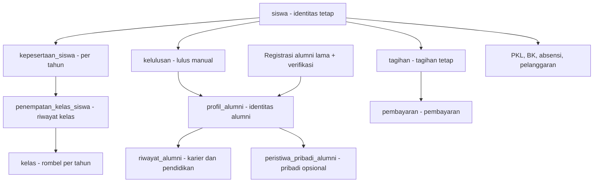

# PRD Platform SaaS SMK — Dedicated VPS per Sekolah

**Product Requirements Document (PRD) · Versi 4.6 · 4 November 2026**  
**Ruang lingkup:** Core System + 15 modul operasional SMK.  
**Arsitektur:** satu sekolah = satu VPS = satu instalasi Laravel + MariaDB.  
**Tujuan utama:** aplikasi praktis; perpindahan siswa, kelulusan, alumni, dan keuangan selalu konsisten.

| **Dokumen** | **Keterangan**                                                       |
|-------------|----------------------------------------------------------------------|
| Versi       | 4.6 — pengembangan aplikasi saja; konfigurasi infrastruktur tidak termasuk pekerjaan developer |
| Tanggal     | 4 November 2026                                                      |
| Status      | Draf implementasi MVP; persetujuan alur operasional sekolah diperlukan                   |
| Target      | SMK di Indonesia                                                     |
| Stack       | Laravel 13 · Livewire 4 · Tailwind CSS 4 · Nginx · PHP 8.5 · MariaDB |
| Hosting     | 1 sekolah = 1 VPS = 1 instalasi dan database                         |
| Batasan     | Tanpa server/domain pusat, multi-tenant, Queue, dan Scheduler        |

**Prinsip produk.** Praktis bagi pengguna sekolah: input seperlunya, validasi hanya saat dibutuhkan, data induk tidak berulang, laporan mudah dicetak, dan **setiap proses yang lama menampilkan progres nyata**.

**Keputusan final.** Penilaian PKL ditranskripsi guru dari kertas; absensi guru dihapus; izin guru/siswa digabung dalam modul absensi siswa; surat boleh tanpa file; naik kelas dan lulus harus melalui konfirmasi admin; lulusan yang sudah tercatat memakai identitas siswa lama, sedangkan alumni lama dapat daftar sendiri tanpa dibuatkan siswa fiktif; Sarpras–Lab memakai satu master aset; menu website dikelola secara dinamis.

**Definisi MVP.** Utamakan alur pokok, formulir singkat, hak akses jelas, modal konfirmasi yang konsisten, loading yang informatif, serta proses massal dengan progres dan pemulihan. **Spesifikasi teknis dan kriteria rilis ada pada Bab 12–18**. Tidak ada Queue, Laravel Scheduler, aplikasi pusat, panel multi-sekolah, atau integrasi pemerintah pada versi ini.

# 1. Ringkasan keputusan produk

| **Keputusan**  | **Ketentuan final**                                                                            |
|----------------|------------------------------------------------------------------------------------------------|
| Model aplikasi | Instalasi independen per sekolah, kode sumber sama pada seluruh VPS.                           |
| Jumlah modul   | 15 modul berbayar. Perizinan lama digabung ke Absensi; tidak dibuat modul pengganti.           |
| Absensi        | Hanya siswa. Pengajuan izin guru ada, tanpa pencatatan kehadiran guru.                         |
| PKL industri   | Tidak ada akun pembimbing industri. Nilai kertas diinput oleh guru pembimbing.                 |
| Tahun ajaran   | Kenaikan kelas dan kelulusan hanya melalui aksi admin, bukan otomatis karena tanggal berganti. |
| Data historis  | ID siswa tetap untuk lulusan yang pernah terdaftar; alumni lama dapat punya profil tanpa `siswa_id`. Riwayat kelas, tagihan, PKL dan alumni tidak ditimpa. |
| Sarpras + Lab  | Satu daftar aset, dengan stok bahan habis pakai dikelola Lab.                                  |
| Surat          | Boleh pencatatan saja, editor surat, atau upload; berkas opsional.                             |
| Website        | CMS mengelola menu, halaman, submenu, urutan dan tautan dinamis.                               |
| Di luar scope  | PPDB, UKK, absensi guru, Queue, Scheduler, billing/pembayaran gateway otomatis.                   |
| Proses massal | Batch kecil paralel terbatas dari browser; progres disimpan ke database, aman dilanjutkan tanpa duplikasi. |
| UI responsif | Loading jelas, progress bar nyata, modal konfirmasi, hasil sukses/gagal per item, pesan galat mudah dipahami. |

# 2. Tujuan, pengguna, dan cakupan

- Membantu operasional SMK dalam satu sistem, tanpa harus membeli semua modul.

- Setiap sekolah hanya mengakses modul berlisensi; core sekolah tersedia selalu.

- Setiap proses punya penanggung jawab, langkah minimal, status jelas, dan keluaran laporan.

- Mudah digunakan melalui desktop dan ponsel, tanpa kewajiban akun eksternal yang tidak diperlukan.

## 2.1 Daftar modul final (15 modul)

| **No.** | **Modul**                  | **Perubahan**                                       |
|---------|----------------------------|-----------------------------------------------------|
| 01      | Manajemen PKL              | Industri memberi nilai pada kertas; input oleh guru |
| 02      | Jurnal Mengajar Guru       | Tetap                                               |
| 03      | Absensi Siswa & Perizinan  | Absensi guru dihapus; perizinan siswa/guru digabung |
| 04      | Administrasi Surat Digital | Lampiran/file opsional                              |
| 05      | Keuangan & SPP             | Riwayat mengikuti siswa sampai alumni               |
| 06      | BKK & Lowongan Kerja       | Pendaftaran alumni mandiri dan profil karier         |
| 07      | Inventaris & Sarpras       | Satu master aset bersama Lab                        |
| 08      | Bimbingan Konseling        | Tetap; akses sensitif dibatasi                      |
| 09      | Jadwal Pelajaran           | Tetap                                               |
| 10      | Tracer Study Alumni        | Profil alumni lama/baru, riwayat aktivitas sepanjang waktu |
| 11      | HUBIN / DUDI               | Data mitra bisa dipakai PKL                         |
| 12      | Supervisi & Kinerja Guru   | Tetap                                               |
| 13      | Laboratorium & Bengkel     | Gunakan aset bersama Sarpras                        |
| 14      | Poin Pelanggaran Siswa     | Sebelumnya modul 15                                 |
| 15      | Website Sekolah + CMS      | Sebelumnya modul 16; menu dinamis                   |

**Catatan nomor modul.** Nomor 14 yang dahulu dipakai Perizinan tidak dipertahankan; seluruh modul setelahnya dinomori ulang. Kode modul harus ditetapkan stabil sejak awal implementasi agar aktivasi lisensi tidak bergantung pada nomor tampilan.

# 3. Arsitektur dan prinsip antarmuka

| **Area**           | **Ketentuan**                                                                                              |
|--------------------|------------------------------------------------------------------------------------------------------------|
| Stack              | Laravel 13, PHP 8.5 FPM, Livewire 4, Blade, Tailwind CSS 4, Nginx, MariaDB.                                |
| Instalasi          | 1 VPS milik 1 sekolah; 1 Laravel; 1 MariaDB; domain .sch.id sekolah.                                       |
| Panel pemilik SaaS | /owner pada instalasi sekolah, dengan autentikasi dan MFA wajib sebelum rilis produksi.                                 |
| Panel operasional  | /admin; tampilan role dan aktivasi modul membatasi menu maupun API/aksi.                                   |
| Lisensi            | Lokal pada database aplikasi. Tanggal kedaluwarsa diperiksa saat membuka/menjalankan modul.                |
| Proses             | Form biasa sinkron; massal via batch kecil dan HTTP request paralel terbatas dari browser, tanpa Queue/Scheduler. |
| File               | Disimpan privat bila memuat data sekolah; validasi tipe dan ukuran file.                                   |
| Backup             | Backup VPS/database dilakukan di level server secara manual/alat infrastruktur; di luar scheduler Laravel. |

**UI standar.** Tiap modul memakai pola: Dashboard ringkas → Daftar → Tambah/Ubah → Detail → Laporan. Status proses ditampilkan dengan bahasa yang mudah dipahami; hindari menu duplikat.

## 3.1 Standar loading, modal, dan pemberitahuan (wajib seluruh modul)

| Situasi | Perilaku antarmuka | Catatan implementasi |
|---|---|---|
| Halaman/daftar sedang mengambil data | Skeleton atau indikator loading pada area yang benar | Jangan menutup seluruh halaman jika hanya tabel yang diperbarui. |
| Tombol Simpan/Kirim/Setujui diproses | Tombol menampilkan spinner + teks **Menyimpan…/Mengirim…**, sementara dinonaktifkan | Mencegah klik berulang; form tetap terbaca. |
| Konfirmasi tindakan berisiko | **Modal konfirmasi** berisi aksi, objek, jumlah data, dampak, tombol **Batal** dan **Lanjutkan** | Dipakai untuk kenaikan/kelulusan massal, perubahan status, penghapusan, pembayaran, dll. |
| Ada kesalahan validasi | Pesan di bawah field; ringkasan di bagian atas form bila perlu | Input pengguna jangan hilang. |
| Error sistem/koneksi | **Modal informasi** dengan alasan mudah dipahami dan tombol **Coba Lagi/Tutup** | Hindari pesan SQL atau stack trace. Jangan menyebut gagal sebelum memeriksa status yang tersimpan. |
| Tindakan ringan sukses | Toast singkat **Berhasil disimpan** | Tidak perlu modal untuk setiap perubahan kecil. |
| Proses massal selesai/parsial | **Modal ringkasan hasil**: berhasil, sudah pernah diproses, gagal, dilewati | Tautan lihat detail, perbaiki dan ulangi yang gagal. |
| Proses massal sedang berlangsung | **Modal progres**: tahap, progress bar %, hitungan item, status, tombol **Jeda** | Tidak dapat ditutup tanpa peringatan; tersedia **Lihat Proses** jika pengguna berpindah halaman. |
| Sesi habis saat memproses | Modal **Sesi berakhir**, arahkan login ulang, lalu lanjutkan proses yang belum selesai | Hasil batch yang sudah commit tidak diulang. |

**Aturan UI:** tidak menggunakan `window.alert()` atau `window.confirm()` bawaan browser; gunakan komponen modal konsisten dengan akses keyboard, fokus yang benar, label tombol jelas, dan warna status tidak menjadi satu-satunya indikator. **Progress bar dilarang menggunakan animasi palsu**: persen harus bersumber dari jumlah item yang sudah ditandai selesai dalam database. Pada operasi biasa yang durasinya tidak bisa diukur, tampilkan loading tak tentu (*indeterminate*), bukan persentase rekaan.


## 3.2 Batas tugas developer aplikasi (FINAL)

**Dalam scope developer:** pembuatan source code Laravel, migration/seeder MariaDB, Blade/Livewire/Tailwind, routing aplikasi, autentikasi dan otorisasi, pengamanan data di tingkat aplikasi, interaksi pengguna, pemrosesan massal HTTP paralel, feature/integration tests, perbaikan bug, dan dokumentasi antarmuka konfigurasi yang dibutuhkan untuk menjalankan aplikasi. Developer menyerahkan instruksi build/migrate/rollback secara operasional **tanpa menjalankan konfigurasi host**.

**Di luar scope developer:** penyediaan VPS, domain/DNS, konfigurasi Nginx, SSL/TLS, firewall/SSH/jaringan, monitoring host, backup dan pemulihan infrastruktur. Tim infrastruktur menerima daftar prasyarat dari developer dan menanggung penerapannya. **Kesiapan aplikasi** tidak identik dengan **kesiapan go-live end-to-end**: rilis nyata memerlukan persetujuan kedua pihak.

**Aturan aplikasi:** jangan hardcode domain atau IP, jangan simpan rahasia pada repository, sediakan `.env.example` tanpa kredensial, route memakai nama, dan uji pada lingkungan pengembangan/staging yang disediakan. Implementasi fitur tidak boleh bergantung pada Laravel Queue maupun Scheduler.

**Acuan dokumen:** `TASK.md` (urutan eksekusi), bagian Panduan implementasi (pedoman asisten coding), bagian Checklist kesiapan rilis aplikasi (gerbang kualitas dan bukti UAT), `prototype/index.html` (referensi antarmuka, bukan implementasi backend).

## 3.3 Bahasa aplikasi dan susunan kode (wajib)

- Seluruh antarmuka menggunakan **Bahasa Indonesia**: menu, tombol, label, placeholder, validasi, autentikasi/reset sandi, modal, notifikasi, status, pesan galat, laporan, cetakan, dan teks aksesibilitas. Halaman HTML memakai `lang="id"`; locale Laravel dan format tanggal/angka memakai Indonesia, mata uang Rupiah. Pesan bawaan Laravel/Livewire/paket harus diterjemahkan sebelum fitur dinyatakan selesai.
- Fokus implementasi fitur pada `routes/`, `app/Http/Controllers/`, `app/Livewire/`, `app/Models/`, `app/Http/Middleware/`, dan `resources/`. Gunakan struktur Laravel standar; kelompokkan per fitur seperlunya tanpa membuat paket modul, lapisan repository/service generik, atau direktori arsitektur tambahan.
- Route hanya memetakan URL dan middleware; Controller menangani alur HTTP; Livewire menangani interaksi, validasi dan status layar; Model menangani relasi, query bisnis yang berulang, serta transaksi data; Middleware menangani autentikasi, peran dan lisensi lintas request; `resources/` berisi Blade, CSS/JS dan teks antarmuka. Controller/Livewire tetap ringkas; jangan salin aturan bisnis di dua tempat.
- Pemeriksaan hak akses objek wajib berlaku pada setiap aksi server. Gunakan fasilitas otorisasi Laravel dari Controller/Livewire dan penugasan pada Model; middleware saja tidak cukup untuk keamanan per objek. Jangan menambah lapisan Policy terpisah sebagai pola wajib di luar fokus folder tersebut.
- File pendukung di luar fokus diubah **sebatas kebutuhan nyata**: `database/migrations`/`seeders` untuk skema dan data awal, `tests/` untuk membuktikan perilaku, `lang/id/` untuk pesan bawaan framework, konfigurasi/bootstrap dan manifest untuk menjalankan Laravel. Ini pendukung, bukan perluasan fitur atau pekerjaan infrastruktur.
- Kode bersih dan rapi: nama kelas/metode/variabel bermakna, metode singkat dengan satu tujuan, tipe parameter/return bila sesuai, validasi server, hindari duplikasi dan query N+1, serta komentar hanya untuk alasan bisnis yang tidak langsung terlihat. Ikuti format Laravel/Pint setelah aplikasi tersedia. Jangan membuat abstraksi sebelum ada kebutuhan nyata.

# 4. Core system dan role

## 4.1 Fitur sistem inti

| **Fitur**            | **Subfitur wajib**                                                  |
|----------------------|---------------------------------------------------------------------|
| Akun                 | Login, logout, reset kata sandi, aktivasi/nonaktif akun.            |
| Profil Sekolah       | Identitas sekolah, NPSN, logo, alamat, kontak, kepala sekolah.      |
| Master Akademik      | Tahun ajaran, semester, jurusan/program (3 atau 4 tahun), kelas/rombel, mata pelajaran. |
| Siswa                | Identitas tetap, NIS/NISN, wali, status, riwayat kelas/tahun ajaran, impor/ekspor Excel. |
| Guru & Staf          | Identitas, jabatan, mata pelajaran, kontak.                         |
| Role/permission      | Role bisa rangkap; izin lihat/tambah/ubah/hapus/setujui bila perlu. |
| Kenaikan & Kelulusan | Proses massal dengan pratinjau, pengecualian, modal konfirmasi, progress real-time, dan lanjutkan proses. |
| Riwayat              | Riwayat kelas/status siswa, perubahan penting, audit dasar.         |

## 4.2 Role dan tugasnya

Role adalah penugasan, bukan akun terpisah untuk setiap jabatan. Satu pengguna boleh merangkap role; setiap akses tetap dibatasi hak tindakan, objek penugasan, dan lisensi fitur. Jabatan tidak otomatis memberikan seluruh izin modul.

| Role | Tugas utama | Batas akses dan persetujuan |
|---|---|---|
| Owner SaaS / Super Admin | Kelola 15 lisensi lokal, masa berlaku dan pembayaran langganan; periksa versi instalasi. | Panel `/owner`, MFA wajib sebelum produksi; bukan pemberi akses bebas data sekolah/BK/keuangan. |
| Admin Sekolah | Kelola profil, tahun ajaran/semester, program, kelas, akun/peran operasional, impor data, kenaikan dan kelulusan. | Data operasional sesuai izin; tidak dapat mengangkat dirinya menjadi owner atau membaca isi konseling otomatis. |
| Kepala Sekolah | Pantau laporan sekolah, tetapkan pejabat persetujuan, setujui surat/hasil supervisi sesuai kebijakan. | Laporan agregat; data pribadi rinci hanya dengan izin khusus, tidak otomatis membuka konseling. |
| Waka Kurikulum | Kelola/publikasikan jadwal, cek bentrok, pantau jurnal dan koordinasikan supervisi. | Bidang kurikulum dan guru/kelas terkait; bukan pengelola pembayaran atau lisensi. |
| Waka Kesiswaan | Tinjau izin siswa sesuai penugasan, validasi/koreksi poin dan koordinasikan pembinaan. | Siswa dalam lingkup tugas; tidak otomatis membaca isi konseling. |
| Waka HUBIN | Periksa kerja sama industri, pantau PKL dan laporan hubungan industri. | Mitra dan kegiatan terkait; persetujuan kerja sama sesuai penunjukan sekolah. |
| Waka Sarpras | Pantau inventaris, kondisi, peminjaman serta kebutuhan ruang/aset. | Aset/unit yang ditugaskan; stok dan laporan lab sesuai izin. |
| Guru Mata Pelajaran | Isi/koreksi jurnal sendiri, lihat jadwal terbit dan ajukan izin diri. | Kelas/mapel yang ditugaskan; tidak ada absensi guru. |
| Wali Kelas | Pantau data, histori kelas, kehadiran dan pembinaan siswa binaan; rujuk ke BK. | Hanya kelas binaan; tidak menyetujui kelulusan atau membaca catatan BK otomatis. |
| Guru Piket | Catat kehadiran siswa dan kejadian pelanggaran; catat pengajuan izin dari bukti manual. | Kelas/tanggal penugasan; poin belum berlaku sebelum validasi. |
| Tata Usaha | Catat surat masuk/keluar, kelola templat, nomor final dan arsip; file boleh kosong. | Arsip sesuai tugas; surat tertentu harus disetujui pejabat penandatangan. |
| Bendahara | Kelola tarif/tagihan, catat cicilan, cetak kuitansi, rekap tunggakan, koreksi/void beralasan. | Keuangan sekolah; koreksi transaksi sah memerlukan izin persetujuan khusus dan audit, bukan menghapus pembayaran. |
| Koordinator PKL | Kelola periode, kuota mitra, penempatan, pembimbing dan rekap nilai final. | Modul PKL aktif; siswa peserta periode yang dikelola. |
| Guru Pembimbing PKL | Periksa jurnal/kehadiran PKL, catat monitoring dan transkripsi nilai industri dari kertas. | Hanya siswa bimbingan; koreksi nilai final beralasan dan diaudit; industri tidak login. |
| Admin BKK | Terbitkan lowongan, verifikasi klaim alumni, kelola status seleksi dan laporan penempatan. | BKK aktif; kandidat identitas hanya dilihat petugas, bukan dibuka ke pendaftar. |
| Admin Tracer | Kelola periode/form survei, verifikasi alumni bila hanya Tracer aktif, pantau jawaban dan laporan. | Tracer aktif; simpan jawaban historis, data pribadi opsional tidak masuk laporan umum. |
| Staf HUBIN | Catat mitra, dokumen kerja sama, masa berlaku dan kegiatan industri. | Mitra bersama PKL; dokumen privat sesuai penugasan. |
| Petugas Sarpras | Kelola unit aset, lokasi/kondisi, serah-terima dan pengembalian pinjaman. | Sarpras aktif dan lingkup aset ditugaskan; tidak membuat salinan aset Lab. |
| Guru BK | Terima rujukan, tangani kasus/sesi konseling, simpan catatan privat dan tindak lanjut. | Kasus sesuai penugasan; laporan pimpinan agregat, isi rahasia tidak dikirim ke pelapor. |
| Kepala Lab / Petugas Lab | Kelola ruang, alat, pemesanan ruang, stok bahan, peminjaman dan kerusakan. | Lab aktif; hanya ruang/aset lab ditugaskan. Tetap dapat bekerja saat Sarpras tidak aktif. |
| Guru Praktik / Pegawai Peminjam | Ajukan penggunaan ruang/peminjaman alat, laporkan pengembalian/kerusakan. | Permintaan sendiri; tidak mengubah saldo stok atau persetujuan petugas. |
| Supervisor | Isi instrumen, observasi, nilai dan rekomendasi supervisi. | Guru yang ditugaskan; guru yang dinilai hanya melihat hasil miliknya. |
| Editor Website | Kelola halaman, berita, galeri, tampilan dan menu/submenu; pratinjau/terbit/arsip. | Website aktif; publik hanya konten terbit, tanpa akses data privat sekolah. |
| Siswa | Lihat profil/jadwal/data sendiri, isi jurnal PKL, ajukan izin/layanan BK sesuai fitur aktif. | Hanya diri sendiri dan fitur diizinkan; tidak mengubah nilai, tagihan, poin final atau persetujuan. |
| Alumni | Daftar/klaim identitas, kelola profil/riwayat sendiri, melamar lowongan dan mengisi tracer. | Akses alumni setelah verifikasi; registrasi saat BKK atau Tracer aktif; tidak membuat siswa fiktif. |
| Orang Tua / Wali Siswa | Lihat data anak yang diizinkan dan ajukan izin siswa jika akun diaktifkan. | Relasi wali–anak wajib diverifikasi; akun opsional; tidak membaca isi konseling privat. |
| Pengunjung Publik | Baca informasi sekolah dan konten website yang terbit. | Tanpa akses admin, draft, dokumen privat atau data pribadi siswa. |

### 4.2.1 Penetapan peran dan alur persetujuan

- Owner dibuat melalui provisioning aman. Admin Sekolah hanya boleh memberi peran operasional yang diizinkan, tidak boleh memberikan role owner atau memperluas izinnya sendiri.
- Penugasan menyebut lingkup kelas, siswa bimbingan, kasus, ruang/aset, periode atau bidang. Rangkap jabatan tetap mengikuti lingkup tersebut; perubahan hak akses berlaku pada request berikutnya dan diaudit.
- Izin siswa diputuskan Waka Kesiswaan/pejabat yang ditunjuk; izin guru diputuskan Kepala Sekolah/pejabat berwenang. Pengaju tidak boleh menyetujui pengajuannya sendiri.
- Pelanggaran diperiksa Waka Kesiswaan/petugas validator sebelum poin final. Koreksi pembayaran hanya oleh petugas dengan hak khusus; surat tertentu oleh penandatangan yang ditunjuk. Tidak menambah persetujuan berlapis pada pekerjaan biasa.
- Verifikasi alumni dilakukan Admin BKK bila BKK aktif atau Admin Tracer bila hanya Tracer aktif; tidak membuka portal tanpa salah satu lisensi tersebut.
- Hak membuat, melihat, mengubah, menyetujui, mengekspor dan mengunduh harus diuji terpisah. Rincian matriks per tindakan/modul pada Bab 13 melengkapi daftar tugas di sini.

# 5. Desain data siswa dan proses akademik — persyaratan KRITIS

Bagian ini **wajib selesai dan diuji sebelum modul lain dibuat**. Kesalahan yang paling harus dihindari adalah hanya menyimpan `kelas_id` di tabel `siswa`, mengubahnya massal saat naik kelas, lalu kehilangan sejarah kelas dan membuat tagihan/alumni tidak sinkron.

## 5.1 Prinsip desain yang tidak boleh dilanggar

1. **Satu identitas siswa sepanjang masa.** `siswa.id` adalah primary key internal yang tidak berubah sejak siswa masuk hingga lulus, menjadi alumni, pindah, atau keluar. Gunakan `BIGINT` atau ULID secara konsisten; jangan memakai NIS/NISN sebagai foreign key.
2. **NIS dan NISN adalah identitas administratif, bukan kunci relasi.** NIS unik pada instalasi sekolah; NISN boleh kosong saat belum tersedia, harus divalidasi format dan ditinjau apabila duplikat.
3. **Status siswa dan kelas adalah dua konsep berbeda.** Siswa dapat berstatus aktif tetapi belum ditempatkan di kelas; siswa lulus menjadi alumni tanpa kehilangan profil siswa/riwayatnya. Akun login juga terpisah dari identitas siswa dan tidak wajib dibuat untuk semua siswa.
4. **Riwayat tahun ajaran dan kelas tidak boleh ditimpa.** Penempatan baru membuat riwayat baru, penempatan lama ditutup, bukan di-overwrite.
5. **Satu siswa maksimal satu kelas aktif pada tanggal yang sama**, di dalam satu tahun ajaran sekolah. Jika pindah kelas di tengah semester, riwayat dipisahkan berdasarkan tanggal efektif.
6. **Kelulusan tidak dipicu jam/tanggal kalender.** Admin harus memilih siswa dan mengonfirmasi keputusan berdasarkan penetapan sekolah.
7. **Biaya yang sudah diterbitkan tidak berubah karena naik kelas, pindah kelas, atau lulus.** Tagihan memakai nilai dan konteks kelas saat diterbitkan; transaksi harus bisa diaudit.
8. **Lulusan yang pernah menjadi siswa di aplikasi tetap menggunakan `siswa.id` lama.** Alumni angkatan lama yang tidak ada di tabel siswa boleh mendaftar dengan profil alumni mandiri tanpa membuat siswa fiktif. BKK/Tracer menggunakan `profil_alumni.id` sebagai identitas alumni.
9. **Tidak ada hapus permanen untuk siswa yang punya riwayat operasional.** Gunakan status `pindah`, `keluar`, atau `lulus`; koreksi data memakai audit log.
10. **Semua aksi massal memakai preview dan konfirmasi** serta transaksi database. Jika ada kegagalan validasi, jangan menyimpan separuh hasil batch.

## 5.2 Entitas data yang disarankan

Tabel di bawah adalah **model logis minimal** untuk desain database. Nama kolom boleh disesuaikan saat implementasi, tetapi hubungannya jangan diubah sembarangan.

| Tabel | Kolom kunci (contoh) | Fungsi / aturan |
|---|---|---|
| `siswa` | `id`, `nis`, `nisn` nullable, `nama`, `jenis_kelamin`, `tanggal_lahir`, `status_siklus` | **Sumber identitas siswa.** `id` tetap, data pribadi bukan salinan per tahun. Status: `aktif`, `lulus`, `mutasi_keluar`, `mengundurkan_diri`. |
| `siswa_wali` | `siswa_id`, `wali_siswa_id`, `hubungan`, `utama` | Relasi siswa dengan orang tua/wali; satu wali dapat terkait beberapa anak. Boleh diisi bertahap. |
| `wali_siswa` | `id`, `nama`, `telepon` nullable | Identitas wali terpisah dari akun login. |
| `tahun_ajaran` | `id`, `nama`, `tanggal_mulai`, `tanggal_selesai`, `aktif` | Contoh `2026/2027`; hanya satu tahun ajaran aktif untuk transaksi operasional normal. |
| `semester` | `id`, `tahun_ajaran_id`, `number`, `tanggal_mulai`, `tanggal_selesai` | Semester 1/2; tahun ajaran berbeda tidak berbagi data pertemuan. |
| `program_keahlian` | `id`, `nama`, `durasi_tahun` = 3 atau 4 | Membedakan program 3 tahun (kelas akhir XII) dan 4 tahun (kelas akhir XIII). |
| `kelas` | `id`, `tahun_ajaran_id`, `program_keahlian_id`, `tingkat`, `nama`, `wali_kelas_id` | Rombel **milik suatu tahun ajaran**. Contoh `X TKJ 1` tahun 2026/27 berbeda ID dengan nama serupa tahun 2027/28. |
| `kepesertaan_siswa` | `id`, `siswa_id`, `tahun_ajaran_id`, `program_keahlian_id`, `tingkat`, `status` | Satu baris **per siswa per tahun ajaran**; unique (`siswa_id`, `tahun_ajaran_id`). Menyimpan tingkat/program pada tahun itu; berlaku juga untuk siswa yang kembali pada tahun yang sama. |
| `penempatan_kelas_siswa` | `id`, `kepesertaan_siswa_id`, `kelas_id`, `berlaku_mulai`, `berlaku_sampai` nullable, `alasan` | Riwayat kelas dalam tahun ajaran. Rentang tanggal tidak boleh tumpang tindih; `berlaku_sampai` adalah batas akhir **eksklusif**. |
| `riwayat_status_siswa` | `siswa_id`, `jenis_peristiwa`, `tanggal_efektif`, `catatan`, `dibuat_oleh` | Jejak perubahan status penting, termasuk pindah/keluar dan koreksi. |
| `kelompok_kenaikan` + `peserta_kenaikan` | tahun asal/tujuan, keputusan per siswa, kelas tujuan, `diproses_pada` | Audit keputusan naik kelas/tinggal kelas/pending serta pencegah proses ganda. |
| `kelulusan` | `siswa_id` unique, `tanggal_lulus`, `tahun_ajaran_id`, `referensi_keputusan` nullable | **Hanya untuk siswa yang dinyatakan lulus.** Kelulusan final per siswa dicatat sekali, koreksi melalui prosedur khusus. |
| `profil_alumni` | `id` PK, `siswa_id` **nullable unique**, `pengguna_id` nullable unique, nama, angkatan/tahun lulus, jurusan, kontak, status verifikasi | **Identitas alumni.** Lulusan tercatat ditautkan ke `siswa.id`; alumni lama tidak dipaksa punya record siswa. |
| `pengajuan_registrasi_alumni` | `id`, `pengguna_id`, nama, tahun lulus, jurusan, NIS opsional, `status`, `diperiksa_oleh` | Klaim mandiri yang ditinjau petugas alumni (Admin BKK atau Admin Tracer) sebelum membuka akses alumni. |
| `riwayat_alumni` | `id`, `profil_alumni_id`, `jenis`, `organisasi`, `jabatan_atau_program`, `tanggal_mulai`, `tanggal_selesai` nullable, `catatan` nullable | Riwayat pekerjaan, wirausaha, pendidikan, dan aktivitas lain yang berulang; jangan menimpa catatan lama. |
| `peristiwa_pribadi_alumni` | `id`, `profil_alumni_id`, `jenis_peristiwa`, `tanggal_kejadian` nullable, `catatan` nullable | Catatan pribadi **opsional** seperti menikah; privat dan tidak ditampilkan dalam laporan umum. |
| `pengguna` | `id`, `email`/login, password hash, status | Akun login **terpisah** dari identitas siswa; siswa boleh belum memiliki akun. Hubungkan dengan `siswa.pengguna_id` nullable atau tabel relasi akun. |

**Aturan database wajib:** foreign key dan index pada seluruh referensi; unique `kepesertaan_siswa(siswa_id, tahun_ajaran_id)`; unique `profil_alumni(siswa_id)` untuk nilai yang tidak NULL, unique `profil_alumni(pengguna_id)` untuk nilai yang tidak NULL, dan unique `kelulusan(siswa_id)`; validasi penempatan aktif dan kesesuaian tahun/tingkat/program di backend. MariaDB tidak menyediakan partial unique index seperti PostgreSQL: mencegah dua penempatan aktif harus ditangani melalui transaksi/penguncian baris, dan boleh ditambah constraint yang sesuai bila diperlukan.

**Penting:** jangan menyimpan `kelas_terkini_id` sebagai sumber kebenaran kedua di tabel `siswa`. Kelas terkini dihitung dari penempatan aktif pada tahun ajaran aktif. Jika butuh percepatan query di kemudian hari, cache bukan sumber kebenaran.

### Relasi logis



## 5.3 Contoh riwayat seorang siswa

| Tahun ajaran | Tingkat | Kelas | Keputusan | Identitas |
|---|---|---|---|---|
| 2025/2026 | X | X TKJ 1 | Naik | `siswa.id = 1001` |
| 2026/2027 | XI | XI TKJ 1 | Naik | `siswa.id = 1001` |
| 2027/2028 | XII | XII TKJ 1 | Lulus (program 3 tahun) | `siswa.id = 1001` |
| Setelah kelulusan | — | — | Alumni | `profil_alumni.id` baru, `siswa_id = 1001` |

Tagihan saat kelas X tetap tertaut ke `siswa_id = 1001` dengan kelas/tarif historisnya, meski profil alumni sudah ada. Tidak membuat entri siswa baru.

## 5.4 Proses kenaikan kelas massal (X → XI, XI → XII, XII → XIII bila program 4 tahun)

**Pelaku:** Admin Sekolah; Kepala Sekolah/Waka Kurikulum dapat memantau hasil sesuai wewenang. 

1. Admin membuat **tahun ajaran tujuan** dan rombel-rombel tujuan terlebih dahulu. Tahun ajaran baru belum otomatis memindahkan siswa.
2. Admin membuka menu **Akademik → Kenaikan Kelas**, memilih tahun asal, tahun tujuan, dan kelas asal.
3. Sistem menampilkan **daftar siswa aktif dan eligible** pada kelas asal, dengan checkbox per siswa dan **Pilih Semua** untuk semua hasil filter.
4. Admin menentukan hasil per siswa: **Naik**, **Tinggal Kelas**, atau **Ditunda**. Pilihan **Pindah/Keluar** ditangani lewat proses mutasi siswa tersendiri, bukan dianggap naik kelas.
5. Admin menetapkan kelas tujuan: bisa **set massal ke satu kelas** atau pemetaan kelas asal → kelas tujuan. Setiap siswa masih boleh diubah secara individual (misalnya X TKJ 1 dibagi menjadi XI TKJ 1 dan XI TKJ 2).
6. Sistem menampilkan **Preview** berisi nama/NIS, kelas lama, kelas baru, tingkat baru, jumlah naik/tinggal/ditunda, dan kesalahan validasi (mis. kelas tujuan tidak sesuai jurusan atau peserta sudah diproses). Jumlah siswa terpilih harus jelas, termasuk jika fitur Pilih Semua mencakup lebih dari satu halaman hasil filter.
7. Setelah admin menyetujui **modal konfirmasi**, sistem mencatat satu operasi massal beserta daftar siswa final (*snapshot*) dan mengunci pilihan selama operasi berjalan.
8. Browser mengirim beberapa **batch kecil secara paralel terbatas**. Untuk setiap siswa, pembuatan `kepesertaan_siswa` dan `penempatan_kelas_siswa` dilakukan **atomik dalam satu transaksi per siswa**, lalu hasil disimpan. Tidak ada satu transaksi panjang untuk ratusan siswa.
9. Modal menampilkan **progres nyata** (selesai/total, %, berhasil, sudah diproses, gagal, dilewati) yang terus diperbarui selama browser aktif.
10. Jika ada yang gagal atau browser ditutup, Admin dapat **Lanjutkan Proses** atau **Ulangi yang Gagal** tanpa mengulang siswa berhasil. Siswa **Ditunda** tetap belum dipindahkan.

**Peraturan teknis yang wajib:** 

- `Naik` menaikkan tingkat 1; `Tinggal Kelas` menjaga tingkat tetapi tetap membuat riwayat tahun ajaran **baru**. Jangan menyalin seluruh transaksi lama.
- **Siswa tidak boleh masuk dua kali** pada tahun tujuan. Proses ulang harus menolak duplikasi atau mengembalikan hasil yang sudah ada (idempotent).
- Kelas tujuan harus terdaftar pada tahun ajaran tujuan, sesuai tingkat dan program peserta.
- Menonaktifkan tahun ajaran lama **tidak menghapus** riwayat peserta; pemilihan tahun ajaran tidak sama dengan perintah kenaikan kelas.
- **Tidak boleh ada kenaikan otomatis pada tanggal tertentu.** Semua dijalankan lewat klik Admin.

## 5.4.1 Standar proses massal paralel dan progress nyata

**Berlaku untuk:** impor siswa, penempatan kelas, kenaikan kelas, kelulusan, pembuatan tagihan massal, dan impor alumni. Gunakan komponen proses massal yang sama; fitur tidak perlu membuat mekanisme progress masing-masing.

### Langkah pengguna

1. Admin memilih data menggunakan **checkbox per baris**, **Pilih Semua halaman** atau **Pilih Semua hasil filter** dengan jumlah terpilih yang jelas. Pilihan massal disimpan sebagai snapshot daftar ID di server saat pratinjau dikonfirmasi agar perubahan filter tidak mengubah peserta di tengah proses.
2. Admin memilih aksi dan parameter (misalnya tahun ajaran, kelas tujuan, atau nominal tagihan), lalu menekan **Pratinjau**. Sistem memeriksa duplikat, status peserta, penempatan yang sudah ada, dan kelengkapan data **tanpa mengubah database operasional**.
3. **Modal konfirmasi** menampilkan total dipilih, yang valid, yang dilewati, tujuan/perubahan, dan peringatan penting. Tombol **Proses Sekarang** aktif hanya jika aksi valid.
4. Sistem membuat catatan `operasi_massal` dan `item_operasi_massal`; setiap siswa/item mendapatkan status awal `menunggu`.
5. Browser menjalankan **2–3 request HTTP paralel maksimum**, masing-masing menangani **10–25 siswa/item** per batch (nilai awal, dapat dikonfigurasi menurut kapasitas VPS). Setiap request berdurasi singkat; hasil commit per siswa.
6. Sistem menyimpan status per item (`berhasil`, `sudah_diproses`, `gagal`, `dilewati`) dan menaikkan hitungan progres berdasarkan catatan yang benar-benar selesai. Frontend membaca respons dan/atau memanggil endpoint status berkala **selama halaman terbuka**.
7. **Jeda** menghentikan pengiriman batch baru, tetapi request yang sudah berjalan dibiarkan selesai. **Lanjutkan** mengambil hanya item yang belum selesai. Tidak ada proses yang dijanjikan berjalan terus setelah browser ditutup; request yang telanjur dikirim bisa saja selesai.
8. Ketika semua item memiliki hasil akhir, tampilkan **modal hasil** dan opsi **Unduh daftar gagal**, **Ulangi yang gagal**, atau **Kembali ke daftar**.

### Status, perhitungan progres, dan contoh tampilan

- `operasi_massal.status`: `draf`, `diproses`, `dijeda`, `selesai`, `selesai_dengan_galat`, `terputus`.
- `item_operasi_massal.status`: `menunggu`, `diproses`, `berhasil`, `sudah_diproses`, `gagal`, `dilewati`.
- **Progres = (`berhasil` + `sudah_diproses` + `gagal` + `dilewati`) / total item × 100%**. Angka 100% berarti seluruh item sudah memperoleh hasil, **bukan semua berhasil**; kegagalan tetap ditampilkan jelas.
- Contoh teks modal: **Memproses kenaikan kelas — 380/600 (63%)**; **Berhasil 371 · Sudah diproses 4 · Gagal 5 · Belum selesai 220**.
- Jika jaringan terputus, modal berubah menjadi **Koneksi terputus — 380 dari 600 tercatat. Periksa status dan lanjutkan**. Jangan mengklaim item berhasil hanya karena request sempat dikirim.
- Perubahan setelah siswa selesai diolah segera tersimpan. **Penanda tahun ajaran aktif tidak otomatis berubah** akibat selesainya sebagian batch; Admin mengaktifkannya secara terpisah.

### Aturan backend (tanpa Queue dan Scheduler)

| Kebutuhan | Implementasi minimal |
|---|---|
| Identitas operasi | `operasi_massal`: `id` UUID, `jenis`, `parameter` JSON, `status`, `total_item`, `dibuat_oleh`, timestamp. |
| Identitas item | `item_operasi_massal`: `operasi_id`, `entitas_id`, `status`, `pesan_galat` ringkas, `diproses_pada`; unique `(operasi_id, entitas_id)`. |
| Paralel terbatas | Javascript/Livewire memulai HTTP request berbeda dengan concurrency limit; PHP-FPM memproses request yang masuk, **bukan worker antrean**. |
| Pengambilan batch | Backend **mengklaim** item `menunggu` secara atomik; dua request tidak boleh memproses item sama. |
| Konsistensi | DB transaction **per siswa/item** untuk data yang saling bergantung; index/unique dan penguncian baris mencegah dua penempatan/tagihan/kelulusan. |
| Retry | Request diberi token idempotensi. Item berhasil tidak diulang; kegagalan yang sudah diperbaiki boleh di-reset ke `menunggu` setelah verifikasi. |
| Request berhenti tiba-tiba | Item `diproses` yang tertinggal dapat dideteksi saat admin menekan **Periksa Status/Lanjutkan**; sistem memeriksa hasil aktual dahulu sebelum mengembalikannya ke `menunggu`. |
| Hak akses | Semua endpoint `preview`, `start`, `process`, `status`, `pause`, `resume`, `retry` wajib otorisasi sesuai role dan tindakan. |
| Pengoperasian | Tidak ada background job, cron Laravel, Queue, Scheduler, progress fiktif, atau satu request PHP sangat panjang. |

**Prioritas MVP:** tidak perlu WebSocket, Redis, atau dashboard pekerjaan yang rumit. Polling status singkat atau pembaruan setelah setiap respons batch sudah cukup. Sesuaikan batch/concurrency dengan RAM dan PHP-FPM agar aktivitas guru lain tidak melambat.

## 5.5 Khusus tingkat akhir: kelas XII dan XIII

Jangan mengasumsikan semua siswa kelas XII langsung menjadi alumni. **SMK dapat mempunyai program 3 tahun atau 4 tahun.** Gunakan `program_keahlian.durasi_tahun` untuk menentukan kelas akhir.

| Program | Ketika siswa berada di XII | Tindakan yang diperbolehkan |
|---|---|---|
| 3 tahun | XII adalah kelas akhir | **Proses Kelulusan** secara eksplisit; jika belum lulus, dapat ditempatkan ulang di XII untuk tahun berikutnya. |
| 4 tahun | XII belum kelas akhir | Boleh diproses **Naik XII → XIII** pada tahun ajaran baru. Kelulusan dilaksanakan setelah XIII. |

**Proses Kelulusan:**

1. Admin membuka **Akademik → Kelulusan** dan memilih tahun ajaran serta siswa tingkat akhir yang memenuhi syarat program.
2. Admin menandai hasil: **Lulus**, **Belum Lulus**, atau **Belum Diputuskan**. Sistem menampilkan sumber keputusan sekolah (nomor/tanggal SK bila tersedia) dan tanggal efektif lulus.
3. Sistem menampilkan pratinjau siswa beserta **informasi tagihan belum lunas**. Tunggakan hanya informasi bagi bendahara, **tidak otomatis menghalangi kelulusan**.
4. Setelah konfirmasi, **hanya siswa Lulus** yang dibuatkan record `kelulusan` dan `profil_alumni` (relasi ke `siswa.id` yang sama), serta status siswa diperbarui menjadi `lulus`.
5. Siswa **Belum Lulus** tetap berstatus siswa; jika melanjutkan tahun ajaran berikutnya, ia dapat ditempatkan ulang pada tingkat akhir melalui alur penempatan/tinggal kelas.
6. Siswa **Belum Diputuskan** tidak diubah statusnya.

**Kelulusan keliru:** hanya admin yang diizinkan boleh melakukan **Koreksi Kelulusan** dengan alasan tercatat, pemeriksaan data BKK/Tracer yang sudah dibuat, serta jejak audit. Jangan langsung menghapus data alumni/transaksi terkait.

## 5.6 Pindah kelas, mutasi keluar, dan siswa masuk di tengah tahun

| Kejadian | Input Admin | Efek data |
|---|---|---|
| **Pindah kelas satu sekolah** | Siswa, kelas baru, tanggal efektif, alasan | Tutup `penempatan_kelas_siswa` lama (end eksklusif) dan buat penempatan baru; `siswa_id`/`kepesertaan_siswa_id` tetap. |
| **Pindah sekolah (mutasi keluar)** | Tanggal keluar, sekolah tujuan jika diketahui, keterangan | `status_siklus = mutasi_keluar`, tutup penempatan aktif; data keuangan/akademik tetap tersimpan. |
| **Berhenti/keluar** | Tanggal, alasan | Status `mengundurkan_diri`; riwayat tetap. |
| **Siswa pindahan masuk di tengah tahun** | Tambah identitas siswa, tahun, program, kelas, tanggal efektif | Buat satu `siswa` baru hanya jika siswa belum pernah ada; buat enrollment dan placement sesuai tanggal. |
| **Siswa lama kembali** | Cari profil lama melalui NIS/NISN/nama-tanggal lahir dan verifikasi | **Gunakan kembali `siswa.id` lama** jika orang yang sama, bukan buat akun/identitas kedua. |

**Validasi:** kelas tujuan harus ada di tahun ajaran sama dan tingkat/program sesuai; penempatan lama berakhir tepat saat penempatan baru dimulai; tidak boleh ada dua kelas pada tanggal efektif yang sama. Absensi sebelum perpindahan tetap berasosiasi dengan kelas saat kejadian, bukan berubah mengikuti kelas sekarang. Jika siswa keluar lalu kembali **pada tahun ajaran yang sama**, gunakan kembali `kepesertaan_siswa` tahun tersebut dengan riwayat penempatan baru; jangan melanggar unique enrollment per tahun.

## 5.7 Keuangan yang tetap konsisten dengan perubahan siswa

Modul Keuangan menggunakan `siswa.id` sebagai penghubung ke siswa aktif maupun alumni. **Pembayaran tidak boleh disimpan sebagai kolom tunggal pada siswa.**

| Tabel | Field minimum | Aturan |
|---|---|---|
| `jenis_biaya` | `id`, `nama` | SPP, praktik, kegiatan, dan lainnya. |
| `aturan_tarif` | `jenis_biaya_id`, `tahun_ajaran_id`, `tingkat` atau `kelas_id`, `nominal` | Tarif acuan untuk **tagihan baru**, bukan untuk menghitung ulang tagihan lama. |
| `tagihan` | `id`, `siswa_id`, `tahun_ajaran_id`, `kepesertaan_siswa_id` nullable, `nama_kelas_saat_terbit`, `nama_biaya_saat_terbit`, `nominal_saat_terbit`, `tanggal_jatuh_tempo`, `status` | Tagihan yang sudah diterbitkan mempertahankan nilai/konteks meski kelas/tarif berubah; periode + jenis tagihan dipakai untuk cegah penerbitan ganda. |
| `pembayaran` | `id`, `tagihan_id`, `nominal`, `dibayar_pada`, `metode`, `dibuat_oleh` | Pembayaran mengurangi saldo tagihan; koreksi tidak menghapus riwayat transaksi. |
| `koreksi_pembayaran` *(bila diperlukan)* | `pembayaran_id`, `alasan`, `nominal`, `disetujui_oleh` | Jejak pembatalan/pembetulan dengan alasan. |

Aturan proses yang harus diuji:

- Saat pindah kelas, **tagihan lama tetap** dan kelas pada kuitansi historis tidak berubah.
- Saat naik kelas, **tidak otomatis menerbitkan tagihan**; bendahara memilih tahun/kelas baru dan menekan **Buat Tagihan**. Validasi mencegah tagihan ganda pada siswa, jenis, dan periode yang sama. Pembayaran lebih besar dari sisa tagihan harus ditolak atau ditangani lewat prosedur koreksi terkontrol.
- Ketika tarif diubah, tagihan yang sudah diterbitkan **tidak ikut dihitung ulang**.
- Ketika siswa lulus atau pindah sekolah, **tunggakan tetap bisa dicari** melalui nama/NIS/riwayat siswa; pembayaran tetap dapat dicatat jika secara kebijakan diperbolehkan.
- Tagihan lunas tidak boleh menjadi belum lunas karena perubahan status akademik. Nilai tagihan, total pembayaran, dan sisa ditentukan oleh transaksi, bukan kelas siswa terkini.
- Tidak menggunakan `ON DELETE CASCADE` dari siswa ke tagihan, pembayaran, alumni, PKL, atau absensi historis.

## 5.8 Penghubung modul lain dan snapshot historis

| Modul | Identitas utama | Data historis yang harus dipertahankan |
|---|---|---|
| Absensi Siswa | `siswa_id` + tanggal + tahun ajaran | Kelas/penempatan saat absensi; jangan berubah sesudah mutasi kelas. |
| Perizinan Siswa | `siswa_id` + rentang tanggal | Status izin dan keputusan; satu tanggal tidak boleh punya dua absensi yang saling bertentangan. |
| PKL | `siswa_id` + periode penempatan | Lokasi PKL, guru pembimbing, jurnal dan nilai di periode itu. |
| BK & Pelanggaran | `siswa_id` + tanggal kejadian | Catatan tetap pada identitas yang sama tanpa ikut pindah kelas; tampilan laporan historis memakai kelas saat peristiwa. |
| Keuangan | `siswa_id` + tagihan | Kelas/tarif saat tagihan dibuat. |
| BKK & Tracer | `profil_alumni.id`, `siswa_id` opsional | Lulusan terdokumentasi ditautkan ke siswa; alumni lama bisa punya profil tanpa siswa; seluruh riwayat karier menggunakan ID alumni. |

## 5.9 Kriteria penerimaan desain siswa (wajib lulus sebelum rilis)

| ID | Skenario uji | Ekspektasi |
|---|---|---|
| S01 | 35 siswa X TKJ 1 dipilih sekaligus ke XI TKJ 1 | Preview menampilkan 35; setelah konfirmasi, ada 35 enrollment tahun tujuan dan tidak ada duplikat. |
| S02 | Dua siswa dikecualikan dari batch | Hanya 33 diproses; dua siswa tetap pending dan bisa diputuskan terpisah. |
| S03 | Satu siswa tinggal kelas | Tahun baru mencatat tingkat X dan kelas X baru; riwayat X tahun lalu tetap. |
| S04 | Admin tanpa sengaja mengklik proses dua kali | Tidak membuat enrollment/placement kedua. |
| S05 | Siswa pindah kelas pada 1 Februari | Absensi Januari menampilkan kelas lama, absensi Februari kelas baru; satu placement aktif per tanggal. |
| S06 | Tahun ajaran berganti ketika siswa XII program 3 tahun belum diputuskan lulus | Tidak menjadi alumni otomatis. |
| S07 | Siswa XII program 4 tahun | Dapat naik ke XIII, **belum** menjadi alumni. |
| S08 | Siswa XII program 3 tahun dinyatakan lulus | Profil alumni tercipta dengan `siswa_id` yang sama; tidak ada record siswa baru. |
| S09 | Siswa dinyatakan lulus dan masih menunggak | Tetap alumni; tagihan dan saldo tertunggak bisa dicari bendahara. |
| S10 | Tagihan kelas X Rp100.000, siswa kini XI dengan tarif Rp125.000 | Tagihan lama tetap Rp100.000; tagihan baru menggunakan tarif baru saat diterbitkan. |
| S11 | Koreksi kelulusan setelah alumni mengisi tracer | Sistem meminta peninjauan data terkait, bukan menghapus otomatis. |
| S12 | Siswa mutasi keluar lalu kembali | Data lama ditemukan dan dipakai kembali, tanpa duplikasi identitas. |
| S13 | Proses kenaikan kelas gagal pada satu peserta | Siswa lain yang sudah sukses tetap tersimpan; peserta gagal ditandai, bisa diperbaiki dan dicoba ulang tanpa duplikasi. |
| S14 | Tahun ajaran lama dinonaktifkan | Rekap surat/absensi/tagihan historis masih dapat dilihat sesuai hak akses. |

**Keputusan implementasi:** selesaikan seluruh skenario S01–S14 dan uji proses massal M01–M09 pada Core System sebelum modul Keuangan, PKL, BKK, dan Tracer dipakai dengan data nyata. Tambahan uji alumni A01–A09 pada §5.10 wajib lulus sebelum pendaftaran alumni dibuka.

## 5.10 Pendaftaran mandiri alumni lama dan riwayat sepanjang hidup

**Masalah yang diselesaikan.** Alumni lama (misalnya lulusan sebelum aplikasi dipasang) mungkin belum pernah masuk `siswa`. Mereka **harus bisa mendaftar sendiri**. Jangan membuat baris `siswa` fiktif hanya untuk memungkinkan registrasi alumni. Alumni baru yang telah dicatat lulus tetap menggunakan identitas siswa lama.

### 5.10.1 Alur registrasi / klaim akun alumni

1. Jika **modul BKK atau Tracer Study aktif**, portal `/alumni/daftar` tersedia walaupun modul Website tidak aktif. Pendaftaran dibatasi agar tidak disalahgunakan.
2. Alumni mengisi **nama lengkap, tahun lulus, jurusan saat lulus, email aktif, password**, dan **NIS jika ingat (opsional)**. Tanggal lahir atau informasi tambahan dapat diminta **untuk proses verifikasi**, tidak wajib ditampilkan pada profil publik. Tidak meminta status menikah saat daftar.
3. Sistem membuat akun **berstatus menunggu verifikasi** dan `pengajuan_registrasi_alumni`, **belum** memberi hak membaca data siswa, tagihan, atau riwayat orang lain. Email boleh diverifikasi dengan tautan jika SMTP tersedia; pengiriman langsung, tanpa Queue.
4. **Petugas alumni (Admin BKK atau Admin Tracer)** meninjau klaim dan mencari kecocokan pada `siswa`, `kelulusan`, dan `profil_alumni` berdasarkan beberapa informasi. Sistem menampilkan kandidat **hanya kepada admin**, bukan kepada pendaftar. **Jangan otomatis menghubungkan identitas hanya berdasarkan nama/NIS.**
5. Bila cocok dengan alumni yang **sudah punya `profil_alumni`**, petugas alumni menghubungkan akun ke profil yang sama setelah verifikasi identitas; **tidak membuat profil kedua**.
6. Bila cocok dengan siswa lama yang sudah lulus tetapi belum mempunyai profil alumni, petugas alumni membuat satu `profil_alumni` yang menaut ke `siswa.id` tersebut. Keputusan lulus harus dapat dibuktikan dari catatan sekolah.
7. Bila **alumni lama benar-benar tidak ada pada master siswa**, petugas alumni menyetujui dan membuat `profil_alumni` dengan `siswa_id = NULL`, memakai data kelulusan yang telah diverifikasi.
8. Jika klaim tidak dapat dibuktikan atau duplikat mencurigakan, status **Perlu Klarifikasi / Ditolak**. Pendaftar dapat melengkapi informasi; admin mencatat alasan keputusan.
9. Alumni yang disetujui dapat login, melengkapi profil dan mengubah **riwayatnya sendiri**. Pendaftar yang belum diverifikasi hanya dapat melihat status registrasi dan mengoreksi pengajuan.

**Petugas verifikasi:** Admin BKK jika modul BKK aktif, atau Admin Tracer jika hanya modul Tracer yang aktif.

**Status registrasi:** Menunggu Verifikasi → Disetujui / Perlu Klarifikasi / Ditolak. **Akun tidak otomatis disetujui karena NIS/NISN cocok.**

**Lulusan yang sudah punya akun siswa:** Setelah sekolah menetapkan kelulusan, hak akses siswa dapat dialihkan/ditambah menjadi alumni sesuai proses klaim akun. Jangan membuat akun baru bila orang tersebut sudah memiliki akun yang sah.

### 5.10.2 Fitur profil dan riwayat alumni

| Fitur | Subfitur sederhana | Aturan data |
|---|---|---|
| Profil Alumni | Nama, foto opsional, tahun lulus, jurusan, kontak, domisili opsional | Tahun/jurusan historis tetap; koreksi identitas penting perlu verifikasi admin. |
| Riwayat Kerja | Perusahaan, jabatan, tanggal mulai, tanggal selesai (opsional), deskripsi singkat | Bisa lebih dari satu pekerjaan, pekerjaan lama tidak ditimpa. |
| Riwayat Wirausaha | Nama/bidang usaha, mulai, berakhir (opsional), keterangan | Bisa bekerja **dan** berwirausaha bersamaan. |
| Riwayat Pendidikan | Nama lembaga/kampus, program studi, mulai, selesai (opsional) | Bisa kuliah sambil bekerja. |
| Kondisi Saat Ini | Sedang mencari pekerjaan, aktivitas lain, belum mengisi data | Jangan simpulkan `menganggur` hanya karena tidak ada riwayat kerja. |
| Perkembangan Pribadi | Status pernikahan/peristiwa menikah, perubahan lain yang ingin dibagikan | **Opsional, privat**, dan tidak menentukan akses layanan BKK. Tidak meminta nama pasangan/dokumen. |
| Timeline | Gabungan entri berdasarkan tanggal | Riwayat dapat ditambah, diedit, atau ditutup tanpa menimpa entri sebelumnya. |
| Tracer | Formulir kondisi alumni pada tanggal/periode pengisian | Laporan agregat karier/pendidikan; status pernikahan tidak perlu masuk statistik umum. |

**Catatan status.** Satu alumni boleh memiliki beberapa aktivitas aktif dalam waktu yang sama: bekerja + kuliah, bekerja + usaha, atau kuliah + usaha. Status menikah **bukan** status pekerjaan. Data pekerjaan/pendidikan menyimpan `tanggal_mulai` serta `tanggal_selesai` agar dapat menampilkan riwayat lama dan keadaan saat ini.

### 5.10.3 Koneksi BKK, Tracer, dan Keuangan

- Lamaran BKK serta jawaban tracer menggunakan **`profil_alumni.id`**, bukan mewajibkan `siswa.id`. Alumni lama dan alumni baru mendapat fitur sama.
- Alumni baru yang berasal dari data siswa: profilnya mempunyai `siswa_id` dan riwayat akademik tetap tersambung. **Tagihan memakai `siswa.id` lama** dan tidak terpengaruh perubahan riwayat alumni.
- Alumni lama tanpa `siswa_id` **tidak memiliki data tagihan otomatis**. Jangan membuat riwayat pembayaran, kelas, ataupun kelulusan palsu; jika arsip lama diimpor kemudian, admin dapat **menghubungkan** profil setelah verifikasi dan pemeriksaan duplikasi, dengan riwayat alumni tetap utuh.
- Status **Diterima** pada lamaran BKK tidak otomatis dianggap **sudah mulai bekerja**. Alumni mengonfirmasi pekerjaan dan tanggal mulai, atau admin mencatatnya setelah verifikasi.
- Laporan tracer mengambil snapshot per periode pengisian (misalnya status saat survei), tidak menghitung ulang jawaban tahun lampau memakai pekerjaan terbaru.
- Akses pendaftaran alumni tetap tergantung aktivasi **BKK atau Tracer**; tidak perlu membuat modul ketujuh belas atau layanan pusat.

### 5.10.4 Uji penerimaan tambahan (alumni)

| ID | Skenario | Harus berhasil |
|---|---|---|
| A01 | Alumni 2017 tidak ada dalam `siswa`, daftar sendiri | Menunggu verifikasi; setelah disetujui punya `profil_alumni.id`, `siswa_id = NULL`, dan akun aktif. |
| A02 | Lulusan 2026 sudah ada `siswa` dan `kelulusan` | Akun terhubung ke profil dengan `siswa_id` lama; tidak membuat siswa baru. |
| A03 | Orang mendaftar dua kali dengan data sama | Admin melihat kandidat duplikat; tidak tercipta dua profil terverifikasi untuk orang yang sama. |
| A04 | Pendaftar mengaku memakai NIS siswa lain | Tidak langsung melihat tagihan/data akademik; verifikasi manual diperlukan. |
| A05 | Alumni bekerja 2021–2023, kuliah 2022–2026, usaha sejak 2025 | Ketiga riwayat tersimpan dan timeline benar; pekerjaan pertama tetap historis. |
| A06 | Alumni mengisi status menikah | Boleh dikosongkan; data privat dan tidak masuk laporan umum atau syarat lowongan. |
| A07 | Arsip siswa lama diimpor setelah alumni mendaftar | Admin bisa menautkan `siswa_id` setelah verifikasi tanpa menghapus riwayat. |
| A08 | Alumni tanpa `siswa_id` menggunakan BKK dan Tracer | Dapat melamar dan mengisi tracer; tidak ada tagihan/kelas fiktif. |
| A09 | Alumni menerima tawaran kerja lewat BKK tetapi belum mulai bekerja | Tidak otomatis menambah pekerjaan aktif; riwayat bertambah setelah konfirmasi. |

## 5.11 Uji penerimaan proses massal dan UX (wajib)

| ID | Skenario | Hasil yang harus terlihat |
|---|---|---|
| M01 | Admin memilih 600 siswa lintas halaman menggunakan **Pilih Semua hasil filter** | Modal pratinjau tepat 600, tidak hanya 20 siswa yang sedang tampil. |
| M02 | Memproses 600 siswa dengan 3 request paralel | Progres bertambah sesuai hasil commit, request tidak melebihi batas paralel dan tidak ada siswa terproses dua kali. |
| M03 | Dua batch bersamaan memuat siswa yang sama karena retry | Claim/unique/idempotensi memastikan satu hasil akademik, bukan data rangkap. |
| M04 | Browser ditutup pada 380/600 | Yang sudah selesai tetap tersimpan; saat login kembali bisa menemukan operasi dan melanjutkan sisanya tanpa duplikasi. |
| M05 | Lima dari 600 siswa datanya tidak valid | Modal hasil menjelaskan 595 berhasil dan 5 gagal; gagal bisa diekspor dan diulang setelah diperbaiki. |
| M06 | Koneksi terputus saat request dikirim | UI menampilkan gangguan, membaca status dari server, tidak mengklaim sukses tanpa bukti. |
| M07 | Admin klik **Jeda** | Batch baru tidak dikirim; batch yang sudah berjalan dibiarkan berakhir; **Lanjutkan** aman. |
| M08 | Konfirmasi kelulusan 200 siswa | Modal menyebut dampak ke profil alumni, jumlah peserta dan siswa yang dikecualikan sebelum proses. |
| M09 | Simpan formulir biasa atau hapus data | Loading tombol, validasi inline, modal konfirmasi tindakan penting, dan modal error yang jelas. |

# 6. Panel pemilik SaaS lokal dan langganan

| **Fitur**        | **Subfitur / alur**                                                 |
|------------------|---------------------------------------------------------------------|
| Profil pelanggan | Profil sekolah ini, domain dan kontak penanggung jawab.             |
| Aktivasi modul   | Daftar 15 modul → aktifkan/nonaktifkan → isi masa berlaku → simpan. |
| Lisensi          | Status aktif/kedaluwarsa; pemeriksaan saat request tanpa cron.      |
| Langganan        | Nama paket/modul, harga, periode, catatan.                          |
| Pembayaran       | Input pembayaran manual; bukti optional; riwayat pembayaran.        |
| Audit            | Riwayat perubahan lisensi dan pengaturan penting.                   |

**Perilaku lisensi.** Modul tidak aktif disembunyikan dari menu DAN ditolak pada route, komponen Livewire, unduhan, serta aksi data. Data tidak dihapus saat lisensi habis. Core System dan /admin tetap ada untuk pengelolaan dasar.

# 7. Persyaratan fitur dan proses bisnis 15 modul

## 01. Manajemen PKL

**Tujuan.** Mengelola penempatan, jurnal, absensi PKL, monitoring, dan hasil penilaian di satu tempat.

**Role.** Koordinator PKL, Guru Pembimbing, Siswa. Pembimbing industri tidak login.

| **Fitur inti**     | **Subfitur / cakupan**                                                                                                                  |
|--------------------|-----------------------------------------------------------------------------------------------------------------------------------------|
| Tempat PKL         | Perusahaan, PIC, kuota, alamat, kontak.                                                                                                 |
| Penempatan         | Siswa, lokasi, guru pembimbing, periode.                                                                                                |
| Jurnal & kehadiran | Input harian oleh siswa; pemeriksaan guru.                                                                                              |
| Monitoring         | Catatan kunjungan dan pembinaan guru.                                                                                                   |
| Nilai PKL          | Transkripsi nilai dari formulir kertas industri oleh guru pembimbing; sumber, penilai, tanggal; komponen nilai sekolah jika diperlukan. |
| Laporan            | Rekap siswa, jurnal, hadir, nilai; PDF/Excel.                                                                                           |

**Proses bisnis:**

> **1.** Koordinator menetapkan periode, mitra, penempatan dan guru pembimbing.
>
> **2.** Siswa mengisi jurnal dan kehadiran selama PKL; guru memeriksa.
>
> **3.** Pembimbing industri menyerahkan lembar nilai kertas kepada guru pembimbing.
>
> **4.** Guru pembimbing memasukkan nilai dari kertas ke aplikasi (scan/foto bukti opsional), menandai nama penilai industri dan tanggal.
>
> **5.** Koordinator memeriksa nilai final dan mengunduh rekap.

**Status.** Jurnal: Draft → Dikirim → Diperiksa / Perlu Perbaikan. Nilai: Belum Diinput → Draft → Final.

**Hasil.** Laporan PKL dan nilai final yang terlacak asalnya.

**Aturan penting.** Tidak ada akun/approval digital pembimbing industri; tanda tangan fisik tetap mengikuti prosedur sekolah. Nilai final yang dikoreksi harus memiliki alasan dan riwayat.

## 02. Jurnal Mengajar Guru

**Tujuan.** Mendokumentasikan pelaksanaan mengajar secara harian.

**Role.** Guru, Waka Kurikulum, Kepala Sekolah.

| **Fitur inti** | **Subfitur / cakupan**                        |
|----------------|-----------------------------------------------|
| Input jurnal   | Tanggal, kelas, mapel, jam, materi, kegiatan. |
| Riwayat        | Cari dan koreksi jurnal.                      |
| Monitoring     | Kelengkapan jurnal per guru/periode.          |
| Laporan        | Rekap cetak atau PDF.                         |

**Proses bisnis:**

> **1.** Guru memilih kelas, tanggal dan mapel, lalu mengisi jurnal.
>
> **2.** Waka Kurikulum melihat kelengkapan dan memberi catatan bila perlu.
>
> **3.** Guru melakukan koreksi jika diminta.
>
> **4.** Pimpinan melihat ringkasan/rekap.

**Status.** Tersimpan → Diperiksa (opsional).

**Hasil.** Jurnal dan rekap pelaksanaan mengajar.

## 03. Absensi Siswa & Perizinan

**Tujuan.** Mencatat kehadiran siswa serta izin siswa dan guru dalam satu modul, tanpa absensi guru.

**Role.** Guru Piket, Wali Kelas, Siswa/Orang Tua (opsional), Guru pengaju izin, Waka Kesiswaan/Kepala Sekolah.

| **Fitur inti** | **Subfitur / cakupan**                                                                       |
|----------------|----------------------------------------------------------------------------------------------|
| Absensi siswa  | Hadir, terlambat, sakit, izin, alpa; per kelas/tanggal.                                      |
| Input absensi  | Manual oleh petugas; QR opsional jika memang dibutuhkan.                                     |
| Izin siswa     | Pengajuan online atau dicatat petugas dari bukti manual; alasan, tanggal, lampiran opsional. |
| Izin guru      | Form pengajuan, tanggal, alasan, keputusan. Bukan presensi guru.                             |
| Persetujuan    | Petugas/pejabat menyetujui atau menolak.                                                     |
| Rekap          | Laporan hadir siswa dan riwayat izin siswa/guru.                                             |

**Proses bisnis:**

> **1.** Guru Piket/Wali Kelas mengisi absensi siswa.
>
> **2.** Siswa/orang tua atau petugas mengajukan izin siswa; guru mengajukan izin guru.
>
> **3.** Pejabat sesuai kewenangan meninjau dan memberikan keputusan.
>
> **4.** Jika izin siswa disetujui, status absensi tanggal terkait diperbarui/dicocokkan tanpa menduplikasi kehadiran.
>
> **5.** Petugas mencetak laporan absensi siswa atau rekap izin.

**Status.** Absensi: Hadir/Terlambat/Sakit/Izin/Alpa. Izin: Diajukan → Disetujui/Ditolak.

**Hasil.** Rekap kehadiran siswa dan administrasi izin.

**Aturan penting.** Tidak ada check-in/check-out atau rekap kehadiran guru. Perizinan guru tidak mengekspor/mengubah sistem absensi pemerintah. Absensi siswa harus terikat tanggal serta riwayat penempatan kelas saat kejadian; persetujuan izin tidak boleh menciptakan dua status harian yang bertentangan.

## 04. Administrasi Surat Digital

**Tujuan.** Mencatat surat masuk dan mengelola surat keluar baik dengan maupun tanpa file.

**Role.** Tata Usaha, Pejabat Penyetuju, Kepala Sekolah.

| **Fitur inti**    | **Subfitur / cakupan**                                                |
|-------------------|-----------------------------------------------------------------------|
| Surat masuk       | Nomor, tanggal, pengirim, perihal; file opsional.                     |
| Surat keluar      | Nomor, tanggal, tujuan, perihal; pilih pencatatan saja/editor/upload. |
| Template          | Kop dan isi surat sederhana bila memakai editor.                      |
| Penomoran         | Nomor unik untuk surat keluar final.                                  |
| Arsip & pencarian | Filter tanggal, jenis, perihal; lihat/unduh jika ada file.            |
| Laporan           | Buku agenda dan rekap surat.                                          |

**Proses bisnis:**

> **1.** TU memilih Tambah Surat Masuk atau Surat Keluar.
>
> **2.** TU mengisi metadata minimum; boleh tanpa lampiran, boleh mengunggah, atau menulis surat langsung di editor.
>
> **3.** Surat keluar yang perlu persetujuan diajukan ke pejabat; jika surat hanya diarsipkan, ikuti izin petugas.
>
> **4.** Nomor final ditetapkan sekali ketika surat keluar disahkan, lalu tercatat di buku agenda.
>
> **5.** TU melakukan pencarian dan cetak/unduh laporan.

**Status.** Surat keluar: Draft → Diajukan → Disetujui / Revisi → Arsip. Surat masuk: Dicatat → Arsip.

**Hasil.** Buku agenda dan surat digital bila ada.

**Aturan penting.** Tanpa file tetap valid; metadata wajib: nomor jika tersedia, tanggal, pihak terkait dan perihal. Hindari nomor surat ganda.

## 05. Keuangan & SPP

**Tujuan.** Mencatat tagihan dan pembayaran sekolah tanpa memutus histori saat siswa naik kelas/lulus.

**Role.** Bendahara, Kepala Sekolah (ringkasan), Siswa/Orang Tua (tagihan sendiri bila diberikan akun).

| **Fitur inti**  | **Subfitur / cakupan**                              |
|-----------------|-----------------------------------------------------|
| Tarif & tagihan | Jenis, tarif, jatuh tempo, tagihan individu/massal. |
| Pembayaran      | Catat pembayaran dan cicilan manual.                |
| Kuitansi        | Nomor bukti dan cetak.                              |
| Tunggakan       | Sisa belum lunas, termasuk alumni.                  |
| Koreksi         | Pembetulan transaksi dengan alasan dan riwayat.     |
| Laporan         | Per siswa, kelas, tahun/periode, lunas/menunggak.   |

**Proses bisnis:**

> **1.** Bendahara mengatur tarif sesuai tahun ajaran/kelas dan menerbitkan tagihan.
>
> **2.** Tagihan menyimpan siswa_id serta snapshot kelas/tarif pada waktu penerbitan.
>
> **3.** Bendahara mencatat pembayaran, sistem menghitung sisa tagihan.
>
> **4.** Perpindahan kelas atau kelulusan tidak mengubah dan tidak menghapus tagihan lama.
>
> **5.** Bendahara melihat tunggakan siswa aktif maupun alumni, serta mencetak kuitansi/laporan.

**Status.** Tagihan: Belum Bayar → Sebagian → Lunas. Pembetulan dicatat sebagai koreksi.

**Hasil.** Buku pembayaran, kuitansi, tunggakan lintas tahun.

**Aturan penting.** Tidak ada pembayaran gateway pada MVP. Pembatalan/koreksi tidak boleh menghilangkan rekam audit.

## 06. BKK & Lowongan Kerja

**Tujuan.** Menyalurkan lowongan, menerima pendaftaran alumni mandiri, dan mencatat proses lamaran alumni/siswa akhir.

**Role.** Admin BKK, Alumni terverifikasi, Siswa akhir (opsional).

| **Fitur inti** | **Subfitur / cakupan**                     |
|----------------|--------------------------------------------|
| Pendaftaran alumni | Form registrasi mandiri, verifikasi petugas alumni, hindari duplikat. |
| Profil alumni | Kontak, angkatan, jurusan, riwayat kegiatan (terhubung ke Tracer). |
| Lowongan | Perusahaan, posisi, syarat, batas tanggal. |
| Pelamar | Form lamaran dan CV opsional. |
| Status seleksi | Diproses, diterima, ditolak; hasil dari perusahaan dicatat admin. |
| Laporan | Rekap lowongan, pelamar, penempatan. |

**Proses bisnis:**

> **1.** Alumni lama mendaftar sendiri dan diverifikasi petugas alumni; alumni baru dapat memakai akun yang terhubung dari data kelulusan.
>
> **2.** Admin BKK memasukkan dan menerbitkan lowongan.
>
> **3.** Alumni terverifikasi melamar pekerjaan dan mengunggah CV bila perlu.
>
> **4.** Admin BKK menerima hasil seleksi dari perusahaan di luar sistem dan memperbarui status.
>
> **5.** Alumni mengisi riwayat kerja setelah benar-benar mulai bekerja; admin mengunduh laporan.

**Status.** Lowongan: Aktif/Arsip. Lamaran: Diajukan → Diproses → Diterima/Ditolak.

**Hasil.** Database lowongan dan rekap penempatan.

**Aturan penting.** Perusahaan tidak diwajibkan memiliki akun untuk MVP. Pendaftaran alumni tidak mensyaratkan adanya siswa di Core System; mekanisme §5.10 wajib diterapkan.

## 07. Inventaris & Sarpras

**Tujuan.** Mencatat seluruh aset sekolah, penempatan, peminjaman, dan kondisinya.

**Role.** Petugas Sarpras, Guru/Staf peminjam, Waka Sarpras.

| **Fitur inti**      | **Subfitur / cakupan**                                   |
|---------------------|----------------------------------------------------------|
| Master aset bersama | Kode unik, nama, kategori, jumlah/unit, lokasi, kondisi. |
| Peminjaman          | Peminjam, tanggal, barang, pengembalian.                 |
| Perubahan kondisi   | Rusak/perbaikan; catatan riwayat.                        |
| Laporan             | Per lokasi, kondisi, dan peminjaman.                     |

**Proses bisnis:**

> **1.** Petugas Sarpras membuat/memperbaiki data aset pada master bersama.
>
> **2.** Pengguna meminjam, petugas mencatat penyerahan dan pengembalian.
>
> **3.** Petugas mengubah kondisi lokasi/barang disertai riwayat.
>
> **4.** Waka Sarpras melihat rekap aset seluruh ruangan, termasuk lab.

**Status.** Aset: Baik/Rusak/Perbaikan. Peminjaman: Dipinjam → Dikembalikan.

**Hasil.** Data aset tunggal dan laporan inventaris.

**Aturan penting.** Aset lab bukan salinan: modul Sarpras dan Lab memakai ID aset yang sama. Peralatan tetap memakai master aset; bahan habis pakai memakai catatan stok terpisah. Jika Lab aktif tetapi Sarpras tidak, petugas Lab tetap dapat mengelola aset Lab melalui antarmuka Lab terbatas.

## 08. Bimbingan Konseling

**Tujuan.** Mencatat layanan konseling dengan perlindungan catatan pribadi siswa.

**Role.** Guru BK, Siswa (permintaan jika diaktifkan), Wali Kelas (rujukan), Pimpinan (rekap).

| **Fitur inti**    | **Subfitur / cakupan**                                        |
|-------------------|---------------------------------------------------------------|
| Layanan BK        | Siswa, tanggal, jenis, guru BK.                               |
| Catatan konseling | Catatan privat, ringkasan tindak lanjut.                      |
| Rujukan           | Masukan dari wali kelas atau poin pelanggaran.                |
| Laporan           | Jumlah layanan/periode dan tindak lanjut, tanpa isi sensitif. |

**Proses bisnis:**

> **1.** Guru BK menerima permintaan atau rujukan.
>
> **2.** Guru BK melakukan layanan dan menyimpan catatan privat.
>
> **3.** Jika perlu, tindakan pembinaan/tindak lanjut ditentukan.
>
> **4.** Pimpinan hanya melihat statistik atau ringkasan yang diizinkan.

**Status.** Diajukan → Ditangani → Selesai.

**Hasil.** Riwayat BK dan laporan agregat.

**Aturan penting.** Catatan konseling tidak bisa dibaca Admin Sekolah/Owner secara otomatis.

## 09. Jadwal Pelajaran

**Tujuan.** Menyusun jadwal yang tidak berbenturan dengan guru, kelas atau ruang.

**Role.** Waka Kurikulum, Guru, Siswa.

| **Fitur inti** | **Subfitur / cakupan**                     |
|----------------|--------------------------------------------|
| Waktu belajar  | Hari, jam, jeda.                           |
| Jadwal         | Kelas, guru, mapel, ruang, jam.            |
| Cek bentrok    | Validasi guru/kelas/ruang pada waktu sama. |
| Publikasi      | Jadwal aktif dan cetak per kelas/guru.     |

**Proses bisnis:**

> **1.** Waka mengatur jam dan pembagian guru.
>
> **2.** Waka membuat jadwal manual.
>
> **3.** Sistem menolak/memberi peringatan saat bentrok sebelum publikasi.
>
> **4.** Guru dan siswa membaca jadwal yang sudah terbit.

**Status.** Draft → Terbit.

**Hasil.** Jadwal kelas dan guru tanpa bentrok.

**Aturan penting.** Tidak perlu generator jadwal otomatis untuk MVP.

## 10. Tracer Study Alumni

**Tujuan.** Alumni **lama dan baru** bisa mengisi serta memperbarui riwayat kerja, wirausaha, kuliah, dan perkembangan lain. Sekolah mendapatkan tracer study tanpa kehilangan perjalanan alumni dari waktu ke waktu.

**Role.** Alumni terverifikasi, Admin Tracer/BKK, Kepala Sekolah (rekap agregat).

| **Fitur inti** | **Subfitur / cakupan** |
|---|---|
| Registrasi alumni | Alumni lama mendaftar sendiri; petugas alumni memverifikasi sesuai §5.10. |
| Profil alumni | Kontak, angkatan, jurusan, data personal miliknya sendiri. |
| Riwayat pekerjaan | Perusahaan, jabatan, periode mulai/selesai, masih bekerja. |
| Riwayat wirausaha | Usaha/bidang usaha, periode mulai/selesai, masih berjalan. |
| Riwayat pendidikan | Perguruan tinggi/lembaga, program, periode, status studi. |
| Riwayat lain | Kegiatan lain dan peristiwa pribadi yang alumni pilih untuk dicatat; **status menikah opsional dan privat**. |
| Kondisi terkini | Bisa multi-aktivitas; mencari kerja dinyatakan oleh alumni sendiri. |
| Survei tracer | Isi kondisi pada tanggal survei; simpan snapshot respon per periode. |
| Rekap dan laporan | Angkatan, jurusan, pekerjaan, kuliah, usaha; Excel/PDF. |

**Proses bisnis:**

> **1.** Alumni yang belum tercatat mendaftar mandiri dan menunggu verifikasi petugas alumni; lulusan yang sudah terdata menghubungkan akun ke profil yang ada.
>
> **2.** Alumni login, melengkapi profil, menambahkan riwayat kerja/kuliah/usaha (boleh lebih dari satu dan saling tumpang tindih).
>
> **3.** Alumni dapat menutup riwayat yang selesai lalu menambah riwayat baru; peristiwa pribadi sepenuhnya opsional.
>
> **4.** Saat periode tracer dibuka, alumni mengisi ringkasan kondisi saat itu. Data survei historis tidak ditimpa perubahan profil terbaru.
>
> **5.** Admin Tracer melihat jumlah responden dan laporan agregat. Data pribadi sensitif tidak tampil dalam laporan umum.

**Status registrasi.** Menunggu Verifikasi → Disetujui / Perlu Klarifikasi / Ditolak. **Status survei.** Belum Mengisi → Sudah Mengisi.

**Hasil.** Profil alumni berkelanjutan, timeline aktivitas, dan statistik alumni per angkatan.

**Aturan penting.** Pendaftaran dapat digunakan jika BKK **atau** Tracer aktif, tidak perlu modul Website; tidak menggantikan sistem pelaporan tracer resmi pemerintah. Tidak memaksa alumni memilih hanya satu status (bekerja/kuliah/usaha), dan tidak memaksa data pernikahan.

## 11. HUBIN / DUDI

**Tujuan.** Menyimpan daftar mitra industri dan arsip kerja sama.

**Role.** Waka HUBIN, Staf HUBIN, Kepala Sekolah.

| **Fitur inti** | **Subfitur / cakupan**                                    |
|----------------|-----------------------------------------------------------|
| Mitra          | Nama, PIC, bidang, alamat, kontak.                        |
| Kerja sama     | Jenis, nomor dokumen, tanggal mulai/akhir, file opsional. |
| Kegiatan       | Kunjungan, guru tamu, kolaborasi.                         |
| Laporan        | Daftar mitra dan kerja sama aktif.                        |

**Proses bisnis:**

> **1.** Staf memasukkan mitra dan rincian kerja sama.
>
> **2.** Waka memeriksa periode dan dokumen bila ada.
>
> **3.** Staf mencatat pelaksanaan kegiatan dengan mitra.
>
> **4.** Pimpinan melihat rekap.

**Status.** Draft → Aktif → Berakhir.

**Hasil.** Database mitra dan arsip kerja sama.

**Aturan penting.** Mitra yang digunakan PKL mengambil sumber data yang sama jika kedua modul aktif.

## 12. Supervisi & Kinerja Guru

**Tujuan.** Mencatat observasi dan tindak lanjut supervisi internal sekolah.

**Role.** Kepala Sekolah, Waka Kurikulum, Supervisor, Guru.

| **Fitur inti** | **Subfitur / cakupan**            |
|----------------|-----------------------------------|
| Jadwal         | Guru, supervisor, tanggal, kelas. |
| Instrumen      | Indikator, nilai, catatan.        |
| Hasil          | Ringkasan dan saran perbaikan.    |
| Laporan        | Rekap supervisi per semester.     |

**Proses bisnis:**

> **1.** Waka menjadwalkan supervisi.
>
> **2.** Supervisor mengisi observasi dan penilaian.
>
> **3.** Guru membaca hasil serta menindaklanjuti rekomendasi.
>
> **4.** Kepala Sekolah melihat rekap.

**Status.** Dijadwalkan → Dinilai → Selesai.

**Hasil.** Dokumen hasil supervisi dan rekap.

## 13. Laboratorium & Bengkel

**Tujuan.** Mengatur penggunaan ruang praktik, aset alat, dan bahan habis pakai.

**Role.** Kepala Lab, Petugas Lab, Guru Praktik.

| **Fitur inti**    | **Subfitur / cakupan**                       |
|-------------------|----------------------------------------------|
| Data ruang        | Nama lab/bengkel, jurusan, penanggung jawab. |
| Alat praktik      | Referensi aset dari master aset bersama.     |
| Bahan habis pakai | Stok masuk, dipakai, sisa.                   |
| Jadwal praktik    | Guru, kelas, tanggal, ruang.                 |
| Peminjaman alat   | Pinjam, kembali, kerusakan.                  |
| Laporan           | Pemakaian ruang, alat dan stok bahan.        |

**Proses bisnis:**

> **1.** Kepala Lab mengatur ruang dan mengelola alat melalui daftar aset bersama.
>
> **2.** Petugas mencatat stok masuk bahan habis pakai.
>
> **3.** Guru menggunakan ruang dan meminjam alat; petugas mencatat pemakaian bahan.
>
> **4.** Petugas memperbarui stok dan kondisi alat; laporan tersedia bagi Kepala Lab/Sarpras.

**Status.** Bahan: Masuk/Dipakai. Alat: Tersedia/Dipinjam/Rusak.

**Hasil.** Riwayat praktik dan stok aktual.

**Aturan penting.** Bila hanya modul Lab yang aktif, pengelolaan aset terbatas ruang lab tetap tersedia melalui core aset yang sama. Tidak membuat tabel/identitas aset duplikat.

## 14. Poin Pelanggaran Siswa Digital

**Tujuan.** Mencatat kejadian dan pembinaan dengan mekanisme validasi.

**Role.** Guru Piket/Guru, Waka Kesiswaan, Wali Kelas, Guru BK, Siswa/Orang Tua (ringkasan).

| **Fitur inti** | **Subfitur / cakupan**                          |
|----------------|-------------------------------------------------|
| Tata tertib    | Kategori pelanggaran dan bobot.                 |
| Catatan        | Siswa, tanggal, kejadian, poin, bukti opsional. |
| Validasi       | Disetujui/ditolak/dikoreksi.                    |
| Pembinaan      | Tindakan, catatan guru BK/wali kelas.           |
| Laporan        | Riwayat dan rekap per siswa/kelas.              |

**Proses bisnis:**

> **1.** Guru mencatat kejadian dan memilih kategori poin.
>
> **2.** Petugas kesiswaan memeriksa sebelum poin berlaku.
>
> **3.** Siswa/orang tua dapat meminta koreksi melalui petugas bila terjadi kesalahan.
>
> **4.** Guru BK/wali kelas mencatat pembinaan jika diperlukan.

**Status.** Menunggu Verifikasi → Sah/Dikoreksi/Ditolak.

**Hasil.** Riwayat kedisiplinan yang dapat ditelusuri.

**Aturan penting.** Tidak ada hukuman otomatis berdasarkan angka poin; keputusan pembinaan dibuat manusia.

## 15. Website Sekolah + CMS

**Tujuan.** Membuat dan memperbarui website publik sekolah pada alamat yang telah disediakan oleh pengelola infrastruktur.

**Role.** Editor Website, Admin Sekolah, Pengunjung publik.

| **Fitur inti**      | **Subfitur / cakupan**                                                                  |
|---------------------|-----------------------------------------------------------------------------------------|
| Halaman & profil    | Sejarah, visi-misi, sambutan, jurusan, kontak.                                          |
| Berita & pengumuman | Tambah, edit, draft, terbit, arsip.                                                     |
| Galeri              | Foto dan tautan video.                                                                  |
| Menu dinamis        | Tambah/ubah/hapus menu, urutan, submenu 1 tingkat, tujuan halaman/URL, tampil/sembunyi. |
| Tampilan            | Logo, warna, banner, footer.                                                            |
| Pratinjau           | Lihat hasil sebelum publikasi.                                                          |

**Proses bisnis:**

> **1.** Admin melengkapi profil dan identitas sekolah.
>
> **2.** Editor membuat halaman/berita dan menekan Simpan Draft atau Terbitkan.
>
> **3.** Editor mengatur menu dinamis, posisi, parent submenu dan tautannya.
>
> **4.** Pengunjung melihat menu serta konten yang sudah diterbitkan; editor dapat mengarsipkan konten.

**Status.** Konten: Draft → Terbit → Arsip. Menu: Tampil/Tersembunyi.

**Hasil.** Website responsif dengan navigasi yang dikelola lewat CMS.

**Aturan penting.** Menu tidak dikode secara statis; CMS menyediakan pengelolaan judul, URL tujuan, urutan, status tampil, dan submenu. Saat halaman ditarik dari publikasi, menu terkait disembunyikan atau diarahkan ulang agar tidak menjadi tautan rusak. Tidak ada PPDB atau page builder kompleks.

# 8. Integrasi wajib lintas fitur

| **Sumber bersama**             | **Dipakai oleh**                         | **Ketentuan**                                                      |
|--------------------------------|------------------------------------------|--------------------------------------------------------------------|
| siswa + kepesertaan_siswa + penempatan_kelas_siswa | Absensi, PKL, Keuangan, BK, Poin | Satu ID identitas; tahun ajaran/kelas/masa aktif disimpan historis.                             |
| profil_alumni (`siswa_id` nullable) | BKK, Tracer, dan Keuangan lewat `siswa.id` bila ada | Lulusan terdata tetap tertaut tagihan; alumni lama tanpa siswa tidak mendapat tagihan fiktif. |
| aset                         | Sarpras, Laboratorium                    | Satu kode/ID aset; stok bahan habis pakai terpisah.                |
| mitra_industri              | HUBIN, PKL, BKK jika relevan             | Hindari pencatatan perusahaan ganda.                               |
| kelas + guru             | Jurnal, Jadwal, Absensi                  | Jadwal tersedia sebagai pilihan hanya jika modul Jadwal aktif.     |
| pengajuan_izin_siswa            | Absensi                                  | Izin siswa disetujui menyelaraskan status absensi tanggal terkait. |

**Independensi modul.** Jika satu modul pasangan tidak aktif, modul lain tetap dapat beroperasi dengan data minimum yang tersedia pada Core System.

# 9. Kriteria penerimaan minimum (UAT)

| **ID** | **Skenario uji**                             | **Harus berhasil**                                                                     |
|--------|----------------------------------------------|----------------------------------------------------------------------------------------|
| U01    | SMK membeli hanya Surat + Website            | Hanya dua modul tersebut tampil dan bisa dipakai; modul lain ditolak saat URL diakses. |
| U02    | PKL memberi nilai industri melalui kertas    | Guru mengisi nilai atas nama penilai industri; tanpa membuat akun industri.            |
| U03    | Surat masuk hanya metadata, tanpa berkas     | Dapat disimpan, dicari, dan masuk agenda.                                              |
| U04    | Pilih seluruh siswa kelas X untuk naik ke XI | Daftar calon perpindahan, kelas tujuan, dan pengecualian tampil sebelum konfirmasi.    |
| U05    | Kelas XII/XIII pada pergantian tahun        | Program 3 tahun: kelas XII hanya lulus lewat keputusan; program 4 tahun: XII boleh naik XIII. |
| U06    | Lulus dengan tagihan belum lunas             | Profil alumni muncul; tagihan tetap terlihat pada bendahara.                           |
| U07    | Tagihan semester lalu setelah naik kelas     | Kelas/nominal tagihan historis tidak berubah.                                          |
| U08    | Alat Lab diperbaiki melalui menu Lab         | Sarpras membaca kondisi aset terbaru tanpa duplikasi.                                  |
| U09    | Siswa punya izin disetujui                   | Status absensi siswa untuk tanggal tersebut konsisten, tanpa dua catatan berlawanan.   |
| U10    | Guru mengajukan izin                         | Alur izin berjalan, tanpa membuat rekaman absensi guru.                                |
| U11    | Editor menambah submenu website              | Menu tampil di publik; urutan dan visibilitas sesuai pengaturan CMS.                   |
| U12    | Masa berlaku modul habis                     | Akses modul ditolak saat digunakan; data tidak dihapus.                                |
| U13    | Alumni lama mendaftar mandiri                | Verifikasi petugas alumni diperlukan, tidak membuat siswa fiktif, riwayat alumni tersimpan. |
| U14    | Alumni bekerja sambil kuliah lalu wirausaha  | Semua entri berperiode tersimpan tanpa menimpa riwayat lama. |
| U15 | Proses massal 600 siswa memakai progres dan modal | Loading/progres nyata, konfirmasi sebelum eksekusi, ringkasan hasil, dapat jeda/lanjutkan/retry tanpa duplikat. |

# 10. Batas MVP dan fase pembangunan

| **Fase**                  | **Pekerjaan**                                                                               | **Selesai bila**                 |
|---------------------------|---------------------------------------------------------------------------------------------|----------------------------------|
| 1 — Fondasi               | Login, role, profil, data siswa/guru/kelas, tahun ajaran, kenaikan/kelulusan, riwayat kelas | Uji S01–S14, M01–M09, U04–U07, dan U15 lolos.    |
| 2 — Penjualan             | Panel owner, modul, aktivasi, masa berlaku, pencatatan pembayaran manual                    | U01 dan U12 lolos.               |
| 3 — Operasional awal      | Surat, Website, Absensi + Izin, Poin Pelanggaran                                            | U03, U09, U10, U11 lolos.        |
| 4 — Akademik kejuruan     | PKL, Jurnal Guru, Jadwal, BK                                                                | U02 dan alur tiap modul lolos.   |
| 5 — Administrasi lanjutan | Keuangan, Sarpras, Laboratorium, HUBIN, BKK, Tracer, Supervisi                              | U06–U08, U13–U14 dan A01–A09 lolos. |

# 11. Ketentuan keamanan dan operasional

- Akses berdasarkan role dan izin per tindakan; modul nonaktif tidak bisa diakses lewat URL atau pemanggilan Livewire secara langsung.

- File sensitif (nilai, pembayaran, dokumen siswa, konseling) berada di penyimpanan privat dengan pemeriksaan izin saat unduh.

- Gunakan transaksi database **per siswa/item** untuk operasi massal kenaikan/kelulusan/tagihan, dan transaksi yang sesuai untuk pembayaran serta perubahan stok; kegagalan item tidak membatalkan ratusan item lain yang sukses. Cegah konflik lintas-request dengan constraint dan kunci baris.

- Perubahan historis sensitif (kelulusan, nilai final, transaksi pembayaran, aset) memiliki audit berisi pengguna, waktu, alasan dan nilai sebelum/sesudah.

- Proses upload menggunakan validasi tipe/ukuran; tidak semua formulir harus mempunyai lampiran.

- Backup, pemeliharaan, dan pemulihan host dilakukan tim infrastruktur, bukan Queue/Scheduler Laravel. Developer menguji integritas aplikasi pada salinan data yang dipulihkan operator.

- Gunakan HTTPS, autentikasi aman, pembatasan login/registrasi, MFA wajib untuk owner sebelum rilis produksi dan dianjurkan untuk pengelola data sensitif. Alumni menilai sendiri data pribadi apa yang ingin dibagikan; catatan pernikahan tidak ditampilkan di dashboard publik atau laporan tracer umum.

- Tidak ada penghapusan otomatis ketika lisensi kedaluwarsa. Kebijakan retensi dan ekspor diatur dalam kontrak layanan.

- Setiap operasi massal memiliki catatan status yang dapat dilihat kembali, pembatasan jumlah request paralel, serta audit siapa yang memulai/menjeda/melanjutkan. Saat sekolah mengubah hak akses atau lisensi di tengah operasi, endpoint selanjutnya harus memeriksa hak akses ulang.

- Semua konfirmasi penting menggunakan modal yang konsisten, tombol tidak bisa diklik dua kali, loading dan pesan gangguan koneksi harus jelas; hindari menampilkan data sensitif di notifikasi yang bisa dilihat role lain.

# 12. Desain Database MariaDB — keputusan implementasi

**Tujuan:** desain database yang cukup sederhana untuk satu sekolah, tetapi tidak kehilangan riwayat ketika siswa naik kelas, pindah, lulus, menjadi alumni, atau memiliki tunggakan. Bab ini memperinci model logis Bab 5; jika terdapat perbedaan penamaan, **aturan integritas dan relasi pada Bab 12 menjadi acuan implementasi**.

## 12.1 Konvensi dasar

| Area | Aturan yang wajib dipakai |
|---|---|
| Primary key | `id` BIGINT UNSIGNED auto increment untuk tabel utama; pakai pola sama di seluruh modul. Pengecualian: `operasi_massal.id` memakai UUID sesuai §12.7; `item_operasi_massal.operasi_id` wajib bertipe UUID yang kompatibel. |
| Foreign key | Gunakan FK pada data yang berkaitan; hindari penghapusan berantai untuk data historis penting. |
| NIS / NISN | `siswa.id` adalah identitas relasional permanen; NIS unik dalam sekolah, NISN nullable dan unik jika terisi setelah verifikasi. |
| Waktu | `created_at`, `updated_at` untuk tabel utama; `dibuat_oleh` / `diubah_oleh` pada aksi sensitif. Timestamp disimpan dalam UTC; tampilan dan tanggal efektif akademik memakai `Asia/Jakarta`. Kolom tanggal tanpa waktu tetap menyimpan tanggal lokal; uji batas hari/tahun. |
| Status | Gunakan enum aplikasi / nilai status terdokumentasi, bukan sekadar teks bebas yang berbeda-beda. |
| Data historis | Koreksi status menggunakan event/audit; catatan kelas, kelulusan, transaksi dan nilai tidak dihapus diam-diam. |
| Lampiran | Simpan file privat dan referensi path di DB; file boleh nullable untuk surat, PKL, izin, dan catatan tertentu. |
| Database | Satu MariaDB pada satu VPS/sekolah; **tidak perlu `sekolah_id` di seluruh tabel operasional**. |
| Modul tidak aktif | Tabel modul boleh tetap ada. Penonaktifan tidak menghapus baris data atau membuat akun hilang. |

**Prinsip penting:** data operasional tidak boleh mengambil kelas terkini dari nilai tunggal `siswa.kelas_id`. Kelas yang benar didapat dari riwayat penempatan siswa pada tahun ajaran dan tanggal yang relevan.

### 12.1.1 Penamaan database Bahasa Indonesia

- Tabel dan kolom bisnis memakai Bahasa Indonesia, `snake_case`, tanpa aksen dan tanpa pemaksaan bentuk jamak: contoh `siswa`, `penempatan_kelas_siswa`, `tagihan`, `pembayaran`, `tahun_ajaran_id`. Seluruh referensi Bab 5/8/12/17 dan `TASK.md` harus memakai nama yang sama.
- `id`, NIS/NISN/NPSN, `email`, `status`, tipe SQL, serta istilah teknis baku dipertahankan. Kolom teknis Laravel `created_at`, `updated_at`, `deleted_at` (jika dipakai), `password`, `remember_token`, dan `email_verified_at` boleh tetap mengikuti framework agar autentikasi/Eloquent kompatibel; label pengguna tetap Bahasa Indonesia. Tabel sesi/reset sandi/cache bawaan framework boleh tetap baku dan bukan tabel bisnis.
- Model memakai nama domain jelas seperti `Siswa`, `Tagihan`, `Pembayaran`, `Pengguna`; tetapkan `$table` dan foreign key relasi secara eksplisit karena pluralisasi Eloquent berbahasa Inggris. Model `Pengguna` tetap mengikuti kontrak autentikasi Laravel dan dikaitkan melalui konfigurasi provider. Jangan menerjemahkan nama API/method framework secara sembarang.
- Nilai status bisnis memakai kode Indonesia yang konsisten (contoh `menunggu`, `diproses`, `berhasil`, `gagal`); tampilkan label manusiawi seperti **Sedang diproses**. Kode modul lisensi dan path route yang sudah dikunci tidak diubah hanya untuk penerjemahan.
- Ini perubahan spesifikasi sebelum aplikasi dibuat, bukan migrasi database operasional. Bila kelak ditemukan database berisi data, buat migration perubahan nama beserta pengujian relasi; jangan hapus tabel atau reset data untuk menerapkan penamaan.

## 12.2 Tabel inti yang harus dibuat lebih dahulu

| Tabel | Kolom pokok | Relasi / batasan penting |
|---|---|---|
| `profil_sekolah` | `id`, `nama`, `npsn`, `domain`, `alamat`, `lokasi_logo` | Satu baris profil sekolah dalam instalasi ini; `domain` hanya metadata profil, bukan pengelolaan DNS/server. |
| `pengguna` | `id`, `nama`, `email`, `password`, `aktif` | `email` unik untuk akun dengan login email; hindari akun duplikat. |
| `peran`, `hak_akses`, `peran_pengguna`, `hak_akses_peran` | `pengguna_id`, `peran_id`, `hak_akses_id` | Akun bisa punya beberapa role; pastikan kombinasi pada tabel pivot unik. |
| `siswa` | `id`, `nis`, `nisn` nullable, `nama`, `program_keahlian_id`, `status_siklus`, `pengguna_id` nullable | `nis` unik; `pengguna_id` unik bila terisi; `id` tidak berubah saat lulus. |
| `wali_siswa`, `siswa_wali` | Nama/kontak wali, `siswa_id`, `wali_siswa_id`, `hubungan` | Wali dapat terkait dengan beberapa siswa; akses akun wali diverifikasi, bukan hanya nomor telepon cocok. |
| `guru`, `pegawai` | Identitas, kontak, jabatan, `pengguna_id` nullable | Tidak wajib punya akun login; `pengguna_id` unik bila terisi. |
| `program_keahlian` | `id`, `nama`, `durasi_tahun` | Hanya durasi program yang valid (3 atau 4 tahun). |
| `tahun_ajaran`, `semester` | Tahun, tanggal, status aktif, nomor semester | Satu tahun ajaran operasional aktif pada satu waktu; semester terkait tahun yang benar. |
| `mata_pelajaran` | Kode, nama, program opsional | Dipakai Jadwal dan Jurnal. |
| `kelas` | `tahun_ajaran_id`, `program_keahlian_id`, `tingkat`, `nama`, `wali_kelas_id` | Rombel harus terkait satu tahun ajaran; nama kelas unik **di dalam tahun ajaran**, bukan global. |
| `kepesertaan_siswa` | `siswa_id`, `tahun_ajaran_id`, `program_keahlian_id`, `tingkat`, `status` | **UNIQUE (`siswa_id`, `tahun_ajaran_id`)**: satu enrolmen per siswa per tahun ajaran. |
| `penempatan_kelas_siswa` | `kepesertaan_siswa_id`, `kelas_id`, `berlaku_mulai`, `berlaku_sampai`, `alasan` | Riwayat pindah kelas; tidak boleh ada rentang tanggal bertabrakan untuk enrolmen siswa yang sama. |
| `riwayat_status_siswa` | `siswa_id`, `jenis_peristiwa`, `tanggal_efektif`, `catatan`, `dibuat_oleh` | Catat mutasi, keluar, kelulusan, pembetulan status. |
| `kelulusan` | `siswa_id`, `tahun_ajaran_id`, `tanggal_lulus`, `referensi_keputusan` nullable, `dibuat_oleh` | **UNIQUE (`siswa_id`)**; lulus hanya melalui aksi terkonfirmasi. |
| `log_aktivitas` | Aktor, aksi, objek, waktu, ringkasan perubahan | Untuk perubahan penting; jangan menyimpan password, token, atau catatan konseling lengkap dalam log. |

**Aturan penempatan kelas:** saat membuat penempatan, server mengunci enrolmen siswa (`SELECT ... FOR UPDATE`) lalu memastikan tidak ada penempatan dengan rentang tanggal tumpang tindih. `berlaku_sampai` adalah batas akhir **eksklusif**. Jika kelas X pindah ke kelas X lain pada 1 September, penempatan lama berakhir pada 1 September dan yang baru mulai 1 September. Jangan menerima penempatan lintas tahun ajaran atau tingkat yang tidak cocok.

**Aturan pergantian tahun:** tahun ajaran baru dibuat sebagai draft; Admin melakukan penempatan/kenaikan dan memeriksa daftar siswa yang belum diproses, lalu mengaktifkan tahun yang baru. Penggantian tahun tidak otomatis mengubah status siswa atau menciptakan kelulusan. Siswa yang tertunda tetap terlihat di daftar **Belum Diproses**.

## 12.3 Kenaikan kelas, kelulusan, dan akun alumni

| Tabel | Kolom pokok | Batasan |
|---|---|---|
| `kelompok_kenaikan` | `id`, tahun asal/tujuan, `status`, `dibuat_oleh`, waktu | Satu operasi massal yang tercatat; pratinjau sebelum konfirmasi. |
| `peserta_kenaikan` | `kelompok_kenaikan_id`, `siswa_id`, `kepesertaan_asal_id`, `kelas_tujuan_id` nullable, `keputusan`, `status` | UNIQUE (`kelompok_kenaikan_id`, `siswa_id`); tidak boleh menempatkan siswa dua kali di tahun tujuan. |
| `profil_alumni` | `id`, `siswa_id` nullable, `pengguna_id` nullable, tahun lulus, jurusan historis, `status_verifikasi` | `siswa_id` dan `pengguna_id` masing-masing unik bila terisi. Alumni lama boleh tanpa `siswa_id`. |
| `pengajuan_registrasi_alumni` | `id`, `pengguna_id`, nama klaim, angkatan, jurusan, `status`, `diperiksa_oleh` | Registrasi mandiri **wajib diverifikasi** sebelum ditautkan ke alumni/siswa existing. |
| `riwayat_alumni` | `profil_alumni_id`, `jenis`, organisasi, peran/program, `tanggal_mulai`, `tanggal_selesai` nullable | Banyak riwayat per alumni; pekerjaan, usaha dan kuliah dapat berlangsung bersamaan. |
| `peristiwa_pribadi_alumni` | `profil_alumni_id`, `jenis_peristiwa`, `tanggal_kejadian` nullable | Data opsional/privat; **bukan** statistik pekerjaan. |

**Algoritme promosi per siswa:** periksa enrolmen asal; validasi keputusan (naik/tinggal/ditunda) dan kelas tujuan; kunci siswa dan enrolmen tujuan; buat enrolmen tahun tujuan bila belum ada; buat penempatan bila belum ada; simpan item berhasil **dalam satu transaksi**. Jika enrolmen sudah dibuat oleh request paralel lain, baca hasilnya dan jangan buat duplikat. Gunakan unique constraint sebagai pagar akhir.

**Aturan kelas akhir:** program 3 tahun kelas XII dan program 4 tahun kelas XIII **tidak** masuk proses promosi standar. Admin melakukan kelulusan terpisah. Program 4 tahun boleh promosi XII → XIII. Kelulusan harus mencatat `kelulusan`, mengubah `siswa.status_siklus`, membuat/menautkan satu `profil_alumni`, dan menyesuaikan hak akun yang sudah ada **dalam transaksi yang konsisten**. Alumni yang belum tercatat lulus tidak boleh dibuat otomatis karena pergantian tahun.

**Akun siswa berlanjut:** apabila `siswa.pengguna_id` terisi, akun pengguna **sama** dapat memperoleh role alumni setelah kelulusan, tanpa membuat akun baru. Akses kelas aktif siswa berhenti sesuai status, tetapi catatan historis tetap ada. Alumni lama yang mendaftar mandiri mendapatkan `profil_alumni.id` tanpa membuat `siswa` fiktif. Jika nanti arsip siswa ditemukan, penautan dilakukan melalui verifikasi dan pengecekan duplikasi.

## 12.4 Tagihan dan pembayaran: jaga histori meski siswa pindah/lulus

Untuk MVP, gunakan **satu tagihan untuk satu jenis biaya dalam satu periode**, dan satu pembayaran menunjuk satu tagihan. Pembayaran bertahap/cicilan tetap bisa dibuat tanpa tabel alokasi yang rumit.

| Tabel | Kolom pokok | Ketentuan |
|---|---|---|
| `jenis_biaya` | `id`, `nama`, `aktif` | Jenis biaya seperti SPP/praktik; nama baru tidak mengubah tagihan lama. |
| `aturan_tarif` | `jenis_biaya_id`, `tahun_ajaran_id`, tingkat/kelas, `nominal` | Tarif acuan untuk **tagihan baru**. |
| `tagihan` | `id`, `siswa_id`, `jenis_biaya_id`, `kunci_periode`, `tahun_ajaran_id`, `kepesertaan_siswa_id` nullable, `nama_kelas_saat_terbit`, `nama_biaya_saat_terbit`, `nominal_saat_terbit`, `tanggal_jatuh_tempo`, `status` | **UNIQUE (`siswa_id`, `jenis_biaya_id`, `kunci_periode`)** dalam lingkup biaya yang ditagih sekali per periode; sesuaikan `kunci_periode` agar mencakup tahun ajaran yang relevan. |
| `pembayaran` | `id`, `tagihan_id`, `nomor_kuitansi`, `nominal`, `dibayar_pada`, `metode`, `status`, `dibuat_oleh` | Pembayaran parsial diperbolehkan; `nomor_kuitansi` unik. Koreksi/void dicatat, bukan menghapus pembayaran. |
| `koreksi_pembayaran` *(opsional)* | `pembayaran_id`, alasan, nilai perubahan, `disetujui_oleh` | Dipakai bila sekolah butuh pembetulan formal; jika belum, perubahan hanya lewat void yang diaudit. |

**Invarian keuangan:** `total_tagihan = tagihan.nominal_saat_terbit`; `total_bayar_efektif = SUM(pembayaran.nominal yang status-nya sah)`; `sisa = total_tagihan - total_bayar_efektif`. `sisa` tidak boleh negatif. Status **Belum Bayar / Sebagian / Lunas** dihitung dari transaksi sah, tidak diubah manual sembarangan. Saat beberapa request menerima pembayaran untuk tagihan yang sama, kunci baris tagihan dan hitung kembali saldo di dalam transaksi agar tidak kelebihan bayar.

**Larangan:** kenaikan kelas, pemindahan kelas, kelulusan, perubahan tarif dan perubahan role tidak boleh mengubah `nominal_saat_terbit`, `nama_biaya_saat_terbit`, maupun `nama_kelas_saat_terbit` pada tagihan yang sudah diterbitkan. Alumni tanpa `siswa_id` tidak mendapat tagihan fiktif. Pembuatan tagihan untuk alumni lama tanpa riwayat siswa **di luar MVP**.

**Tagihan massal:** pasangan (`siswa_id`, `jenis_biaya_id`, `kunci_periode`) menjadi kunci bisnis pencegah duplikasi. Jika sekolah memerlukan beberapa komponen berbeda pada periode sama, buat tagihan terpisah per jenis dan tampilkan total gabungannya di laporan. Retry batch dengan kunci sama harus melewati item yang sudah dibuat, bukan membuat tagihan ganda.

## 12.5 Satu master aset untuk Sarpras dan Laboratorium

| Tabel | Kolom pokok | Aturan |
|---|---|---|
| `aset` | `id`, `kode_aset`, nama, kategori, lokasi, kondisi, penanggung jawab | **UNIQUE (`kode_aset`)**; milik bersama Sarpras–Lab. |
| `peminjaman_aset` | `aset_id`, peminjam, tanggal pinjam/kembali, status | Satu aset individu tidak boleh dipinjam ke dua pihak secara aktif bersamaan. |
| `perpindahan_aset` | `aset_id`, lokasi asal/tujuan, waktu, alasan | Riwayat perpindahan dan perubahan penting. |
| `bahan_habis_pakai` | `id`, nama bahan, satuan, stok | Barang habis pakai berbeda dari aset berseri/QR. |
| `mutasi_stok_lab` | `bahan_habis_pakai_id`, jenis masuk/keluar, jumlah, aktor | Saldo stok berasal dari transaksi valid; tidak boleh minus. |
| `pemesanan_ruang_lab` | `ruang_id`, kelas/guru, waktu mulai/selesai | Validasi bentrok penggunaan ruang. |

**Pembedaan wajib:** laptop dengan nomor inventaris dikelola per unit di `aset`, sedangkan bahan seperti kabel, cairan, atau baut yang habis pakai dikelola kuantitas di stok Lab. Jika alat Praktik diperbaiki melalui modul Lab, perubahan kondisi terjadi pada **baris `aset` yang sama** dan langsung terlihat di Sarpras. Untuk transaksi stok paralel gunakan penguncian baris stok.

## 12.6 Data sederhana untuk modul lain

| Modul | Tabel minimum yang relevan | Aturan lintas modul |
|---|---|---|
| PKL | `mitra_industri`, `periode_pkl`, `penempatan_pkl`, `jurnal_pkl`, `kehadiran_pkl`, `penilaian_pkl` | Nilai industri diinput guru dari kertas, penilai dan tanggal dicatat; berkas bukti opsional. |
| Jurnal Mengajar | `jurnal_mengajar` | Referensi guru/kelas; jadwal dijadikan pilihan jika modul Jadwal aktif. |
| Absensi + Izin | `kehadiran_siswa`, `pengajuan_izin_siswa`, `pengajuan_izin_pegawai` | `kehadiran_siswa` unik (`siswa_id`,`tanggal_kehadiran`) untuk absensi harian; **tanpa** tabel absensi guru. |
| Surat | `surat`, `templat_surat` | Mode `metadata`, `editor`, atau `upload`; path file nullable. Penomoran final unik sesuai tahun/jenis. |
| BKK | `lowongan_kerja`, `lamaran_kerja` | Lamaran menunjuk `profil_alumni.id` atau siswa tingkat akhir yang sah. |
| BK | `kasus_konseling`, `sesi_konseling` | Catatan rahasia terpisah dan izin sangat terbatas. |
| Jadwal | `jadwal_pelajaran` | Periksa bentrok guru/kelas/ruang untuk rentang waktu yang sama. |
| Tracer | `jawaban_tracer` | Snapshot jawaban pada tanggal/periode pengisian, tidak ditimpa perubahan riwayat terbaru. |
| HUBIN | `mitra_industri`, `kerja_sama_industri` | `mitra_industri` dipakai bersama PKL; satu mitra jangan diduplikasi. |
| Supervisi | `supervisi`, `nilai_supervisi` | Guru hanya melihat hasil miliknya; supervisor menginput. |
| Poin pelanggaran | `aturan_pelanggaran`, `catatan_pelanggaran`, `tindak_lanjut_pelanggaran` | Poin berlaku sesudah validasi; koreksi mempunyai audit. |
| Website | `halaman_website`, `artikel_website`, `menu_website`, `media_website` | Menu dinamis dengan `induk_id` nullable, urutan, tujuan halaman/URL, status tampil. |

**Aturan izin–absensi:** izin siswa yang disetujui harus diperhitungkan dalam absensi tanggal yang sama, bukan membuat dua status aktif. Jika absensi sudah dicatat `Alpa` dan izin disetujui kemudian, proses menyelaraskan status disertai audit. Izin guru hanya dicatat di `pengajuan_izin_pegawai`, **tanpa** membuat absensi guru.

## 12.7 Proses massal: progres nyata dan keamanan idempotensi

| Tabel | Kolom inti | Fungsi |
|---|---|---|
| `operasi_massal` | `id` UUID, `jenis`, `dibuat_oleh`, `status`, `total_item`, `parameter` JSON, `created_at`, `selesai_pada` | Mencatat impor, kenaikan, kelulusan, tagihan massal, atau impor alumni. |
| `item_operasi_massal` | `operasi_id`, `kunci_entitas`, `status`, `jumlah_percobaan`, `galat_terakhir`, `diproses_pada` | UNIQUE (`operasi_id`, `kunci_entitas`); tiap siswa/baris impor dihitung sekali. |

- Status operasi konsisten dengan Bab 5: `draf`, `diproses`, `dijeda`, `selesai`, `selesai_dengan_galat`, `terputus`.
- Status item: `menunggu`, `diproses`, `berhasil`, `sudah_diproses`, `dilewati`, `gagal`; item `gagal` bisa diulang setelah diperbaiki.
- **Progress = (`berhasil` + `sudah_diproses` + `dilewati` + `gagal`) / `total_item` × 100%** pada satu putaran proses. Artinya 100% adalah **seluruh item sudah mendapat hasil**, bukan berarti semua berhasil; tampilkan rincian berhasil/gagal/dilewati. `diproses` belum dihitung selesai.
- Jika Admin menekan **Ulangi yang Gagal**, item yang dipilih dikembalikan ke status `menunggu` sehingga persentase proses putaran baru bisa turun. Tunjukkan informasi **Mengulang item gagal** agar tidak membingungkan.
- `kunci_entitas` adalah identitas stabil seperti `siswa_id` atau baris file impor + checksum; request berulang untuk operasi/item yang sama tidak membuat duplikat.
- Tiap item diproses dengan transaksi untuk claim, validasi, perubahan bisnis, dan status akhir. Jika request mati, lanjutkan hanya setelah memeriksa hasil bisnis yang telah commit; jangan mengandalkan timeout sebagai tanda gagal.
- Browser mengirim **2–3 HTTP request paralel**, masing-masing mengerjakan **10–25 item**. Ini batas awal yang harus diuji pada VPS, bukan jaminan performa.
- Klik **Jeda** mencegah pengiriman batch berikutnya; request yang telanjur berjalan tetap boleh selesai. Setelah browser ditutup, proses tidak berjalan terus otomatis; saat login lagi Admin dapat **Lanjutkan** setelah pemeriksaan status.
- **Tidak ada Queue, Scheduler, cron aplikasi, atau worker latar belakang.** Persentase berasal dari status item yang benar-benar tersimpan di MariaDB, bukan animasi.
- Semua endpoint proses, status, retry dan resume memeriksa role serta lisensi setiap request. Setelah jaringan putus, frontend mengambil kembali status DB sebelum meminta retry.

## 12.8 Daftar constraint yang wajib ada sejak migrasi pertama

1. Unique NIS sekolah; NISN unik hanya jika terisi; `siswa.id` tidak boleh diperbarui.
2. Unique enrolmen siswa/tahun; kesesuaian kelas dengan tahun, program dan tingkat diperiksa dalam transaksi.
3. Tidak ada rentang penempatan kelas tumpang tindih; keputusan promosi dan kelulusan tidak dapat diproses dua kali.
4. Unique graduasi per siswa; alumni terkait siswa dan akun masing-masing maksimal satu profil.
5. Foreign key/tagihan selalu menunjuk `siswa.id` lama; snapshot nominal dan kelas tagihan tak berubah karena kenaikan/kelulusan.
6. Pembayaran tidak boleh melebihi sisa tagihan; transaksi dibatalkan/dikoreksi melalui audit, bukan dihapus.
7. Unique kode aset; stok lab tidak negatif; satu aset tidak dipinjam aktif oleh dua pihak.
8. Unique absensi siswa/tanggal untuk tipe absensi harian; izin disetujui tidak berbenturan dengan absensi.
9. Unique item per operasi massal dan kunci bisnis untuk tagihan massal, agar retry tidak menduplikasi.
10. Foreign key dengan `RESTRICT`/perlakuan aman untuk histori siswa, alumni, transaksi, dan aset; data sensitif tidak dihapus berantai.

---

# 13. Permission Matrix — role dan kewenangan

**Prinsip:** role hanya menjelaskan jabatan. Izin aktual harus mengecek **(1) pengguna aktif, (2) modul berlisensi aktif, (3) permission tindakan, dan (4) lingkup data miliknya/kelas/unitnya**. Menyembunyikan menu saja tidak aman. Pemeriksaan yang sama berlaku pada URL, aksi Livewire, unduhan, dan request massal.

## 13.1 Akses sistem inti dan panel owner

| Tindakan | Owner SaaS | Admin Sekolah | Kepala Sekolah/Waka | Guru/Wali Kelas | Siswa/Alumni |
|---|---|---|---|---|---|
| Kelola lisensi, aktivasi modul, masa berlaku | **Ya** | Tidak | Tidak | Tidak | Tidak |
| Catat pembayaran langganan SaaS | **Ya** | Tidak | Tidak | Tidak | Tidak |
| Kelola profil sekolah & tahun ajaran | Teknis terbatas | **Ya** | Lihat | Tidak | Tidak |
| Tambah/impor siswa, guru, kelas | Tidak secara default | **Ya** | Lihat sesuai tugas | Lihat lingkup tugas | Diri sendiri (profil) |
| Kenaikan kelas massal & kelulusan | Tidak | **Ya** | Lihat/konfirmasi sesuai kebijakan | Tidak | Tidak |
| Kelola akun dan role operasional | Owner akun sendiri | **Ya** | Tidak secara default | Tidak | Tidak |
| Lihat data BK/keuangan siswa | **Tidak default** | Sesuai izin khusus, bukan otomatis | Rekap seperlunya | Hanya sesuai penugasan | Hanya data sendiri yang diizinkan |
| Lihat informasi versi dan kesehatan instalasi | **Ya** | Terbatas | Tidak | Tidak | Tidak |

**Aturan owner:** pemilik SaaS boleh memperbaiki instalasi dan lisensi, tetapi tidak boleh otomatis membaca catatan konseling atau rincian keuangan sekolah. Bantuan yang memerlukan akses data sekolah harus diotorisasi secara eksplisit dan diaudit. **Jangan sediakan tombol bypass bebas**.

## 13.2 Matriks kewenangan tiap modul

| Modul | Boleh membuat/mengubah | Boleh memeriksa/menyetujui | Boleh melihat laporan | Batas data yang wajib diterapkan |
|---|---|---|---|---|
| 01 PKL | Koordinator (penempatan), siswa (jurnal sendiri), guru pembimbing (nilai kertas) | Guru pembimbing/koordinator | Koordinator, Waka HUBIN | Siswa: dirinya; guru: siswa binaan. Tidak ada akun industri. |
| 02 Jurnal | Guru pengampu | Waka Kurikulum (jika sekolah memakai pemeriksaan) | Waka Kurikulum, Kepala Sekolah | Guru hanya jurnal sendiri; pengawas sesuai bidang. |
| 03 Absensi + Izin | Guru piket/ditugaskan (absensi); siswa/orang tua (izin siswa); guru (izin diri) | Petugas izin sesuai alur sekolah | Wali Kelas, Waka Kesiswaan, Admin berizin | Per kelas/anak/diri sendiri; **tidak ada absensi guru**. |
| 04 Surat | Tata Usaha | Kepala Sekolah/pejabat penandatangan untuk surat tertentu | Tata Usaha, Kepala Sekolah | Arsip/dokumen sesuai tugas; file boleh kosong. |
| 05 Keuangan | Bendahara | Bendahara berizin untuk koreksi/void | Bendahara, Kepala Sekolah (ringkasan) | Siswa/orang tua hanya tagihannya sendiri; Owner bukan bendahara. |
| 06 BKK | Petugas BKK (lowongan/status), alumni (lamaran sendiri) | Petugas BKK (validasi lowongan/akun alumni) | Petugas BKK | Alumni hanya lamaran/profil sendiri; perusahaan belum perlu akun. |
| 07 Sarpras | Petugas Sarpras; guru/staf (ajukan pinjam) | Petugas Sarpras | Petugas, Waka Sarpras | Unit/lokasi aset yang dikelola. |
| 08 BK | Guru BK (catatan), siswa (permohonan) | Guru BK untuk penanganan | Guru BK, pimpinan hanya angka agregat | Catatan rahasia per kasus; tidak otomatis terlihat oleh Admin/Owner. |
| 09 Jadwal | Waka Kurikulum/petugas penjadwalan | Waka Kurikulum (publikasi) | Guru, siswa, pimpinan | Guru/siswa hanya jadwal relevan; versi draft dibatasi. |
| 10 Tracer | Alumni (riwayat/jawaban sendiri), petugas tracer (form/periode) | Petugas Tracer (verifikasi akun) | Petugas Tracer, pimpinan (agregat) | Data pernikahan privat dan tidak masuk laporan umum. |
| 11 HUBIN | Staf/Waka HUBIN | Waka HUBIN/pejabat berwenang | HUBIN, Kepala Sekolah | Dokumen kerja sama sesuai penugasan. |
| 12 Supervisi | Supervisor | Kepala Sekolah (hasil akhir bila diperlukan) | Guru (hasil sendiri), Kepala Sekolah | Hasil supervisi guru lain tidak terbuka untuk semua guru. |
| 13 Lab/Bengkel | Kepala/Petugas Lab (stok), guru praktik (pinjam) | Petugas/Kepala Lab | Kepala Lab, Waka Sarpras | Lokasi lab yang ditugaskan; aset dari master Sarpras bersama. |
| 14 Pelanggaran | Guru/Guru piket (catat), BK (pembinaan) | Waka Kesiswaan/petugas terpilih (validasi/koreksi) | Wali kelas/BK sesuai siswa, pimpinan agregat | Siswa/orang tua hanya catatan dirinya/anak terkait yang telah valid. |
| 15 Website | Editor/pegawai ditugaskan (konten/menu) | Editor/pengelola yang ditunjuk (publikasi) | Admin Sekolah; publik hanya konten terbit | Draft dan media internal tidak boleh terekspos publik. |

### Aturan approval minimal

- **Wajib approval:** pencatatan poin sebelum berlaku, pengajuan izin, koreksi transaksi keuangan yang sudah sah, dan surat yang sekolah tetapkan membutuhkan persetujuan.
- **Tidak perlu approval berlapis:** jurnal guru standar, konten yang diterbitkan Editor berwenang, pembaruan profil sendiri, dan data operasional biasa (kecuali kebijakan sekolah mengharuskan).
- **Alumni lama:** mendaftar mandiri → status pending → petugas BKK/Tracer memverifikasi → baru mendapat akses alumni. Tidak ada klaim otomatis berdasarkan NIS/NISN.

## 13.3 Bentuk permission yang diterapkan di Laravel

Penamaan permission tetap konsisten: `resource.action`, misalnya `siswa.view`, `siswa.create`, `siswa.update`, `siswa.import`, `siswa.promote`, `siswa.graduate`, `finance.pembayaran.record`, `finance.pembayaran.void`, `discipline.records.verify`, `website.posts.publish`, `modules.activate`.

- Pengguna dengan dua role mendapat gabungan izin **yang sah**, tetapi tetap dibatasi penugasan data, bukan akses penuh otomatis.
- Setiap fitur minimal mendukung `view`, `create`, `update`, `delete` **hanya bila memang relevan**. Fitur historis/keuangan memakai `correct` atau `void`, bukan hard delete.
- Pengecekan otorisasi berbasis objek: Guru A tidak boleh mengubah jurnal Guru B, wali kelas tidak boleh membaca kelas lain, siswa tidak dapat memanipulasi `siswa_id` dalam request.
- Endpoint massal dan endpoint status operasi memeriksa pembuat/petugas berizin; angka progres operasi sensitif tidak bisa dibaca akun lain tanpa izin.
- Akses orang tua mensyaratkan relasi wali–anak sudah diverifikasi; tidak berdasarkan pencarian NIS saja.
- Ketika lisensi berakhir di tengah operasi massal, request berikutnya wajib berhenti dan menjelaskan status; data yang berhasil tetap tersimpan.

## 13.4 Akses ketika modul berakhir

| Kondisi | Perilaku MVP |
|---|---|
| Modul aktif & role berizin | Boleh memakai fitur sesuai penugasan. |
| Modul tidak dibeli | Menu tersembunyi; URL/aksi modul ditolak. |
| Modul kedaluwarsa | Aksi baru dan mutasi ditolak; data tidak dihapus. |
| Permintaan ekspor data setelah kedaluwarsa | Ditangani oleh petugas resmi dengan verifikasi dan prosedur ekspor terbatas sesuai kontrak. |
| Core System | Tetap tersedia untuk Admin Sekolah, terlepas dari pembelian modul tambahan. |

---

# 14. Implementation & Testing Plan — dari kode hingga produksi

**Prinsip rilis:** jangan mengklaim aplikasi siap produksi hanya karena PRD lengkap. Tahap di bawah adalah gerbang kerja dan pengujian nyata. Tidak menambah modul dan tidak mengharuskan Queue/Scheduler.

## 14.1 Urutan implementasi yang tidak merusak data

Nomor fase pada tabel ini adalah ringkasan produk, sedangkan ID pekerjaan tetap mengikuti `TASK.md`. Urutan eksekusi teknis: **F0 → skema/master F1 → F4 → penyelesaian impor F1 → F2 → F3 → F5/F6 → F7 → F8/F9**. K0–K2 dikerjakan bersama fondasi; K3 bersama QA/rilis. Kontrol lisensi minimum dari F3 disiapkan sebelum portal alumni dibuka. F4 harus tersedia sebelum impor, kenaikan, kelulusan, atau tagihan massal. Desain dan tes model tagihan/pembayaran disiapkan dalam F2; UI Keuangan tetap F5.09.

| Fase | Implementasi | Syarat selesai |
|---|---|---|
| 0. Fondasi proyek | Laravel 13 + PHP 8.5 + Livewire 4 + Tailwind 4 + MariaDB; konfigurasi aplikasi dan `.env.example` aman | Aplikasi stabil, login/logout, migrasi dan rollback teruji di staging. |
| 1. Data induk (F1 + F4 untuk impor) | Users/peran, profil sekolah, tahun ajaran, jurusan, kelas, siswa, guru, wali; impor validasi | ID siswa permanen, FK/unique berjalan, hasil impor jelas. |
| 2. Akademik historis (F2, sesudah F4) | Enrolmen, penempatan, pindah kelas, kenaikan kelas, program 3/4 tahun, kelulusan | Riwayat tidak terhapus; 600 siswa bisa diproses/diulang dengan progres nyata. |
| 3. Alumni & tagihan | Alumni lama/baru, riwayat kerja/kuliah/usaha, desain tagihan/pembayaran historis | Lulusan tetap terhubung ke tagihan; alumni lama tidak dibuat siswa fiktif. |
| 4. Super Admin lokal | Aktivasi 15 modul, masa berlaku, catatan pembayaran manual, audit, pengaturan owner | Modul tidak aktif ditolak backend; tidak ada akses bebas owner ke data sensitif. |
| 5. Modul operasional awal | Surat (tanpa file juga boleh), Website (menu dinamis), Absensi+Izin, Poin Pelanggaran | Alur lengkap per role, modal/konfirmasi/loading lulus uji. |
| 6. Modul pembelajaran & PKL | PKL, Jurnal, Jadwal, BK | Nilai industri diinput guru; data siswa mengikuti enrolmen tepat. |
| 7. Modul lain | Keuangan, BKK, Tracer, HUBIN, Sarpras, Lab, Supervisi | Integrasi data bersama tidak ganda; bisa aktif sendiri-sendiri. |
| 8. Pilot & rilis | UAT sekolah, tes beban, pengetesan keamanan aplikasi, verifikasi pemulihan data bersama operator, SOP support aplikasi | Semua **release gate** Bab 14.4 terpenuhi. |

**Catatan implementasi:** fase 3 menyiapkan model data keuangan dan alumni walaupun antarmuka modul Keuangan/BKK/Tracer dibangun belakangan. Ini mencegah perubahan besar pada relasi `siswa`, `profil_alumni`, dan tagihan saat modul baru diaktifkan.

## 14.2 Standar semua halaman agar pengalaman pengguna konsisten

| Situasi | Perilaku wajib |
|---|---|
| Masuk halaman / pindah tab | Skeleton atau loading jelas ketika konten belum siap; bukan halaman putih. |
| Simpan formulir | Tombol menunjukkan **Menyimpan...**, tidak dapat ditekan dua kali, validasi di bawah field. |
| Hapus/batalkan/ubah status penting | Modal konfirmasi menyebut objek dan dampak, tombol **Batal** dan tindakan utama jelas. |
| Perubahan berhasil | Toast sukses singkat dan data layar langsung sesuai database. |
| Gagal validasi | Pesan mudah dipahami dan data input tidak hilang. |
| Request lama tidak terukur | Spinner indeterminate; **tidak membuat persentase palsu**. |
| Operasi massal | Modal preview jumlah sasaran, bar persen dari DB, jumlah berhasil/gagal/lewat, tombol Jeda/Lanjutkan/Retry, ringkasan akhir. |
| Koneksi putus | Tampilkan status koneksi dan **Periksa Status** sebelum melakukan retry. |
| Hak akses/lisensi ditolak | Pesan jelas, bukan halaman error mentah; tidak mengungkap data modul. |
| Tampilan HP | Tabel responsif dengan filter sederhana, aksi utama mudah diakses; modal bisa digulir dengan benar. |

## 14.3 Test cases wajib untuk QA dan sekolah

| ID | Area | Skenario uji | Kriteria lulus |
|---|---|---|---|
| DB01 | Identitas siswa | NIS/NISN duplikat pada impor | Data duplikat ditolak per baris dengan alasan; siswa existing tidak tertimpa diam-diam. |
| DB02 | Tahun ajaran | Buat tahun baru, siswa belum diproses | Siswa tertunda terlihat; tidak otomatis naik/terhapus. |
| DB03 | Penempatan | Pindah kelas tengah tahun | Riwayat lama tertutup, yang baru aktif, tidak tumpang tindih. |
| DB04 | Promosi | Dua request paralel menaikkan siswa sama | Satu enrolmen dan satu penempatan yang sah; tidak ada duplikat. |
| DB05 | Kelulusan | Kelas XII program 4 tahun | Bisa naik XIII, tidak menjadi alumni otomatis. |
| DB06 | Kelulusan | Siswa program akhir dinyatakan lulus | `kelulusan` unik, profil alumni dibuat/ditautkan, akun lama dipakai. |
| DB07 | Alumni | Alumni lama tidak ada di master siswa | Dapat mendaftar/terverifikasi tanpa siswa fiktif. |
| DB08 | Riwayat alumni | Bekerja + kuliah bersamaan, lalu usaha | Riwayat per periode tetap utuh. |
| DB09 | Keuangan | Pindah kelas setelah tagihan diterbitkan | Nominal dan kelas snapshot tagihan tetap; saldo tak berubah. |
| DB10 | Keuangan | Lulus dengan tunggakan | Tagihan masih terhubung `siswa.id` lama dan bisa ditelusuri bendahara. |
| DB11 | Keuangan | Dua pembayaran paralel untuk tagihan yang sama | Tidak terjadi overpayment / kuitansi ganda. |
| DB12 | Aset | Ubah kondisi alat di Lab | Sarpras melihat aset yang sama dan perubahan terbaru. |
| DB13 | Stok | Dua pemakaian bahan bersamaan | Stok tidak negatif dan setiap pemakaian tercatat tepat sekali. |
| DB14 | Absensi | Izin siswa disetujui setelah terlanjur Alpa | Satu status kehadiran sah dan riwayat koreksi dapat dilihat. |
| DB15 | Surat | Buat surat masuk tanpa lampiran | Berhasil tersimpan dan muncul di agenda. |
| DB16 | PKL | Pembimbing industri memberi formulir nilai kertas | Guru input skor, identitas penilai tercatat, akun industri tidak diperlukan. |
| DB17 | Website | Susun menu/submenu dinamis | Urutan, visibilitas, arah tautan, dan perubahan publik konsisten. |
| PM01 | Izin | Guru biasa membuka pembayaran bendahara | Ditolak di route, Livewire action, dan unduhan. |
| PM02 | Data privat | Owner mencoba membuka catatan konseling | Ditolak tanpa otorisasi bantuan yang sah. |
| PM03 | Penugasan | Wali kelas A mencoba lihat siswa kelas B | Ditolak sesuai batas penugasan. |
| PM04 | Lisensi | Modul tidak dibeli / habis | Aksi dan URL ditolak, data tidak terhapus. |
| PM05 | Pendaftaran alumni | Pendaftar memakai NIS orang lain | Tidak memperoleh akses data siswa sebelum verifikasi. |
| BL01 | Proses massal | 600 siswa, 3 batch request paralel | Progres sesuai commit dan hasil benar, tidak ada proses ganda. |
| BL02 | Proses massal | Browser ditutup setelah sebagian selesai | Setelah login lagi, sisa proses bisa dilanjutkan. |
| BL03 | Proses massal | Lima item gagal | Sukses lain tetap tercatat; daftar gagal, alasan dan retry tersedia. |
| BL04 | Proses massal | Jaringan putus setelah server commit | UI cek status server sebelum retry; tidak membuat duplikat. |
| UX01 | UI | Double click tombol simpan | Hanya satu perubahan data; indikator loading tampil. |
| UX02 | UI | Hapus data penting/kelulusan | Modal konfirmasi eksplisit dan preview dampak tersedia. |
| UX03 | UI | Data input tidak valid | Field terkait menunjukkan pesan; isian lain tidak hilang. |
| SEC01 | Keamanan | Akses file sensitif dengan URL langsung | Ditolak tanpa login dan permission. |
| OPS01 | Backup | Simulasikan kegagalan DB pada staging | Backup berhasil dipulihkan, relasi/riwayat tidak rusak. |
| OPS02 | Rilis | Migrasi versi baru pada salinan data staging | Tidak menghilangkan atau menimpa data siswa/keuangan/alumni. |

Tes pada Bab 5 (`Sxx`, `Mxx`, `Axx`) dan Bab 9 (`Uxx`) **tetap berlaku**; tabel di sini menambahkan pemeriksaan teknis yang eksplisit dan tidak menggantikannya.

## 14.4 Release gate sebelum dipakai sekolah sungguhan

| Gerbang | Bukti yang harus ada |
|---|---|
| Alur inti benar | Seluruh tes siklus siswa (aktif–naik/tinggal–pindah–lulus–alumni) dan tagihan historis lulus. |
| Hak akses aman | Setiap role diuji pada halaman, Livewire action, ekspor, dan API; tidak ada kebocoran data lintas peran. |
| Proses massal stabil | Tes paralel, pengulangan request, koneksi putus, browser ditutup, progres akurat, dan resume lulus. |
| Integritas DB | FK/unique terpasang, transaksi konsisten, audit perubahan sensitif tersedia. |
| Data sensitif terlindungi | HTTPS aktif, file privat, otorisasi unduh, keamanan akun dan registrasi alumni telah diuji. |
| Prasyarat infrastruktur (di luar PRD aplikasi) | Lingkungan hosting siap dan diamankan oleh penanggung jawab VPS; developer hanya memverifikasi aplikasi dapat dijalankan. |
| Backup nyata | Operator infrastruktur bertanggung jawab membuat dan menguji restore data. Developer memverifikasi integritas aplikasi pada salinan yang dipulihkan. |
| UAT sekolah | Admin, Tata Usaha, Guru, Bendahara, Koordinator PKL, serta petugas lain yang relevan berhasil menyelesaikan tugas utamanya. |
| Dokumentasi minimum | Panduan Admin Sekolah, langkah ekspor data, SOP koreksi transaksi, dan prosedur pemulihan tersedia. |
| Pilot | Satu SMK menggunakan alur utama, masalah kritis telah ditutup sebelum penjualan lebih luas. |

**Keputusan produksi:** tahap development boleh dimulai memakai PRD ini. Status **siap produksi** hanya diberikan setelah implementasi dan bukti seluruh gerbang relevan di atas telah lolos; tidak bisa disimpulkan dari PRD saja.

## 14.5 Yang sengaja tidak dibangun pada MVP

Tidak ada PPDB, UKK, absensi guru, modul perizinan tersendiri, akun pembimbing industri, chat internal, pembayaran gateway, AI, generator jadwal canggih, SSO lintas sekolah, multi-tenancy, domain/server pusat, **Queue**, **Scheduler**, maupun layanan background otomatis. Notifikasi cukup melalui status halaman/toast saat pengguna membuka aplikasi. Pengembangan baru ditambah hanya jika ada kebutuhan sekolah yang terkonfirmasi.

# 15. Kontrak route aplikasi dan koneksi database — wajib diikuti

Bagian ini mengunci alamat URL **di setiap instalasi sekolah**. Contoh `smka.sch.id` hanya placeholder; tidak ada domain pusat, tidak ada instalasi sekolah lain pada VPS ini. **Path bersifat relatif terhadap domain sekolah**, bukan host layanan terpisah. Nama route Laravel harus stabil agar tautan dari menu, email reset password, cetak dan tes tidak berubah-ubah.

## 15.1 Peta URL dan akses minimum

| URL / pola route | Fungsi | Akses | Modul wajib aktif |
|---|---|---|---|
| `/` | Website publik jika aktif, jika tidak halaman informasi sekolah sederhana | Publik | `website` hanya untuk CMS lengkap |
| `/login`, `/forgot-password`, `/reset-password/{token}` | Autentikasi dan pemulihan akun | Publik dengan pembatasan percobaan | Core |
| `POST /logout` | Keluar dari akun; tidak menggunakan GET | Pengguna login + CSRF | Core |
| `/owner` | Dashboard dan lisensi lokal milik pemilik SaaS | Role `owner` + MFA | Core |
| `/owner/modul`, `/owner/langganan`, `/owner/pembayaran` | Aktivasi modul, masa berlaku, catatan pembayaran manual | Role `owner` + MFA | Core |
| `/admin` | Dashboard admin sekolah | Pengguna login dengan permission sekolah | Core |
| `/admin/siswa`, `/admin/kelas`, `/admin/tahun-ajaran` | Data induk akademik | Role/permission terkait | Core |
| `/admin/kenaikan-kelas`, `/admin/kelulusan` | Proses siswa massal dan kelulusan | Admin akademik berizin | Core |
| `/admin/alumni/verifikasi` | Verifikasi alumni lama | Petugas yang ditugaskan | Core (portal alumni aktif bila BKK atau Tracer aktif) |
| `/siswa` | Portal data dan layanan siswa | Siswa terautentikasi | Core + modul sesuai fitur |
| `/alumni` | Portal profil dan riwayat alumni | Alumni terverifikasi | Core + fitur portal terkait |
| `/alumni/daftar` | Registrasi mandiri alumni lama, tanpa PPDB | Publik dengan rate limit; hanya bila BKK/Tracer aktif | `bkk` **atau** `tracer` |
| `/admin/pkl` | Manajemen PKL | Permission PKL | `pkl` |
| `/admin/jurnal-guru` | Jurnal mengajar | Permission Jurnal | `jurnal_guru` |
| `/admin/absensi-izin` | Absensi siswa dan izin siswa/guru | Permission Absensi/Izin | `absensi_izin` |
| `/admin/surat` | Surat masuk/keluar, template, arsip | Permission Surat | `surat` |
| `/admin/keuangan` | Tagihan, pembayaran, tunggakan | Permission Keuangan | `keuangan` |
| `/admin/bkk` | Lowongan dan lamaran alumni | Permission BKK | `bkk` |
| `/admin/sarpras` | Inventaris dan aset bersama | Permission Sarpras | `sarpras` |
| `/admin/bk` | Konseling, pembinaan terbatas | Permission BK khusus | `bk` |
| `/admin/jadwal` | Jadwal pelajaran | Permission Jadwal | `jadwal` |
| `/admin/tracer` | Tracer study dan statistik | Permission Tracer | `tracer` |
| `/admin/hubin` | Mitra industri dan kerja sama | Permission HUBIN | `hubin` |
| `/admin/supervisi` | Supervisi guru | Permission Supervisi | `supervisi` |
| `/admin/laboratorium` | Alat, stok bahan, peminjaman lab | Permission Lab | `laboratorium` |
| `/admin/pelanggaran` | Tata tertib, poin dan pembinaan | Permission Kesiswaan | `pelanggaran` |
| `/admin/website` | CMS, menu/submenu dinamis | Permission Editor Website | `website` |
| `/berkas/{berkas}/unduh` | Unduh dokumen privat melalui Controller | Role + policy per objek + lisensi bila terkait | Sesuai asal berkas |

**Kontrak routing:** route publik yang disebut di tabel (website, login/reset, registrasi alumni) mengikuti batasan publiknya; tidak diwajibkan login. Seluruh route privat dan aksi Livewire privat harus melewati `auth`, pemeriksaan role/permission **dan** lingkup objek (siswa/kelas yang ditugaskan), serta `module-aktif` jika masuk modul berbayar. Route owner wajib terpisah dari operator sekolah; `owner` **bukan** bypass untuk catatan BK, pembayaran siswa, data sensitif siswa. Gunakan HTTP method POST/PATCH/DELETE untuk mutasi dan validasi CSRF; **jangan melakukan mutasi melalui GET**. Alumni yang hanya memiliki riwayat tidak boleh melihat profil siswa lain. Nama path tidak menjadi mekanisme keamanan.

## 15.2 Konfigurasi Laravel dan MariaDB (lingkup aplikasi)

**Batas tanggung jawab:** PRD ini mengatur **kode aplikasi Laravel**, bukan pengadaan domain, DNS, Nginx, SSL, firewall, atau konfigurasi sistem operasi. Infrastruktur dikelola oleh penanggung jawab VPS dalam prosedur terpisah. Teknologi Nginx tetap menjadi bagian stack yang disepakati, tetapi tidak perlu dibuatkan konfigurasi server di PRD atau task pengembangan fitur.

- URL pada tabel di atas adalah **path relatif**, misalnya `/admin/siswa`, dan tidak mengunci nama domain. Pakai **named routes** Laravel (`route('...')`), bukan URL host yang ditulis langsung dalam komponen.
- `APP_URL` adalah **nilai lingkungan yang disediakan saat deployment**; developer aplikasi cukup mengonsumsinya secara benar. Jangan membuat pengaturan domain/DNS/Nginx dari dashboard sekolah.
- Koneksi MariaDB didefinisikan melalui environment/config Laravel. Jangan hardcode kredensial di source code atau commit `.env`.
- Setiap instalasi berisi **data satu sekolah saja**, satu database MariaDB, tanpa `tenant_id` atau komunikasi ke server pusat.
- Jika modul Website tidak aktif, route `/` menampilkan halaman informasi sekolah sederhana; halaman `/admin` tetap berfungsi untuk modul yang aktif.

**Variabel aplikasi minimum pada `.env.example` (hanya nama dan contoh yang tidak rahasia):**

```dotenv
APP_NAME="Aplikasi SMK"
APP_ENV=local
APP_DEBUG=true
APP_URL=http://localhost

DB_CONNECTION=mariadb
DB_HOST=127.0.0.1
DB_PORT=3306
DB_DATABASE=smk_app
DB_USERNAME=smk_app
DB_PASSWORD=

SESSION_DRIVER=database
FILESYSTEM_DISK=local
```

- Nilai produksi (`APP_ENV=production`, `APP_DEBUG=false`, `APP_URL` nyata, password database, kunci aplikasi) **disuplai secara aman oleh proses deployment**, tidak ditentukan di PRD.
- `APP_KEY` harus unik per instalasi; key/token/kata sandi tidak boleh tersimpan dalam dokumentasi/repository.
- Tanggal efektif dan laporan akademik memakai zona waktu sekolah (`Asia/Jakarta`); timestamp disimpan dalam UTC dan dikonversi saat ditampilkan; kolom tanggal efektif memakai tanggal lokal dan diuji pada batas pergantian hari.
- Database wajib memiliki **foreign key, unique constraint, transaksi, dan indeks** sebagaimana Bab 12/17. Hak akses akun DB mengikuti prinsip minimum; pembukaan port dan pengamanan server termasuk lingkup operator VPS, bukan tugas pengembangan modul.

# 16. Ketentuan keamanan dan privasi — minimum untuk produksi

Ketentuan berlaku pada seluruh modul tanpa menambah proses yang mengganggu pengguna biasa. Keamanan diperiksa di server, bukan hanya disembunyikan pada menu HTML.

| Area | Aturan wajib | Cara menguji |
|---|---|---|
| Akun dan session | Hash password melalui Laravel; regenerasi session saat login; invalidasi session saat logout; CSRF aktif; cookie Secure, HttpOnly, SameSite sesuai kebutuhan | Login/logout, session fixation, CSRF ditolak |
| Owner | Hanya akun owner hasil provisioning aman (tidak ada password default); **MFA wajib untuk akses owner pada rilis produksi**; pertimbangkan VPN/pembatasan IP | Role lain gagal masuk `/owner`; MFA teruji |
| Role dan objek | Middleware + otorisasi objek untuk route, Livewire method, export/import, download; guru hanya data siswa yang ditugaskan; owner bukan admin data BK | Uji IDOR: ubah ID siswa/file di URL dan tetap ditolak |
| Lisensi | Cek modul aktif di server setiap mutasi/akses fitur terkait; kedaluwarsa tidak menghapus data dan tidak membocorkan data lama | URL/Livewire langsung ke modul nonaktif ditolak |
| Input dan XSS | Validasi server-side, query parameterized/Eloquent; output di-escape; HTML berita diproses dengan allowlist sanitasi sebelum ditampilkan | Payload XSS/SQLi tidak dieksekusi |
| Upload | Validasi MIME berdasarkan isi, ekstensi, ukuran maksimum, dan otorisasi; nama file acak; simpan file siswa/BK/keuangan di disk privat **di luar public** | Upload file salah tipe ditolak; direct URL tidak membuka file |
| Unduh | Controller unduhan dengan otorisasi berdasarkan dokumen dan pemilik/lingkup; file tidak dapat diakses hanya dengan menebak path | File milik role lain ditolak 403 |
| Data sensitif | Catatan BK, riwayat pelanggaran, data keluarga, pembayaran, dan informasi pribadi alumni dibatasi; status menikah opsional dan privat | Audit permission per field dan laporan agregat |
| Registrasi alumni | Verifikasi manual sebelum taut akun ke siswa lama; rate limit register/login/reset; cegah email enumeration dan klaim NIS orang lain | Akun palsu tidak dapat mengambil profil alumni lain |
| Transaksi penting | MariaDB transaction, lock, unique constraint, idempotency, audit koreksi; tidak `cascade delete` histori penting | Tes dua request bersamaan untuk tagihan/kelulusan |
| Monitoring & log | Log error seperlunya tanpa token/password/data BK; hak akses log dibatasi. Enkripsi dan lokasi backup di luar VPS merupakan tanggung jawab tim infrastruktur | Cari data sensitif dalam log; developer memverifikasi integritas aplikasi setelah restore oleh operator |
| Dependency aplikasi | Perbarui dependency Laravel/Livewire yang terdampak advisory, audit paket PHP/JS | `composer audit`, `npm audit`, regresi fitur utama |
| Browser | CSRF, XSS/sanitasi CMS, cookie session yang aman, tidak membocorkan data privat; kebijakan header harus kompatibel Livewire | Tes interaksi frontend dan keamanan aplikasi |

**Mekanisme error:** jangan pernah tampilkan stack trace, SQL query, token, kredensial, atau path internal kepada pengguna; simpan detail teknis pada log terbatas. Modal kesalahan menampilkan pesan sederhana dan opsi ulangi/periksa status. Upload HTML/JS sebagai dokumen harus ditolak atau diperlakukan sebagai unduhan non-eksekusi, bukan ditampilkan di origin sekolah.

**Privasi:** sekolah dan penyedia layanan harus menetapkan tujuan pengolahan data, pembagian hak akses, retensi, prosedur ekspor/penghapusan, serta tanggung jawab bila ada insiden. Sistem tidak boleh mempublikasikan NISN, nilai, daftar pelanggaran, atau detail pribadi tanpa dasar otorisasi yang sah. Jangan menjadikan fitur opsional seperti status pernikahan alumni sebagai kolom wajib. Kebijakan ini perlu ditinjau terhadap ketentuan perlindungan data Indonesia sebelum rilis.

**Lisensi lokal:** karena tidak ada server pusat, perubahan lisensi dikendalikan pada instalasi masing-masing. Pemeriksaan database lokal adalah pembatasan aplikasi; tidak boleh dijanjikan anti-tamper jika administrator mempunyai kendali root/server/source code.

# 17. Kontrak integritas database dan checklist kesiapan rilis

## 17.1 Kontrak tabel, kunci unik, dan referensi yang tidak boleh hilang

Bab 12 mendeskripsikan tabel utama; migration nyata harus mempertahankan aturan ini:

| Area | Constraint minimal (di MariaDB, bukan sekadar validasi UI) | Dampak bisnis |
|---|---|---|
| `siswa` | `PRIMARY KEY(id)`, `UNIQUE(nis)`, `UNIQUE(nisn)` dengan nilai kosong disimpan sebagai NULL | Siswa tidak ganda; NISN opsional |
| `kepesertaan_siswa` | `FK siswa_id`, `FK tahun_ajaran_id`, `UNIQUE(siswa_id, tahun_ajaran_id)` | Maksimum satu enrolmen per siswa per tahun |
| `penempatan_kelas_siswa` | FK enrolmen + FK kelas; validasi tanggal tidak overlap **dalam transaksi dengan lock enrolmen** | Riwayat mutasi kelas utuh; query current class berdasarkan tanggal |
| `kelulusan` | `FK siswa_id`, `UNIQUE(siswa_id)` | Kelulusan tidak dapat ganda |
| `profil_alumni` | `FK siswa_id NULL`, `FK pengguna_id NULL`, masing-masing UNIQUE bila tidak null | Alumni baru tersambung siswa; alumni lama tanpa siswa fiktif |
| `tagihan` | FK siswa, tarif snapshot, `UNIQUE(siswa_id, jenis_biaya_id, kunci_periode)` dengan kunci_periode yang membedakan tahun/periode | Tagihan tidak dibuat dua kali |
| `pembayaran` | FK tagihan, `UNIQUE(nomor_kuitansi)`; transaksi tagihan terkunci sebelum menambah pembayaran | Tidak overpayment atau kuitansi ganda |
| `aset` | Identitas aset unit unik; Lab merujuk `aset.id` yang sama; bukan tabel aset duplikat | Sarpras dan Lab konsisten |
| `item_operasi_massal` | `UNIQUE(operasi_id, kunci_entitas)`; item bersifat idempotent | Retry/dua tab tidak menggandakan mutasi |
| `peran_pengguna`, `hak_akses_peran` | UNIQUE pasangan masing-masing FK | Peran/hak tidak terpasang berkali-kali |

Gunakan `RESTRICT` atau strategi arsip/koreksi untuk relasi historis penting, bukan `ON DELETE CASCADE` pada tagihan, graduation, enrolmen atau data siswa. Pembayaran yang sudah sah tidak boleh dihapus; gunakan void/koreksi dengan audit. Satu sekolah hanya memiliki satu `profil_sekolah` secara logis (enforce via instalasi/seed, bukan `sekolah_id` berulang).

## 17.2 Kewajiban proses massal tanpa worker

`operasi_massal` mencatat operasi, filter yang sudah disnapshot, total, status, owner, dan waktu. `item_operasi_massal` menyimpan entity key, status, hasil, attempt, timestamp, `token_klaim`/`klaim_berakhir_pada` untuk klaim atomik. Status item hanya `menunggu`, `diproses`, `berhasil`, `sudah_diproses`, `dilewati`, `gagal` sesuai transition sah.

- Maksimum **2–3 request HTTP paralel** per operasi, setiap request memproses paling banyak **10–25 item**; konfigurasi dapat diturunkan bila VPS tidak kuat.
- Browser menjalankan permintaan batch; server **tidak menjalankan task di background**. Jeda berarti tidak mengirim batch baru; request terlanjur berjalan boleh commit.
- Saat browser tertutup, lease kedaluwarsa hanya ditinjau saat user membuka kembali proses atau ketika request baru masuk (lazy recovery), **bukan lewat scheduler**.
- Satu item diklaim dengan locking/unique key, diberi lease dan token; commit hasil hanya jika token sesuai. Timeout **tidak otomatis berarti gagal**, status server harus dibaca sebelum retry.
- Mutasi inti tiap item dilindungi constraint unik dan transaksi sehingga item yang lease-nya diklaim ulang tidak dapat menyebabkan mutasi kedua. Untuk pembayaran, sekolah harus memvalidasi transaksi manusia sebelum input; jangan memakai retry generik untuk membuat pembayaran tanpa kunci idempotensi.
- Persen = jumlah status terminal (`berhasil + sudah_diproses + dilewati + gagal`) / total snapshot, bukan countdown buatan. Tampilkan persentase, hitungan berhasil/gagal/lewat, dan sisa; 100% tidak otomatis berarti semua berhasil.

## 17.3 Gerbang keamanan aplikasi, routing, database, dan rilis (blokir rilis bila gagal)

| Pemeriksaan wajib | Bukti minimal |
|---|---|
| Semua URL pada Bab 15 dan akses role/lisensi | Feature tests untuk tamu, pengguna salah role, lisensi nonaktif, URL langsung dan Livewire action |
| Konfigurasi DB dan koneksi | koneksi MariaDB dikonfigurasi aman lewat environment; migration FK/UNIQUE dan transaksi concurrent lulus (pengamanan host database oleh tim infrastruktur) |
| Routing Laravel | Semua named routes, redirect, reset password, dan tautan bekerja pada host yang disediakan deployment; tidak mempercayai Host input mentah |
| Akses owner dan akun | MFA owner, rate limit, CSRF, session aman, tidak ada password default |
| Upload, unduh, dan privasi | MIME/ukuran benar, file privat tak bisa diakses langsung, data BK tidak bocor |
| Progress batch dan resume | 100–1.000 siswa sintetis diuji, dua browser dan koneksi putus tanpa duplikat |
| Backup di luar VPS dan restore | Hasil restore oleh operator telah diverifikasi dari aplikasi: data siswa, tagihan, aset, dan dokumen bisa dibaca tanpa ketidaksesuaian |
| Deployment | Aset dibuild, migrasi diuji pada salinan, `APP_DEBUG=false`, dependensi dan permission aman |
| UAT sekolah | Admin, TU, Waka, Guru, Bendahara, BK menuntaskan tugas yang relevan dengan modul rilis |

**Status file:** ini adalah spesifikasi dan checklist, belum bukti aplikasi berhasil dibuat. Status *production ready* tidak boleh diberikan hanya karena PRD/`TASK.md` sudah lengkap.


# 18. Gerbang penyelesaian pekerjaan developer (App-Only)

PRD adalah spesifikasi, bukan bukti aplikasi berfungsi. Status **READY FOR APP HANDOVER** hanya boleh diberikan jika semua kriteria berikut mempunyai bukti tes, URL layar atau nama test, dan catatan penguji:

1. Seluruh modul yang dinyatakan masuk rilis sudah berjalan dari tampilan sampai MariaDB (bukan mock data HTML), dilengkapi tes role, lisensi, dan kegagalan input. Modul yang belum siap **tidak boleh dipasarkan sebagai aktif**.
2. Core System menangani tambah/impor siswa, siswa pindah kelas, kenaikan kelas massal, kelas XII→XIII untuk program empat tahun, kelulusan kelas akhir, alumnisasi tanpa mengganti identitas, dan alumni lama registrasi/verifikasi mandiri.
3. Tagihan/cicilan/riwayat pembayaran mempertahankan snapshot tarif dan kelas saat diterbitkan; identitas siswa dan alumni tetap terhubung; perubahan historis yang salah memakai koreksi terotorisasi.
4. Sarpras dan Laboratorium berbagi master aset; perizinan siswa+guru satu modul dengan absensi siswa (tanpa absensi guru); PKL menerima input nilai dari guru tanpa akun industri; surat boleh tanpa file; menu CMS dinamis.
5. Pemrosesan massal 600 siswa sintetis dan retry/dua browser/koneksi putus tidak menghasilkan duplikasi. Persen progress sesuai data commit; tombol Jeda hanya menghentikan pengiriman batch baru.
6. Semua layar penting menampilkan status loading, pesan validasi, konfirmasi modal sebelum tindakan berisiko, modal ringkasan hasil, empty state, dan error yang tidak mengekspos detail sensitif.
7. Uji autentikasi, MFA owner, permission object-level, session, CSRF, IDOR, sanitasi CMS, upload privat, dan unduh berizin lulus. Dependency audit tidak menunjukkan kerentanan kritis yang belum ditangani.
8. `migrate:fresh` hanya pada **database uji**, migration upgrade pada data sintetis, release rollback, dan seeder aman diuji. Jangan menjalankan operasi destruktif pada database produksi.
9. UAT Admin, Waka Kurikulum, Guru, TU, Bendahara, BK, dan BKK (sesuai modul rilis) lulus serta bug penghambat ditutup.
10. Handover mencakup source/tag rilis, `.env.example` aman, dokumentasi setup **aplikasi saja**, daftar konfigurasi yang diperlukan dari operator, perintah migration/build aplikasi, hasil test, dan isu tersisa. Tidak ada konfigurasi domain/Nginx/SSL/VPS di dalam task developer.

Detail bukti dan keputusan rilis ada di bagian Checklist kesiapan rilis aplikasi pada `TASK.md`. Kriteria modul berlaku untuk modul dalam cakupan rilis; modul di luar cakupan tetap nonaktif. Core, keamanan, dan proses massal yang digunakan tetap wajib lulus. Status **GO LIVE** untuk sekolah hanya dapat diputuskan setelah tim infrastruktur menyatakan platform pendukung siap melalui proses terpisah.


---

## Peta desain HTML

Semua file di `prototype/` hanya merupakan desain dan simulasi antarmuka. CSS dan JavaScript tertanam di setiap HTML; tidak memerlukan build atau backend. Buka `prototype/index.html` untuk mulai. Panduan pengerjaan, checklist rilis, dan progres ada di `TASK.md`.


HTML berikut adalah **simulasi frontend**, bukan aplikasi production. Data dan statusnya adalah contoh. Prioritas implementasi tetap `PRD.md`.

| File HTML | Alur yang didemokan |
|---|---|
| `index.html` | Halaman indeks prototipe |
| `01-owner.html` | Owner lokal, aktivasi modul, masa lisensi |
| `02-dashboard.html` | Dashboard sekolah berdasarkan modul aktif |
| `03-siswa.html` | Data induk siswa, pencarian |
| `04-kenaikan.html` | Pilih massal, konfirmasi, progress |
| `05-kelulusan.html` | Penetapan lulus, status alumni |
| `06-alumni.html` | Pendaftaran alumni lama, verifikasi, riwayat |
| `07-pkl.html` | Jurnal dan input nilai pembimbing industri melalui guru |
| `08-absensi.html` | Absensi siswa dan izin siswa/guru |
| `09-keuangan.html` | Tagihan, pembayaran, tunggakan |
| `10-surat.html` | Surat dengan atau tanpa lampiran |
| `11-sarpras.html` | Aset bersama Sarpras/Lab |
| `12-website.html` | CMS dan menu dinamis |
| `13-pelanggaran.html` | Poin kedisiplinan dan validasi |
| `14-modul-lain.html` | Ringkasan modul lain |

**Catatan:** prototipe HTML bukan pengganti Blade/Livewire, database, autentikasi, permission, atau unit test.
